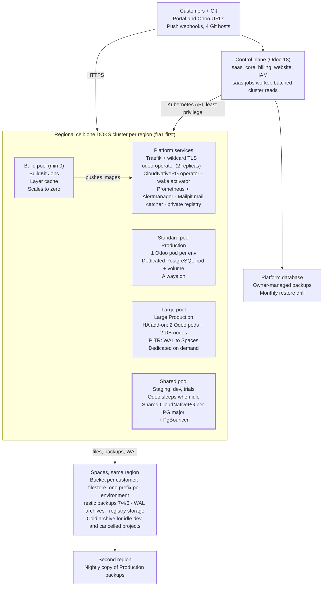

# Veltnex Architecture Review and Target Design

Oct 11, 2026 · @Mostafa · Doc: https://claude.ai/code/artifact/2e71a7cf-e77c-4e5f-bd39-a0854eee94ad

This is the architecture review and the target design. The step-by-step work lives in [PLAN-implementation.md](PLAN-implementation.md), which also holds the four earlier plans (backup and restore, Spaces filestore, cluster capacity, PostgreSQL) as appendices.

## Summary

**Keep the core model (Kubernetes, the Go operator, and one namespace per environment), and split the fleet into two tiers.** Production gets dedicated, always-on resources. Development, staging and trials share resources and sleep when idle. Odoo itself becomes stateless on top of Spaces. Most of the margin comes from that split. Most of the risk sits in a short list of security and recovery gaps to close before launch.

1. **Production:** one Odoo pod and one dedicated PostgreSQL per environment, as today. Each is sized by the plan and placed in a Standard or Large node pool. Paid add-ons: High Availability (HA, a standby database plus a second Odoo pod) and point-in-time recovery (PITR).
2. **Development, staging and trials:** databases live in one shared CloudNativePG cluster per PostgreSQL major version. Odoo sleeps after inactivity and wakes on the next visit. Long-idle environments are archived to Spaces instead of being deleted.
3. **Files:** the filestore moves to a Spaces bucket per customer. Sessions move to the database. Odoo then needs no volume, so pods can move between nodes, drain cleanly and run as two replicas.
4. **Scale unit:** one DOKS cluster per region (a "cell") with pools for Standard, Large, shared and builds. Open a second cell when a cell reaches the triggers in the scalability section, not before.
5. **Control plane:** keep Odoo 18 as the control plane, but stop polling every tenant. Read cluster state in batches per cluster and keep the platform database backups you already run outside the repository.

**Fix before launch:**

- Customer images must go to a private registry.
- Every tenant namespace holds a copy of the one shared backup key.
- Plan prices are not yet held to the 60% gross-margin floor.
- The control plane holds cluster-admin rights.
- Restore drops the database before loading the new one.
- CI does not gate deployments.
- There are no custom domains or mail catcher, which customers will expect from day one.

## Current state assessment

**The platform is further along than most at this stage.** Provisioning, Git builds with an update gate, staging copies with neutralization and PII masking, billing, IAM and shells all exist in code. The weak points are statefulness (Odoo and PostgreSQL pinned to one block volume), security shortcuts, and control-plane loops that grow with tenant count. Every row below was checked in the repository on 2026-10-11. "Planned" means a PLAN file exists and no code does.

| Area | Status | Evidence | Main limitation |
| --- | --- | --- | --- |
| Tenant runtime | Implemented | operator `resources/deployment.go`, `tenancy.go` | One Odoo pod plus a cron sidecar, and a PostgreSQL StatefulSet, all on one RWO volume, so the tenant is pinned to one node (`deployment.go:282`) |
| Zero-downtime updates | Implemented | MaxSurge 1, update gate `controller/update.go` | The surge pod must fit on the same node; no pre-update backup; a node drain or upgrade still means 1–3 minutes down |
| Pod hardening | Implemented | restricted Pod Security, non-root, read-only root, seccomp (`deployment.go:129`) | Good baseline |
| Network isolation | Partial | `networkpolicy.go` | Egress 443 is open to any destination, including in-cluster; no SMTP egress; all ports open inside a namespace |
| PostgreSQL | Implemented, dedicated per environment | `resources/database.go`; CNPG mode `cnpg.go` is single-instance | No HA, no PITR, no pooler; changing the major version deletes the pod with no guard (`controller/database.go:256`) |
| Filestore on Spaces | Planned | PLAN-implementation.md Appendix B; no `saas_object_storage` in code | Files live on block storage, which keeps Odoo stateful |
| Builds | Implemented | `saas_core/drivers/k8s_builds.py`, BuildKit Job, signed webhooks | No cache (slow, CPU-heavy), no submodules, no test runs; builds share tenant nodes |
| Image registry | Partial | Docker Hub `moutazmuhammad/*`; per-cluster registry setting | Docs warn that free Docker Hub repos are public, so customer code could leak |
| Environments | Implemented | `_create_env_child`, `_NEUTRALIZE_SQL`, `_PII_MASK_SQL` in `saas_instance.py` | Each dev or staging environment runs a full always-on stack; no sleep; no mail catcher |
| Backups | Implemented (full dumps) | backup-tool `run-backup.sh`, CronJob, 7 kept | One shared S3 key is copied into every tenant namespace (`saas_instance.py:3787`); unbounded `/tmp`; the client is PostgreSQL 16 only while the CRD allows 17 |
| Restore | Partial | `run-restore.sh:125`, `saas_instance.py:3400` | Drops the database before loading the new one; a failed restore leaves no database |
| Incremental backups, integrity checks | Planned | PLAN-implementation.md Appendix A | — |
| PITR / HA | Missing | CRD forces 1 replica; CNPG 1 instance | Nothing to sell to customers who need them |
| Sleep / scale-to-zero | Missing | only manual `suspended` (`controller/suspension.go`) | Idle dev and staging cost the same as busy ones |
| Capacity and autoscaling | Partial | typed caps `_has_capacity_for` (`saas_server.py:441`); DOKS pool 0–2 | Pending pods for about 27 minutes on 2026-10-10; nothing reads the autoscaler (Appendix C) |
| Control-plane jobs | Partial | durable `saas.job` queue plus `run_in_background` threads | Two crash-recovery models; stop, suspend and cancel use threads |
| Control-plane scaling | Partial | `_cron_reconcile`, `_cron_verify_webhooks`, `_cron_sync_scheduled_backups` | Unbounded loops over all tenants with per-tenant API calls; a new Kubernetes client per call |
| Storage-limit enforcement | Partial | the only TODO in code, `_cron_check_storage_limits` (`saas_instance.py:5802`) | It reads stale or zero usage |
| Secrets at rest | Partial | `EncryptedChar` (Fernet) | Without a key it falls back to plaintext; backup S3 keys and webhook secrets are plain |
| Control plane to cluster access | Implemented, over-privileged | 03b §7: ServiceAccount bound to cluster-admin | A stolen kubeconfig gives every cluster |
| Platform database backup | Owner-managed | `scripts/deploy/saas-deploy.sh` dumps locally before deploys | Backed up by the owner outside the repository (confirmed 2026-10-11) |
| Monitoring and alerts | Partial | Prometheus, no Alertmanager, no rules; `saas_alert._notify` posts to one webhook, unset on the live server | Problems surface through customers |
| Logs | Partial | live tail of the web container (`container_logs.py`) | No stored or searchable logs |
| Custom domains | Missing | only `subdomain.base_domain` | Expected by every production customer |
| 2FA | Missing | no `auth_totp` dependency | Staff accounts can open shells on clusters |
| CI/CD gates | Partial | `.github/workflows/cd.yml` "temporary fast deployment mode" | Tests and scans do not block deployments |
| Odoo versions | Partial | chart `supportedOdooVersions` 17.0–20.0 | Decided: sell 11–20, so the chart, images, PostgreSQL matrix and all four filestore adapters must cover 11–20 |

## Recommended target architecture

**One design: a regional cell (one DOKS cluster) that runs four classes of environment on four node pools.** Production is dedicated and always on. Everything else shares and sleeps. The class decides where an environment's Odoo pod, database, files and backups live, and how it is priced.

| Class | Odoo | Database | Files | When idle | Backups | Priced by |
| --- | --- | --- | --- | --- | --- | --- |
| Production | 1 pod, guaranteed requests, Standard pool; never sleeps | Dedicated PostgreSQL pod and volume, tuned per plan | Customer Spaces bucket | Always on | restic daily, 7 daily + 4 weekly + 6 monthly | Workers + storage |
| Production Large | 1 pod, Large pool | Dedicated, larger | Customer bucket | Always on | Same | Workers + storage, Large rate |
| Production HA (add-on) | 2 pods on different nodes | CloudNativePG, 2 instances, WAL archiving | Customer bucket | Always on | restic + PITR 7 days | Base plan + HA fee |
| Staging | 1 small pod, Shared pool | Database on the shared CloudNativePG cluster | Customer bucket, own prefix | Sleeps after 2 idle hours, wakes on visit | Manual snapshots | Slot fee; "always awake" costs extra |
| Development | Same as staging | Shared cluster | Customer bucket, own prefix | Sleeps after 1 idle hour; archived to Spaces after long inactivity | None (rebuilt from Production) | Slot fee |
| Trial | Same as staging | Shared cluster | Customer bucket | Sleeps after 1 idle hour; deleted on expiry unless converted | None | Free, capped |

**Why this design:**

- **Cost** sits in the numerous, mostly idle environments (dev, staging, trials). Sharing their database and putting their Odoo to sleep removes most of the waste. Production is already paid for by its plan.
- **Reliability** comes from isolating Production. No Production database, node or volume is shared with non-production work. HA and PITR are sold to the customers who need them instead of being paid for by everyone.
- **Operations** stay small: one operator, one cluster per region, CloudNativePG as the only new component, and no service mesh, Redis or message bus. The control plane stays Odoo.
- **Scale** comes from adding cells, not from growing one cluster without limit. Each cell is the blast radius of a failure or an upgrade.

**Stateless Odoo is the enabler.** Once files are in Spaces and sessions in the database, the Odoo pod needs no volume. Then:

- an Odoo rollout can use any node;
- a node drain no longer means downtime for Odoo;
- a sleeping environment wakes on any free node;
- HA is simply two replicas.

Only the dedicated Production database stays pinned to its volume.

## Architecture diagram



The control plane talks to each cell only through the Kubernetes API. Customers reach Odoo through Traefik. Every byte of customer data that must survive a node or a cell (files, backups, WAL) lands in Spaces, and Production backups are copied to a second region. Only the Shared pool sleeps, and it holds no Production workload.

## Key architecture decisions

**Twelve decisions shape the design. Four of them are expensive to reverse:** D2, D4, D10 and D11. They decide where data lives and how the fleet is cut, so they should be settled before more code is written. The rest can change later at little cost.

| # | Decision | Rejected alternatives | Why it wins |
| --- | --- | --- | --- |
| D1 | Tenancy unit: one namespace per environment on shared clusters (keep) | One cluster per customer; one shared Odoo serving many databases | Every customer has their own code and addons, so a shared Odoo is impossible. A cluster per customer multiplies fixed cost and upgrades. |
| D2 | Production database: a dedicated PostgreSQL pod per environment (keep, tune) | One central PostgreSQL for all customers; a managed database per tenant | A central database makes one tenant's heavy report everyone's outage, exposes database names to the SQL console, and ties every customer to one major version. A managed database per tenant has a monthly price floor far above a small plan's database cost. |
| D3 | Non-production databases: one shared CloudNativePG cluster per PostgreSQL major, per cell | Dedicated pods (today); databases inside the Production pod | Staging and dev tolerate a short slowdown. Sharing turns about 50 idle database pods into one cluster. Per-login limits stop a heavy query from hurting the others. |
| D4 | Files: a Spaces bucket per customer, through one server-wide module for every Odoo version | Block volume (today); RWX file storage (NFS or Longhorn); one shared bucket | It makes Odoo stateless, is cheaper per GB than block storage, and limits a leaked key to one customer. RWX adds an always-on storage service and slow small-file input/output. |
| D5 | Sessions in PostgreSQL | Redis; sticky sessions on a volume | No new service; sessions survive pod moves and work with two replicas. |
| D6 | Sleep idle non-production Odoo, wake on request; archive long-idle dev environments | Always on (today); delete dev environments after about 3 days, as Odoo.sh does | Most of the saving, and the customer keeps their data. A 20–30 second wake is acceptable outside Production. |
| D7 | HA as a paid add-on only | HA for everyone; never | It doubles database cost. Most small customers accept restore from backup; those who don't will pay. |
| D8 | PITR as an add-on (CloudNativePG WAL archiving to Spaces); restic daily for everyone | PITR for all; dumps only | WAL archiving is cheap per tenant but needs CloudNativePG mode. It is valuable to sell and unnecessary for dev. |
| D9 | Builds on a dedicated build pool (min 0) with layer cache and a private registry backed by Spaces | No cache on tenant nodes (today); external CI | Builds stop stealing rollout headroom from tenants. The cache cuts build minutes. A private registry closes the code-leak risk. |
| D10 | Scale by cells: one DOKS cluster per region, with a new cell at the triggers | One ever-growing cluster; a cluster per customer | It limits the blast radius of failures and upgrades and keeps each cluster in a well-tested size range. |
| D11 | The control plane stays Odoo; read cluster state in batches and react to operator status; platform database backups stay owner-managed | Rewriting it as Go services | The bottleneck is per-tenant polling, not Odoo. A rewrite costs months and buys nothing customers see. |
| D12 | Four node pools, Standard, Large, Shared and Build, with labels and taints | One pool (today) | Dev noise cannot reach Production nodes. Large customers fit without fragmenting small nodes. Builds scale to zero. |

| # | Cost | Scalability | Operational complexity | Trade-off or risk |
| --- | --- | --- | --- | --- |
| D1 | Neutral | Thousands of namespaces per cluster is normal | Unchanged | Per-namespace objects grow etcd; watched as a cell trigger |
| D2 | About one small pod and one volume per Production environment | Linear, no shared hot spot | Unchanged; adds tuning presets | Small customers carry a database pod each, already covered by the plan price |
| D3 | Largest database saving for non-production | One shared cluster serves hundreds of databases; shard at the triggers | New: CloudNativePG operator, vendored chart | A shared-cluster outage stops all dev and staging in the cell (never Production) |
| D4 | Cheaper files; lower block storage spend | Removes node pinning, the main scheduling constraint | New module across 4 Odoo generations; bucket pool to run | Bucket and key account limits; the module is customer-visible code |
| D5 | None | Needed for 2 replicas | Small module | Session table growth; needs a cleanup cron |
| D6 | Largest compute saving | Wake storms after an outage are possible; rate-limit wakes | New component: a small activator and idle detection | A slow first request after sleep |
| D7 | Revenue rather than cost | Two pods and two database nodes per HA customer | CloudNativePG failover to operate | Customers without HA keep 1–3 minutes of downtime on node failure |
| D8 | Spaces storage for WAL | Per-tenant WAL streams | Restore drills needed | Only for CloudNativePG-mode tenants |
| D9 | Build nodes only while building | Concurrent builds limited by pool max | Registry garbage collection to run | Cache layers can carry stale dependencies; key the cache on requirements |
| D10 | One more control plane fee and load balancer per cell | Near-linear | Upgrades per cell, staged | Cross-cell moves need a backup and restore |
| D11 | None | Control plane load becomes per-cluster, not per-tenant | Refactor of crons | None material |
| D12 | Small, from better packing | Each pool autoscaled independently | Pool ceilings set by hand (decided) | More pools to watch |

## Scalability analysis

**The first limits Veltnex will hit are not Kubernetes.** In order they are:

- **TLS certificates:** each environment gets its own Let's Encrypt certificate, and Let's Encrypt allows 50 new certificates per registered domain per 7 days ([source](https://letsencrypt.org/docs/rate-limits/)). That caps new environments on one base domain at about 50 a week.
- **Control-plane polling:** loops that call the cluster once per tenant.
- **Backups:** every tenant's backup starts at 02:00.
- **Pool ceilings:** the DOKS pool maximum is 2 nodes, and the Droplet limit is 25.

All four are cheap to fix and should be fixed before launch, not at scale.

Thresholds marked *assumed* are starting values to confirm with real measurements.

| Bottleneck | Evidence | Trigger | Response |
| --- | --- | --- | --- |
| Let's Encrypt limit on the base domain | per-tenant certificate via the issuer (`kubernetes_driver.py:525`) | about 50 new environments a week | One wildcard certificate per base domain via DNS-01; HTTP-01 only for custom domains |
| Backup start times | `set_scheduled_backup` default `0 2 * * *`, never overridden | about 20 tenants per node starting together (*assumed*) | Spread start minutes by a hash of the tenant id across a 4-hour window; cap concurrent backup Jobs per node |
| Reconcile and webhook crons | `_cron_reconcile`, `_cron_verify_webhooks`, `_cron_sync_scheduled_backups` iterate all tenants | about 300 tenants, when a cycle passes its interval (*assumed*) | One list of OdooInstances and pods per cluster per cycle; operator status drives state; verify webhooks only on change or daily in batches |
| Health observation | 50 tenants a minute, 30-second budget (`saas_instance_health.py:166`) | more than 100 tenants: background state older than the 120-second freshness rule | Read readiness and 5xx rate from Prometheus (kube-state-metrics, Traefik metrics) in one query per cluster; keep the HTTP probe only for Production, sampled |
| Kubernetes client per call | `_compute_driver()` parses the kubeconfig each time (`saas_instance.py:1591`) | any loop above | Cache one API client per cluster per worker |
| Node pool ceilings | pool `node` max 2; Droplet limit 25 (Appendix C) | requests above 80% of the pool, or autoscaler "max size reached" | Capacity reader and alerts (Appendix C); raise ceilings by hand; Standard and Large pools |
| Shared non-production database | (new) | per shared cluster: 70% of connections, sustained CPU above 60%, about 200 databases, or 70% disk (*assumed*) | Open the next shared cluster in the cell; new environments go there |
| Operator | single replica, leader election off (`deployment.yaml:45`) | about 1,000 OdooInstances, or reconcile queue latency above 30 seconds (*assumed*) | Enable leader election with 2 replicas; tune concurrent reconciles; restrict the Secret informer to labelled objects |
| Cell size | (new) | about 1,500 environments or 60 nodes per cell, or a region needs a separate failure domain (*assumed*) | Open a new cell (cluster); new customers go there; nothing moves |
| Spaces | bucket and key account limits unknown (Appendix B, open items) | about 70% of either limit | Request a limit increase; recycle buckets through the pool |
| Registry | each build pushes a full image | 70% of registry storage | Garbage-collect images older than the last 5 builds per environment |

**How it grows:**

1. **Launch (up to about 100 environments):** one cell in fra1; Standard, Shared and Build pools; one shared non-production cluster. The fixes above go in first.
2. **Growth (100 to 1,000):** add the Large pool. Pool ceilings rise as alerts fire. A second shared cluster opens when its triggers fire. Watch the control-plane job queue length.
3. **Scale (1,000 and beyond):** a second cell per region, or new regions as cells. Allocation already picks a cluster per region (`_allocate_servers`), so a cell is just another `saas.server`. Move the control plane to two application servers in front of the managed database.

## Cost optimization strategy

**The biggest saving is in non-production: sleep plus a shared database cuts a dev environment from about $5.30 to about $1.10 a month.** This is the rough estimate from the PostgreSQL plan (Appendix D), on `s-2vcpu-4gb` nodes at about $24 a month. Production cost is already covered by plan prices through the existing cost floor in `saas_pricing.py`, so the work there is packing and pricing, not cutting.

Every environment's monthly cost is the same formula. `_package()` already computes its inputs, so one function can serve both pricing and the margin cron:

```latex
\text{cost} = \text{CPU}_{req} \cdot r_{cpu} + \text{RAM}_{req} \cdot r_{ram} + \text{GiB}_{block} \cdot 0.10 + \text{GiB}_{spaces} \cdot 0.02 + \text{backup GiB} \cdot 0.02 + \text{share of cell overhead}
```

Here `r_cpu` and `r_ram` are the node price divided by allocatable CPU and RAM, and the storage rates are dollars per GiB-month from the repository's DigitalOcean notes. Cell overhead covers the load balancer, Prometheus, the operator, the shared database cluster and the registry.

| Cost driver | Today | Lever | Saving | Effect on customers |
| --- | --- | --- | --- | --- |
| Idle dev, staging and trial compute | Always-on pod per environment | Sleep after inactivity; Shared pool may overcommit limits | Largest | 20–30 second wake outside Production |
| Non-production databases | One pod and volume each | Shared cluster per PostgreSQL major | Large | None while within limits |
| Block storage | One volume per tenant holds database and files; it can never shrink | Files to Spaces; volumes for the database only | Medium; grows with file-heavy customers | Downloads stream through Odoo |
| Long-idle dev environments | Kept running | Archive to Spaces after long inactivity; restore on demand in about a minute | Medium | One-click restore |
| Backups | Full dump every day, 7 kept, per tenant | restic incremental with deduplication | Medium, grows with retention | None |
| Builds | No cache, on tenant nodes | Build pool with min 0; layer cache | Build minutes and rollout headroom | Faster builds |
| Node packing | One pool; rollout headroom per node | Standard and Large pools; requests at 25% of limits (already) | Small to medium | None |
| Snapshots | Billed per GB-month (already) | Keep | Revenue | — |
| Engineering time | Custom backup, health and polling code | Reuse CloudNativePG, Prometheus and restic instead of building more | Largest over a year | Fewer incidents |

**Pricing principles:**

1. **Price on guaranteed resources, not limits.** Workers set requests through `_package()`. Price each worker at or above its request cost times the target margin. Target 60% gross margin at launch, so price is at least 2.5 × cost, rising to 70% or more at scale (at least 3.3 × cost). Set the cost floor in `saas_pricing.py` to 60% and alert when any plan or add-on falls below it. Margin is never bought by cutting Production isolation, backups or security.
2. **Non-production is a cheap slot, because it sleeps.** "Always awake" staging is a paid option at near-Production cost.
3. **Storage is included up to the plan, then billed by real usage.** This needs the Kubernetes-native usage measurement that is missing today (`_cron_check_storage_limits`).
4. **Resource-heavy extras are always priced, never bundled:**
    - HA at least the cost of a second database and a second Odoo pod, plus margin;
    - PITR as a fixed fee plus WAL GB;
    - Large and dedicated pools at node cost plus margin, with a minimum term.
5. **Trials are an acquisition cost with a ceiling:** shared, sleeping, a fixed duration (14 days is assumed), one per company (already enforced).

| Customer profile | What drives cost | How to price | Loss risk if ignored |
| --- | --- | --- | --- |
| Small, light Production | One small pod and database; storage | Entry plan of 1–2 workers with included storage | Low |
| Many dev and staging environments | Count of environments; wake time | Slot fee per environment; awake option | High today; low with sleep |
| Heavy database or storage | Database CPU and IOPS; Spaces and backup GiB | Large pool; storage beyond the plan billed on usage | High: database load is not billed today |
| Needs HA, PITR or dedicated | Second database node and pod; WAL; whole nodes | Add-ons and dedicated pool with a minimum term | High if bundled |

**Measurements needed for a reliable cost model:**

- p95 CPU and RAM per plan, for Odoo and the database separately;
- active hours per day of dev and staging environments;
- database and filestore GiB per tenant, and their growth;
- build minutes per week;
- backup GiB after deduplication;
- Spaces requests and egress per customer.

Prometheus already holds the first three for live tenants.

## Security and reliability review

**Tenant pods are well hardened; the risk is concentrated in a few shared credentials and the control plane.** One leaked secret from the list below reaches every customer at once. Those secrets are the cluster-admin kubeconfig, the one backup key, and a personal Docker Hub account that serves the operator image. Fix them first.

| Severity | Risk | Evidence | Safeguard |
| --- | --- | --- | --- |
| Critical | The internet-facing control plane holds a cluster-admin token for every cluster | 03b §7; 107 public API routes | A least-privilege ClusterRole: OdooInstances, read nodes and pods, exec only in `odoo-tenant-*`, build Jobs in `odoo-builds`. The kubeconfig is encrypted with a mandatory key. |
| Resolved | Platform database backups are run by the owner outside the repository | `saas-deploy.sh` local dump only | Keep a monthly restore drill of those backups |
| Critical | Customer code images could land in a public registry | 04 docs warning; per-cluster registry setting | A private registry per cell, backed by Spaces; refuse public registries in `saas.server` validation |
| High | One backup key, valid for every customer's backups, sits in each tenant namespace | `saas_instance.py:3787`, `set_scheduled_backup` | Now: a key limited to the backup bucket. Once files are in Spaces, backup Jobs run in a platform namespace, so no platform key enters tenant namespaces; restic password per tenant (Appendix A) |
| High | The operator image comes from a personal Docker Hub account, and the operator can create workloads cluster-wide | `values.yaml:4`, `clusterrole.yaml` | An organization registry, images pinned by digest, signed builds (SBOM and provenance already exist) |
| High | Restore drops the database before loading | `saas_instance.py:3400`, `run-restore.sh:125` | Restore into a new name and swap (Appendix A, P1) |
| High | Backups fail for PostgreSQL 17 tenants | backup image ships `postgresql-client-16`; the CRD allows 17 | Client per major version, or cap the CRD at 16 until shipped |
| High | A change of PostgreSQL major version breaks the database | `controller/database.go:256` deletes the pod; the old PGDATA won't start | Reject major changes in validation; upgrade only through dump and restore |
| High | Login and OTP rate limits can be bypassed with a forged header | `api.py:162` trusts the left-most X-Forwarded-For | Trust only the proxy's appended address |
| High | Secrets fall back to plaintext without a key; backup and webhook secrets are always plain | `crypto.py`, `res_config_settings.py:100`, `saas_instance_repo.py:164` | Refuse to start without a key; encrypt those fields |
| High | No 2FA for staff who can open cluster shells | no `auth_totp` | TOTP required for staff and for customer owners |
| High | CI does not gate deployments | `cd.yml` "temporary fast deployment mode" | Re-enable tests, typecheck and scans as required checks |
| High | Alerts reach only the log | `saas_master.alert_webhook` unset on the live server | Teams webhook, Alertmanager rules for nodes, pods, backups and certificates |
| Medium | Tenant egress on 443 reaches any address, including in-cluster; SMTP egress is blocked, so customer mail over SMTP fails | `networkpolicy.go` | Deny cluster and VPC ranges on 443; allow 465 and 587 to the internet |
| Medium | A shell user can write the data_dir `addons/` folder, which Odoo loads (inferred, not tested) | `deployment.go:232` | Mount the shell's data_dir read-only except the filestore; moot once files move to Spaces |
| Medium | Cancel waits 2 minutes for the final backup, then deletes anyway | `finalize.go:211` | Block deletion until the final backup succeeds or staff confirm |
| Medium | One operator replica with leader election off | `deployment.yaml:45` | 2 replicas with leader election |

**Odoo 11–20 are sold (decided).** Odoo publishes security fixes only for its most recent major versions, so older ones get none upstream. Each environment's own namespace, non-root pod and network policy already contain a compromise to that customer. Add three things: a support matrix of Odoo version, PostgreSQL major and image; a portal notice on unsupported versions; and an upgrade path sold as a service. Odoo 11–12 must be tested on PostgreSQL 13, the CRD minimum, before they are offered.

**Failure domains.** Recovery times are internal targets, not customer SLAs. MAINTAINING.md says the docs must not promise those.

| Failure | Today | Target |
| --- | --- | --- |
| Odoo pod or node | 1–3 minutes while the volume re-attaches | Production Odoo reschedules on any node (stateless); HA tenants fail over |
| Production database volume | Restore from the nightly dump, so up to 24 hours of data lost | Same for base plans; PITR tenants lose under 5 minutes |
| Shared non-production database cluster | (new) | CloudNativePG standby takes over; Production unaffected |
| Whole cell | Restore each tenant from Spaces into another cluster | Same, scripted; files already in Spaces, so only databases restore |
| Spaces region | Backups and files are in one fra1 bucket | Nightly copy of backups to a second region for Production |
| Control plane | Tenants keep running; no provisioning or billing | Owner-managed database backups; application server rebuilt by bootstrap in under an hour |
| Let's Encrypt or DNS | Renewals fail silently | Certificate expiry alert at 14 days |

## Odoo.sh competitive gap analysis

**Veltnex already matches Odoo.sh on the core loop:** Git push, build, staging from neutralized Production, then promotion. It also beats Odoo.sh on persistence and choice. Four gaps would lose deals at launch: custom domains, Git submodules, a mail catcher, and backups kept in more than one location. Odoo.sh facts below come from its [branches documentation](https://www.odoo.com/documentation/18.0/administration/odoo_sh/getting_started/branches.html) and [pricing page](https://www.odoo.sh/pricing), read on 2026-10-11.

| Capability | Odoo.sh | Veltnex today | Verdict |
| --- | --- | --- | --- |
| Custom domains with TLS | Yes | Missing; only `subdomain.base_domain` | Essential before launch |
| Git submodules (OCA and shared addons) | Yes | Missing; `fetch.sh` is shallow and deletes `.git` | Essential before launch |
| Mail catcher for staging and dev | Yes: outgoing mail intercepted | Missing; mail is only disabled | Essential before launch; one Mailpit per cell |
| Production backups | 7 daily, 4 weekly, 3 monthly; "3 backups servers in different locations" | 7 daily dumps in one fra1 bucket | Essential: 7/4/6 restic plus a second-region copy (Appendix A) |
| Logs | Stored log files per build | Live tail only | Launch: live tail plus the previous container log. Growth: stored logs on Spaces |
| Staging from neutralized Production | Neutralized: crons, mail, IAP, payments | Same, plus PII masking | Advantage: keep |
| Dev builds | Fresh database with demo data per commit; tests run; kept about 3 days | Production copy; no tests; always on | Add a "fresh demo database" option. Tests per commit: Growth |
| Environment lifetime | Dev about 3 days; staging deleted after one month | Kept until deleted | Advantage, made affordable by sleep and archive |
| Git providers | GitHub | GitHub, GitLab, Gitea, Bitbucket; merge is GitHub-only | Advantage; extend merge to GitLab |
| Shell, SQL, database manager | Web shell and tools | Shell, SQL console, database manager | Parity |
| Monitoring for the customer | Yes | Usage dashboard from Prometheus | Parity |
| Dedicated resources | "Dedicated" for more than 16 workers or 512 GB | Planned Large pool | Growth |
| HA and point-in-time recovery | Not offered on the pricing page | Missing | Premium add-ons: a differentiator |
| Enterprise licence | Hosting price excludes the Enterprise licence | Runs Community images | Pricing advantage for Community customers; Enterprise support is a business decision |
| Regions | Several | fra1 only | Growth: new cells |
| Major version upgrades | Odoo upgrade service for Enterprise | Module upgrades only | Later |

## Prioritized roadmap

**Launch waits only for P0 and P1. Everything after that is paid for by growth or by premium customers.** The four earlier root plans are folded into these phases and kept in full as appendices of [PLAN-implementation.md](PLAN-implementation.md):

- backup and restore (Appendix A): P0, P1;
- Spaces filestore (Appendix B): P1 for the bucket and key, P3 for the filestore itself;
- cluster capacity (Appendix C): P0, P2, P3;
- PostgreSQL (Appendix D): P2, P3, P4.

Detailed fix plans for each launch blocker (P0.1, P0.5–P0.7, P0.13, P0.16–P0.18) and for custom domains on Production (P1.1) are in the implementation plan.

```mermaid
flowchart TD
    P0["P0 · Launch blockers: security and recovery (before launch)<br/>Least-privilege cluster access · Private registry, images by digest<br/>Pricing floor at 60% gross margin · Restore into new name, then swap<br/>pg client per major, block major upgrades · Spread backup times, bounded /tmp<br/>Wildcard TLS via DNS-01 · Real client IP, fail-closed secrets<br/>2FA for staff and owners · CI gates and Teams alerts on<br/>Capacity reader, ceilings, alerts · SMTP egress, deny in-cluster 443"]
    P1["P1 · Launch features (before launch)<br/>Custom domains with TLS · Git submodules<br/>Mailpit for staging and dev · Customer bucket + scoped key<br/>restic 7/4/6 + second-region copy · Backup integrity checks + report<br/>Previous-container logs · Odoo 11–20 support matrix"]
    P2["P2 · Cost engine (first 100 environments)<br/>Sleep and wake for non-production · Shared CloudNativePG per PG major<br/>Archive idle dev to Spaces · Batched reads, cached API clients<br/>Standard, Large, Shared, Build pools · Build layer cache"]
    P3["P3 · Stateless Odoo (growth)<br/>Spaces filestore, 17–19 first · Sessions in PostgreSQL<br/>Drop node pinning for Odoo · Production DB tuning presets<br/>Customer moves between pools · Limited simultaneous updates"]
    P4["P4 · Premium and scale (on demand)<br/>HA add-on (CNPG, 2 instances) · PITR add-on (WAL to Spaces)<br/>Dedicated pools, minimum term · Tests per commit, stored logs<br/>Second cell or region · Control plane on 2 app servers"]
    P0 --> P1
    P1 -- "Gate A · launch: P0 and P1 done, restore drill passed" --> P2
    P2 -- "Gate B · growth: idle saving measured, shared cluster stable" --> P3
    P3 -- "Gate C · premium: first customers ask for HA or PITR" --> P4
```



## Open questions and assumptions

**Decided on 2026-10-11:**

1. **Odoo versions:** 11 to 20 are sold. The chart, images, PostgreSQL matrix and all four filestore adapters must cover them.
2. **Gross margin:** 60% at launch, aiming for 70% or more at scale, never at the expense of security or Production stability.
3. **Sleep:** Production never sleeps. Development sleeps after 1 idle hour, Staging after 2, Trials after 1.
4. **Platform database backups:** run by the owner, outside the repository.

**Still open:**

1. **Archiving:** how many idle days before a dev environment is archived to Spaces? *Assumed: 14 days.*
2. **Trials:** do they share the non-production cluster? How long do they last? *Assumed: yes, 14 days.*
3. **Paid add-ons:** sell HA, PITR and dedicated pools at launch, or after the first customers ask?
4. **Second region:** which region receives off-site backup copies? *Assumed: ams3, close to fra1.*
5. **Enterprise:** offer Enterprise hosting (customer brings their licence) or Community only?

**Evidence needed:**

- Which registry do live clusters push customer images to, and is it private?
- What are the DigitalOcean account limits on Spaces buckets, Spaces keys, Droplets and load balancers?
- Which PostgreSQL major does each Odoo version from 11 to 20 run on in our images? Odoo 11–12 must be tested on PostgreSQL 13, the CRD minimum.
- What are the real p95 usage figures and active hours listed under the measurements in the cost section?

**Assumptions used throughout:**

- DigitalOcean prices are the ones recorded in the repository's docs and plans.
- A 20–30 second wake is acceptable outside Production.
- No customer SLA is published (MAINTAINING.md).
