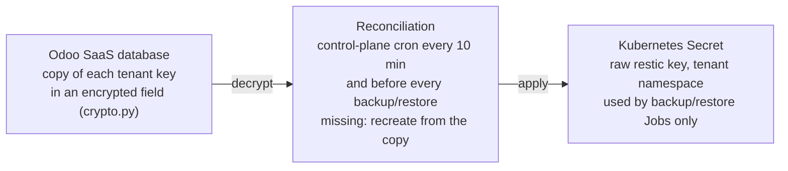
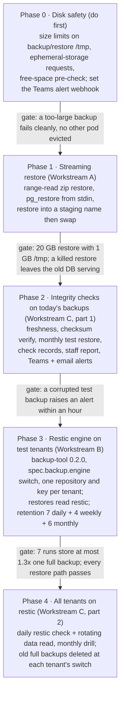

# Backup & Restore Overhaul Plan

Oct 11, 2026 · @Mostafa

## Summary

We make every restore stream from the bucket with no full local copy, move the backup job to **restic** (incremental, de-duplicated), and add scheduled integrity checks with a staff report and alerts. The work runs in five phases, safety first, so tenants are protected from a full disk before the bigger changes land.

- **Goal A — Streaming restore.** No restore path downloads a whole backup to the pod's `/tmp`. Database data streams into PostgreSQL; files go straight to the filestore volume.
- **Goal B — Restic backups.** One restic repository per tenant in the existing bucket. Each daily run uploads only changed data; 7 daily backups cost about one full copy plus the daily changes.
- **Goal C — Integrity checks.** Daily and weekly `restic check` runs, plus a monthly test restore, recorded in a report you can open in the backend, with alerts on failure.

While reviewing the code I found a more urgent problem. The operator's backup and snapshot-restore Jobs also stage everything in `/tmp`, on an emptyDir with **no size limit**. That is the node's own disk, so one large tenant can fill it and get other tenants' pods evicted. Phase 0 fixes this first.

## How it works today

Every artifact lives in the bucket (DigitalOcean Spaces `node2027`, fra1). Backups already stream out; three of the four restore paths, and the backup job itself, stage whole files on local disk first.

| Path | Made by | Format in bucket | Local disk used | Code |
| --- | --- | --- | --- | --- |
| Daily backup, snapshot, final snapshot | Operator CronJob / one-off Job (`run-backup.sh`) | `db.dump` + `filestore.tar.gz` + `manifest.json`, full copy every run | **Yes** — both files written whole to `/tmp` (unbounded emptyDir) before `rclone copy` | `compute/tools/backup-tool/run-backup.sh`, `operator/internal/resources/backup.go:73` |
| Snapshot restore (full instance) | Operator restore Job (`run-restore.sh`) | reads the same run | **Yes** — downloads both files to `/tmp`, then `pg_restore` and `tar -x` | `run-restore.sh:66`, `operator/internal/resources/restore.go:94` |
| Database backup download | `pg_dump -Fc` in the Odoo pod, piped to the multipart uploader | `.dump` under `ondemand/` | No — already streaming | `saas_instance_backup.py` (`exec_stream_out` → `_upload_stream_to_bucket`) |
| Zip backup (used by copies) | Odoo-format zip written to the pod's stdout, streamed up | `.zip` (dump.sql + filestore) | No — already streaming | `saas_instance_backup.py` `_stream_odoo_zip_to_bucket` |
| Restore one database (upload or backup) | `curl` into the Odoo pod, `unzip`, `psql -f dump.sql`, `cp` filestore | reads a `.zip` | **Yes** — zip downloaded to `/tmp`, then extracted there too (about 2× the size) | `saas_instance.py` `_do_restore_backup` (“Downloading backup...”) |
| Copy Production to Staging/Dev | Zip backup of the source, then the restore above on the target | `.zip`, deleted after | **Yes** — same as restore one database | `saas_instance.py` `_do_copy_dbs` |

Two more facts shape the plan:

- Restoring one database drops the old database **before** the new one is loaded. A failed restore leaves the customer with no database.
- Operational alerts go to a webhook (`saas_master.alert_webhook`), which is **not set** on the live server, so today they only reach the log.

## Workstream A — Streaming restore

Every restore reads the bucket as a stream: database data is piped into PostgreSQL and files are written straight onto the filestore volume, so `/tmp` holds only small buffers whatever the backup size.

**A1. Restore one database from a zip (uploads, backups, copies).** A zip keeps its index at the end, so it cannot be read front to back from a plain download. We read it with HTTP range requests instead; the bucket supports them on presigned URLs.

1. A small Python helper runs inside the Odoo pod. It opens the presigned URL as a seekable remote file (range reads, 8 MB read-ahead) and hands it to Python's `zipfile`.
2. **Validate first, nothing touched yet:** read the zip index, require `dump.sql`, check the manifest's Odoo version, and reject paths that escape the filestore (`../`).
3. Restore into a staging name `<db>__restoring`: stream the `dump.sql` entry into `psql` stdin in 1 MB chunks, with `ON_ERROR_STOP=1`.
4. Extract `filestore/` entries one by one into `<filestore>/<db>__restoring` on the volume.
5. **Swap only on success:** drop the old database and rename `<db>__restoring` to `<db>`, then swap the filestore folders. On failure, drop the staging copy; the customer's database is untouched.
6. Neutralize and mask PII for Staging/Dev, exactly as today.

**A2. Restore one database from a `.dump` (pg\_dump custom format).** `curl` the presigned URL and pipe it into `pg_restore --no-owner --exit-on-error` (custom format restores from stdin; parallel `-j` is not available that way). Same staging-name and swap as A1.

**A3. Copy Production to Staging/Dev.** Keep the bucket in the middle (the two pods sit in different namespaces), but both halves stream: the source already streams its zip up, and the target uses A1. A later option is to stream a `.dump` instead of a zip, which is smaller and faster to load.

**A4. Operator snapshot restore (`run-restore.sh`).** Replace `rclone copy` + local files with `rclone cat <run>/db.dump | pg_restore` and `rclone cat <run>/filestore.tar.gz | tar -xz -C <filestore>`. After Workstream B this becomes `restic dump` / `restic restore` straight onto the volume.

**A5. Guard rails.** The staging-name swap needs room for two copies of the database on the PostgreSQL volume. Check free space first and refuse with a clear message (“free X GB or add storage”) rather than fail halfway.

**Code touched:** `saas_core/models/saas_instance.py` (`_do_restore_backup`, `_do_copy_dbs`), a new pod-side helper next to `_docker_exec_python`, `compute/tools/backup-tool/run-restore.sh`.

**Risks.** Range reads cost one request per 8 MB, which is cheap on Spaces. A presigned URL can expire mid-restore, so it gets a lifetime of the restore timeout plus a margin, and a re-sign on 403. Very large single files inside the filestore stream fine because they are written as they are read.

## Workstream B — Move the backup job to restic

**Recommendation: restic, with one repository per tenant.** Both tools de-duplicate and handle our needs. Restic wins on maturity, a simpler single binary, and the platform's earlier restic code path; kopia's main advantages (lock-free concurrency, built-in scheduler) matter less when each tenant has its own repository.

|  | restic | kopia |
| --- | --- | --- |
| Maturity | Since 2015, very widely used | Since 2019, smaller user base |
| Incremental / de-duplication | Yes, content-defined chunks | Yes, content-defined chunks |
| Compression | zstd (repository format v2) | zstd and others |
| Encryption | AES-256 + Poly1305, always on | AES-256-GCM or ChaCha20, always on |
| Back up a stream (`pg_dump` stdin) | `--stdin --stdin-filename db.dump` | `--stdin-file` |
| Restore as a stream | `restic dump <snap> db.dump \| pg_restore` | `kopia show <object>` |
| Integrity check | `check`, `check --read-data-subset=n/N` | `snapshot verify --verify-files-percent` |
| Concurrent writers | Prune takes an exclusive lock | No exclusive locks |
| Earlier use in this platform | Yes (`restic` backup format, pre-Kubernetes) | No |

**Repository layout.** One repository per tenant at `restic/<partner>/<subdomain>/` in the existing bucket. This keeps tenants isolated, gives each its own key, and avoids lock contention between tenants. The repository password is generated by the control plane, stored encrypted in `saas.instance` (the existing encrypted-field mechanism), and passed to Jobs through the tenant's backup Secret.

**What each run stores.** The run makes two restic snapshots that share a `run:<timestamp>` tag, so restore always pairs a database with its matching files. Both are also tagged by source (`scheduled`, `snapshot`, `final`):

- `pg_dump -Fc -Z0 | restic backup --stdin --stdin-filename db.dump` — uncompressed dump so restic's chunking de-duplicates well; restic compresses it.
- `restic backup /filestore` — unchanged files are skipped outright.

Nothing is staged in `/tmp`, so the emptyDir problem disappears for backups too.

**Retention.** Paid plans keep 7 daily, 4 weekly and 6 monthly backups: `restic forget --tag scheduled --keep-daily 7 --keep-weekly 4 --keep-monthly 6 --prune`. With de-duplication the 10 extra backups add only the data that changed in those weeks and months. Customer snapshots are kept until deleted (`forget <id>`). The final copy taken at cancellation goes to the long-term archive bucket (Cold Storage, see `PLAN-spaces-filestore.md`), so a customer can restore a project years later by paying the restoration fee.

**Changes.**

1. `backup-tool` image 0.2.0: add restic and a `BACKUP_ENGINE=full|restic` switch in `run-backup.sh` / `run-restore.sh`.
2. Operator: new `spec.backup.engine` field (default `full`), passed to the Jobs; CRD + chart bump.
3. Control plane: the backup model records restic snapshot ids (`format='restic'` already exists), lists snapshots via a small Job or `restic snapshots --json`, and deletes customer snapshots with `forget`.
4. Snapshot pricing: unchanged rules, DigitalOcean-style (see “Snapshot pricing after restic” below).

### Snapshot pricing after restic

**Decision: bill each snapshot like DigitalOcean does — on its own full size, as if it were stored alone, at the same per-GB-month price.** De-duplication between snapshots lowers our storage cost; it does not change what the customer pays, so prices stay predictable and match today's.

- **Billed size** = `restic stats <snapshot-id> --mode raw-data` for the run's two snapshots (database + files) together: the compressed data that snapshot needs on its own. This is the same kind of number as today's size (compressed `db.dump` + `filestore.tar.gz`), so a customer's price does not jump at migration.
- **Rounding and price** stay as in `saas_snapshot_billing.py`: size rounded up to whole GB, 1 GB minimum, × `saas_master.snapshot_price_per_gb` per month.
- **Frozen at creation**, prorated to the customer's snapshot billing day, then billed monthly in advance until deleted — all exactly as today. Deleting a snapshot stops its next renewal; no refunds for the prepaid period.
- **Not billed:** daily automatic backups (covered by the daily-backup add-on price) and the final snapshot during the reactivation window.

DigitalOcean's own docs say only that pricing is “based on the size of the snapshot”, at $0.06 per GB-month with a $0.01 minimum ([DigitalOcean snapshot pricing](https://docs.digitalocean.com/products/snapshots/details/pricing/)); billing each snapshot on its own size is the reading that matches their console and their staff's statements.

### Repository keys

**Decision: one random key per tenant, held raw only in a Kubernetes Secret, with an encrypted copy in the SaaS database that rebuilds the Secret automatically.**

Keep a copy of `saas_secret_key` (`odoo.conf`) in your password manager.

1. **Generate.** When a tenant's first restic backup is enabled, the control plane creates a random key (`secrets.token_urlsafe(48)`) and runs `restic init` once. Backup Jobs never run `init`, so a missing key can never create a second repository with a different key.
2. **Store a copy in the SaaS database,** in an encrypted field using the platform's existing helper (`saas_core/crypto.py`). Nothing new to build.
3. **Store the key in the cluster:** Secret `odoo-backup-repo` in the tenant namespace, mounted only by the backup and restore Jobs, never by the Odoo pod or the customer shell.
4. **Recreate if missing.** Before every backup, restore or check, and in a cron every 10 minutes, the control plane checks the Secret exists and recreates it from the database copy if not.

**Cluster lost entirely.** Register the new cluster and redeploy the tenants. Reconciliation recreates every Secret from the database, and each repository in the bucket opens with its key again. No backup data is lost.

**Keep it simple for now.** The only extra step is a copy of `saas_secret_key` (from `odoo.conf`) in your password manager, so the database copies can always be decrypted. A stronger recovery scheme (an offline recovery key split between people) can come later if the platform grows; nothing in this plan blocks it.

## Workstream C — Integrity checks, report and alerts

Three levels of check run on a schedule per tenant; every result is stored, shown on a staff report, and any failure raises an alert within the hour.

| Check | What it proves | Schedule | Cost |
| --- | --- | --- | --- |
| Freshness | A backup finished in the last 26 hours for every tenant with daily backups | Hourly, control plane only | None (reads our records) |
| Structure (`restic check`) | Index, snapshots and pack metadata are consistent | Daily, per tenant | Small: metadata only |
| Data read (`restic check --read-data-subset=1/7`) | The stored bytes still decrypt and match their hashes | Daily, rotating, so all data is read every 7 days | Reads about 1/7 of the repository a day |
| Test restore | A real backup restores and Odoo can open it | Monthly per tenant, staggered | One scratch database and Job for a few minutes |

**The test restore.** A Job restores the latest backup into a throwaway database `__verify_` on the tenant's PostgreSQL, runs `SELECT count(*) FROM res_users` and checks the filestore file count against the manifest, then drops it. Until restic lands, the same drill runs against today's full backups, so we get value from Phase 2 on.

**Where results go.**

- New model `saas.backup.check`: tenant, check type, started/finished, result (`ok` / `warning` / `failed`), details, repository size and the size added by the last run.
- **Staff report:** a backend menu *SaaS → Backups → Integrity* with a list per tenant (last result of each check, last good backup, repository size) and filters for failures. A weekly summary email goes to SaaS managers.
- **Customer view:** the Snapshots page shows “Last verified: \<date>” per server, nothing technical.
- **Prometheus:** export `saas_backup_last_success_timestamp` and `saas_backup_check_failed` per tenant to the existing Prometheus, so the cluster dashboard can graph them.

**Alerts.**

- Failure of any check, or a missed backup, calls `saas.alert._notify` (event `backup_integrity`), which posts to the alert webhook, plus an email to SaaS managers.
- Alerts go to a **Microsoft Teams** channel: create a webhook for the channel (a Teams Workflows flow “post to a channel when a webhook request is received”) and put its URL in `saas_master.alert_webhook`. Teams Workflows expect an Adaptive Card, so `_notify` gets a small Teams formatter. Today the setting is empty and alerts only reach the log.
- A failed check is retried once before alerting, to absorb transient bucket errors. Two failures in a row page as `error`; a stale backup over 48 hours pages as `critical`.

**Repair runbook** (linked from the alert): run `restic check` again; if packs are damaged, `restic repair index` / `repair snapshots`, then force a fresh full backup of that tenant and re-run the data check.

## Rollout

Five phases, each gated by a live test on the DOKS cluster; nothing in a phase ships to customers until its gate passes.

**Old backups.** Old full backups are not kept: a tenant's old runs are deleted when it switches to restic, and every restore path reads restic only. This removes all dual-format work from Phases 3 and 4.

**Rollback.** Phase 3 and 4 are a per-tenant switch (`spec.backup.engine`). Setting it back to `full` makes the next run a normal full backup; restic repositories are kept until their retention ends, so nothing is lost. Phase 1 can fall back to today's download path behind a setting while it beds in.

## Testing and acceptance criteria

Each phase is done when its checks below pass on the DOKS test cluster, verified live, with zero downtime for the tenant being restored.

- [ ] **Disk safety:** a backup Job that exceeds its `/tmp` limit fails cleanly with a clear message, and no other pod on the node is evicted.
- [ ] **Streaming restore, large:** restore a 20 GB database plus 10 GB filestore into a pod whose `/tmp` limit is 1 GB. Peak `/tmp` use stays under 100 MB.
- [ ] **Restore failure is safe:** cut the stream halfway (kill the Job). The customer's original database and files are unchanged and serving.
- [ ] **Bad upload:** a zip without `dump.sql`, a truncated zip, and a zip with `../` paths are each rejected before anything is changed.
- [ ] **Prod to Staging copy:** a new staging server gets the neutralized, PII-masked copy, using the streaming path.
- [ ] **Restic size:** after 7 daily runs on an unchanged tenant, the repository is at most 1.3× one full backup (today: 7×).
- [ ] **Restic restore:** snapshot restore, one-database restore and reactivation from the final snapshot all work from restic.
- [ ] **Integrity alert:** delete one pack file from a test repository. The next data check fails, the report shows it, and the webhook and email fire within an hour.
- [ ] **Stale backup alert:** pause one tenant's CronJob for 27 hours; the freshness check raises an alert.
- [ ] **Monthly drill:** the test-restore Job restores, checks users and file count, drops the scratch database, and records `ok`.
- [ ] **UI walk-through:** the browser test of restore, snapshot, password reset and prod-to-staging copy passes as a customer, before and after each phase.

Automated tests: Python unit tests for the range-reader and swap logic (mocked driver, as in `test_teardown.py`), shell tests in `compute/tools/backup-tool/test_backup_restore.py` for both engines, and operator envtests for the new `spec.backup.engine` field.

## Open questions

Answered on 2026-10-11. One item is deferred but stays required.

| # | Question | Decision |
| --- | --- | --- |
| 1 | Alert channel | A **Microsoft Teams** channel, through its webhook in `saas_master.alert_webhook` |
| 2 | Retention for paid plans | **7 daily + 4 weekly + 6 monthly** |
| 3 | Space for the safe restore (two copies for a few minutes) | **Deferred, still required:** decide before Phase 1 ships. Until then, Phase 1 uses the safe swap only when there is room and falls back to today's drop-then-load |
| 4 | Old full backups after the switch | **Not needed:** delete them at the switch; restores read restic only |
| 5 | Copy of `saas_secret_key` | **Kept manually** by you, outside the SaaS server |

Also decided: snapshot pricing follows DigitalOcean's rule (each snapshot billed on its own full size), and repository keys use the simple scheme in Workstream B.
