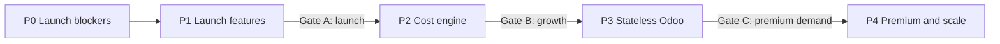
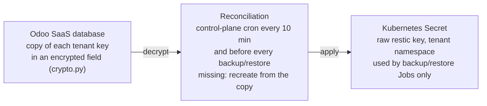
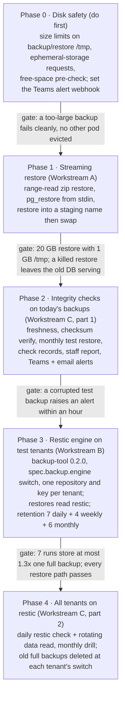
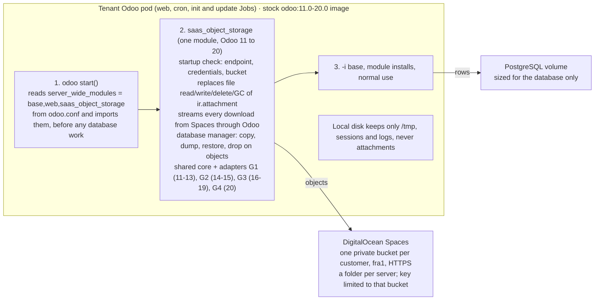

# Veltnex Implementation Plan

Oct 11, 2026 · @Mostafa · Target design: [ARCHITECTURE-TARGET.md](ARCHITECTURE-TARGET.md)

This plan turns the target architecture into ordered, shippable items. It replaces the four separate root plans. Their full text is kept, unchanged, in Appendices A–D, and each item below points to the appendix section that holds its detail. Where this plan differs from an appendix, the difference is listed in "Changes to the earlier plans" and this plan wins. Inside the appendices, a mention of an old file name means its appendix: `PLAN-backup-restore.md` is A, `PLAN-spaces-filestore.md` is B, `PLAN-cluster-capacity.md` is C, and `PLAN-postgresql-architecture.md` is D.

Status: plan only. Nothing here is built or deployed.

## How to use this plan

- **Order:** phases run in order. Items inside a phase are independent unless a "needs" line says otherwise. A gate must pass before the next phase starts.
- **Each item** gives:
    - **What:** the change;
    - **Where:** the files or components it touches (paths from the repository root);
    - **Done when:** the acceptance check.
- **Working rules (unchanged):**
    - Every customer-facing flow is a rolling update with zero downtime. Verify it live with an HTTP poll. The only exception is a cross-pool move (1–3 minutes, at a customer-chosen time).
    - Odoo tests run on the SaaS server against a throwaway database. Runtime behaviour is verified on the DOKS test cluster.
    - When tests pass, commit and push to main. Deploying is done by hand, not by this plan.
    - Store-computed fields across addons get an upgrade-with-data test, not only a fresh install.
- **IDs** (P0.1, P1.3, …) are stable. Reference them in commits and PRs.

## Changes to the earlier plans

| Earlier plan | What changes here | Why |
| --- | --- | --- |
| A · Backup & Restore | Its Phase 0 (disk safety, alert webhook) and Phase 1 (streaming restore with swap) move into P0. Its Phases 2–4 (integrity checks, restic) move into P1. Added: a backup client per PostgreSQL major, start times spread by tenant, and a nightly second-region copy for Production. The shared backup key is narrowed to the backup bucket now (P0.5). After files move to Spaces, backup Jobs run in a platform namespace (P3.4). restic repositories stay in the backup bucket, not the customer bucket, so a customer key can never delete backups. | Restore safety and key scope are launch blockers; Odoo.sh keeps backups in 3 locations. |
| B · Spaces Filestore | The customer bucket and scoped key are created at provisioning from P1.4, before the filestore uses them, so every new customer already has one. The filestore itself is P3.1. The module ships through the operator's existing platform-addons ConfigMap (`compute/operator/internal/resources/platformaddons.go`), so stock images still work. Sessions in PostgreSQL join the same module (P3.2). All four generations are built, because Odoo 11–20 are sold (P1.7): 17–19 first, then 16 and 20, then 14–15, then 11–13. | Statelessness needs sessions too; the platform-addons path already delivers server-wide modules without custom images. |
| C · Cluster Capacity | Its Phase 1 (capacity reader, placement, alerts) is P0.12. Its Phase 2 (size classes) grows from Standard and Large to four pools (Standard, Large, Shared, Build) with labels and taints (P2.5). Its Phases 3 and 4 (moves, limited simultaneous updates) are P3.5 and P3.6. Decisions recorded on 2026-10-11 stand. | Non-production and builds must not take Production headroom. |
| D · PostgreSQL | Sleep (its P1) and the shared CloudNativePG cluster (its P2) are both P2. Production tuning (its P3) is P3.3. HA and PITR (its P4) are P4.1 and P4.2. Added: archive of long-idle dev environments (P2.3), and idle detection from Traefik metrics in Prometheus, so nothing new has to collect traffic. | Same design; the order follows the business case. |

## P0 · Launch blockers: security and recovery

Before launch. These close the risks in the security review rated Critical or High.

**P0.1 Least-privilege cluster access for the control plane.** Launch blocker.
- **Today:** bootstrap binds the control plane's ServiceAccount to `cluster-admin` (`scripts/bootstrap/bootstrap.py:215`). The control plane is internet-facing (107 public API routes), so a compromise of it means every cluster.
- **What the control plane actually calls** (grep of `saas_core`):
    - OdooInstance get, create, patch and delete;
    - namespaces read and list;
    - deployments listed across all namespaces;
    - in tenant namespaces: pods (list, read, create, delete, exec, log), secrets (create, read, patch, replace), jobs, a cron job read, a deployment patch for restarts, config maps, network policies, a service-account read and a lease read;
    - the Prometheus service proxy;
    - Jobs and pods in `odoo-builds` and the toolbox namespace;
    - one config map in `kube-system`.
- **Design:** RBAC cannot grant "every namespace named `odoo-tenant-*`", so the grant is split three ways.
    1. **ClusterRole `veltnex-control-plane`:**
        - OdooInstances: get, list, watch, create, patch, delete;
        - namespaces: get, list;
        - nodes: get, list (for P0.12);
        - deployments: list;
        - nothing else cluster-wide.
    2. **Namespaced Roles in fixed namespaces:**
        - `odoo-builds`: jobs, pods, pods/log, secrets, config maps, network policies;
        - the toolbox namespace: pods and pods/exec;
        - `monitoring`: get `services/proxy` on the Prometheus service only (`resourceNames`);
        - `kube-system`: get on the `cluster-autoscaler-status` config map only.
    3. **Per-tenant RoleBinding created by the operator:** in every tenant namespace, bound to a ClusterRole `veltnex-tenant-access` that lists the tenant verbs above. The operator already creates every per-namespace object, so the binding appears and disappears with the namespace.
- **Steps:**
    1. Add the ClusterRoles, Roles and ServiceAccount to the operator chart (`compute/charts/odoo-operator/templates/controlplane-rbac.yaml`).
    2. Add the RoleBinding to the operator's tenancy reconcile (`compute/operator/internal/resources/tenancy.go`). The operator's own ClusterRole needs `bind` on `veltnex-tenant-access` only.
    3. Move namespace creation for `odoo-builds` and the toolbox namespace into bootstrap, so the control plane never needs `create namespace`.
    4. Bootstrap issues the new kubeconfig (`bootstrap.py`, `register_cluster.py`), and the docs drop cluster-admin (`setup/03a`, `03b` §7, `09`).
    5. On the test cluster, upload the new kubeconfig to the `saas.server` and run the full UI walk-through. Log every 403 from the driver; each one is a missing verb to add or a call to remove.
    6. Repeat per cluster. Remove the cluster-admin binding only after a clean week.
- **Rollout and rollback:** no tenant is touched; switching kubeconfig is instant. Rollback means re-uploading the old kubeconfig while its binding still exists.
- **Done when:**
    - `kubectl auth can-i --list --as=<sa>` shows no cluster-wide write except OdooInstances;
    - `can-i delete nodes` and `can-i get secrets -n kube-system` are both "no";
    - the walk-through passes: deploy, shell, logs, build, backup, restore, metrics, delete.

**P0.2 Platform database recovery.** Closed on 2026-10-11: the owner runs the platform database backups outside the repository. Keep one item: a short restore-drill runbook in `setup/02-SAAS-SERVER-SETUP.md`, practised monthly.

**P0.3 Private registry and pinned platform images.**
- **What:**
    - A private registry per cell, backed by Spaces, for customer images.
    - `saas.server` validation refuses a public registry.
    - Operator and backup-tool images move from the personal Docker Hub account to an organization registry and are pinned by digest.
    - Tenant pull secrets are copied by the operator (already done for `odoo-platform-pull`).
- **Where:** `control-plane/saas_core/models/saas_server.py` (registry fields), `compute/charts/odoo-operator/values.yaml` (`image`), `compute/operator/internal/resources/backup.go` (default backup image), `setup/04-IMAGES-AND-REGISTRY.md`, `.github/workflows/cd.yml`.
- **Done when:** an anonymous pull of a customer image fails, a build and update still roll with zero downtime, and the chart references images by digest.

**P0.4 Restore safety.** Appendix A, Phase 0 and Workstream A (A1–A5).
- **What:**
    - Size-limited `/tmp` for backup and restore Jobs, with ephemeral-storage requests.
    - Range-read zip restore, `pg_restore` from stdin, and restore into `<db>__restoring` then swap.
    - A free-space check first, falling back to today's path only when there is no room, as decided.
- **Where:** `compute/operator/internal/resources/backup.go:73`, `restore.go:94`, `compute/tools/backup-tool/run-restore.sh`, `control-plane/saas_core/models/saas_instance.py` (`_do_restore_backup`, `_do_copy_dbs`).
- **Done when:** the acceptance checks in Appendix A for disk safety, large streaming restore, safe failure and bad upload all pass.

**P0.5 Backup key scope.** Launch blocker.
- **Today:**
    - One S3 key from settings (`ir.config_parameter`, plain text, `res_config_settings.py:100`) is copied into a Secret in every tenant namespace (`saas_instance.py:3787`, `set_scheduled_backup`).
    - Anyone who can read one tenant's Secret can list, read and delete every customer's backups.
- **Steps**, each shippable on its own:
    1. **Narrow the key:** create a Spaces key granted only on the backup bucket, not account-wide. Save it in settings. `_cron_sync_scheduled_backups` rewrites each tenant Secret within 30 minutes. Revoke the old key once every backup has run once with the new one.
    2. **Encrypt it:** move the access and secret key to encrypted fields (`EncryptedChar`, which fails closed after P0.8).
    3. **Survive deletion:** turn on versioning for the backup bucket, with a lifecycle rule that expires old versions after 30 days. A leaked key can then delete nothing for good. Verify that Spaces supports noncurrent-version expiry before relying on it; if not, add a nightly copy to the second-region bucket (P1.5) under a different key.
    4. **Make reading useless:** use a per-tenant restic repository password (Appendix A, Workstream B, in P1.5), so the bucket key alone cannot read any backup.
    5. **Remove it from tenant namespaces:** in P3.4, backup Jobs move to a platform namespace once Odoo is stateless.
- **Residual risk until P3.4:** a staff member, or an operator bug that reads tenant Secrets, still holds a working key. Steps 3 and 4 limit what that key can do.
- **Rollout and rollback:** a key change is a Secret update with no pod restart; the next backup uses it. Rollback means restoring the old key before it is revoked.
- **Done when:**
    - the old key is revoked and every tenant's next backup succeeds;
    - the new key cannot list any other bucket;
    - a deleted backup object is restored from its previous version.

**P0.6 Guard PostgreSQL major-version changes.** Launch blocker.
- **Today:** the CRD allows 13–17 (`odooinstance_types.go:54`). A changed `spec.database.version` changes the image, and `syncDatabasePod` deletes the pod (`controller/database.go:256`). The new major then refuses the old data directory, so the tenant is down with no automatic way back.
- **Design, two layers:**
    1. **API server:** a CEL transition rule on `spec.database`, `self.version == oldSelf.version`, with the message "PostgreSQL major version cannot change in place; restore into a new environment". This blocks every writer (control plane, kubectl, Helm) without a webhook. The CRD already uses CEL for `replicas`.
    2. **Operator, defence in depth:** record the running major in `status.database.runningMajor` from the StatefulSet's image. If the spec ever disagrees, keep the old image and set a `DatabaseMajorChangeRejected` condition.
- **The upgrade path customers get instead:** "Upgrade PostgreSQL" creates a new environment on the new major from the latest backup (streaming restore, P0.4). The customer tests it and then switches. An in-place dump and reload at a customer-chosen time can come later, like pool moves.
- **Control plane:** the version field is read-only after creation in the UI and the API.
- **Where:** `compute/operator/api/v1alpha1/odooinstance_types.go`, `compute/operator/internal/controller/database.go`, `validate.go`, the CRD in `compute/charts/odoo-operator/crds`, `control-plane/saas_core/drivers/kubernetes_driver.py`.
- **Done when:**
    - `kubectl patch` from 16 to 17 on a live CR is refused by the API server and the database keeps serving;
    - an envtest covers both layers;
    - a same-major image change still applies.

**P0.7 Wildcard TLS for base domains.** Launch blocker.
- **Today:**
    - Every environment gets its own Let's Encrypt certificate through the cluster issuer (`kubernetes_driver.py:525`; operator `tls.go`, `route.go`), using HTTP-01.
    - Let's Encrypt allows 50 new certificates per registered domain per 7 days, so the base domain caps new environments at about 50 a week.
    - A failed or rate-limited issuance leaves a new environment without TLS.
- **Design:**
    - **The certificate:** one certificate `*.<base-domain>` per base domain, issued with DNS-01. Use cert-manager's DigitalOcean DNS solver if the zone is on DigitalOcean DNS, otherwise the DNS provider's cert-manager webhook. The DNS token is a Secret in the `cert-manager` namespace, scoped to DNS records only.
    - **Serving it:** the certificate lives in Traefik's namespace and is listed in Traefik's default `TLSStore`. Ingresses for base-domain hosts carry no per-tenant certificate, and Traefik serves the wildcard by SNI.
    - **CRD:** add `spec.domain.tls.mode: PerHost | Shared` (default `Shared` for base-domain hosts). In `Shared` mode the operator creates no Certificate and sets the router TLS annotation.
    - **Custom domains** (P1.1) keep HTTP-01 per host. Those certificates count against the customer's domain, not ours.
- **Steps:**
    1. Vendored cert-manager: add the DNS-01 ClusterIssuer and the token Secret (`scripts/bootstrap/doks.sh`, `setup/03b`).
    2. Create the wildcard Certificate and the Traefik `TLSStore` (chart values in `compute/charts/vendor/traefik`).
    3. Operator: add `Shared` mode in `tls.go` and `route.go`, plus tests in `route_test.go`.
    4. Control plane: new environments use `Shared` (`kubernetes_driver.py`).
    5. Existing tenants: switch them to `Shared` in batches of 10. Traefik already holds the wildcard, so the switch is a plain Ingress update. After a day, delete the old per-tenant Certificates and Secrets.
    6. Update the bootstrap readiness check (`bootstrap-check.<domain>`) to expect the wildcard.
- **Rollout and rollback:** an HTTP poll on a switched tenant shows no TLS error and no failed request. Rollback means setting `PerHost` again; the old Secret is kept for a day for that reason.
- **Done when:**
    - 60 environments are created in one day on one base domain, all with valid TLS;
    - Let's Encrypt shows one order per base domain;
    - P0.11's certificate-expiry alert covers the wildcard.

**P0.8 Request hardening.**
- **What:** take the client IP from the proxy-appended address only. Make secret encryption fail closed: refuse to start without a key. Encrypt `webhook_secret`.
- **Where:** `control-plane/saas_website/controllers/api.py:162`, `control-plane/saas_website/controllers/main.py:1246`, `control-plane/saas_core/crypto.py`, `control-plane/saas_core/fields.py`, `control-plane/saas_core/models/saas_instance_repo.py:164`.
- **Done when:** a forged `X-Forwarded-For` no longer resets the login rate limit (unit test), and a server started without a key exits with a clear error.

**P0.9 Two-factor authentication.**
- **What:** TOTP for staff (required) and for customer owners (required for anyone who can open a shell or the SQL console).
- **Where:** `control-plane/saas_core/__manifest__.py` (depend on `auth_totp`), `control-plane/saas_iam`, `control-plane/saas_website/controllers/api.py` (login flow), `frontend/veltnex` (enrolment and prompt).
- **Done when:** a staff user without TOTP cannot open a pod or cluster shell, and the SPA login works with TOTP.

**P0.10 CI gates.**
- **What:** end the "temporary fast deployment mode". Tests, typecheck, lint and scans become required checks before `cd.yml` deploys.
- **Where:** `.github/workflows/ci.yml`, `.github/workflows/cd.yml`, `setup/06-CICD.md`.
- **Done when:** a failing test blocks the deploy job.

**P0.11 Alerts that reach people.**
- **What:**
    - Set the Teams webhook.
    - Add a Teams message format to `saas.alert`.
    - Enable Alertmanager with rules for node not ready, pods pending over 5 minutes, PVC above 85%, backup older than 27 hours, certificate expiry under 14 days, and operator down.
- **Where:** `control-plane/saas_core/models/saas_alert.py`, `compute/charts/monitoring/prometheus-values.yaml`.
- **Done when:** each rule fires once on the test cluster and arrives in Teams.

**P0.12 Capacity reader, ceilings and alerts.** Appendix C, sections 1, 2, 5 and 6 (its Phase 1).
- **What:**
    - A `saas.capacity` reader from nodes and `cluster-autoscaler-status`.
    - Per-node rollout headroom in placement.
    - The four Teams alerts.
    - Raise the DOKS pool maximum and the Droplet limit by hand.
- **Where:** `control-plane/saas_core/models/saas_server.py` (`_has_capacity_for`), `control-plane/saas_core/models/saas_instance.py` (`_allocate_servers`, `_cron_retry_pending_provision`).
- **Done when:** the Appendix C Phase 1 acceptance checks pass.

**P0.13 Tenant network policy: mail allowed, cluster blocked.** Launch blocker.
- **Today:** tenant egress allows DNS, PostgreSQL inside the namespace, and TCP 443 to any address (`networkpolicy.go`). This causes two problems:
    - outgoing mail over SMTP (465, 587) and Odoo's incoming mail servers (IMAP 993, POP3 995) are blocked;
    - 443 reaches in-cluster addresses as well as the internet.
- **Design:**
    - Egress to the internet is allowed on 443, 465, 587, 993 and 995 through an `ipBlock` of `0.0.0.0/0` with `except` set to the pod, service and VPC ranges.
    - The ports come from an operator value, `tenantEgress.ports`, so operations can add one (for example 2525 or LDAP 636) without a release.
    - The ranges come from `tenantEgress.privateCIDRs`, filled by bootstrap from the cluster's settings (`doctl kubernetes cluster get`).
    - Port 25 stays closed: DigitalOcean blocks it on Droplets, and customers should use submission ports.
    - Inside a namespace, ingress narrows to Odoo to PostgreSQL on 5432, plus the existing gateway and ACME paths.
- **Where:** `compute/operator/internal/resources/networkpolicy.go`, `compute/operator/internal/controller/network.go`, `compute/charts/odoo-operator/values.yaml` and `values.schema.json`, `scripts/bootstrap/doks.sh`.
- **Rollout and rollback:** a NetworkPolicy change applies live with no pod restart. Rollback means the previous chart values.
- **Done when:**
    - a tenant sends mail through an external SMTP server on 587;
    - an incoming mail server on IMAP 993 fetches;
    - `curl https://kubernetes.default` and a connection to another tenant's pod IP both fail;
    - the UI walk-through passes.

**P0.14 Safe cancel.**
- **What:** deletion waits for the final backup to succeed. After a timeout it stops and alerts staff instead of deleting.
- **Where:** `compute/operator/internal/controller/finalize.go:211`.
- **Done when:** a cancel with the bucket unreachable keeps the namespace and raises an alert.

**P0.15 Operator availability.**
- **What:** 2 replicas with leader election. Fix the ServiceMonitor TLS setting.
- **Where:** `compute/charts/odoo-operator/templates/deployment.yaml:45`, `values.yaml`.
- **Done when:** deleting the leader pod hands over within 30 seconds with no reconcile lost.

**P0.16 Spread backup start times.** Launch blocker.
- **Today:** `set_scheduled_backup` defaults to `0 2 * * *`, and `_sync_scheduled_backup` never passes a schedule (`kubernetes_driver.py:701`, `saas_instance.py:3787`). Every tenant's backup starts at 02:00, all competing for node disk, network and the bucket at once.
- **Design:**
    - A deterministic minute per tenant, `offset = crc32(subdomain) % 240`, with the schedule `M H * * *`, where `H = 1 + offset // 60` and `M = offset % 60`. That spreads backups across 01:00–04:59, and the same tenant always gets the same time.
    - CronJob `timeZone: UTC` is set explicitly.
    - A customer-chosen backup window can come later; the hash stays the default.
- **Steps:** compute the schedule in `_sync_scheduled_backup` and pass it to `set_scheduled_backup`. `_cron_sync_scheduled_backups` re-patches every tenant, so existing tenants move within 30 minutes with no restart.
- **Done when:** 20 test tenants show 20 different start minutes, and all of the next night's backups succeed.

**P0.17 Backup tools for every PostgreSQL major.** Launch blocker.
- **Today:**
    - The backup-tool image installs only `postgresql-client-16` (`compute/tools/backup-tool/Dockerfile:27`), while the CRD allows 13–17. pg_dump 16 refuses a 17 server, so backups of a PostgreSQL 17 tenant fail.
    - The control plane does not set `spec.database.version` today, so live tenants run the default 16 and the failure is latent. It becomes real with the Odoo 11–20 matrix (P1.7).
    - On-demand dumps and downloads run `pg_dump` inside the Odoo container with the Odoo image's own client (`saas_instance_backup.py:73`, `exec_stream_out`). That client may not match the server either.
- **Design:**
    - The backup-tool image installs `postgresql-client-13` to `-17` from the PGDG repository its base image already carries.
    - The scripts take `PG_MAJOR` from the operator, which sets it from `spec.database.version`, and use `/usr/lib/postgresql/$PG_MAJOR/bin`.
    - The scripts check `server_version_num` first and stop with a clear message on a mismatch.
    - On-demand dumps and restores run in the PostgreSQL container, whose tools always match its server, instead of the Odoo container.
- **Where:** `compute/tools/backup-tool/Dockerfile`, `run-backup.sh`, `run-restore.sh`, `test_backup_restore.py`, `compute/operator/internal/resources/backup.go` and `restore.go` (env), `control-plane/saas_core/models/saas_instance_backup.py`, `kubernetes_driver.py` (container choice in `exec_stream_out`).
- **Until it ships:** the control plane offers only majors the backup image supports.
- **Done when:** the shell test matrix passes for 13–17, and on the test cluster a PostgreSQL 17 tenant backs up, downloads a dump and restores.

**P0.18 Pricing floor at 60% gross margin.**
- **What:**
    - Price at least 2.5 × the package cost for 60% gross margin. The target at scale is 70% or more, which means at least 3.3 × cost.
    - The cost comes from the formula in the architecture's cost section.
    - Add-ons (HA, PITR, extra storage, awake staging, dedicated pools) follow the same floor.
    - The margin cron alerts when any live plan or add-on falls below 60%.
    - Margin never comes from cutting Production isolation, backups or security.
- **Where:** `control-plane/saas_billing/models/saas_pricing.py` (cost floor), the margin cron in `saas_billing`, `control-plane/saas_core/models/saas_plan.py` (`_package()` cost inputs).
- **Done when:** a plan priced below the floor cannot be published, and the margin report lists every plan with its cost and margin.

## P1 · Launch features

Before launch. These are the Odoo.sh gaps that would lose deals.

**P1.1 Custom domains for Production.**
- **What the customer gets:** they connect their own domain, for example `erp.customer.com`, to their Production environment instead of the Veltnex default domain. Staging and dev keep the default domain.
- **Flow:**
    1. In the portal, the customer adds `erp.customer.com` to Production. Several domains are allowed (a cap such as 5 is assumed), and one is marked primary.
    2. The portal shows the DNS record to create:
        - for a subdomain: a CNAME to `.<base-domain>`;
        - for an apex domain: an A record to the cell's load balancer IP, with a warning that the IP can change, so a `www` subdomain or the provider's CNAME flattening is better.
    3. **Verification:** the platform checks that the name resolves to the cell's load balancer. It then fetches a one-time token over HTTP at `/.well-known/veltnex/<token>`, which the platform serves for that host until verified.
    4. **Activation:**
        - the control plane adds the host to the CR;
        - the operator adds an Ingress rule and a Certificate for the host (HTTP-01, cert-manager);
        - the state moves to Active.
    5. **Primary domain:** the control plane sets `web.base.url` (and `web.base.url.freeze`) in the Production database, so links and emails use the customer's domain. The default domain keeps working; redirecting it to the primary is a per-project option.
- **Safety:**
    - A host is unique across all tenants (database constraint), so one customer cannot claim another's domain.
    - DNS is re-checked daily. If the domain stops pointing to Veltnex for 7 days, the host is disabled and the customer is told, which prevents stale routing and takeover.
    - Certificates for custom domains count against the customer's registered domain, not ours.
- **Removal:** the host leaves the Ingress and its Certificate is deleted. If it was primary, `web.base.url` returns to the default domain.
- **Where:**
    - new model `saas.instance.domain` in `control-plane/saas_core/models/` (host, state, primary, verification token, last check);
    - `kubernetes_driver.py`;
    - CRD `spec.domain.extraHosts` (`odooinstance_types.go:174`);
    - operator `route.go`, `tls.go` and `networkpolicy.go` (the ACME path on 8089 already exists);
    - `control-plane/saas_website/controllers/api.py` (add, verify, set primary, remove);
    - `frontend/veltnex` (domain settings page, Arabic strings in `ar.json`).
- **Rollout:** adding or removing a host updates the Ingress only; Odoo is not restarted.
- **Done when:**
    - a domain added in the UI serves Odoo with a valid certificate within 5 minutes;
    - an HTTP poll on the default domain shows zero failed requests during add and remove;
    - links in an emailed invitation use the primary domain;
    - a second tenant cannot add a host that is already taken;
    - a domain whose DNS is removed is disabled after the grace period.

**P1.2 Git submodules.**
- **What:** fetch submodules recursively, with the same credentials for the same host, and record each submodule's commit in the build. Deploy keys per submodule are out of scope.
- **Where:** `control-plane/saas_core/templates/build/fetch.sh`, `inspect.py` (addons paths inside submodules), `control-plane/saas_core/models/saas_instance_build.py`.
- **Done when:** a repository with an OCA submodule builds, and its modules install on staging.

**P1.3 Mail catcher.**
- **What:** one Mailpit per cell in the Shared pool. Neutralization points staging and dev outgoing mail at it instead of only disabling mail. The customer reads their environment's mail from the portal, filtered by environment.
- **Where:** `control-plane/saas_core/models/saas_instance.py` (`_NEUTRALIZE_SQL` near line 3449), a vendored Mailpit chart in `compute/charts/vendor/`, `frontend/veltnex` (mail tab).
- **Done when:** a password-reset mail sent from staging appears in that environment's mail tab and never leaves the cluster.

**P1.4 Customer bucket and scoped key at provisioning.** Appendix B, "Storage design".
- **What:** at first provisioning of a customer, take a bucket from the pool and create a key granted only on it. Store both encrypted. Nothing uses them yet except the restic repository password scheme in P1.5.
- **Where:** new `control-plane/saas_core/models/saas_storage_bucket.py`, `saas_instance.py` (deploy path), DigitalOcean API client.
- **Done when:** a new customer gets a bucket and key, and a second customer's key cannot list the first bucket.

**P1.5 restic backups, integrity checks and an off-site copy.** Appendix A, Workstreams B and C, Phases 2–4.
- **What:**
    - backup-tool 0.2.0 with restic;
    - `spec.backup.engine`;
    - retention 7 daily + 4 weekly + 6 monthly;
    - daily `restic check`, rotating data reads and a monthly drill;
    - a staff report, with alerts to Teams.

  Added here: a nightly copy of each Production repository to a second-region bucket.
- **Where:** as listed in Appendix A, plus a copy Job in `compute/operator/internal/resources/backup.go`.
- **Done when:** all Appendix A acceptance checks pass, and a test restore from the second-region copy works.

**P1.6 Previous-container logs.**
- **What:** the log viewer can show the previous container's log after a crash or restart, plus a download of the last 24 hours that the kubelet still holds.
- **Where:** `control-plane/saas_core/controllers/container_logs.py`, `kubernetes_driver.py` (`open_log_stream`, add `previous`), `frontend/veltnex`.
- **Done when:** after a forced crash, the customer sees the crash trace in the portal.

**P1.7 Odoo 11–20 support matrix.** Decided on 2026-10-11: versions 11 to 20 are sold.
- **What:**
    - **Matrix:** a support matrix of Odoo version, image, Python and PostgreSQL major. Map versions onto as few PostgreSQL majors as possible, because each major means another shared non-production cluster per cell (P2.2). Odoo 11–12 must be tested on PostgreSQL 13, the CRD minimum, before they are offered. If they fail there, they run on a dedicated database only.
    - **Chart:** `supportedOdooVersions` covers 11.0–20.0.
    - **Filestore adapters:** all four generations of Appendix B, built in this order: 17–19, then 16 and 20, then 14–15, then 11–13.
    - **Portal notice:** versions Odoo no longer patches carry a notice and an upgrade offer.
- **Where:** `compute/charts/odoo-operator/values.yaml`, `control-plane/saas_core/models/saas_odoo_version.py` (PostgreSQL major per version), `kubernetes_driver.py` (set `spec.database.version` from it), `setup/04-IMAGES-AND-REGISTRY.md`.
- **Done when:** one tenant per version from 11 to 20 deploys, builds a custom addon, backs up and restores on the test cluster.

### Gate A · Launch

- [ ] All P0 and P1 items done.
- [ ] Restore drill passed for a Production tenant and for the platform database.
- [ ] Full UI walk-through as a new customer passes, including a custom domain, a staging copy with mail caught, a build with a submodule, and a restore.

## P2 · Cost engine

For the first 100 environments. These cut the cost of non-production.

**P2.1 Sleep and wake for non-production.** Appendix D, "Sleep when idle".
- **What:**
    - **Idle windows (decided 2026-10-11):** Production never sleeps; Development sleeps after 1 idle hour, Staging after 2, Trials after 1.
    - **Idle detection:** no requests within the window, read from Traefik's per-service request counter in Prometheus with one query per cluster.
    - **Sleep:** scale Odoo to 0, keeping the database and volumes.
    - **Wake:** a small activator in `odoo-system` serves a "Waking up your server…" page for sleeping hosts (Traefik fallback route), patches the CR, and redirects once ready. Wakes are rate-limited per cell.
    - **Opt-out:** "Always awake" is a per-environment option, billed.
- **Where:**
    - CRD (`spec.sleep` or a reuse of `suspended` with a reason; add a `Sleeping` phase);
    - `compute/operator/internal/controller/suspension.go`;
    - a new activator in `compute/operator/cmd/` (same binary, separate Deployment);
    - `route.go`;
    - `control-plane/saas_core/models/saas_instance.py` (idle cron);
    - `saas_billing` (awake option);
    - `frontend/veltnex` (status "Sleeping").
- **Done when:**
    - a dev environment sleeps after the idle window;
    - the first visit wakes it in under 30 seconds;
    - Production never sleeps (test);
    - the cost report shows the drop.

**P2.2 Shared CloudNativePG cluster for non-production.** Appendix D, "Development and Staging".
- **What:**
    - Vendor the CloudNativePG chart in `compute/charts/vendor/`.
    - Run one cluster per PostgreSQL major per cell: 2 instances, PgBouncer in session mode, WAL archiving to Spaces.
    - Each environment gets a database and a login named by server id, with `REVOKE CONNECT … FROM PUBLIC` and per-login limits on connections, `statement_timeout`, `idle_in_transaction_session_timeout`, `work_mem` and `temp_file_limit`.
    - The Production copy streams `pg_dump` into it, then neutralizes and masks PII as today.
- **Where:**
    - CRD `spec.database.mode` (add `Shared` with a cluster reference);
    - `compute/operator/internal/controller/database.go`;
    - `resources/cnpg.go`;
    - `control-plane/saas_core/models/saas_instance.py` (`_create_env_child`, `_do_copy_dbs`, `hosting_sql_query` scoped to its own login);
    - `saas_plan.py` (`_package()` without a database pod for shared environments).
- **Done when:**
    - a new staging environment is ready in under 2 minutes with a neutralized copy;
    - one environment running a heavy query cannot push others past their timeouts (load test);
    - failover of the shared primary keeps dev environments working.

**P2.3 Archive long-idle dev environments.**
- **What:** after M idle days (open question 4), dump the database and files to the customer's archive prefix and drop them from the shared cluster. Restore on demand from the portal in about a minute.
- **Where:** `control-plane/saas_core/models/saas_instance.py` (new state or flag `archived`), `saas_instance_backup.py`, `frontend/veltnex`.
- **Done when:** an archived environment restores with its data intact, and its database no longer appears on the shared cluster.

**P2.4 Control-plane scaling.**
- **What:**
    - Cache one Kubernetes client per cluster per worker.
    - `_cron_reconcile` lists OdooInstances and pods once per cluster.
    - Health reads readiness and 5xx rate from Prometheus.
    - `_cron_verify_webhooks` and `_cron_sync_scheduled_backups` run on change, or in daily batches.
    - Stop, suspend, cancel and env activation move from `run_in_background` to the `saas.job` queue.
- **Where:** `control-plane/saas_core/models/saas_instance.py` (`_compute_driver` near line 1591, `_cron_reconcile` near 5769, `_cron_verify_webhooks` near 4307), `saas_instance_health.py:166`, `saas_instance_backup.py:1057`, `saas_job.py`.
- **Done when:** with 500 simulated instances on the test cluster (CRs with suspended workloads), every cron cycle finishes within its interval, and no call is made per tenant.

**P2.5 Four node pools.** Appendix C, section 3 (extended).
- **What:**
    - Pools Standard, Large, Shared and Build, labelled `saas.platform/pool`.
    - Shared and Build are tainted.
    - The operator sets node affinity and tolerations from the environment class.
    - Build Jobs tolerate only the Build pool, which has min 0.
    - Pool ceilings are set by hand (decided).
- **Where:** `compute/operator/internal/resources/deployment.go`, `database.go`, `control-plane/saas_core/drivers/k8s_builds.py`, `setup/03b-DOKS-CLUSTER-SETUP.md`.
- **Done when:** a dev environment never lands on a Standard node, a build scales the Build pool from 0 and back, and Production rollouts still have headroom.

**P2.6 Build cache.**
- **What:** a BuildKit layer cache in the registry, keyed on the Odoo base image and the merged `requirements.txt`. Keep `--no-cache` as a "clean build" button.
- **Where:** `control-plane/saas_core/templates/build/build.sh`, `Dockerfile.jinja`, `k8s_builds.py`.
- **Done when:** a second build with an unchanged `requirements.txt` takes less than half the first build's time.

### Gate B · Growth

- [ ] Measured idle saving per non-production environment, compared with the estimate in the architecture.
- [ ] The shared cluster has run 30 days with no Production impact and no customer-visible incident.
- [ ] The measurements listed in the architecture's cost section are being collected.

## P3 · Stateless Odoo

Growth. These remove node pinning.

**P3.1 Spaces filestore.** Appendix B in full (its Phases 1–4).
- **What:** the server-wide module, delivered through the operator's platform addons, using the customer bucket and key from P1.4. New tenants only (decided). Downloads stream through Odoo.
- **Where:** as listed in Appendix B, with `compute/operator/internal/resources/platformaddons/` as the delivery path.
- **Done when:** all Appendix B acceptance checks pass.

**P3.2 Sessions in PostgreSQL.**
- **What:** the same module stores sessions in the tenant database, with a cleanup cron.
- **Where:** `platformaddons/saas_object_storage` (or a sibling module).
- **Done when:** a logged-in user stays logged in across a pod replacement on another node.

**P3.3 Production database tuning presets.** Appendix D, "Production" items 1–2.
- **What:**
    - `shared_buffers`, `effective_cache_size`, `work_mem` and `max_connections` derived from the package;
    - `pg_stat_statements` on;
    - autovacuum tuned for Odoo's large tables.
- **Where:** `compute/operator/internal/resources/database.go` (tuning from memory limit already exists; extend it), `saas_plan.py` (`_package()`).
- **Done when:** the presets apply with an in-place restart, and the slow query view in the portal reads from `pg_stat_statements`.

**P3.4 Odoo without a volume.**
- **What:** for tenants on the Spaces filestore:
    - drop the filestore PVC from the Odoo pod;
    - remove the required pod affinity to the volume node;
    - run backup Jobs in a platform namespace that reaches the tenant database through its Service, so tenant namespaces hold no platform key.
- **Where:** `compute/operator/internal/resources/deployment.go:282`, `pvc.go`, `backup.go`, `networkpolicy.go`.
- **Done when:** draining the Odoo pod's node causes zero failed requests in an HTTP poll, and the tenant namespace has no backup Secret.

**P3.5 Customer moves between pools.** Appendix C, section 4 (its Phase 3).
- **Done when:** the Appendix C Phase 3 acceptance checks pass.

**P3.6 Limited simultaneous updates.** Appendix C, its Phase 4.
- **Done when:** the Appendix C Phase 4 acceptance checks pass.

### Gate C · Premium demand

- [ ] At least one paying customer asks for HA or PITR, or a sales decision to offer them at a price.

## P4 · Premium and scale

On demand.

**P4.1 HA add-on.**
- **What:**
    - CloudNativePG mode with 2 instances on different nodes for the tenant database;
    - Odoo with 2 replicas;
    - a PodDisruptionBudget of 1;
    - pod anti-affinity.

  Lift the `replicas: 1` rule only for HA tenants.
- **Where:** `compute/operator/api/v1alpha1/odooinstance_types.go` (CEL rule near line 447), `controller/workload.go`, `resources/cnpg.go`, `control-plane/saas_core/models/saas_plan.py` (`_package()`), `saas_billing` (add-on price).
- **Done when:** killing the primary database node and one Odoo pod produces no failed request in an HTTP poll beyond the failover window.

**P4.2 PITR add-on.**
- **What:** CloudNativePG WAL archiving to the customer's bucket, with 7 days of recovery, and a "restore to time" action that creates a new environment.
- **Where:** `resources/cnpg.go` (backup and WAL config), `control-plane/saas_core/models/saas_instance_backup.py`, `frontend/veltnex`.
- **Done when:** a restore to a chosen minute shows data written before that minute and not after.

**P4.3 Dedicated pools.**
- **What:** a tainted pool per dedicated customer, with node cost plus margin and a minimum term.
- **Where:** `saas_server.py` (pool records), the operator's tolerations from P2.5, and `saas_billing`.

**P4.4 Tests per commit and stored logs.**
- **What:**
    - **Tests:** optional test runs on dev branches, using a fresh database with demo data in the shared cluster, results shown on the build.
    - **Logs:** stored logs on Spaces with 7-day retention.

**P4.5 Second cell or region.**
- **What:** bootstrap a new DOKS cluster and register it as a `saas.server`. Allocation already picks clusters per region.
- **Where:** `scripts/bootstrap/doks.sh`, `register_cluster.py`.
- **Done when:** a new customer in the new region is provisioned end to end with no change to existing customers.

**P4.6 Control plane on two application servers.**
- **What:** two Odoo application servers and one `saas-jobs` worker in front of the platform database (a managed PostgreSQL becomes worth it at this point), with sticky sessions at the proxy.
- **Where:** `setup/02-SAAS-SERVER-SETUP.md`, `scripts/deploy/saas-deploy.sh`.

## Open questions

See [ARCHITECTURE-TARGET.md](ARCHITECTURE-TARGET.md#open-questions-and-assumptions). These block specific items:

| Question | Blocks |
| --- | --- |
| Archive window | P2.3 |
| Whether trials share the cluster | P2.2 |
| Second region for backup copies | P1.5 |
| Where the space for the safe two-copy restore comes from (Appendix A, open question 3) | P0.4, safe swap on full disks |

---

## Appendix A · Backup & Restore Overhaul Plan

*Earlier root plan `PLAN-backup-restore.md`, kept unchanged below. Where it differs from the phases above, this plan wins (see "Changes to the earlier plans").*

Oct 11, 2026 · @Mostafa

### Summary

We make every restore stream from the bucket with no full local copy, move the backup job to **restic** (incremental, de-duplicated), and add scheduled integrity checks with a staff report and alerts. The work runs in five phases, safety first, so tenants are protected from a full disk before the bigger changes land.

- **Goal A — Streaming restore.** No restore path downloads a whole backup to the pod's `/tmp`. Database data streams into PostgreSQL; files go straight to the filestore volume.
- **Goal B — Restic backups.** One restic repository per tenant in the existing bucket. Each daily run uploads only changed data; 7 daily backups cost about one full copy plus the daily changes.
- **Goal C — Integrity checks.** Daily and weekly `restic check` runs, plus a monthly test restore, recorded in a report you can open in the backend, with alerts on failure.

While reviewing the code I found a more urgent problem. The operator's backup and snapshot-restore Jobs also stage everything in `/tmp`, on an emptyDir with **no size limit**. That is the node's own disk, so one large tenant can fill it and get other tenants' pods evicted. Phase 0 fixes this first.

### How it works today

Every artifact lives in the bucket (DigitalOcean Spaces `node2027`, fra1). Backups already stream out; three of the four restore paths, and the backup job itself, stage whole files on local disk first.

| Path | Made by | Format in bucket | Local disk used | Code |
| --- | --- | --- | --- | --- |
| Daily backup, snapshot, final snapshot | Operator CronJob / one-off Job (`run-backup.sh`) | `db.dump` + `filestore.tar.gz` + `manifest.json`, full copy every run | **Yes** — both files written whole to `/tmp` (unbounded emptyDir) before `rclone copy` | `compute/tools/backup-tool/run-backup.sh`, `operator/internal/resources/backup.go:73` |
| Snapshot restore (full instance) | Operator restore Job (`run-restore.sh`) | reads the same run | **Yes** — downloads both files to `/tmp`, then `pg_restore` and `tar -x` | `run-restore.sh:66`, `operator/internal/resources/restore.go:94` |
| Database backup download | `pg_dump -Fc` in the Odoo pod, piped to the multipart uploader | `.dump` under `ondemand/` | No — already streaming | `saas_instance_backup.py` (`exec_stream_out` → `_upload_stream_to_bucket`) |
| Zip backup (used by copies) | Odoo-format zip written to the pod's stdout, streamed up | `.zip` (dump.sql + filestore) | No — already streaming | `saas_instance_backup.py` `_stream_odoo_zip_to_bucket` |
| Restore one database (upload or backup) | `curl` into the Odoo pod, `unzip`, `psql -f dump.sql`, `cp` filestore | reads a `.zip` | **Yes** — zip downloaded to `/tmp`, then extracted there too (about 2× the size) | `saas_instance.py` `_do_restore_backup` (“Downloading backup...”) |
| Copy Production to Staging/Dev | Zip backup of the source, then the restore above on the target | `.zip`, deleted after | **Yes** — same as restore one database | `saas_instance.py` `_do_copy_dbs` |

Two more facts shape the plan:

- Restoring one database drops the old database **before** the new one is loaded. A failed restore leaves the customer with no database.
- Operational alerts go to a webhook (`saas_master.alert_webhook`), which is **not set** on the live server, so today they only reach the log.

### Workstream A — Streaming restore

Every restore reads the bucket as a stream: database data is piped into PostgreSQL and files are written straight onto the filestore volume, so `/tmp` holds only small buffers whatever the backup size.

**A1. Restore one database from a zip (uploads, backups, copies).** A zip keeps its index at the end, so it cannot be read front to back from a plain download. We read it with HTTP range requests instead; the bucket supports them on presigned URLs.

1. A small Python helper runs inside the Odoo pod. It opens the presigned URL as a seekable remote file (range reads, 8 MB read-ahead) and hands it to Python's `zipfile`.
2. **Validate first, nothing touched yet:** read the zip index, require `dump.sql`, check the manifest's Odoo version, and reject paths that escape the filestore (`../`).
3. Restore into a staging name `<db>__restoring`: stream the `dump.sql` entry into `psql` stdin in 1 MB chunks, with `ON_ERROR_STOP=1`.
4. Extract `filestore/` entries one by one into `<filestore>/<db>__restoring` on the volume.
5. **Swap only on success:** drop the old database and rename `<db>__restoring` to `<db>`, then swap the filestore folders. On failure, drop the staging copy; the customer's database is untouched.
6. Neutralize and mask PII for Staging/Dev, exactly as today.

**A2. Restore one database from a `.dump` (pg\_dump custom format).** `curl` the presigned URL and pipe it into `pg_restore --no-owner --exit-on-error` (custom format restores from stdin; parallel `-j` is not available that way). Same staging-name and swap as A1.

**A3. Copy Production to Staging/Dev.** Keep the bucket in the middle (the two pods sit in different namespaces), but both halves stream: the source already streams its zip up, and the target uses A1. A later option is to stream a `.dump` instead of a zip, which is smaller and faster to load.

**A4. Operator snapshot restore (`run-restore.sh`).** Replace `rclone copy` + local files with `rclone cat <run>/db.dump | pg_restore` and `rclone cat <run>/filestore.tar.gz | tar -xz -C <filestore>`. After Workstream B this becomes `restic dump` / `restic restore` straight onto the volume.

**A5. Guard rails.** The staging-name swap needs room for two copies of the database on the PostgreSQL volume. Check free space first and refuse with a clear message (“free X GB or add storage”) rather than fail halfway.

**Code touched:** `saas_core/models/saas_instance.py` (`_do_restore_backup`, `_do_copy_dbs`), a new pod-side helper next to `_docker_exec_python`, `compute/tools/backup-tool/run-restore.sh`.

**Risks.** Range reads cost one request per 8 MB, which is cheap on Spaces. A presigned URL can expire mid-restore, so it gets a lifetime of the restore timeout plus a margin, and a re-sign on 403. Very large single files inside the filestore stream fine because they are written as they are read.

### Workstream B — Move the backup job to restic

**Recommendation: restic, with one repository per tenant.** Both tools de-duplicate and handle our needs. Restic wins on maturity, a simpler single binary, and the platform's earlier restic code path; kopia's main advantages (lock-free concurrency, built-in scheduler) matter less when each tenant has its own repository.

|  | restic | kopia |
| --- | --- | --- |
| Maturity | Since 2015, very widely used | Since 2019, smaller user base |
| Incremental / de-duplication | Yes, content-defined chunks | Yes, content-defined chunks |
| Compression | zstd (repository format v2) | zstd and others |
| Encryption | AES-256 + Poly1305, always on | AES-256-GCM or ChaCha20, always on |
| Back up a stream (`pg_dump` stdin) | `--stdin --stdin-filename db.dump` | `--stdin-file` |
| Restore as a stream | `restic dump <snap> db.dump \| pg_restore` | `kopia show <object>` |
| Integrity check | `check`, `check --read-data-subset=n/N` | `snapshot verify --verify-files-percent` |
| Concurrent writers | Prune takes an exclusive lock | No exclusive locks |
| Earlier use in this platform | Yes (`restic` backup format, pre-Kubernetes) | No |

**Repository layout.** One repository per tenant at `restic/<partner>/<subdomain>/` in the existing bucket. This keeps tenants isolated, gives each its own key, and avoids lock contention between tenants. The repository password is generated by the control plane, stored encrypted in `saas.instance` (the existing encrypted-field mechanism), and passed to Jobs through the tenant's backup Secret.

**What each run stores.** The run makes two restic snapshots that share a `run:<timestamp>` tag, so restore always pairs a database with its matching files. Both are also tagged by source (`scheduled`, `snapshot`, `final`):

- `pg_dump -Fc -Z0 | restic backup --stdin --stdin-filename db.dump` — uncompressed dump so restic's chunking de-duplicates well; restic compresses it.
- `restic backup /filestore` — unchanged files are skipped outright.

Nothing is staged in `/tmp`, so the emptyDir problem disappears for backups too.

**Retention.** Paid plans keep 7 daily, 4 weekly and 6 monthly backups: `restic forget --tag scheduled --keep-daily 7 --keep-weekly 4 --keep-monthly 6 --prune`. With de-duplication the 10 extra backups add only the data that changed in those weeks and months. Customer snapshots are kept until deleted (`forget <id>`). The final copy taken at cancellation goes to the long-term archive bucket (Cold Storage, see `PLAN-spaces-filestore.md`), so a customer can restore a project years later by paying the restoration fee.

**Changes.**

1. `backup-tool` image 0.2.0: add restic and a `BACKUP_ENGINE=full|restic` switch in `run-backup.sh` / `run-restore.sh`.
2. Operator: new `spec.backup.engine` field (default `full`), passed to the Jobs; CRD + chart bump.
3. Control plane: the backup model records restic snapshot ids (`format='restic'` already exists), lists snapshots via a small Job or `restic snapshots --json`, and deletes customer snapshots with `forget`.
4. Snapshot pricing: unchanged rules, DigitalOcean-style (see “Snapshot pricing after restic” below).

#### Snapshot pricing after restic

**Decision: bill each snapshot like DigitalOcean does — on its own full size, as if it were stored alone, at the same per-GB-month price.** De-duplication between snapshots lowers our storage cost; it does not change what the customer pays, so prices stay predictable and match today's.

- **Billed size** = `restic stats <snapshot-id> --mode raw-data` for the run's two snapshots (database + files) together: the compressed data that snapshot needs on its own. This is the same kind of number as today's size (compressed `db.dump` + `filestore.tar.gz`), so a customer's price does not jump at migration.
- **Rounding and price** stay as in `saas_snapshot_billing.py`: size rounded up to whole GB, 1 GB minimum, × `saas_master.snapshot_price_per_gb` per month.
- **Frozen at creation**, prorated to the customer's snapshot billing day, then billed monthly in advance until deleted — all exactly as today. Deleting a snapshot stops its next renewal; no refunds for the prepaid period.
- **Not billed:** daily automatic backups (covered by the daily-backup add-on price) and the final snapshot during the reactivation window.

DigitalOcean's own docs say only that pricing is “based on the size of the snapshot”, at $0.06 per GB-month with a $0.01 minimum ([DigitalOcean snapshot pricing](https://docs.digitalocean.com/products/snapshots/details/pricing/)); billing each snapshot on its own size is the reading that matches their console and their staff's statements.

#### Repository keys

**Decision: one random key per tenant, held raw only in a Kubernetes Secret, with an encrypted copy in the SaaS database that rebuilds the Secret automatically.**

Keep a copy of `saas_secret_key` (`odoo.conf`) in your password manager.

1. **Generate.** When a tenant's first restic backup is enabled, the control plane creates a random key (`secrets.token_urlsafe(48)`) and runs `restic init` once. Backup Jobs never run `init`, so a missing key can never create a second repository with a different key.
2. **Store a copy in the SaaS database,** in an encrypted field using the platform's existing helper (`saas_core/crypto.py`). Nothing new to build.
3. **Store the key in the cluster:** Secret `odoo-backup-repo` in the tenant namespace, mounted only by the backup and restore Jobs, never by the Odoo pod or the customer shell.
4. **Recreate if missing.** Before every backup, restore or check, and in a cron every 10 minutes, the control plane checks the Secret exists and recreates it from the database copy if not.

**Cluster lost entirely.** Register the new cluster and redeploy the tenants. Reconciliation recreates every Secret from the database, and each repository in the bucket opens with its key again. No backup data is lost.

**Keep it simple for now.** The only extra step is a copy of `saas_secret_key` (from `odoo.conf`) in your password manager, so the database copies can always be decrypted. A stronger recovery scheme (an offline recovery key split between people) can come later if the platform grows; nothing in this plan blocks it.

### Workstream C — Integrity checks, report and alerts

Three levels of check run on a schedule per tenant; every result is stored, shown on a staff report, and any failure raises an alert within the hour.

| Check | What it proves | Schedule | Cost |
| --- | --- | --- | --- |
| Freshness | A backup finished in the last 26 hours for every tenant with daily backups | Hourly, control plane only | None (reads our records) |
| Structure (`restic check`) | Index, snapshots and pack metadata are consistent | Daily, per tenant | Small: metadata only |
| Data read (`restic check --read-data-subset=1/7`) | The stored bytes still decrypt and match their hashes | Daily, rotating, so all data is read every 7 days | Reads about 1/7 of the repository a day |
| Test restore | A real backup restores and Odoo can open it | Monthly per tenant, staggered | One scratch database and Job for a few minutes |

**The test restore.** A Job restores the latest backup into a throwaway database `__verify_` on the tenant's PostgreSQL, runs `SELECT count(*) FROM res_users` and checks the filestore file count against the manifest, then drops it. Until restic lands, the same drill runs against today's full backups, so we get value from Phase 2 on.

**Where results go.**

- New model `saas.backup.check`: tenant, check type, started/finished, result (`ok` / `warning` / `failed`), details, repository size and the size added by the last run.
- **Staff report:** a backend menu *SaaS → Backups → Integrity* with a list per tenant (last result of each check, last good backup, repository size) and filters for failures. A weekly summary email goes to SaaS managers.
- **Customer view:** the Snapshots page shows “Last verified: \<date>” per server, nothing technical.
- **Prometheus:** export `saas_backup_last_success_timestamp` and `saas_backup_check_failed` per tenant to the existing Prometheus, so the cluster dashboard can graph them.

**Alerts.**

- Failure of any check, or a missed backup, calls `saas.alert._notify` (event `backup_integrity`), which posts to the alert webhook, plus an email to SaaS managers.
- Alerts go to a **Microsoft Teams** channel: create a webhook for the channel (a Teams Workflows flow “post to a channel when a webhook request is received”) and put its URL in `saas_master.alert_webhook`. Teams Workflows expect an Adaptive Card, so `_notify` gets a small Teams formatter. Today the setting is empty and alerts only reach the log.
- A failed check is retried once before alerting, to absorb transient bucket errors. Two failures in a row page as `error`; a stale backup over 48 hours pages as `critical`.

**Repair runbook** (linked from the alert): run `restic check` again; if packs are damaged, `restic repair index` / `repair snapshots`, then force a fresh full backup of that tenant and re-run the data check.

### Rollout

Five phases, each gated by a live test on the DOKS cluster; nothing in a phase ships to customers until its gate passes.

**Old backups.** Old full backups are not kept: a tenant's old runs are deleted when it switches to restic, and every restore path reads restic only. This removes all dual-format work from Phases 3 and 4.

**Rollback.** Phase 3 and 4 are a per-tenant switch (`spec.backup.engine`). Setting it back to `full` makes the next run a normal full backup; restic repositories are kept until their retention ends, so nothing is lost. Phase 1 can fall back to today's download path behind a setting while it beds in.

### Testing and acceptance criteria

Each phase is done when its checks below pass on the DOKS test cluster, verified live, with zero downtime for the tenant being restored.

- [ ] **Disk safety:** a backup Job that exceeds its `/tmp` limit fails cleanly with a clear message, and no other pod on the node is evicted.
- [ ] **Streaming restore, large:** restore a 20 GB database plus 10 GB filestore into a pod whose `/tmp` limit is 1 GB. Peak `/tmp` use stays under 100 MB.
- [ ] **Restore failure is safe:** cut the stream halfway (kill the Job). The customer's original database and files are unchanged and serving.
- [ ] **Bad upload:** a zip without `dump.sql`, a truncated zip, and a zip with `../` paths are each rejected before anything is changed.
- [ ] **Prod to Staging copy:** a new staging server gets the neutralized, PII-masked copy, using the streaming path.
- [ ] **Restic size:** after 7 daily runs on an unchanged tenant, the repository is at most 1.3× one full backup (today: 7×).
- [ ] **Restic restore:** snapshot restore, one-database restore and reactivation from the final snapshot all work from restic.
- [ ] **Integrity alert:** delete one pack file from a test repository. The next data check fails, the report shows it, and the webhook and email fire within an hour.
- [ ] **Stale backup alert:** pause one tenant's CronJob for 27 hours; the freshness check raises an alert.
- [ ] **Monthly drill:** the test-restore Job restores, checks users and file count, drops the scratch database, and records `ok`.
- [ ] **UI walk-through:** the browser test of restore, snapshot, password reset and prod-to-staging copy passes as a customer, before and after each phase.

Automated tests: Python unit tests for the range-reader and swap logic (mocked driver, as in `test_teardown.py`), shell tests in `compute/tools/backup-tool/test_backup_restore.py` for both engines, and operator envtests for the new `spec.backup.engine` field.

### Open questions

Answered on 2026-10-11. One item is deferred but stays required.

| # | Question | Decision |
| --- | --- | --- |
| 1 | Alert channel | A **Microsoft Teams** channel, through its webhook in `saas_master.alert_webhook` |
| 2 | Retention for paid plans | **7 daily + 4 weekly + 6 monthly** |
| 3 | Space for the safe restore (two copies for a few minutes) | **Deferred, still required:** decide before Phase 1 ships. Until then, Phase 1 uses the safe swap only when there is room and falls back to today's drop-then-load |
| 4 | Old full backups after the switch | **Not needed:** delete them at the switch; restores read restic only |
| 5 | Copy of `saas_secret_key` | **Kept manually** by you, outside the SaaS server |

Also decided: snapshot pricing follows DigitalOcean's rule (each snapshot billed on its own full size), and repository keys use the simple scheme in Workstream B.

## Appendix B · Spaces Filestore Backend Plan

*Earlier root plan `PLAN-spaces-filestore.md`, kept unchanged below. Where it differs from the phases above, this plan wins (see "Changes to the earlier plans").*

Oct 11, 2026 · @Mostafa

### Summary

**No custom Odoo image is needed.** One storage module, loaded as a *server-wide module* through `odoo.conf`, replaces the filestore before Odoo creates its first database, in every version from 11 to 20. The operator already ships a server-wide module this way (`saas_tenant_dbm`, mounted from a ConfigMap), so the stock `odoo:<version>` images stay as they are.

- **Why it works:** in every version from 11 to 20, `odoo.service.server.start()` imports the server-wide modules *before* it initializes or upgrades any database (Odoo 17: `service/server.py:1470`, ahead of `preload_registries`). A module imported at that moment can replace the filestore functions on the base `ir.attachment` class, so the first `-i base` already writes to Spaces.
- **Why a normal addon is not enough:** an addon's code joins the registry only once it is installed in the database, which is after `base` and other modules have already written attachments to disk.
- **One codebase for 11 to 20:** a shared core (Spaces client, object layout, integrity rules) plus four thin version adapters, because Odoo's filestore API changed in four steps (11–13, 14–15, 16–19, 20).
- **The saving:** attachments move from block storage at $0.10/GiB-month to Spaces at $0.02/GiB-month beyond the 250 GiB included, about 5× cheaper per GiB. The volume shrinks to what PostgreSQL needs.
- **Status:** plan only. Nothing is built or deployed.

### What the Odoo source shows

In Odoo 17, only three files in the whole codebase (core and all community addons) touch the filestore directly; the same three seams exist in every version, with four different shapes.

Checked against the `odoo:17.0` image (`sha256:8779f815…`, built 2026-09-09) and the `11.0`–`19.0` and `master` (20.1 alpha) branches on GitHub:

| Generation | Versions | File read / write | How downloads reach the file | Garbage collection |
| --- | --- | --- | --- | --- |
| G1 | 11, 12, 13 | `_file_read(fname, bin_size)` returns **base64**; `_file_write(value, checksum)` takes base64 | Through `datas`, so through `_file_read` | Checklist folder, `_file_gc` |
| G2 | 14, 15 | bytes: `_file_read(fname)`, `_file_write(bin_value, checksum)` | Through `datas` (`ir.http._binary_record_content`) | `_gc_file_store` + checklist folder |
| G3 | 16, 17, 18, 19 | bytes; 19 adds `_file_read(fname, size=None)` | **Bypasses `_file_read`:** `Stream.from_attachment` (16–17, `odoo/http.py`) or `ir.attachment._to_http_stream` (18–19) opens the local path, with optional X-Sendfile | `_gc_file_store_unsafe` walks `filestore/checklist` |
| G4 | 20 (alpha) | streaming: `_file_read(self)`, `_file_write(fname, io.IOBase)`, new `filestore/upload` folder | `_to_http_stream`, `odoo/http/stream.py` | `_gc_file_store_unsafe(grace_period)` |

The three seams, by file (Odoo 17):

1. **`addons/base/models/ir_attachment.py`** — `_full_path`, `_get_path` (also the SHA-1 collision check), `_file_read`, `_file_write`, `_file_delete`, `_mark_for_gc`, `_gc_file_store_unsafe`, `force_storage` / `_migrate`.
2. **`http.py`** — `Stream.from_attachment` builds `type='path'` from `config.filestore(db)` and calls `os.stat`; `get_response` uses X-Sendfile when enabled.
3. **`service/db.py`** — the database manager: duplicate (`copytree`), dump (zips the folder), restore (moves the folder in), drop and rename (folder delete / move).

Also relevant:

- **Early loading:** `start()` calls `load_server_wide_modules()` before `preload_registries()` creates or upgrades a database (17: `service/server.py:1470`). The list comes from the `server_wide_modules` option, which can live in `odoo.conf`, so the init Job, the update Job, the cron sidecar and `odoo shell` all pick it up.
- **Scripts that build a `Registry` directly** skip `start()`. The platform runs such scripts inside pods (admin password reset, neutralize, PII masking), so they must import the adapter first.
- **Python versions differ:** the Odoo 11 image runs Python 3.5. The shared core therefore avoids f-strings and newer syntax, and uses `requests` (present in every Odoo image) instead of `boto3`.

### Architecture

A server-wide module named `saas_object_storage` is listed in `odoo.conf`, so Odoo imports it at process start, before it touches any database, and it replaces the filestore with Spaces for the life of the process.

The module arrives from the platform-addons ConfigMap; the Spaces credentials come from a Kubernetes Secret.

**Options weighed:**

| Option | Verdict | Why |
| --- | --- | --- |
| Normal addon installed in the database | Not enough | Its code joins only after installation; `base` and earlier modules have already written to disk |
| Server-wide module via `odoo.conf` (chosen) | Use | Loaded before any database work in 11–20; delivered through the existing platform-addons ConfigMap; stock images |
| Custom Odoo image with a patched core | Not needed | Same result as the server-wide module, plus one image to build and track per version; keep only as a fallback if a future version removes the early-load point |
| Mount Spaces as a folder (s3fs, rclone mount, CSI) | Reject | Needs a privileged or FUSE-capable pod; slow directory scans (GC walks the checklist folder); weaker consistency for rename and delete |

**How it replaces the filestore.** The module replaces methods on the base `ir.attachment` class (and, for 16–20, the download stream) at import time, before the registry builds the model classes, so every model built later inherits the Spaces versions. This is a narrow, explicit patch on six to eight named methods per generation, not broad monkey-patching, and each patch checks it is replacing the method signature it expects. If a future Odoo version changes a signature, the module refuses to start rather than silently writing to disk.

**Maintenance across upgrades.** Each Odoo release gets a short compatibility test (fresh database, install, upload, download, GC, database manager) that fails if a seam moved. The version adapter is the only code that changes.

### Storage design

Each customer gets one private bucket and one key that can reach only that bucket; all the customer's projects and environments (production, staging, dev) live in it, each server under its own folder. Objects keep Odoo's own content-addressed names, so database rows never change.

**Decision (2026-10-11): one bucket and one key per customer,** shared by all of that customer's projects and environments. Spaces can limit a key to specific buckets (Read, or Read/Write/Delete) but not to a folder inside one ([manage access](https://docs.digitalocean.com/products/spaces/how-to/manage-access/)). With a bucket per customer, a key read by the customer's own code (Shell, Git modules) reaches only that customer's own files, never another customer's. Each customer's bucket also has its own 800 operations/second.

One consequence inside a customer: any of the customer's servers can technically reach the files of the customer's other servers. That only matters when a customer gives a teammate access to some projects but not others (the platform's team permissions); such a teammate with Shell or Git access on one server could read files of the owner's other projects. The database itself stays separate per server.

**Giving a customer its bucket, and each new server its folder.** The control plane does this automatically while it provisions a server, before the first database exists; the customer never sees it.

1. **First server of a customer only:** take a bucket from the pool (see recycling below), or create one if the pool is empty: a private fra1 bucket with a neutral random name such as `odoo-fs-7k2m9q`, made with the platform's full-access Spaces key, which lives only on the SaaS server. Set the lifecycle rule that expires `trash/` after the backup retention period.
2. **First server of a customer only:** create the customer's key, limited to that bucket, through the DigitalOcean API (`POST /v2/spaces/keys`, one grant: that bucket, permission `readwrite`). DigitalOcean shows the secret only once, so it is stored immediately, encrypted with the existing helper (`saas_core/crypto.py`), on the customer's record.
3. **Every server:** assign its folder `<server-id>/` inside the customer's bucket (the server's numeric id in the platform database, never typed by anyone). No storage path ever uses a project name or subdomain: customers with the same project name get different buckets, two servers never share a folder, and renaming a project or changing a subdomain moves nothing.
4. **Every server:** create the Kubernetes Secret `odoo-object-storage` in its namespace with the endpoint, the customer's bucket and key, and the server's folder.
5. **Create the server as today:** the init Job starts, the storage module loads, checks the bucket, then `-i base` writes its first files under the server's folder.

Every step first checks whether it already happened (bucket assigned, key with this name exists), so the deploy's normal retries resume where they stopped. If a key was created but its secret was not stored, that key is deleted and a new one made.

**When a server ends** (after its reactivation window), a background job deletes its folder `<server-id>/` and `trash/<server-id>/`; the bucket and key stay for the customer's other servers.

**When a customer's last server ends, recycle the bucket, never delete it.** DigitalOcean deletes a bucket asynchronously: it stays pending for at least two weeks and its name stays reserved in that time ([destroy a bucket](https://docs.digitalocean.com/products/spaces/how-to/destroy/)). With trial customers coming and going, that churn would also eat into the bucket limit. Recycling never loses a customer's data: it starts only after every server of that customer has a verified copy in the archive bucket (see “Restoring a cancelled project” below), so a restore years later comes from the archive into a fresh bucket. Then:

1. **Revoke access.** Delete the customer's key (`DELETE /v2/spaces/keys/{access_key}`), then list the account's keys and confirm no key still has a grant on this bucket. Prove it: a request signed with the old key must fail with 403.
2. **Delete everything, including what a normal listing hides:**
    - every object, in batches of 1,000 per request;
    - every old object version and delete marker, if versioning was ever turned on (`ListObjectVersions`);
    - every unfinished multipart upload (`ListMultipartUploads`, then abort each one); these hold uploaded data that a normal listing never shows.
3. **Prove the bucket is empty.** All three listings (objects, versions, multipart uploads) must come back empty, twice, a few minutes apart. Reset the bucket's settings to the platform default: no CORS, no bucket policy, only the standard `trash/` lifecycle rule.
4. **Only then hand it out.** The bucket returns to the pool and the next customer gets it with a brand-new key. Each recycle step is written to the audit log (bucket, previous owner, times, listing results).

The pool keeps a few empty buckets ready (for example 5); buckets beyond what the pool needs are only then deleted, and their slow deletion no longer matters. If any check fails, the bucket stays out of the pool and an alert goes to Teams.

**Restoring a cancelled project, even years later.** A customer can bring back a deleted project after a year or more by paying the data-restoration fee, and that must work even after their bucket has been emptied and recycled. So the final copy of a server never lives in the customer's bucket; it lives in a separate **archive bucket** that only the platform can reach.

1. **At cancellation**, before anything is deleted, an archive Job writes the server's final copy to the archive bucket under `archive/<customer-id>/<server-id>/<date>/`: the database dump, all of the server's files packed into one `files.tar` (streamed from the customer's bucket, never staged on disk), and a `manifest.json` (Odoo version, database names, file count, sizes, checksums).
2. **The archive is checked before the original goes:** the Job re-reads the archive's checksums against the manifest. Only after that check passes may the server's folder be deleted, and later the bucket recycled. If the check fails, nothing is deleted and an alert goes to Teams.
3. **The archive bucket uses Spaces Cold Storage:** $0.007 per GiB-month, about 3× cheaper than standard storage, with a 30-day minimum, $0.01 per GiB retrieved and a 128 KiB minimum per object ([Spaces pricing](https://docs.digitalocean.com/products/spaces/details/pricing/)). Packing files into one tar is what keeps the many small Odoo files from each being billed as 128 KiB.
4. **No customer key ever reaches the archive.** Bucket recycling, customer deletion and the per-customer `trash/` rules never touch it.
5. **Reactivation, at any time within the archive retention:** the customer pays the restoration fee; the control plane gives them a bucket from the pool with a new key (or their existing bucket if they still have other servers), restores the database from the dump, and unpacks `files.tar` into the new server's folder, streaming from the archive. The retrieval cost is covered by the fee.
6. **Archive retention** is a SaaS setting (for example 3 years). A month before an archive expires, the customer gets an email offering reactivation; at expiry it is deleted and the deletion is written to the audit log.

**What you provide once:** a DigitalOcean API token allowed to manage Spaces keys, and a full-access Spaces key (the backup key, if it has full access). Both are stored in the SaaS settings.

**To verify in Phase 2:** the exact request body for creating a key. The docs confirm the `/v2/spaces/keys` endpoint and a per-bucket `readwrite` permission, but do not show the full create example; most likely `{"name": …, "grants": [{"bucket": …, "permission": "readwrite"}]}` ([Spaces keys API](https://docs.digitalocean.com/reference/api/reference/spaces-keys/), [doctl spaces keys create](https://docs.digitalocean.com/reference/doctl/reference/spaces/keys/create)). Also the account's bucket limit, and whether buckets pending deletion count toward it.

**Object layout** (inside the customer's bucket):

| Prefix | Holds | Notes |
| --- | --- | --- |
| `<server-id>/<db>/<sha[:2]>/<sha>` | Attachment content | The part after `<db>/` is the `store_fname` Odoo already stores, so rows and backups stay valid |
| `<server-id>/<db>/checklist/<sha>` | Empty “may be garbage” markers | Replaces the local `filestore/checklist` folder, same logic as Odoo |
| `trash/<server-id>/<db>/<sha>` | Deleted content awaiting expiry | One lifecycle rule on `trash/` expires it after the backup retention period |

**Write** (`_file_write`): compute the SHA-1 as Odoo does; `HEAD` the key; if it exists, compare the stored `x-amz-meta-sha1` (Odoo's collision check); otherwise write a checklist marker, then `PUT` the content with `Content-MD5`. Odoo inserts the row only after the write returns, so a successful write is never reported before the object is stored. A transaction that rolls back leaves an object plus its marker, which GC removes.

**Read** (`_file_read`, downloads): `GET` with a 3 s connect and 30 s read timeout and 3 retries with backoff on 5xx and “Slow Down”. Downloads always stream from Spaces through Odoo, so every access check stays inside Odoo and the bucket is never exposed to browsers.

**Delete and GC.** `_file_delete` only writes a checklist marker, exactly as Odoo does. GC lists the markers, asks the database which names are still referenced, and for each unreferenced one **moves** the content to `trash/` (server-side copy, then delete) instead of deleting it. A lifecycle rule expires `trash/` after the longest backup retention (6 months, per the backup plan), so restoring an old database dump never finds its files missing. Every step is idempotent and safe to repeat.

**Duplicates and concurrency.** Content addressing means two uploads of the same file write the same key with the same bytes; the second `PUT` is harmless. Odoo's database rows are the reference count.

**When Spaces is down.** No local fallback, ever. Writes raise an error and the transaction rolls back; reads return an error page and log the bucket, key and HTTP status. At start the module checks the endpoint, the credentials and the bucket (`HEAD` bucket, then write, read and delete a probe object) and stops Odoo with a clear message if any step fails.

**Audits.** A weekly job compares the bucket listing with `ir_attachment.store_fname` and reports missing objects (a row with no object) and orphans (an object with no row and no marker) to the backup integrity report from the backup plan.

**Speed.** Web assets are attachments read on every page, so the module keeps a small read-through cache on local disk (an `emptyDir` with a 512 MiB `sizeLimit`, entries keyed by SHA-1, so they can never be stale). Losing the cache only costs a few extra reads.

### What changes in the platform

The module is the small part; most of the work is teaching the platform's own backup, restore, copy and quota code that files now live in a bucket, not on the volume.

| Area | Today | With Spaces |
| --- | --- | --- |
| Operator (`compute/operator`) | Mounts `/var/lib/odoo` from the shared volume | Adds `server_wide_modules` to the `odoo.conf` template, ships `saas_object_storage` in the platform-addons ConfigMap, injects Spaces settings from a Secret, adds the cache `emptyDir`. A new `spec.storage.filestore.backend: Volume \| ObjectStorage` switch, default `Volume`, so existing tenants are untouched |
| Control plane provisioning | Sizes one volume for database + files | On a customer's first server, takes a bucket from the pool (or creates one) and creates the customer's limited key; for every server, assigns its folder and sizes the volume for the database only; deletes a server's folder after its reactivation window, and recycles the bucket after the customer's last server |
| Storage quota and usage | Volume usage | Volume usage + bucket size (daily listing, cached). The module refuses uploads once the tenant is over its storage allowance |
| Daily backup and snapshots (backup plan) | Database dump + tar of the filestore | **Database dump only.** Files are already in the bucket and are never deleted before the backup retention ends (the `trash/` rule), so restic keeps only the database |
| Snapshot restore and reactivation | Untar the filestore | Restore the database; files are already there |
| Restore one database / customer upload | Unzip `filestore/` into the pod | Upload each file from the zip to the bucket (streamed), then load the database |
| Copy Production to Staging/Dev | Zip, then unzip on the target | Copy objects from the production folder to the staging/dev folder inside the customer's bucket, on the server side (no download), then load the database dump |
| Database manager (Odoo's and `saas_tenant_dbm`) | Folder copy, zip, move, delete | Handled inside the module (the `service/db.py` seam): copy/delete by prefix, dump streams objects into the zip |
| Platform scripts run in pods (password reset, neutralize, PII masking, database list) | Build a `Registry` directly | Import the module first; they rarely touch files, but this guarantees it |
| Download of a backup zip from the Databases page | `pg_dump` + walk the filestore in the pod | `pg_dump` + stream the objects into the zip |

**Existing tenants** stay on their volumes. A separate migration tool comes later: copy files to the new bucket, switch the backend, restart, verify every row has its object, and keep the old files for 30 days before freeing them.

### Networking and cost (DOKS fra1)

Files cost about 5× less per GiB in Spaces than on block storage, and traffic between the fra1 cluster and an fra1 bucket is free, so moving files out of the volume is a clear saving.

| Item | Block storage (today) | Spaces |
| --- | --- | --- |
| Storage | $0.10 per GiB-month, 1 GiB minimum per volume | $5/month for the account, 250 GiB included, then $0.02 per GiB-month |
| Transfer | n/a | Inbound free; Spaces fra1 to Droplets fra1 free; otherwise 1,024 GiB/month included, then $0.01 per GiB |
| Requests | n/a | No per-request charge on Standard storage; 4 KiB minimum billable object |
| Limits | Volume size per tenant | 800 operations/second per bucket; 5 GB per single upload (multipart beyond) |

**Example:** 100 tenants with 5 GiB of files each (500 GiB). On volumes: about $50 per month for the files. On Spaces: $5 + 250 GiB × $0.02 = about $10 per month, under the same $5 subscription the backups already use.

**Private path.** DigitalOcean says Droplets that use the VPC-local DNS resolver reach Spaces over its internal network, and that traffic does not count against the Spaces transfer allowance. Their note names Droplets only, not DOKS. DOKS nodes are Droplets, but pods resolve names through CoreDNS, so this must be checked on our cluster: resolve `fra1.digitaloceanspaces.com` from a node and from a pod, compare the addresses, and watch the account's bandwidth graph during a test upload. Either way fra1-to-fra1 transfer is free under the pricing page.

**Fewer calls:** the read cache for assets, `HEAD` only when a write might collide, and one `LIST` per GC run rather than per file.

Sources: [Spaces pricing](https://docs.digitalocean.com/products/spaces/details/pricing/), [Spaces limits](https://docs.digitalocean.com/products/spaces/details/limits/), [Volumes pricing](https://docs.digitalocean.com/products/volumes/details/pricing/), [Spaces private network release note](https://docs.digitalocean.com/notes/2026/spaces-private-endpoint/).

### What still uses the local disk

Attachments leave the disk entirely; a few small, non-attachment needs remain, and none of them holds customer files.

| Need | Where it stays | Why |
| --- | --- | --- |
| Sessions (`data_dir/sessions`) | The tenant's existing volume (the PostgreSQL one), a few MB | On a throwaway disk every rollout would log users out |
| `data_dir/addons` (apps uploaded through the UI) | Same volume, small | Rarely used; must survive restarts |
| Upload buffering, report rendering (wkhtmltopdf), Odoo temp files | `/tmp` (`emptyDir` with a size limit) | Disposable by design |
| Read cache for assets | `emptyDir`, 512 MiB limit | Disposable; keyed by SHA-1 |
| Code: Odoo, addons, platform addons | The image and ConfigMaps | Read-only |
| Logs | stdout | Collected by Kubernetes |
| PostgreSQL data | Its volume | Unchanged |

The volume shrinks from “database + files” to “database + a few MB”, which is where the saving comes from.

### Phases, tests and acceptance

Build for Odoo 17 first, prove it end to end on a fresh tenant, then add the other generations one at a time.

1. **Phase 1 — Core + Odoo 17 (G3).** Shared core (Spaces client with SigV4 signing on `requests`, retries, startup check, cache), the G3 adapter, and the `service/db.py` seam. Tested against MinIO in CI and a real fra1 test bucket.
2. **Phase 2 — Operator and control plane.** The `backend: ObjectStorage` switch, `odoo.conf` and Secret wiring, bucket pool, per-customer bucket and key, per-server folders, lifecycle rule, bucket recycling, storage usage and quota. New test tenants only.
3. **Phase 3 — Platform flows.** Backups become database-only, restore, prod-to-staging copy by server-side object copy, the Databases-page zip, the weekly audit.
4. **Phase 4 — Other versions.** G3 for 16, 18 and 19; G2 (14, 15); G1 (11–13, Python 3.5 syntax); G4 (20) once 20 is released. Each passes the same compatibility suite.
5. **Phase 5 — Existing tenants (optional).** The migration tool, one tenant at a time, with the old files kept 30 days.

**Automated tests** (each Odoo version in the matrix; MinIO for CI, a real bucket for the release check):

- [ ] Fresh database, `-i base` and a set of core apps from an empty state: the bucket gets the objects and `data_dir/filestore` is never created
- [ ] Attachments written during module installation land in the bucket
- [ ] Upload, read, replace and delete through the UI and the ORM
- [ ] Pod replaced: every attachment still downloads, nothing was read from the old pod
- [ ] Spaces down or timing out: writes fail and roll back, reads fail with a clear error, nothing is written to local disk, start-up refuses with a clear message
- [ ] Concurrent uploads of the same file, and of different files
- [ ] Duplicate checksums and the SHA-1 collision check
- [ ] GC: unreferenced objects move to `trash/`, referenced ones stay, a rolled-back upload is cleaned
- [ ] Cross-tenant: customer A's key gets 403 on customer B's bucket
- [ ] Missing object and orphan object are both reported by the audit
- [ ] Restore an old database dump: its files are still there (within retention)
- [ ] Web assets, report PDFs, email attachments and images render; website assets load
- [ ] Database manager duplicate, backup (zip), restore and drop

**Acceptance:** a brand-new Odoo 17 tenant initializes its database, installs its modules and serves attachments with Spaces as the only persistent filestore; deleting its pod and letting Kubernetes start a new one loses nothing; the bucket listing and the database agree.

### Risks and open questions

The items to confirm before Phase 2 are the account limits for buckets and keys, and whether pods on DOKS take the free private path to Spaces.

| Risk or question | Why it matters | Plan |
| --- | --- | --- |
| Buckets and keys per account | One bucket and one key per customer (not per server); keys default to 200 per account | Confirm the bucket limit and request higher bucket and key limits from DigitalOcean support before onboarding many tenants; the bucket pool keeps churn low |
| Pod-to-Spaces network path | Free private routing is documented for Droplets, not DOKS pods | Test from a pod in fra1 (Networking section); transfer is free fra1-to-fra1 either way |
| Lifecycle rules by prefix | GC relies on expiring `trash/` | Verify a prefix-scoped expiration rule on a test bucket in Phase 2 |
| Page speed | Each uncached file read is a network call | Asset read cache; measure page loads against the volume today |
| Odoo 20 still alpha (`master` is 20.1) | Its filestore API (G4) may change before release | Build G4 only after 20 is released; the module refuses to start on an unknown signature |
| Odoo upgrades move a seam | A silent fallback to disk would lose files | Signature checks at start plus the per-version compatibility suite |
| Storage quota | Files no longer count in the volume | Bucket size in usage; uploads refused over the allowance |
| Backup plan overlap | Restic would no longer back up files | Update the Backup & Restore Overhaul Plan: restic for the database only, files protected by delayed deletion |

**Decided (2026-10-11):**

1. **New tenants only.** Existing tenants stay on their volumes; migrating them (Phase 5) is a later, separate decision.
2. **Downloads always stream through Odoo,** so every access check stays inside Odoo. No signed links to the bucket.
3. **Odoo 20 waits for its stable release** before its adapter (G4) is built.
4. **One bucket and one key per customer, for all their projects and environments,** with a folder per server; a key leaked through customer code reaches only that customer's files; buckets are recycled through a pool instead of deleted.

## Appendix C · Cluster Capacity Auto-Expansion Plan

*Earlier root plan `PLAN-cluster-capacity.md`, kept unchanged below. Where it differs from the phases above, this plan wins (see "Changes to the earlier plans").*

Oct 11, 2026 · @Mostafa

### Summary

**Goal:** a new customer is provisioned automatically as long as capacity can be added; an existing customer can grow their resources without the system failing just because their current node is small; and cost stays under control, with larger nodes running only when a customer needs them (the Large pool scales from zero and the autoscaler removes nodes that become empty).

No new customer is blocked while the cluster can still grow, every existing customer always has room to update, and customers run on node pools sized for them; the autoscaler adds nodes on its own, so the platform only has to place tenants correctly and warn you early.

- **Set each pool's maximum once** to the most you are willing to pay for. Raising it automatically would do the same thing as setting it to that ceiling from the start, because the autoscaler only adds a node when a pod is waiting for one.
- **Real capacity, not typed numbers:** the platform reads the nodes and the autoscaler and stops refusing customers because of hand-entered limits.
- **Room to update, always:** every node keeps space for an update of the tenants on it.
- **Two pools by size, Standard and Large:** the platform picks the pool from the customer's plan; a customer who outgrows their node is moved to one that fits.
- **Four alerts** to Teams: provisioning stuck over 15 minutes, a stuck update, nodes near the maximum, and no pool that fits a customer.

### How it works today

The platform decides placement from numbers typed into each cluster record, while the real limit is the node pool's autoscaler maximum, which nothing in the platform reads or changes.

| Item | Today | Source |
| --- | --- | --- |
| DOKS pool (fra1) | One pool `node`, size `s-2vcpu-4gb` (1.9 CPU usable per node), autoscaler min 0 / **max 2**, 1 node running | live `cluster-autoscaler-status` ConfigMap, node labels |
| Capacity check | `saas.server._has_capacity_for` compares the sum of tenant packages against hand-entered `max_cpu_cores` / `max_ram_gb` / `max_instances` | `saas_core/models/saas_server.py` |
| When full | Overcommit if allowed, otherwise the tenant waits in `pending_provision`; a cron retries with back-off and escalates after 24 h | `saas_instance.py` `_allocate_servers`, `_cron_retry_pending_provision` |
| Placement rule | A tenant's Odoo pods and its PostgreSQL share one `ReadWriteOnce` volume, so the whole tenant lives on **one node**; a rollout needs room for a second Odoo pod on that same node | `setup/01-ARCHITECTURE.md` §4.1 |

**What happened on 2026-10-10.** The pool was at its maximum and CPU requests reached 91% of the node. A new tenant's pod and a production rollout both sat `Pending` for about 27 minutes. The autoscaler logged “max node group size reached” for the new tenant, and “node(s) didn't match pod affinity rules” for the rollout, because that rollout must land on the node that holds the tenant's volume.

Two lessons shape the design:

- **A new tenant** needs room on any node, or a new node. Raising the maximum solves it.
- **A rollout of an existing tenant** needs room on its own node. A new node never helps it, so every node must keep rollout headroom.

### 1. Real capacity instead of typed numbers

The platform stops deciding from hand-entered CPU and RAM; it looks at what the cluster really has and at what the autoscaler can still add.

**What it reads** (every minute per cluster, cached):

- Each node: allocatable CPU and memory, minus the requests already placed on it, and its pool.
- Each pool: current, minimum and maximum node count and whether a scale-up is running, from the standard `cluster-autoscaler-status` ConfigMap in `kube-system`. DOKS publishes it, and so does any cluster that runs the Kubernetes cluster autoscaler.
- Pending pods and the reason they wait.

**How a new customer is placed** (`_allocate_servers`, through a new `saas.capacity` service):

1. Pick the pool for the plan (section 3).
2. **A node in that pool has room** for the whole package plus its update room (section 2) → provision now.
3. **No node has room, but the pool is below its maximum** → provision anyway. The pods wait a few minutes while the autoscaler adds a node, and the customer sees “Preparing”. This is the change: today such a customer is refused into `pending_provision`.
4. **The pool is at its maximum** → the customer waits in `pending_provision` as today, and you get the “nodes at the maximum” alert so you can raise it.
5. **No pool has nodes big enough for the package** → the customer is not provisioned and you get the “no node fits” alert.

The hand-entered `max_cpu_cores` / `max_ram_gb` stay only as an optional extra cap, empty by default.

### 2. Room to update an existing customer

An update (new code, plan change, platform add-on change) starts a second Odoo pod next to the old one on **the same node**, because the tenant's volume is attached there. A new node cannot help it, so the room must already be on that node.

- **Update room per node:** a node only accepts a new tenant if, after placing it, it still has room for one extra Odoo pod of its largest tenant. The fit check in section 1 enforces this.
- **Limit simultaneous updates:** some changes (a new platform add-on, an operator upgrade) update every tenant at once. The operator will roll at most one tenant per node at a time, and the next only after the previous is ready, so the update room is never needed twice on one node.
- **If an update still waits for room** (for example after a manual change), the “stuck update” alert fires after 10 minutes with the node and tenant named. The old pod keeps serving meanwhile, so the customer has no downtime.

### 3. Node pools by size

A few pools by size class, not a pool per customer; the platform places each customer in the class that fits their plan.

| Pool | Machine (DOKS example) | For | Rule |
| --- | --- | --- | --- |
| Standard | `s-2vcpu-4gb` (today's pool) | Small and medium plans | Package + update room fits in about half a node, so two or more tenants share a node |
| Large | for example `s-4vcpu-8gb` or `g-4vcpu-16gb` | Plans with more workers or RAM | Anything that does not fit the Standard rule |

- **Labels:** each pool's nodes carry a label such as `saas.platform/pool=standard` or `large`. DOKS sets node pool labels at creation; on any other Kubernetes the same label is set on the node group.
- **Placement:** the operator adds a node affinity for that label to all of the tenant's pods (Odoo, cron, PostgreSQL, Jobs), so the whole tenant lands in its class.
- **Choosing the class:** a new setting on each pool (size class and machine size) plus the package size from `saas.plan._package()`; the smallest class that fits wins.
- **Each pool has its own minimum and maximum.** The Large pool can have a minimum of 0, so it costs nothing until the first large customer arrives.

### 4. A customer who outgrows their node

When a customer resizes and the new package no longer fits their node (or belongs to a larger class), the platform moves them to a node that fits.

1. **Check first:** the target pool has room or can grow (section 1). If not, the resize is refused before payment with a clear message, and you get the “no node fits” alert.
2. **Tell the customer:** a move needs a short downtime, usually 1–3 minutes, because the volume holding the database can be attached to only one node at a time. The customer picks “now” or a time window, and gets an email before and after.
3. **Move:** the operator stops the tenant's pods, the volume detaches from the old node and attaches to a node in the target pool (block volumes attach to any node in the same region), and the pods start there with the new size. The platform polls the site until it answers.
4. **Small resizes that still fit** stay on the same node with today's zero-downtime rolling update.

**Later, zero downtime here too:** once files live in Spaces (Spaces Filestore Backend Plan) and sessions move off the volume, only PostgreSQL holds the volume. A move can then start the new Odoo pods first and limit the downtime to the database restart; a fully online move would need a PostgreSQL replica (CloudNativePG), a larger project kept out of this plan.

### 5. Alerts

All go to the Teams channel through the alert webhook, and each one names the cluster, pool, tenant and the action to take.

| Alert | When | What to do |
| --- | --- | --- |
| Provisioning stuck | A customer has been provisioning or waiting for more than 15 minutes | Check the reason shown (pool at maximum, no node fits, image pull) |
| Update stuck | An update has waited for room or failed to become ready for more than 10 minutes | Free room on that node, or move the tenant |
| Nodes near the maximum | A pool reaches 80% of its maximum node count, and again at 100% | Raise the pool's maximum (and the DigitalOcean Droplet limit if needed) |
| No node fits | A customer's package fits no pool, or a resize needs a class with no room | Add or enlarge a pool, or change the plan |

### 6. One-time settings

- **DOKS Standard pool:** raise the maximum from 2 to your ceiling (for example 6–10 nodes at about $24/month each for `s-2vcpu-4gb`).
- **DOKS Large pool:** create it with a minimum of 0 and a maximum you choose, with the size-class label.
- **DigitalOcean account:** the total node count is capped by the Droplet limit (25 by default); ask DigitalOcean to raise it before you need more.
- **Other Kubernetes later:** the same two pools and labels, with each provider's own node-group minimum and maximum; nothing in the platform is DigitalOcean-specific.

### 7. Phases, tests and acceptance

1. **Phase 1 — Capacity reader, placement and alerts.** Sections 1, 2 (update room) and 5. Raise the Standard pool's maximum.
2. **Phase 2 — Size classes.** Pool labels, node affinity in the operator, class choice in the platform, the Large pool.
3. **Phase 3 — Moving a customer between pools.** Section 4, with the customer's time window and emails.
4. **Phase 4 — Limited simultaneous updates** in the operator (one tenant per node at a time).

**Tests** (on the DOKS cluster):

- [ ] With the pool full but below its maximum, a new customer is provisioned and becomes ready once the autoscaler adds a node.
- [ ] With the pool at its maximum, the customer waits and the “nodes at the maximum” alert fires.
- [ ] After filling a node, an update of a tenant on it still completes with no downtime (update room).
- [ ] A platform add-on change rolls all tenants one per node at a time, none stuck.
- [ ] A large plan lands in the Large pool; a small one in Standard.
- [ ] Resizing across classes moves the tenant with downtime under 3 minutes and its data intact.
- [ ] A package that fits no pool triggers “no node fits” and is not provisioned.
- [ ] A provisioning stuck for 15 minutes triggers its alert.

**Acceptance:** customers are never refused while a pool can still grow, no update ever waits for room on its node, and each of the four alerts has fired once in a test.

### 8. Decisions (2026-10-11)

1. **Pool ceilings are set by hand** in the provider's UI (the DigitalOcean console for DOKS). The platform only reads each pool's maximum; it never changes it.
2. **The Large pool's machine size is also chosen by hand** in the provider's UI. The platform reads each node's real size and picks the pool that fits a package, so a later change of machine size needs no platform change.
3. **Moving a customer between pools may take 1–3 minutes of downtime,** at a time the customer picks, with an email before and after. This is an accepted exception to the zero-downtime rule until the move without the shared volume is possible.

## Appendix D · PostgreSQL Architecture Plan

*Earlier root plan `PLAN-postgresql-architecture.md`, kept unchanged below. Where it differs from the phases above, this plan wins (see "Changes to the earlier plans").*

Oct 11, 2026 · @Mostafa

### The answer

**Do not put all customers on one central database. Use a hybrid:** every Production server keeps its own dedicated PostgreSQL, as today, and all Staging/Development servers and trials share one central PostgreSQL cluster per Kubernetes cluster. Idle Development servers go to sleep and wake on the next visit.

- **Customer comfort:** Production is never slowed or stopped by another customer, and a customer's update, restore or upgrade touches only their own database. Development servers are created and copied from Production in seconds and stay out of the way when unused.
- **Stable performance:** each Production database has fixed, guaranteed CPU and memory sized from the plan; the shared cluster has per-customer limits so one heavy Development query cannot hurt the others.
- **Your margin:** Production cost is covered by the plan price. The waste today sits in Development servers and trials: each carries its own PostgreSQL pod and volume while mostly idle. Sharing their database and putting them to sleep cuts that cost sharply, so Development servers can be sold cheaply and still earn well.
- **Paid extras on top:** High Availability (a standby database) and point-in-time restore for Production, for customers who need them.

### The three options

A database per Production customer protects what customers pay for; one shared cluster is right only where a short slowdown is acceptable, which is Development.

|  | A. Dedicated PostgreSQL per server (today) | B. One central cluster for everyone | C. Hybrid (recommended) |
| --- | --- | --- | --- |
| Noisy neighbours | None: each database has its own CPU and memory | One heavy report or import slows every customer | None for Production; limited by per-customer caps on the shared cluster |
| Failure impact | One customer | **All customers at once** | One Production customer, or Development only |
| Security with customer Shell/SQL access | Full: a separate server | Weaker: every customer sees the list of all databases on the cluster; extensions and roles need care | Full for Production; acceptable for Development |
| Version upgrades | Per customer, at their time | All at once; old Odoo versions need old PostgreSQL | Per Production customer; one shared cluster per PostgreSQL major |
| Restore one customer | Simple, only their server | Per database is fine; point-in-time restore is cluster-wide | Simple for Production |
| Connections | Small and predictable | Hundreds of Odoo workers need a pooler; Odoo's live-chat/bus needs session-mode connections | Pooler only on the shared cluster |
| Cost for many small or idle servers | High: one PostgreSQL pod and volume each | Lowest | Low where it matters (Development, trials) |
| Fit for Veltnex | Good for Production, wasteful for Development | Risky for paying customers | **Best** |

### Production: a dedicated database per customer

Keep today's model, a PostgreSQL pod per Production server, and make it lighter, faster and safer.

1. **Sized from the plan.** CPU and memory come from the plan as today (`saas.plan._package()`), with guaranteed requests, so performance does not depend on neighbours.
2. **Tuned for Odoo, automatically per size:** `shared_buffers` about 25% of the database memory, `effective_cache_size` about 70%, a modest `work_mem`, `max_connections` matched to the plan's Odoo workers, `pg_stat_statements` on, and autovacuum tuned for Odoo's large tables (`mail_message`, `account_move_line`).
3. **Separate the database from Odoo.** Today Odoo and PostgreSQL share one volume, which forces them onto the same node. Once files move to Spaces (Spaces Filestore Backend Plan) and sessions move to the database, Odoo needs no volume at all. Then Odoo updates can run on any node with zero downtime, and moving a customer between pools only restarts the database (Cluster Capacity plan).
4. **Backups:** daily database backups with restic (Backup & Restore plan); the files are already in Spaces.
5. **Paid extras:**
   - **High Availability:** a standby copy of the database on another node (CloudNativePG, two instances); if the node fails, the standby takes over in under a minute. Priced on top of the plan, since it doubles the database cost.
   - **Point-in-time restore:** continuous archiving of the database's changes to Spaces, so the customer can restore to any minute of the last 7 days. Cheap to run, valuable to sell.
6. **Large customers** get a bigger dedicated database on the Large node pool (Cluster Capacity plan); nothing else changes.

### Development and Staging: one shared cluster, and sleep when idle

All Staging/Development servers and trials of a Kubernetes cluster keep their databases in one shared PostgreSQL cluster; each server gets its own database and its own login, and idle servers sleep.

**The shared cluster.**

- CloudNativePG, two instances (primary and standby) on the Standard pool, with continuous archiving to Spaces. Starting size: 2 CPU and 4 GB; it grows as needed.
- One cluster per PostgreSQL major version that the Odoo versions need (for example PostgreSQL 12 for Odoo 11–13, PostgreSQL 16 for Odoo 14–20).
- A connection pooler (PgBouncer) in front, in session mode, which Odoo's live notifications require.

**Isolation per server.**

- Each server gets its own database and its own login, which can connect only to that database (`REVOKE CONNECT ... FROM PUBLIC`).
- Database names use the server's id, not the customer's name, because the list of database names is visible to everyone on a shared cluster.
- **Limits on each login** so no Development server can hurt the others: a connection limit (for example 10), `statement_timeout` (5 minutes), `idle_in_transaction_session_timeout`, `work_mem` and `temp_file_limit`.
- `pg_stat_statements` shows the heaviest servers; one that keeps hitting its limits is moved to a dedicated database automatically, and you get an alert.

**Lifecycle, all fast because nothing new starts up:**

- **Create:** a new database and login in seconds; the Production copy streams `pg_dump` from the customer's Production database into it, then is neutralized and PII-masked as today.
- **Delete:** drop the database and login; nothing to tear down.
- **Stop:** the database stays, using only disk.

**Sleep when idle.** A Development or Staging server with no visits for a set time (for example 2 hours) scales its Odoo pod to zero. The next visit shows “Waking up your server…” for about 20–30 seconds while Odoo starts; the database is already running in the shared cluster. The customer can turn sleep off per server for a fee, for example for a demo.

### Cost and how it fits the other plans

The saving comes almost entirely from Development servers and trials, which are the most numerous and the most idle.

**Rough estimate per Development server**, from today's requested sizes (PostgreSQL pod 0.125 CPU / 128 MiB, Odoo about 0.25 CPU) on `s-2vcpu-4gb` nodes at about $24/month; real numbers depend on your plans:

|  | Dedicated database, always on (today) | Shared database, always on | Shared database + sleep (idle 20 h a day) |
| --- | --- | --- | --- |
| Database | Own pod + own volume | Share of the shared cluster (about $0.50) | Same |
| Odoo | Running all month | Running all month | Running about 4 h a day |
| Approximate cost per server per month | about $5.30 | about $3.70 | about $1.10 |

With 50 Development servers that is roughly $265 → $55 a month for the same service, while Production stays exactly as reliable.

**How it fits the other plans:**

- **Spaces Filestore plan:** files leave the volume, so Odoo becomes stateless; this is what lets the database stand alone.
- **Backup & Restore plan:** Production backups stay per customer; the shared cluster is backed up as a whole by continuous archiving, plus a daily dump per Development database.
- **Cluster Capacity plan:** Production databases live in the Standard or Large pool by size; the shared cluster lives on the Standard pool.

### Phases, risks and open questions

1. **Phase 1 — Sleep for idle Development servers.** The biggest saving, small change: scale Odoo to zero after inactivity, wake on the next request. Works even before the shared cluster.
2. **Phase 2 — Shared cluster for new Development servers and trials.** CloudNativePG (vendored chart), per-server database and login, limits, pooler, Production copy by streaming.
3. **Phase 3 — Production tuning and separating Odoo from the database volume** (after the Spaces filestore lands).
4. **Phase 4 — Paid High Availability and point-in-time restore** for Production.

**Risks:**

| Risk | Mitigation |
| --- | --- |
| The shared cluster fails and every Development server stops | Two instances with automatic failover; Production is never on it |
| One Development server overloads the shared cluster | Per-login limits, top-query monitoring, automatic move to a dedicated database |
| A customer sees other database names | Names based on server ids; no customer data in names |
| Very old Odoo versions need old PostgreSQL | One shared cluster per PostgreSQL major in use |
| Customers dislike waiting for a sleeping server | Only Development/Staging sleep; a visible “waking up” page; sleep can be switched off for a fee |

**Open questions:**

1. Sleep after how long without visits: 1, 2 or 4 hours?
2. Should trials share the cluster too (recommended), or keep a dedicated database so the trial behaves exactly like the paid Production?
3. Do you want to sell High Availability and point-in-time restore as add-ons, and should Staging be allowed to stay awake by default (it is often used for testing with clients)?
