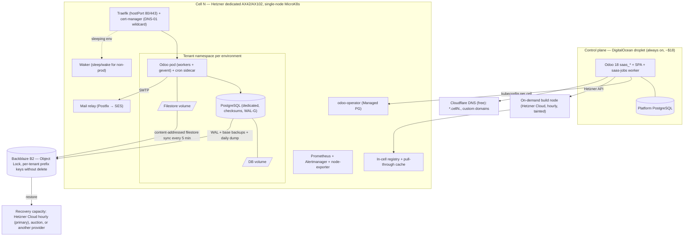
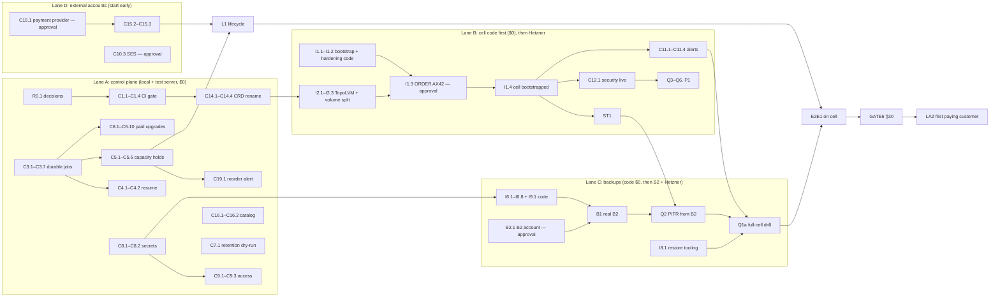
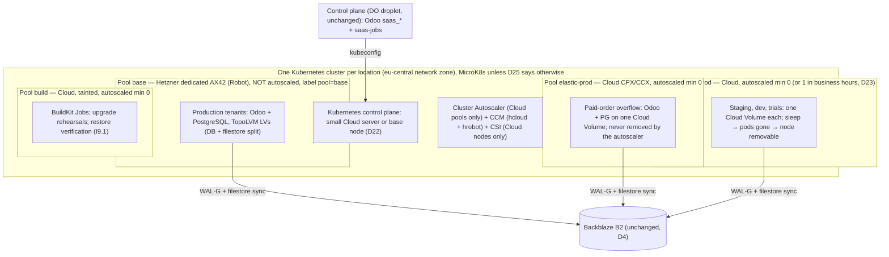

# Veltnex Managed Hosting — Master Plan

**Revision 5.2 · 2026-10-13 · Status: revision 5 ACCEPTED by the owner as the architectural baseline, subject to the validation gates in §30.** Revision 5.2 only reorganizes execution: §25 is now the execution roadmap (session rules, phases PH0–PH11, milestones M0–M7, dependency graph, cost and approval map, next tasks) and §26 the task catalogue (120 tasks with a tracking table and an evidence log). No architectural, financial or security decision changed. Nothing here is authorized for implementation, purchase or deployment until the owner approves the remaining actions in §29.

**Revision 5.3 (2026-10-15, PROPOSED, not yet accepted):** adds §31, a review of shared multi-node clusters with Hetzner Cloud autoscaling at the owner's request. It proposes decisions D20–D28 and tasks K1.1–K1.7 and K2.1–K2.6. No revision 5 decision changes until the owner answers D20–D28.

Revision 5.1 changes only four things, and every earlier verified finding and decision stands:
- §9.1: server choice by cost per safely hosted tenant;
- §17.6: a lead-time reorder point replaces the fixed 60% server-ordering threshold;
- §15.7: restore verification, and real-B2 gates before any customer-facing recovery promise;
- §26: an implementation-ready backlog.

Revision 5 was a consistency and risk review of revision 4. It changes the storage engine, the backup key model, the filestore backup method and the DR rules, corrects four financial statements, and replaces the launch checklist with a go/no-go gate (§30). Every change is listed in Appendix A.

This file replaces revision 2 (git `b7c0aa0`; a local copy is kept outside the repository) as the single authoritative Managed Hosting plan. [PLAN-byos.md](PLAN-byos.md) remains the separate BYOS plan and is not changed by this document.

## How to read this plan

**Evidence tags.** Every material figure carries one:

| Tag | Meaning |
|---|---|
| **[CODE]** | Verified in this repository (`file:line`), at `b7c0aa0` |
| **[ODOO]** | Verified in Odoo upstream source (16.0–19.0), read 2026-10-13 |
| **[MEAS]** | Measured (local lab, the live control-plane server, or the DOKS test cluster) |
| **[DOC]** | Provider/vendor price or documentation read 2026-10-13 |
| **[ASSUMP]** | Assumption, used only as a scenario input |
| **[P]** | Policy the owner must confirm |
| **[TEST]** | Not yet benchmarked; the plan names the test and its budget |

**Money.**
- EUR→USD at 1.15 [ASSUMP]. Hetzner prices exclude VAT.
- "Cash" means money paid out. "Economic" adds founder hours valued at $25/h [ASSUMP].

**Evidence files** are kept in branch `worktree-founder-review`. Some are not yet committed (§29 D12 proposes merging them):

| File | Contents |
|---|---|
| `experiments/storage-backup-lab/` | Per-instance volume boundary; PITR + filestore consistency |
| `experiments/shared-pg-lab/` | Shared vs dedicated PostgreSQL. Steps M1–M5 cover memory, isolation, quotas, tenant PITR and the Odoo notification leak |
| `docs/profit-model-v4.py`, `docs/final-validation-v4.py` | Comparison of DOKS, Hetzner Cloud and Hetzner dedicated |
| `docs/P0.24-database-roles.md`, `docs/P0.1-control-plane-rbac.md`, `docs/P0.19-build-pool.md` | Security runbooks |
| Backup lab B0 (revision 5; local scratch, not in the repository — method and results in Appendix C) | WAL-G, content-addressed filestore sync and restic against an S3 server with Object Lock and per-tenant keys; total host loss and restore on PostgreSQL 14.24 and 16.4 |

The cost model used in this revision (v5) is reproduced in full in Appendix D.

---

## 1. Executive summary

### The decision

**Run Veltnex on self-managed Hetzner dedicated servers from the first paying customer.**

- **Cells.** One server = one single-node MicroK8s "cell", running the existing operator and bootstrap. Volumes on **TopoLVM** over the server's RAID1 (§14).
- **Control plane.** Stays on the small existing DigitalOcean droplet, at a different provider from the cells.
- **Backups.** Immutable copies in Backblaze B2: WAL-G for every production database, content-addressed sync for the filestore, one prefix-scoped key per tenant that cannot delete (§15).
- **Recovery.** No standing spare. A tested cold restore onto hourly Hetzner Cloud capacity, with auction and cross-provider paths as alternatives (§15). No paying customer before a full-cell drill passes (§30).

The founder's DevOps skill is what makes this the cheapest **safe** design. DOKS is no longer the launch platform.

### Why

**1. Cost.** Infrastructure per customer for the same customer mix, at list prices, base scenario (§21):

| Customers | Hetzner dedicated | DOKS | Hetzner Cloud |
|---|---|---|---|
| 5 | **$28** | $60 | $74 |
| 50 | **$15** | $35 | $37 |
| 250 | **$13.7** | $33.5 | $35 |

Every row includes backups, DNS, the control plane and the build pool. The gap is about 2.5× at every size, larger than the founder's extra operating time (§9).

**2. Flexibility.** Hetzner dedicated servers have no minimum term, are billed hourly up to a monthly cap, and can be cancelled immediately [DOC]. That removes lock-in. It does **not** guarantee fast replacement: auction stock varies and new AX42 delivery in Germany is "several weeks" [DOC]. Recovery therefore relies on hourly cloud capacity, priced and drilled in §15.

**3. Near-zero idle cost** (§10):

| State | Infrastructure cash per month | All recurring cash incl. business tools |
|---|---|---|
| Dormant: control plane only | **$21** (≈ $13 if the control plane moves to OVH) | $71 |
| Trial-ready: one cell running | **$137** (+ €49 one-time setup) | $187 |
| First customers: the same cell | **$138–140** | $188–190 + payment fees |
| **Today, until DOKS is deleted (I7)** | +$37 on every line | — |

The waker is the always-on control plane. A Kubernetes cluster cannot wake itself. Sleeping workloads save **no cash** on a cell that is already paid for; they only postpone the next cell (§10).

**4. Dedicated PostgreSQL per environment stays** (confidence high). Shared PostgreSQL saves $0.9–2.7 per Starter customer per month. It was rejected on measured and verified evidence (§13):

- one tenant filled the shared WAL and stopped every tenant in 8.4 s;
- restoring one tenant needs a temporary copy of the whole shard;
- PostgreSQL has no hard per-tenant quota;
- Odoo's bus and cron leak tenant metadata through the shared `postgres` database.

**5. Prices to test:** Lite **$29**, Starter **$59**, Business **$129**, Scale **$279**, Dedicated from **$349**.

At list price, monthly billing, in a fleet of 100 customers of that plan (definitions in §19.1):

| Plan | Infra cost/month | Hosting gross margin | Margin after payment fees | Contribution after support, before acquisition |
|---|---|---|---|---|
| Lite | $5.1 | 82% | 76% | $15.7 |
| Starter | $9.9 | 83% | 77% | $33.1 |
| Business | $22.0 | 83% | 78% | $75.1 |
| Scale | $41.8 | 85% | 80% | $172.7 |

These are **full-occupancy** figures. On a cell that is only partly full, the cell is a fixed cost: the blended infra cost is $28 per customer at 5 customers (§21). The cost of adding one more customer while the cell has room is only $0.25–2 a month (§19.1). Each price has a test arm and a numeric decision rule (§19).

**6. Break-even** (base scenario [ASSUMP]; real minimum infrastructure: one whole AX42, control plane, domains, tools, fees, backups):

| Measure | Customers |
|---|---|
| Monthly cash break-even, founder unpaid, base mix | **3** (4 while DOKS still runs) |
| Same, if every early customer is Lite / Starter / Business | **8 / 4 / 2** |
| Economic break-even (all hours paid at $25/h) | **24** |
| Founder after-tax income ≥ $2,000/month | **45** |
| Founder after-tax income ≥ $4,000/month | **89** |

Monthly break-even is not cumulative break-even. When each new customer costs $150 to acquire [ASSUMP] and growth is 2 net new customers a month, cumulative cash bottoms at **−$655** and recovers in month 7, at 14 customers (§21.3).

**The conservative scenario never reaches economic break-even.** Its inputs are support × 1.5, churn 5% and a $400 acquisition cost. The support boundary and a partner-first sales strategy are therefore conditions of the business, not optimizations.

**7. Critical code gaps before the first paying customer** (§6, §26):
- no resume after an overdue invoice is paid;
- the paid → deploy step runs in an untracked thread;
- no capacity check before payment;
- backups are off unless the customer buys an add-on;
- one platform-wide bucket key is copied into every tenant namespace;
- push-capable registry credentials are copied into every tenant namespace;
- Odoo memory limits are derived from the pod limit and do not match Odoo's per-worker check;
- no point-in-time recovery;
- no PostgreSQL data checksums;
- no host hardening;
- CI does not gate deploys;
- secret encryption is optional.

### Confidence by decision

| Decision | Confidence | What would change it |
|---|---|---|
| Dedicated PostgreSQL per environment | High | Nothing short of new isolation evidence |
| Hetzner dedicated for cells | Medium–High | Q1a restore RTO, or Q5 maintenance downtime, worse than targets |
| No standing spare server | Medium | Q1a full-cell drill misses the RTO, or cloud capacity is repeatedly unavailable |
| Backup design (WAL-G + content-addressed filestore + per-tenant keys) | Medium–High (lab B0 on an S3 emulator) | B1 on real B2 |
| Storage engine: TopoLVM | Medium | ST1 acceptance fails → Longhorn, already vendored |
| Sleep for non-production | Medium | S1–S3 wake latency |
| Prices | Low | No demand data yet; decided by the price test |

---

## 2. Founder objectives and constraints

**Objective:** maximum sustainable net profit at competitive prices.
- Near-zero idle cost.
- Low variable cost and high safe density.
- Automated lifecycle and customer self-service.
- Strong isolation and tested recovery.

**Founder capability.** The founder knows Odoo, PostgreSQL, Linux, Kubernetes and DevOps. Self-managed infrastructure is acceptable when it improves profit without unacceptable risk. Founder time is capped at **140 h/month** [ASSUMP] and is costed at **$25/h** in economic profit [ASSUMP].

**Standing owner decisions this plan keeps:**

| Topic | Decision |
|---|---|
| Margin | 60% gross margin at launch, 70%+ at scale; never at the cost of security or production stability |
| Production | Never sleeps. No production HA for now, but the chart stays HA-ready (P1.44) |
| Sleep | Dev after 1 idle hour, staging after 2, trials after 1 |
| Database roles | No tenant PostgreSQL superuser (P0.24) |
| Control plane | Lives at a different provider from tenant cells (P12) |
| Backups | In every plan; immutable off-site copy |
| Domains | Custom domains are a launch feature |
| Mail | AWS SES behind a platform relay; no AWS credentials in tenant namespaces |
| Odoo Enterprise | Behind a legal gate |
| Zero downtime | Every customer-initiated flow is a rolling update; cross-cell moves at a customer-chosen time are the only exception |
| SLA | Uptime target published, no SLA until HA is proven |
| Platform DB backups | Managed by the owner outside this plan |
| Estimates | Plans carry only measured cost/effort or clearly tagged [ASSUMP] scenario inputs (owner rule, 2026-10-13) |

**Superseded owner decision:** "PostgreSQL out of Kubernetes on shared VM shards" (A23/A24, 2026-10-11) is replaced by dedicated PostgreSQL per environment on the cell. The reasons are the measured evidence in §13 and the cell storage in §14.

---

## 3. Verified current project status

### Live footprint today [MEAS, read-only, 2026-10-13]

| Component | Detail | List price |
|---|---|---|
| Control plane | DigitalOcean droplet, fra1, Ubuntu 24.04: 2 vCPU, 2 GB RAM (1.16 GB used), 58 GB disk. Runs nginx, PostgreSQL 16, `saas-odoo` and `saas-jobs` | ≈ $18 [ASSUMP: DO 2 vCPU/2 GB tier; not re-read today. $12 for 1 vCPU/2 GB and $24 for 2 vCPU/4 GB were confirmed (DOC)] |
| DOKS test cluster | One s-2vcpu-4gb node (2.93 GiB allocatable), one DO LoadBalancer, one 8 GiB Prometheus volume, **no tenants** | $24 + $12 + $0.80 |
| **Idle spend** | | **≈ $55/month** |

**Platform and images**
- Platform images are on Docker Hub (`moutazmuhammad/*`, public).
- The tenant Odoo base images are `docker.io/library/odoo`, so pulls are subject to anonymous rate limits [CODE `saas_odoo_version_data.xml:5`; DOC].

**Code size**
- Control plane: Odoo 18 addons `saas_core`, `saas_billing`, `saas_website`, `saas_iam`, with 59 test files (~842 tests).
- Operator (Go, kubebuilder): 90 test functions; the envtest suites pass locally [MEAS].
- React SPA served by Odoo.
- Vendored Helm charts: cert-manager, Longhorn, Prometheus, Traefik.
- Backup tool; bootstrap scripts for `saas`, `microk8s` and `doks`.

---

## 4. Repository architecture and code audit

```
control-plane/            Odoo 18 addons (portal, billing, IAM, drivers, job queue, crons)
  saas_core/drivers/      ComputeDriver (base.py:72) → KubernetesDriver (only driver), k8s_builds.py
  saas_core/cli/          saas-jobs worker (4 threads, saas_jobs.py:50)
compute/operator/         OdooInstance CRD + controller (Managed/CNPG/External DB modes)
compute/charts/           odoo-operator chart (+ RBAC/admission policies) + vendored charts
compute/tools/backup-tool pg_dump + filestore tar → S3/PVC; restore script
scripts/bootstrap/        bootstrap.py: saas | microk8s (SSH, Longhorn, hostPort Traefik) | doks
frontend/veltnex/         React/Vite SPA, built into saas_website/static/spa
.github/workflows/        ci.yml (manual only), cd.yml (push to main, no CI gate)
```

### Architecture as built

1. A customer orders and pays.
2. The invoice payment hook starts a background thread.
3. That thread enqueues a `saas.job` deploy.
4. The jobs worker builds the `OdooInstance` CR through `KubernetesDriver`.
5. The operator reconciles. Each environment gets:
   - its own namespace;
   - an Odoo Deployment, with the cron sidecar;
   - a PostgreSQL StatefulSet;
   - one volume holding both the filestore and PGDATA;
   - NetworkPolicy, quota, TLS certificate and route.
6. Prometheus per cluster feeds the customer dashboard.

---

## 5. Implemented vs missing

Status legend: **IT** = implemented and tested · **IU** = implemented, unverified live · **P** = partial · **PL** = planned only · **M** = missing · **D** = defective · **X** = unnecessary.

| Capability | Status | Evidence |
|---|---|---|
| Order → invoice → payment → deploy job | IT, with one non-durable step | `saas_website/controllers/api.py:550`; `saas_billing/models/account_move.py:252` (thread); core `saas_instance.py:4670,4806` |
| Job queue (idempotency, SKIP LOCKED, backoff, heartbeat, reaper) | IT | `saas_job.py:104,224-293,473` |
| Package sizing (Odoo 0.5 CPU / 512 MiB per worker; cron limit/4 ≤ 512 MiB; PG 0.25 CPU / 256 MiB per worker, floor 512 MiB; requests = 25% of limits) | IT | `saas_plan.py:120-226` |
| Plan upgrade (prorated) → `set_package` (rolling Odoo, in-place PG resize, online volume grow, quota) | IT | `saas_billing/.../saas_instance.py:2757,2919,3039`; `kubernetes_driver.py:837` |
| Plan downgrade at cycle end, refused if usage ≥ 75% of target | P | `billing:3114`; sends a smaller volume size that cannot shrink |
| Failed package patch after billing change converges | **D** | Logged only, `billing:3102-3111` |
| Capacity admission | **P** | Only "cluster reachable" at order time (`saas_region.py:93`). `_has_capacity_for` checks limits, all caps default 0 = unlimited (`saas_server.py:148-165,447`). Pending → failed after 24 h, no refund (core `:4035`) |
| Staging/dev environments, DB copy with PII masking and neutralization | IT | core `:1268,5000,3532,3548` |
| Suspend for nonpayment | IT | `billing:2426` |
| **Resume after paying an overdue invoice** | **M** | No suspended branch in `_saas_check_instance_payment`; `action_portal_start` requires `stopped` (core `:6251`) |
| Resume after buying storage | **D** | `billing:1044-1045` calls `action_reactivate()` without args; the storage check only scans `running` |
| Cancellation | IT | `_do_delete_instance_locked` (core `:5277`): **immediate** namespace/volume deletion, one retained snapshot |
| Retention / purge of long-suspended tenants and expired trials | **M** | No cron; their volumes live forever |
| Trials (14 d, one per partner, expiry suspends) | P | No purge, no sleep |
| Idle sleep / wake | **M** | Only manual `spec.suspended` (`suspension.go:85-130`) |
| Backups: `pg_dump -Fc` + filestore tar to S3, keep 7 | IU (mock-tested) | `run-backup.sh`. **Only with the paid add-on** (`kubernetes_driver.py:701-756`) |
| PITR / WAL archiving | **M** | None |
| Deferred filestore deletion | **X** (revision 5) | Odoo already defers deletion: `_file_delete` only adds the file to a checklist, and `_gc_file_store` removes it in the daily `@api.autovacuum` run [ODOO 17.0/18.0 `ir_attachment.py:149-167`]. Revision 4 said "unlinks immediately"; that was wrong. The lab's 20/60 loss modelled GC running between filestore snapshots. With the content-addressed filestore sync (§15), the bucket keeps every file for the retention window, so a platform addon is not needed |
| Restore as non-superuser | **D** | `pg_restore: must be owner of extension pg_trgm` with `--exit-on-error` (`run-restore.sh:129`) [MEAS local test] |
| PostgreSQL data checksums | **M** | No `--data-checksums` / `POSTGRES_INITDB_ARGS` in the operator |
| Tenant DB roles: no superuser; Odoo role owns the DB with CREATEDB (P0.24) | IT, not deployed | `database_roles.sh:12,19,97-110` |
| Tenant isolation: namespace per environment, PSS restricted, default-deny NetworkPolicy, HTTPS egress to public IPs, automount off | IT, CNI enforcement not live-verified | `tenancy.go:26-46`; `networkpolicy.go` |
| Control-plane RBAC + admission (P0.1), build pool (P0.19) | IT, not deployed | Chart templates; `k8s_builds.py` |
| Secrets | **P** | `EncryptedChar` fields exist but encryption is **opt-in** (no key = plaintext, `crypto.py`). Bucket keys are plaintext `ir.config_parameter` (`res_config_settings.py:93-118`). One global bucket key is copied into every backup-enabled namespace (`kubernetes_driver.py:729-746`). Push-capable registry credentials are copied into every namespace (`k8s_builds.py:479-506`) |
| Login/OTP rate limiting | **D** | Keyed on spoofable left-most `X-Forwarded-For` (`api.py:163-170`) |
| Staff 2FA | **M** | No `auth_totp` |
| Payments | P | Generic Odoo `payment.provider`, country routing, token charges (`saas_payment.py`). No MoR module. Test-mode providers accepted in `charge()` (`:269`) |
| Setup fee | M | — (this plan drops it, §19) |
| Plan catalog as module data | M | Seeds/demo only (`saas_demo_data/hooks.py`). Code price = $10/worker + $0.30/GB (`saas_pricing.py:46-63`) |
| Cost/margin per tenant | P | Rate card defaults to $0 (`saas_server.py:190-203`) |
| Ingress/TLS | IT | Traefik (DOKS LB, or hostPort DaemonSet on MicroK8s); cert-manager HTTP-01 per instance |
| Custom domains | **M** | Single `domain.hostname` (`odooinstance_types.go:222-229`) |
| Outgoing mail | **M** | Tenant SMTP egress blocked (`networkpolicy.go:129-132`); no relay |
| Monitoring | P | Prometheus per cluster; **Alertmanager and node-exporter disabled** (`prometheus-values.yaml:35-39`); no external probe |
| Git builds (BuildKit rootless Job, tainted pool, admission policy) | IT | `k8s_builds.py`; `build-pool-admission.yaml` |
| CI on push / CD gated on CI | **M / D** | `ci.yml:3-7` manual only; `cd.yml:36` no gate |
| Bootstrap: DOKS; MicroK8s over SSH with Longhorn + hostPort Traefik; control plane over SSH | IT | `scripts/bootstrap/bootstrap.py:155-321`; `test_bootstrap.py` |
| Host hardening (firewall, unattended upgrades) | **M** | `ubuntu_microk8s.py` installs packages only |
| Export download (Odoo-format zip, presigned URL) | IT | `saas_instance_backup.py:12-27` |
| Odoo versions | P | Only 20.0 seeded (17/18/19 in demo data); any `N.0` accepted |
| CloudNativePG DB mode | **X** | `cnpg.go`: never used, not vendored |
| `saas_instance_container` seam, `KubernetesDriver.set_resources`, SSH/paramiko stack, `_cron_check_container_health` shim | **X** | Dead per audit |
| BYOS install script | Out of scope | Governed by PLAN-byos.md |

---

## 6. Existing problems and technical debt (prioritized by profit and launch impact)

| # | Problem | Evidence | Impact | Fix size |
|---|---|---|---|---|
| T1 | Paying an overdue invoice does not resume the tenant | §5 | Paying customers stay down | M |
| T2 | Paid → deploy runs in `run_in_background` threads, which commit the accounting transaction part-way; no recovery for `state='paid'` | `account_move.py:252,287`; `utils.py:185` | Lost deploys after payment | M |
| T3 | No capacity admission before payment | §5 | Paid but unserved orders, or overcommitted nodes | M |
| T4 | Backups opt-in, unencrypted, global bucket key in every namespace; no PITR; restore defect; no data checksums | §5 | Data loss or backup tampering | M–L |
| T5 | Billing switches even when the resource patch fails; nothing converges | `billing:3102-3111` | Revenue and resources drift apart | S/M |
| T6 | Long-suspended tenants and expired trials never purged; cancellation purges immediately with no grace | §5 | Storage cost forever; accidental data loss | M |
| T7 | Odoo per-worker `limit_memory_*` derived from the **pod** limit. Odoo checks these per worker against **virtual** memory [ODOO `server.py`]. Requests are 25% of limits, but capacity and cost use limits | `deployment.go:262-273`; `saas_plan.py:140` | OOM kills before worker recycle; 4× memory overcommit | S |
| T8 | Control-plane polling grows with tenants: reconcile is 2 K8s calls per tenant every 5 min in one transaction, with a new API client each time; runtime health is up to 6,000 calls/h; backup sync 4N/h. **About 10.3k K8s calls/h at 100 tenants and 35.5k/h at 1,000.** The SPA polls `/status` every 12 s, doing live K8s and HTTP calls inside HTTP workers | core `:5757,1580`; `saas_instance_health.py:168`; `InstancesContext.tsx:16` | Control-plane cost and latency at scale | M |
| T9 | Instance list N+1 (`_get_all_invoices` with `ilike` per instance) on every 12 s poll | `api.py:850-866,2298`; `billing:485` | DB load × tenants × viewers | S/M |
| T10 | Secrets encryption opt-in; plaintext bucket keys; push-capable registry credentials in tenant namespaces | §5 | One leak exposes all backups and images | M |
| T11 | Spoofable rate limit; no staff 2FA (staff hold the browser "Cluster Shell") | §5 | Account and cluster takeover | S |
| T12 | CRD group `saas.odoo.example.com/v1alpha1` placeholder | `groupversion_info.go:13` | Renaming after launch needs CR migration; trivial now | S/M |
| T13 | `saas.job` rows never deleted; webhook verification queues a ping job per repo every 15 min | `saas_job.py`; core `:4295` | ~96 rows per repo per day | S |
| T14 | 4 job threads shared by deploys, backups and builds | `saas_jobs.py:50` | Bursts queue | S |
| T15 | DigitalOcean assumptions | `bootstrap.py:76-78` (providerID), `doks.sh`, Spaces endpoint with an invalid `us-east-1` fallback (`saas_instance_backup.py:415-436`), `scripts/deploy/local.py:366-410` defaults, `check-build-pool.py` doctl | Blocks clean multi-provider | S each |
| T16 | Renewals invoiced only for `running`; stopped/suspended tenants hold storage unbilled | `billing:1999-2005` | Unpaid storage | S |
| T17 | Dead code: CNPG mode, container seam, SSH stack, `set_resources`, four backup storage backends | §5 | Maintenance cost | S |

---

## 7. Architecture alternatives (compared on total cost)

### 7.1 Compute provider (same customer mix; infrastructure cash per month, base [ASSUMP] profiles)

Hetzner dedicated cost per customer at sizes not shown here is in §21.1.

| Customers | **Hetzner dedicated (AX42-1 cells)** | DOKS (s-8vcpu-16gb + LB + build node) | Hetzner Cloud k3s (CPX62 + volumes + LB) |
|---|---|---|---|
| 0 (trial-ready) | $137 | $178 | $203 |
| 5 | **$140** | $298 | $369 |
| 20 | **$337** | $753 | $870 |
| 50 | **$748** | $1,760 | $1,870 |
| 100 | **$1,359** | $3,439 | $3,537 |
| 1,000 | **$13,283** | $32,985 | $34,901 |
| What binds | Disk on AX42 / CPU on AX102 | DO 15 volumes per node (3.35 volumes per customer) | CPU and volumes |

Sources and inputs:

| Input | Detail |
|---|---|
| Hetzner dedicated prices [DOC] | AX42-1 €97.30 + €1.70 IPv4, setup €49; AX102-1 €257.30, setup €129 |
| DOKS prices [DOC] | s-8vcpu-16gb $96 (13 GiB allocatable); LB $12; volumes $0.10/GiB; **15 volumes per node** |
| Hetzner Cloud prices [DOC] | CPX62 €129.99 since the **2026-06-15 price increase** (CCX/CPX ×2.1–2.8; CX/CAX "not available"); volumes €0.0572/GB; **16 per server** |
| Profiles | Code limits [CODE]; occupancy and awake share [ASSUMP] |

**Founder operations** [ASSUMP]:
- Dedicated: 2 h/server/month, plus 8 h per hardware incident at 0.5 incidents/server/year.
- DOKS: about 0.25 h/node.

At 5 customers the cash difference ($158/month) exceeds the extra founder time valued at $25/h. At 50 customers it is ~$1,000/month against ~12 extra hours.

**Other providers.** OVH, Netcup and Contabo dedicated servers are not modelled as cells; their prices were not verified. They are second-provider DR candidates later (§9).

### 7.2 Recovery models for dedicated cells

| Model | Standing cost | RTO | RPO | Verdict |
|---|---|---|---|---|
| **Cold, cloud-first** (recommended) | $0 standing; ≈ $3 per drill | Provision + bootstrap + restore from B2 (§15.4 formula, measured in Q1a) | DB ≤ 5 min, filestore ≤ 5 min (§15.2) | Chosen. Hetzner Cloud CCX43 (16 vCPU, 64 GB, 360 GB) costs €0.4423/h with a €275.99 monthly cap; CCX53 (128 GB, 600 GB) €0.855/h [DOC]. Hourly capacity does not depend on auction stock. Data is on local disks, so any recovery is a restore |
| Cold, auction or new dedicated | $0 standing | Auction delivery is "usually within a few minutes" when suitable ECC stock exists [DOC]; new AX42 "several weeks" in DE | Same | Second path, and the permanent home after a cloud recovery. Not relied on for the RTO |
| Warm spare server | +1 server ($116) | Restore time only | Same | Rejected: pays for capacity that does not cut the dominant term (restore). Reconsider at ≥ 10 cells as a shared spare |
| Hot (streaming replica per tenant) | ~2× PostgreSQL RAM + disk | Minutes | Seconds | Sold later as a Scale/Dedicated HA option only (owner A25) |
| Cross-provider | $0 standing | Cold + DNS | Same | Same B2 data and the same MicroK8s bootstrap on any Ubuntu VM. Targets: DigitalOcean droplet or DOKS (code exists). Drilled yearly (Q1c) |

### 7.3 Other components

| Component | Options | Choice |
|---|---|---|
| Kubernetes on a cell | **MicroK8s** (bootstrap exists and is tested [CODE]) · k3s (server ~1.6 GB with workload [DOC]; new bootstrap) | **MicroK8s** (reuse; overhead under 3% of 64 GB). Revisit only if a test shows a problem |
| Storage engine | Longhorn single-replica (vendored 1.12.1 [CODE]) · **TopoLVM** · local-path · OpenEBS hostpath with XFS quotas | **TopoLVM** (decided in revision 5; comparison in §14). Longhorn stays vendored as the fallback |
| PostgreSQL | Dedicated per environment · shared CNPG · shared plain PG · hybrid | **Dedicated** (§13) |
| Filestore | Native volume · OCA `fs_attachment_s3` (16–19 only, Beta [DOC]) | **Native volume**; S3 by trigger (§14) |
| Builds | Always-on tainted pool (today) · **on-demand Hetzner Cloud build node** | **On-demand**: ~€0.05/h, deleted after 15 min idle |
| Registry | Docker Hub · GHCR (container storage/bandwidth "currently free" [DOC]) · **in-cell zot/distribution** | Platform images on **GHCR**. Tenant images in an **in-cell registry** with per-tenant pull-only credentials (P0.3), plus a pull-through cache for `library/odoo` |
| Ingress | DO LB ($12) · Hetzner LB11 (€7.49) · **hostPort Traefik + DNS** | **hostPort Traefik** (exists [CODE]); $0 |
| DNS | **Cloudflare free** (API, proxiable wildcards [DOC]) | Cloudflare, **DNS-only (not proxied)** for tenant records: the free proxy caps uploads at 100 MB [DOC], which would break large attachments and restores |
| TLS | HTTP-01 per instance (today) · **DNS-01 wildcard per cell** | Wildcard for platform subdomains: Let's Encrypt allows 50 new certificates per registered domain per week [DOC, read from the vendor repo]. HTTP-01 for custom domains |
| Object storage | DO Spaces ($5 minimum) · Hetzner Object Storage (€6.49 minimum) · **Backblaze B2** ($6.95/TB, first 10 GB free, Object Lock free [DOC]) | **B2** |
| Monitoring | Prometheus per cell (exists) + Alertmanager + node-exporter; UptimeRobot free (50 monitors / 5 min, commercial use allowed) or Healthchecks.io free [DOC] | As listed; $0 |
| CI | GitHub Actions | The repository is public (GitHub API returned 200 unauthenticated, 2026-10-13 [MEAS]), so standard runners cost $0. If it is made private, the free minute allowance applies and CI may become a recurring cost |
| Logs | Loki/Grafana Cloud free (50 GB) · stdout + `kubectl logs` | stdout now; Grafana Cloud free if needed |
| Mail | Customer SMTP · **platform relay → SES** ($0.10/1,000 [DOC]) | Relay (owner decision) |
| Control plane host | Existing DO droplet (~$18) · OVH VPS-2 (€8.49 no commitment, 4 vCore / 8 GB [DOC]) | Keep DO now; optional move to OVH (§26 X5) |
| Payments | Stripe (country support for the owner's entity unverified) · **Paddle / Lemon Squeezy MoR** (5% + $0.50 [DOC]) | Owner decision D6 |

---

## 8. Selected target architecture and rationale



### Rationale

| Principle | How the design meets it |
|---|---|
| Every always-on component justifies its cost | Only the control plane ($18) and the cells that hold customers |
| Shared components are cell-wide, never data-bearing across tenants | Traefik, registry, relay, monitoring |
| Data isolation is physical | Per-tenant PostgreSQL process, WAL and volumes |
| Reuse existing code | Operator, driver, bootstrap (MicroK8s + hostPort Traefik), job queue, billing. The one component swapped is the storage engine (Longhorn → TopoLVM), a StorageClass setting, not operator code (§14) |
| Provider-specific code sits behind small adapters | Server ordering (Hetzner Robot/Cloud API), DNS (Cloudflare), object storage (S3 API) |

### Existing stack: kept, changed, not introduced (revision 5)

| | Components | Reason |
|---|---|---|
| **Kept as is** | MicroK8s bootstrap over SSH; operator + `OdooInstance` CRD in Managed-PG mode; `KubernetesDriver`; `saas.job` queue; hostPort Traefik; cert-manager (HTTP-01); vendored Prometheus; backup tool (extended, not replaced); Helm charts vendored locally | Working and tested [CODE]; no profit or risk case for replacing them |
| **Changed** | Storage engine Longhorn → TopoLVM (a StorageClass and bootstrap change) | Recovery without Kubernetes; no unused replication layer; cheapest before the first customer (§14.3) |
| | Backup key model and filestore method | Measured failures in lab B0 (§15) |
| | Capacity checks → hold ledger | Customers can be charged for resources that cannot be allocated today (§17.4) |
| **Not introduced** (multi-node and autoscaler under review: §31, D20) | CNPG or shared PostgreSQL, Ceph or replicated storage, multi-node cells, cluster autoscaler, service mesh, external secret store, managed databases | No measured economic or safety case at this stage |

---

## 9. Infrastructure provider strategy

### Roles

| Role | Provider | Why | Monthly |
|---|---|---|---|
| Control plane | DigitalOcean (existing droplet) | Already running; separate provider from cells (P12) | ~$18 |
| Cells | **Hetzner dedicated**, Germany FSN1/NBG1 (closest to MENA of the Hetzner sites [ASSUMP latency]) | ~2.5× cheaper than DOKS/Hetzner Cloud per customer; unlimited traffic at 1 Gbit [DOC]; no minimum term [DOC] | $114 per AX42-1 (€99 incl. IPv4) |
| Build nodes, test machines, emergency capacity | Hetzner Cloud (hourly) | Seconds to create; hourly billing with monthly cap [DOC] | Cents per build |
| Cold recovery | Hetzner Cloud CCX43/CCX53 hourly (primary); Hetzner auction (minutes when stock exists, no setup fee [DOC]); DigitalOcean (cross-provider) | $0 standing | ≈ $3 per drill |
| Backups | Backblaze B2 (different provider from cells) | Immutable, cheapest [DOC] | ≈ $0.47 per base customer |
| DNS / CDN | Cloudflare free | $0 | $0 |

### Server choices

| Server | Price [DOC] | Use |
|---|---|---|
| **AX42-1** (Ryzen 7 PRO 8700GE, 64 GB **ECC** DDR5, 2×512 GB NVMe) | €97.30 + €1.70, setup €49 | Production default |
| AX42-1-LTD | €77.30, setup €39, while supply lasts | Preferred if available |
| AX102-1 (128 GB ECC, 2×1.92 TB) | €257.30, setup €129; AX102-1-LTD €157.30, setup €39 | Later cells, by the §9.1 rule; storage-heavy tenants |
| AX41-LTD (64 GB, **non-ECC**, €59, setup €0) and auction non-ECC machines | — | Trials, builds and recovery drills only. **Never** production databases |

**Delivery:** AX42-1 shows "several weeks" in Germany and 2–3 workdays in Finland [DOC, order-processing page]. Order the first cell as soon as D1 is approved, or use HEL1 or an ECC auction machine (Xeon E3-1275 v5/v6, 64 GB ECC, from €67 [DOC]) as the interim pilot cell.

### 9.1 Storage economics: cost per safely hosted tenant (revision 5.1)

**Method.** For each ECC server: monthly price (incl. IPv4, setup over 24 months) ÷ the number of tenants it can hold safely. Safe capacity is the **minimum** of:

| Limit | How it is computed |
|---|---|
| RAM | Usable RAM × 80% |
| CPU | Usable threads ÷ CPU requests [ASSUMP until P2] |
| Disk | **One** disk of the RAID1 mirror × ~0.78 (filesystem, OS, 85% fill), with +15% for WAL, temp and the local dump copy |
| DR cap | §15.4 |

Backups (B2), the control plane and builds cost the same per tenant on every server type, so they are left out of the comparison. Recovery capacity is noted separately below.

| Server [DOC] | USD/month | RAM / threads / usable disk | Base mix: tenants (binding) | **$/tenant** | Lite-heavy | Storage-heavy | Lead time [DOC] |
|---|---|---|---|---|---|---|---|
| **AX42-1** | $116 | 58 GiB / 14 / 405 GB | 9.2 (disk) | **$12.62** | $6.59 | $20.37 | DE several weeks; FI 2–3 workdays |
| AX42-1-LTD | $93 | same | 9.2 (disk) | $10.07 | $5.26 | $16.26 | While supply lasts |
| EX63-1 (Core Ultra 7: 8 P + 12 E cores, 2×1 TB) | $175 | 58 / 18 / 780 | 13.8 (CPU) | $12.68, or $16.91 if an E-core counts half | $7.71 | $18.02 | DE 2–3 workdays; FI minutes |
| EX63-1-LTD | $116 | same | 13.8 (CPU) | $8.39 / $11.19 | $5.10 | $11.93 | While supply lasts |
| AX102-1 (2×1.92 TB) | $304 | 122 / 30 / 1,487 | 23.0 (CPU) | $13.23 | $8.04 | $18.80 | DE 5–6 workdays; FI minutes |
| **AX102-1-LTD** | $185 | same | 23.0 (CPU) | **$8.04** | **$4.89** | $11.42 | While supply lasts |
| AX162-1 (48 cores, 128 GB base) | $721 | 122 / 94 / 1,487 | 32.1 (RAM) | $22.47 | $13.91 | $34.42 | DE 5–6 workdays |
| AX162-1-LTD | $369 | same | 32.1 (RAM) | $11.50 | $7.12 | $17.61 | While supply lasts |

The mixes [ASSUMP]:

| Mix | Lite / Starter / Business / Scale |
|---|---|
| Base | §21 |
| Lite-heavy | 60 / 35 / 5 / 0 |
| Storage-heavy | 5 / 35 / 45 / 15 |

Prices are from the Hetzner price API and the 2026 price-adjustment page. "Usable" figures follow Hetzner's RAID1 note: usable space is one disk minus the OS.

**Findings:**
1. **More NVMe alone does not lower cost per tenant.** Once disk stops binding, CPU requests bind on EX63 and AX102. At regular prices, AX42, EX63 and AX102 land within 5% of each other on the base mix ($12.6–13.2).
2. **Thin filestore (ST2) is the cheaper disk fix on AX42:** at 50% reservation the cost falls from $12.62 to $10.83, then CPU binds.
3. **The largest saving is LTD stock:** AX102-1-LTD is $8.04 per tenant (−36% vs AX42-1); AX42-1-LTD is −20%. Hetzner says LTD servers carry the same service and support, offered "as long as supply lasts" [DOC]. They are an opportunistic buy, not a planning basis.
4. **Bigger cells cost more at small scale.** Steps are $116 (AX42) vs $304 (AX102) per cell. At 10 customers: 2×AX42 $232, 1×EX63 $175, 1×AX102 $304. At 20: 3×AX42 $349, 2×EX63 $350, 1×AX102 $304.
5. **Bigger cells have a bigger blast radius and longer full-cell restores.** At full density and 50% of sold storage used [ASSUMP], a cell holds:

   | Cell | Data to restore |
   |---|---|
   | AX42 | ≈ 176 GB |
   | AX102 | ≈ 440 GB |
   | AX162 | ≈ 613 GB |

   On a 1 Gbit-class link, the AX162 figure endangers the 4 h RTO. The DR cap (§15.4) decides; Q1a must run on the largest cell type in use.
6. **Recovery capacity scales with cell size.** An AX42 cell restores onto a CCX43 (€0.4423/h). An AX102 cell needs a CCX53 (€0.855/h) plus Hetzner Cloud volumes for disk beyond 600 GB. The drill cost stays under $10.
7. **AX162 is rejected:** at the base 128 GB it is RAM-bound and the dearest per tenant.
8. **EX63 stays conditional:**
   - ECC on the base EX63-1 configuration must be confirmed (the page is ambiguous);
   - P2 must show how its hybrid P/E cores perform under Odoo.

**Decision:**

| Rule | Detail |
|---|---|
| First cell | **AX42-1**, or AX42-1-LTD if offered. Lowest step cost and lowest idle cost; unchanged from revision 5. Order in **HEL1** if DE delivery is "several weeks" |
| Each later cell | Choose the type with the lowest $/tenant **for the forecast demand over its lead time** (§17.6), not by RAM or price alone. In practice: buy any **ECC LTD** server on offer (AX102-1-LTD first); otherwise AX42-1 while forecast demand is under ~15 base customers, and AX102-1 when forecast demand fills it within its lead time, or for storage-heavy tenants |
| Never on production | Non-ECC machines (AX41, EX44, non-ECC auction) |
| Not bought | Extra NVMe on AX42/AX102: disk is not the binding limit once thin filestore pools exist; prices were not captured |
| Re-run | This comparison after P2 with measured CPU requests, because CPU binds on every type except a thick AX42 |

### Provider independence: what is portable and what is not

- **Portable** [CODE]:
  - operator and CRD;
  - Kubernetes driver;
  - MicroK8s bootstrap (any Ubuntu over SSH);
  - DOKS bootstrap;
  - S3-compatible backups;
  - Cloudflare DNS.
- **Not portable without an adapter:**
  - server ordering/deletion;
  - storage class (Longhorn/TopoLVM vs DO volumes);
  - ingress mode (hostPort vs cloud LB);
  - IP addressing.
- **Not claimed:** "complete" portability. The tested escape hatches are DOKS (exists) and any Ubuntu server (MicroK8s path).

### DOKS

**Delete the idle DOKS cluster** (−$37/month) after the first cell passes qualification (D2). Keep the DOKS bootstrap path as a $0-idle recovery and premium option.

---

## 10. Zero-customer and low-customer cost strategy

### Component idle analysis

| Component | Must stay on? | Scale-to-zero / alternative |
|---|---|---|
| Control plane (sign-up, payments, webhooks, the waker for everything) | **Yes** | It is the always-on component that can wake anything else. Cost ~$18 (or ≈ $10 on OVH) |
| Cell | Only once trials or customers exist | Dormant mode: no cell; first trial triggers creation |
| Build nodes | No | Created per build, deleted after 15 min idle |
| Non-production environments | No | Sleep after 1–2 h idle (§17) |
| Production environments | **Yes** | Never auto-sleep: crons, mail, integrations, customer expectations |
| Backups (B2) | Data persists | Pay per GB; first 10 GB free |
| DNS, uptime, status page, TLS | Persist | Free tiers |
| Registry | Platform images on GHCR | Free |

### The three cases (infrastructure cash per month; business tools ≈ $50 [ASSUMP] extra)

| Case | Configuration | Infra cash | Notes |
|---|---|---|---|
| **A0 — zero customers, dormant** | Control plane only; no cell | **$21** (≈ $13 with control plane on OVH VPS-2) | A trial sign-up triggers cell creation: auction or Hetzner Cloud server + bootstrap. Expected 15–40 min [TEST Z1, ~€1] |
| **A1 — zero paying, trial-ready** | Control plane + one AX42 cell | **$137** (≈ $114 with AX42-LTD) | Instant trials; the same cell serves the first paying customers, so there is no migration |
| **B — 1–9 customers** | Same | **$138–143** | Cold recovery from B2 (§15). Infra per customer **$28** at 5. With thick-provisioned sold storage, one AX42 holds ~9 base-mix customers (disk binds, §23); the 10th adds a second cell |
| **C — growth** | Add a cell when admission (§17) says the next order does not fit | Step: +$114 (AX42) or +$298 (AX102) per cell | §21 tables show the stepwise cost; per-customer cost falls to $15 at 50 and $13–14 at 100–1,000 |

**Recommendation:**
- Stay in **A0** while building and testing. Use hourly Hetzner Cloud machines for tests.
- Move to **A1** the week public marketing starts.

The AX42 setup fee (€49) is the only sunk cost of starting a cell. Cancellation is immediate [DOC]. Every new AX42 order pays it again, so do not cycle between A0 and A1; auction servers have no setup fee.

### Recurring-cost audit (revision 5)

**What the $21 dormant and $137 trial-ready figures include:**

| Line | A0 | A1 | Source |
|---|---|---|---|
| Control-plane droplet | $18 | $18 | [ASSUMP price, measured size] |
| Domains | $3 | $3 | [ASSUMP] |
| AX42-1 incl. IPv4 (€99) | — | $113.85 | [DOC] |
| AX42 setup €49 spread over 24 months | — | $2.35 | Cash is €49 ($56) in month 1 |
| B2, builds, mail | $0 | $0 | First 10 GB of B2 free [DOC]; nothing runs |
| **Infrastructure** | **$21** | **$137.2** | Reproduced by Appendix D |

**Recurring lines outside those figures:**

| Line | Amount | Note |
|---|---|---|
| Business tools | $50 [ASSUMP] | Shown separately everywhere; included in all cash-profit figures |
| DOKS test cluster | $37 | Billed today until I7 |
| Droplet backups, if enabled at DigitalOcean | ≈ 20% of the droplet [ASSUMP] | Platform DB backups are owner-managed |
| GitHub Actions, GHCR | $0 | Public repository [MEAS]; changes if it becomes private |
| Cloudflare, UptimeRobot, Let's Encrypt | $0 | Free tiers [DOC] |
| Payment provider | $0 fixed | Percentage fees only [DOC] |
| Hetzner Cloud build or drill machines | $0 when deleted | Billed while they exist, even powered off; primary IPv4 €0.50/month while allocated [DOC] |
| B2 after cancellations | Locked bytes stay billed until Object Lock retention ends | Small (§15.6) |

**What sleeping saves:**

| Resource | Billed while the workload sleeps? |
|---|---|
| Dedicated cell | **Yes**, the full month. Sleep frees RAM, which only postpones the next cell |
| Tenant volumes (DB and filestore) | Yes, as disk on the cell |
| B2 backups | Yes, per stored GB |
| Hetzner Cloud server that is powered off | **Yes**. Only deletion stops billing |
| Build nodes | No, once deleted after 15 min idle |
| Control plane | Yes, always on |

**Only a cancelled cell is truly zero.** That is case A0.

### What "near-zero" honestly means

- A dormant platform costs about **$13–21/month** in infrastructure.
- No production customer can be hosted at zero idle cost. A cell must run to answer requests.
- Cluster scale-to-zero with wake-on-request is possible only because the control plane stays up. **The control plane is the cost of waking**, plus the provisioning delay (Z1).

---

## 11. Compute and Kubernetes architecture

| Topic | Design |
|---|---|
| **Cell** | One dedicated server = one single-node MicroK8s cluster = one `saas.server` record. Cells are independent failure domains; no cross-server cluster networking. Multi-node clusters add nothing while storage is local |
| Control-plane overhead | MicroK8s + Calico + Traefik + cert-manager + Prometheus + operator + registry + relay ≈ 4–6 GiB per cell [ASSUMP; measure in ST1]. The model reserves 6 GiB of 64 |
| **Requests and limits** [P] | **Memory: request = limit** (no memory overcommit for production; non-production may overcommit through sleep, see §17). **CPU: request = measured need, limit = burst** (CPU is compressible; burst within limits is the free elasticity). Kubernetes limits are not guaranteed physical capacity; admission (§17) sums requests, not limits |
| **PriorityClasses** | `platform-critical` > `tenant-production` > `tenant-nonprod` (preemptible) > `build` |
| Bin packing | The scheduler packs by requests. Admission keeps 20% RAM unsold [ASSUMP] plus one surge pod's worth of headroom per cell for rolling updates |
| Rolling upgrades | Existing `MaxSurge 1 / MaxUnavailable 0` [CODE `deployment.go:55-56`]; all pods are on the same node, so RWO is fine |
| **Host maintenance** | A cell reboot means minutes of downtime for **all** tenants on it (single replica, no HA; owner A25). Published monthly maintenance window; unattended security upgrades without auto-reboot; Ubuntu Livepatch (free for 5 machines; commercial-use wording inconsistent [DOC]) or batched reboots. Measured in Q5 |
| **Autoscaling** | Under review in §31 (D20: autoscaled Cloud pools beside a non-autoscaled dedicated base pool). Until decided: no cluster autoscaler on cells. Capacity is added in server steps by admission/alerts (§23). Build nodes are created per job |
| In-place pod resize | GA since Kubernetes 1.35 [DOC]; MicroK8s channel 1.35 [CODE `ubuntu_microk8s.py:24`]. Already used for PostgreSQL resize [CODE] |
| Graceful shutdown | Odoo SIGTERM handling exists upstream; confirm the `terminationGracePeriodSeconds` value in the operator during C2 |

---

## 12. Odoo workload and worker model

### Facts

| Fact | Source |
|---|---|
| Worker count is a process start argument (`--workers`). Changing it needs a pod restart, which the rolling update makes zero-downtime | [CODE `deployment.go:73`] |
| Cron runs in a sidecar with `--workers=0`, so it does not consume HTTP workers | [CODE `deployment.go:203-222`] |
| The gevent process serves `/websocket` (16+) / `/longpolling` (≤15) | [CODE `route.go:114-127`] |
| `limit_memory_soft/hard` are per worker, checked against **virtual** memory on Linux; `limit_time_cpu/real` per request | [ODOO `server.py`] |
| Odoo guidance: workers = 2×CPU + 1, ~6 concurrent users per worker, light worker ~150 MB, heavy ~1 GB | [DOC Odoo deploy] |
| `db_maxconn` defaults to 64 per process; the operator does not set it; PostgreSQL `max_connections` stays at the default 100 | [ODOO; CODE] |

### Profiles

Memory today = code limits [CODE], which become guaranteed requests in C2. CPU = proposed request [ASSUMP] / code limit [CODE: Odoo 0.5 per worker (floor 1.0) + cron limit/4 (≤ 0.5) + PostgreSQL 0.25 per worker (floor 0.25)]. Users is a guide from the Odoo docs (≈ 6 per worker), not a guarantee.

| Profile | Odoo workers | Memory | CPU | Users | Upgrade trigger [P] |
|---|---|---|---|---|---|
| **Lite** (production) | 1 | 1.125 GiB: Odoo 0.5 + cron 0.125 + PG 0.5 | 0.45 / 1.5 | ≤ 5 | p95 > 2 s for 3 days, or > 5 active users, or a 1-worker queue stall (one long report blocks everyone) |
| **Starter** (production) | 2 | 1.75 GiB | 0.8 / 1.75 | ≤ 12 | p95 > 2 s, worker saturation > 50% of business hours |
| **Business** (production) | 4 | 3.5 GiB | 1.5 / 3.5 | ≤ 25 | Same |
| **Scale** (production) | 8 | 6.5 GiB | 2.9 / 6.5 | ≤ 50 | Same |
| **Dedicated** | Sized to the server | Whole server | Whole server | Custom | — |
| **Non-production** (staging/dev) | 1 | 1.125 GiB (sleeps when idle) | 0.45 / 1.5 | Developer use | — |

**Changes to validate in P1/P2:**
- Per-worker VMS limits from the measured VMS/RSS ratio, instead of fractions of the pod limit (C2).
- `db_maxconn` 8–16 per process and PostgreSQL `max_connections` sized to workers.
- Lite `limit_time_real` 300 s.
- If heavy PDFs OOM at 512 MiB/worker: a 768 MiB worker (+$0.6/month on dedicated).

**Scaling:**
- **Vertical:** plan change → `set_package` [CODE]. Workers/RAM → rolling restart (zero downtime with surge headroom). PostgreSQL resize in place. Storage grows online.
- **Horizontal:** multiple Odoo replicas are **not supported**. The driver rejects replicas ≠ 1 [CODE `kubernetes_driver.py:518`]; it would need an RWX/S3 filestore and sticky sessions. Scale tier only, later.
- **No seamless automatic worker scaling is promised.** The only automatic elasticity is CPU burst up to the limit.

---

## 13. PostgreSQL architecture

### Decision

**Dedicated PostgreSQL per environment** (Managed mode, existing StatefulSet), PostgreSQL 16 for all Odoo 17/18/19.

**Shared PostgreSQL (CNPG or plain) is rejected, not reopened.** No new evidence justifies it:

| # | Evidence |
|---|---|
| 1 | **Shared WAL failure:** with archiving stalled, one tenant's update loop (data constant at 49 MiB) filled a 96 MiB WAL filesystem in **8.4 s**. The whole cluster PANICked for every tenant. After expansion, 0 acknowledged rows were lost [MEAS lab M3c] |
| 2 | **No native per-database quota** [DOC PG]. In the default tablespace, one tenant filling the disk failed the neighbour's writes [MEAS M3a]. Only a tablespace per tenant on its own filesystem isolates data and temp files [MEAS M3b], and CNPG gives each tablespace its own PVC [DOC] |
| 3 | **Tenant PITR from a shared cluster** = restore the whole shard to a temporary cluster, dump, reload. It works, but temporary disk and time scale with the shard: 925 MiB of temporary disk for a 128 MiB tenant [MEAS M4] |
| 4 | **Odoo bus and cron use the database literally named `postgres`** for `NOTIFY` and `LISTEN imbus` / `cron_trigger` [ODOO `bus.py:152-160,232-235`, `ir_cron.py:533-540`, `server.py:530,552`; 16.0–19.0]. With Odoo's exact SQL, tenant t2 received tenant t1's `[["db_t1","res.partner",7],…]` and `cron_trigger "db_t1"`, and t2 could forge notifications into t1's channels. A dedicated instance received nothing. Revoking CONNECT on `postgres` breaks Odoo [MEAS M5] |
| 5 | **Real memory is not saved:** 8 dedicated instances used 199.5 MiB PSS vs 201.2 MiB for 1 instance with 8 databases under the same load. Only the per-pod reservation floor differs [MEAS M1] |
| 6 | **Saving:** $0.9 per Starter on dedicated servers, $2.7 on DOKS (model v4) |

### Minimize PostgreSQL cost without sharing

| Change | Detail | Status |
|---|---|---|
| PostgreSQL floor | Production 512 MiB, non-production 256–384 MiB | [TEST P1] |
| Connections | Odoo `db_maxconn` 8–16; `max_connections` = 2 × (workers + 3) + 10 | [ASSUMP; TEST P1] |
| **Data checksums** | `initdb --data-checksums` | C-item |
| WAL | `archive_mode` + WAL-G to B2 (`archive_timeout` 60 s; restart once after any restore, §15.2); `max_wal_size` ≤ 1 GiB; `temp_file_limit` | — |
| Non-production databases | Sleep with their environment | — |

**Restore and migration capability (defined and tested by Q2/Q4):**
- Any production tenant can be restored to any point in the PITR window, plus daily logical dumps.
- Tenant moves between cells = dump/restore or WAL-G restore + DNS switch, in a customer-chosen window.
- The External DB mode stays as the escape hatch.

---

## 14. Storage architecture

### 14.1 Decision (final, revision 5)

**TopoLVM** on an LVM volume group over the server's mdadm RAID1 (the two NVMe disks).

| Environment | Volumes |
|---|---|
| Production | A **DB** logical volume (LV), always thick, plus a **filestore** LV, thick at launch and on a thin pool only after ST2 (§14.4) |
| Non-production | One thick LV |

- Longhorn stays vendored and selectable as the fallback if the ST1 acceptance test fails.
- The operator already takes the StorageClass from the CR [CODE `resources/database.go:36`], so the switch is configuration plus bootstrap. Today the bootstrap forces `longhorn` (`bootstrap.py:90-91,310-316`). No operator rewrite is needed.

### 14.2 What protects what

| Failure | RAID1 | TopoLVM, or Longhorn with 1 replica | B2 off-site backups |
|---|---|---|---|
| One NVMe fails | **Protects** | — | — |
| Both disks, controller or whole host lost; provider account lost | **No** | **No** | Only protection |
| Filesystem corruption, operator error, ransomware, bad migration | No (mirrors the damage) | No | PITR + Object Lock |
| One tenant fills its volume | — | Hard size per volume | — |

**No local mechanism protects against losing the host.** On a single node, Longhorn replicas sit on the same disks and add nothing over RAID1. The only protection against host loss is the off-site copy plus a drilled restore (§15).

### 14.3 Comparison

| Criterion | **TopoLVM (LVM LVs)** | Longhorn 1.12, v1 engine, 1 replica | local-path (MicroK8s hostpath) | OpenEBS hostpath + XFS project quotas |
|---|---|---|---|---|
| Hard size per volume | Yes (LV size) | Yes (block device size) | **No** | Yes (quota) |
| Isolation when a volume fills | Own filesystem per volume [MEAS lab: data and inode exhaustion hit only that volume] | Own filesystem per volume | Shared filesystem | Shared filesystem and journal; the quota stops the fill, not shared-filesystem faults |
| Data path | Kernel device-mapper, no extra hop | iSCSI frontend plus per-volume engine and replica processes in user space [DOC] | Native | Native |
| Standing components | Controller, node plugin, lvmd | Manager, instance manager, CSI, UI, engine image | One provisioner | One provisioner |
| Online grow | Yes | Yes | n/a | Yes |
| Thin provisioning | Optional thin pool | Inherent (sparse files) | n/a | Inherent |
| Read data without Kubernetes | **Yes: `lvchange -ay` + `mount`** | Needs Longhorn tooling to rebuild the replica's snapshot chain | Yes | Yes |
| Upgrades | Small chart | Engine upgrade per volume | Trivial | Small chart |
| In the repository today | No: vendor the chart and create the volume group in bootstrap (S/M) | Yes, tested bootstrap [CODE] | Addon | No |
| Protects against host loss | No | No | No | No |

**Why TopoLVM rather than keeping Longhorn:**
1. Replication, Longhorn's main feature, is unused on single-node cells.
2. A cell whose Kubernetes is broken can still be read from local disk with standard LVM tools. That shortens the "repair instead of restore" path (F2 in §15.4).
3. No user-space engine or iSCSI hop on every PostgreSQL write. The gain is **not measured**; ST1 measures it, but the decision does not depend on it.
4. Changing the engine later means moving every tenant volume. Before the first customer it costs one bootstrap change.

**The other options:**
- **local-path:** rejected; it enforces no size limit.
- **OpenEBS hostpath with XFS quotas:** the simplest workable option, but every tenant shares one filesystem and journal. Rejected for DB volumes.

### 14.4 Layout and provisioning policy

| Data | Where | Boundary | Notes |
|---|---|---|---|
| PostgreSQL data + WAL | Thick LV per **production** environment | LV size = sold DB GB × 1.1 | A full WAL stops only that tenant, which recovers losslessly [MEAS v3 lab S5] |
| Filestore | Second LV per production environment | LV size | Kept apart from PGDATA so a full filestore cannot stop PostgreSQL. Both share one volume today [CODE]; the split is part of I2 |
| Non-production | One LV (DB + files) | LV size | Disposable |
| Local fast-restore copy, temp files, logs | Host LVs | — | Counted in the 15% disk overhead [ASSUMP] |
| Backups | B2 (§15) | Per-tenant prefix | — |
| Tenant images | In-cell registry | — | Rebuildable from Git; deleted on purge |

**Thick vs thin.** Thick provisioning reserves every sold GB, which makes disk the binding resource on AX42. With the base mix, one AX42 holds:

| Limit | Customers per AX42 |
|---|---|
| Sold disk (thick) | **9.2** |
| CPU | 10.7 |
| RAM | 15.2 |

Thin filestore pools raise the disk limit, but they turn pool exhaustion into a cell-wide failure. Rules:
- DB LVs are always thick.
- A filestore thin pool only after ST2 passes. The overcommit ratio starts at 1.0 [P] and rises only with measured used-to-sold data.
- Alert at 70%, block new filestore allocations at 80%, never let a pool exceed 90%.
- Beyond that, the lever is AX102 cells (1,487 GB usable) for storage-heavy tenants.

### 14.5 Cost per GB and quotas

| Storage | Cost/GB/month |
|---|---|
| AX42 local disk (405 GB usable at 85% fill for $114) | **$0.28** |
| AX102 | $0.20 |
| B2 | $0.007 |
| DO volume | $0.10 |
| Odoo.sh sells storage at | $0.25 [DOC] |

**Quota enforcement:**
- Hard: LV size.
- Soft: the existing storage state machine (warn80 → full → 7-day grace → restricted) [CODE], and `default_transaction_read_only` at 100%.
- Growth: grow-only expansion through billing; volumes never shrink (C17).

**S3 filestore** (OCA `fs_attachment_s3`, 16–19, Beta [DOC]): only when filestore exceeds 40% of cell disk or a customer needs multi-replica Odoo. It needs per-version tests. Not before.

---

## 15. Backup and disaster recovery

**Mandatory for every production plan.** Backups are no longer an add-on.

### 15.1 Mechanism (revised in revision 5)

| Data | Mechanism | Frequency | Key |
|---|---|---|---|
| PostgreSQL | WAL-G: continuous WAL archive (`archive_timeout` 60 s) plus base backups (full weekly, delta daily) | Continuous | Tenant key |
| PostgreSQL logical copy | `pg_dump -Fc`, kept 7 days: portability, exports, a guard against physical corruption | Daily | Tenant key |
| Filestore | **Content-addressed sync**: upload each new file under its own name, then write one manifest per run. Odoo names filestore files by the SHA-1 of their content, so objects never change | Every 5 min | Tenant key |
| Retention and pruning | Object Lock default retention = plan retention. Pruning after the lock expires uses a maintenance key that never lives on a cell | — | Maintenance key |

**restic and the deferred-deletion addon are dropped:**
- In lab B0, restic could not even initialize a repository without read access. It also deletes its own lock files.
- The content-addressed sync is a small extension of the existing backup tool. Because the bucket keeps every file for the retention window, no deferred-deletion addon is needed (§5).
- Restore to time T = WAL-G to T + the last filestore manifest at or after T.

| Plan | Promise | Self-service |
|---|---|---|
| Lite | Daily restore points 14 d | Support restore |
| Starter | Daily 30 d | Support restore |
| Business | **PITR 7 d** + daily 30 d | Portal restore-to-time (G3) |
| Scale | PITR 14 d + daily 90 d + monthly restore report | Portal |
| Non-production | Daily 7 d | Rebuilt from production on request |

Every plan uses the same mechanism. Plans differ only in retention and self-service.

### 15.2 RPO, measured

| Data | Target [P] | Evidence |
|---|---|---|
| Database | ≤ 5 min, with `archive_timeout` 60 s | Lab B0, PostgreSQL 16.4, kill at a random moment with `archive_timeout` 10 s: the last **5 of 25** commits were lost, exactly those after the last archived segment [MEAS] |
| Filestore | ≤ 5 min | Lab B0, sync every 15 s: after host loss, **38 attachments** committed in the last 9.3 s had database rows but no file in the bucket [MEAS]. Filestore RPO equals the sync interval. Revision 4's daily filestore snapshot meant up to 24 h of broken attachments |
| Right after a restore | Bounded only after a PostgreSQL restart | See below |

**Post-restore archiving defect (lab B0).** After a WAL-G recovery, `archive_timeout` stopped forcing WAL switches:

| Version | Observed |
|---|---|
| PostgreSQL 14.24 | No switch in 3 min, even after a manual `pg_switch_wal()` |
| PostgreSQL 16.4 | No switch in 30 s |

When a second host loss was simulated, every commit on the new timeline (143 of 143) was lost. A restart restored normal switching (checked on 14.24). The cause was not investigated.

**Rules from these findings:**
- The restore job restarts PostgreSQL once.
- It confirms that `pg_stat_archiver` advances before the tenant is marked ready.
- The C11 alert fires on WAL-archive lag over 2 × `archive_timeout` while the WAL position moves.

**Readiness.** During recovery, PostgreSQL accepted read connections as a hot standby before recovery finished: a lab query returned 28 of 240 rows. A restored tenant is ready only when `pg_is_in_recovery()` is false.

### 15.3 Keys and immutability

Tested in lab B0 on an S3 server with Object Lock (versitygw 1.4.1, not B2). B1 repeats every row on B2.

| Test | Result [MEAS B0] |
|---|---|
| Tenant key writes its own prefix / another prefix | Allowed / denied |
| Tenant key deletes its own object; another tenant reads it | Denied; denied |
| Overwrite of a locked object | New version; the old version is kept and readable |
| Delete a locked version with the maintenance or root key (COMPLIANCE) | Denied |
| Shorten COMPLIANCE retention | **Allowed by this emulator.** Vendor-specific; B1 must show that B2 denies it |
| WAL-G `wal-push` and full `backup-push` with a write-only key | Work |
| WAL-G after a restore (new timeline) with a write-only key | **Fails.** WAL-G reads `00000002.history` to check for an overwrite, so archiving stops |
| The same with read access to the tenant's own prefix | Works |
| restic with a write-only key | Fails at `init` |

**Key model (changed from revision 4's write-only key):**
- **Tenant key:** one B2 application key per tenant, restricted to the bucket and the tenant's name prefix. Capabilities: `listFiles`, `readFiles`, `writeFiles`. **No `deleteFiles`** [DOC; verified in B1]. Read access exposes nothing new: the cell already holds that tenant's live data. Object Lock in compliance mode keeps history undeletable.
- **Maintenance key** (pruning after the lock expires) and **restore keys:** held only by the control plane.
- **Restore generations:** every restore gets a new key and a new prefix (`<tenant>/g<N>/`), so a revived old host can never write into the restored tenant's archive.

### 15.4 Disaster scenarios

| # | Event | Data on the host | Recovery path | RPO |
|---|---|---|---|---|
| F1 | One NVMe fails | Intact (RAID1) | Hetzner swaps the disk; RAID resyncs. Downtime only if the swap needs a power-off [ASSUMP]; scheduled | 0 |
| F2 | Power supply, board or RAM fails | Intact | Hetzner repair, **and** start F3 in parallel at T+15 min. Whichever serves first wins; the other is fenced and discarded. Repair time unknown [ASSUMP] | 0 if repair wins |
| F3 | Host lost (both disks, fire, unrecoverable) | Lost | Cloud-first cold restore (§15.5) | ≤ 5 min |
| F4 | No cloud capacity in a location | — | Another Hetzner location (FSN1/NBG1/HEL1) → auction → DigitalOcean. Each step adds provisioning time | ≤ 5 min |
| F5 | Hetzner account lock or provider-wide outage | Unreachable | Cross-provider restore on DigitalOcean (MicroK8s bootstrap on any Ubuntu VM). The control plane and B2 are outside Hetzner (P12) | ≤ 5 min |
| F6 | Corruption, operator error, ransomware | Damaged | Per-tenant PITR to before the event. Object Lock keeps history | Chosen point |
| F7 | Whole data centre lost | Lost | F3 in another location | ≤ 5 min |

**Fencing (new rule).** Once a restore elsewhere is declared, the old host must never serve or archive again:
- revoke its tenants' B2 keys (the restore uses new-generation keys);
- block it with the Hetzner firewall, or power it off;
- wipe it before any reuse.

DNS flips only after fencing.

**Recovery time for a full cell:**

```
RTO(last tenant) = T_detect + T_provision + T_bootstrap + T_restore + T_verify
T_restore        ≈ Σ tenant bytes / (R × p)  +  WAL replay since the last base backup
```

| Term | Value |
|---|---|
| T_detect | ≤ 5 min (C11 alert) |
| T_provision | Hetzner Cloud: minutes [ASSUMP; measured in Q1a]. Auction: minutes, only when stock exists. A new dedicated order is excluded |
| T_bootstrap | MicroK8s bootstrap on a fresh VM [TEST Q1a, Z1] |
| R, p | Restore throughput per stream from B2, and parallel restores (start at 4). Limited by link, B2 and disk [TEST Q1a] |
| WAL replay | ≤ 1 day of WAL, thanks to daily delta base backups |
| Restore order | Scale → Business → Starter → Lite. Non-production last, or rebuilt on request |

**Targets [P]:**
- RTO ≤ 1 h for the first Business or Scale tenant.
- RTO ≤ 4 h for the last production tenant of a full cell.
- RPO ≤ 5 min.

They are **internal targets** until the real-B2 gates in §15.7 pass. After that they may be published as uptime and recovery targets, never as an SLA.

**Maximum tenants per cell (new rule).** A cell may hold no more production tenants, and no more backed-up bytes, than the latest successful full-cell drill (Q1a) restored within the RTO target:

```
max_bytes_per_cell   = 0.75 × R_measured × p × (4 h − T_fixed_measured)
max_tenants_per_cell = production tenants restored in that drill
```

- The admission ledger (§17.4) enforces this cap alongside RAM, CPU and disk.
- Q1a therefore runs at the planned maximum density of an AX42 (about 31 Lite-size or 13 Starter-size production environments, plus non-production), so the DR cap does not bind below the resource ceilings.
- If it does bind, density goes down (cost in §23), never the RTO.

**Running on recovery capacity:**
- A CCX43 costs about $85 per week, capped at $317 per month [DOC]. A server-loss event therefore costs about $3–85 in capacity, plus founder hours.
- Moving tenants back to a dedicated cell is a second, **planned** move per tenant, in a customer-chosen window (the zero-downtime exception).

### 15.5 Server-loss runbook (drilled as Q1a)

1. An alert fires (cell down, RAID or node-exporter): this is T0.
2. At T0 + 15 min, unless the fault is clearly transient: open a Hetzner ticket **and** create a CCX43 or CCX53 through the API, in another location.
3. Run `bootstrap.py microk8s` on it and register the cell in the control plane.
4. Fence the old host (keys, then firewall or power).
5. Restore tenants in priority order (WAL-G + filestore manifest). Restart PostgreSQL once and check that archiving resumed. Mark a tenant ready when `pg_is_in_recovery()` is false and the attachment check passes.
6. Flip Cloudflare DNS per tenant.
7. Tell each customer the restored point and list any attachments without files.
8. Later, move the tenants back to a dedicated cell in a planned window.

**Verification:**
- Monthly: an automated restore of a random tenant onto hourly cloud capacity, checking row counts and attachment presence.
- Quarterly: a full-cell drill (Q1a).
- Yearly: a cross-provider drill (Q1c).

### 15.7 Restore verification and real-B2 gates (revision 5.1)

**Definition: a consistent Odoo environment restored to time T** satisfies all of:

| # | Check | How |
|---|---|---|
| V1 | Database at T | WAL-G recovery to `recovery_target_time = T` (or end of WAL); `pg_is_in_recovery()` = false; data checksums on, and `pg_amcheck` on the tenant DB reports no corruption |
| V2 | Every attachment present and intact | For every `ir_attachment` row with `store_fname`: the file exists, and **SHA-1 of its content = the row's `checksum`**. Odoo computes `checksum` as SHA-1 of the content and stores the file at `sha[:2]/sha`, legacy `sha[:3]/sha` [ODOO 17.0/18.0 `ir_attachment.py:104-113,286-291`]. Files come from the last filestore manifest at or after T, via the content-addressed objects |
| V3 | Archiving works again | PostgreSQL restarted once after recovery. Before the tenant is marked ready, `pg_stat_archiver.archived_count` advances, `last_failed_wal` is empty, and a forced `pg_switch_wal()` segment arrives in the new generation's prefix |
| V4 | Odoo serves | Login, open a record with an attachment and download it; render one PDF report; cron runs once without error |
| V5 | Report | Restored point T, rows checked, attachments verified, any missing or mismatched files listed by name. Sent to the owner, and to the customer for a customer-requested restore |

**Pass rule:**
- **0 mismatched checksums.**
- **0 missing attachments older than the filestore RPO (5 min) before T.**
- Missing files newer than that are reported, not hidden.

**Where the checks run:**
- in every restore path: the support restore, the portal PITR (G3), the full-cell DR (I8) and the monthly verification;
- in the new verifier `compute/tools/backup-tool/verify-restore.py` (backlog I9).

A restore that fails V1–V4 is not handed to the customer.

**Real-B2 gates.** No customer-facing recovery guarantee before these pass on **real Backblaze B2**, not the emulator:

| Gate | Proves | When |
|---|---|---|
| B1 | Key isolation, COMPLIANCE lock, WAL-G push and archiving after a restore, filestore objects | Before Q2 |
| Q2 | Per-tenant PITR to T on Odoo 17/18/19, from B2, passing V1–V5 | Before Q1a |
| Q1a | Full-cell restore from B2 at the largest cell type in use, within the RTO, passing V1–V5 for every tenant | Before the first paying customer |
| Monthly | Random-tenant restore from B2 passing V1–V5 | Ongoing; a failure blocks new sign-ups until fixed |

### 15.6 Backup cost

| Item | Cost |
|---|---|
| Backup bytes | 1.76 × sold GB [ASSUMP] → ≈ $0.47 per base customer per month |
| Sensitivity | At 5× those bytes: ≈ $2.35 per base customer, i.e. +$187/month at 100 customers (≈ 3% of founder income). Not decisive |
| Monthly single-tenant restore check | ≈ $0.15 |
| Quarterly full-cell drill (CCX43 for 6 h) | ≈ $3 |
| Server-loss event | ≈ $3–85 of temporary capacity + ~8 founder hours [ASSUMP] |

---

## 16. Security and tenant isolation

| Requirement | When | Status |
|---|---|---|
| Namespace per environment, PSS restricted, default-deny NetworkPolicy, automount off, no tenant superuser (P0.24), control-plane RBAC + admission (P0.1), build isolation on separate nodes (P0.19) | **Before first paying customer** (deploy + live verify; Calico enforces NetworkPolicy on MicroK8s) | IT, not deployed |
| Egress: deny private ranges, metadata, cell-internal except relay and DNS; SMTP only via relay | Before first paying customer | Partly done (uncommitted tightening exists in branch) |
| Mandatory secret-encryption key (startup fails without it); bucket keys encrypted; per-tenant B2 keys; per-tenant pull-only registry credentials (P0.3) | Before first paying customer | M (T10) |
| Rate limiting on the real client IP (trusted proxy hop), staff TOTP 2FA, OTP test mode off in production (startup check) | Before first paying customer | D/M (T11) |
| Host hardening: SSH keys only; firewall (22 from admin IPs, 80/443 public, 16443 from control-plane IP only); unattended security upgrades; RAID and SMART monitoring; PostgreSQL data checksums | Before first paying customer | M |
| Encrypted, immutable, tested backups | Before first paying customer | M |
| Custom code from identified, contracted customers only (pilot threat model); hostile-module test Q6 | Before first paying customer | — |
| Audit log of staff shell/exec actions; incident runbook; status page | Before scale (>25 customers) | P |
| Dependency and image scanning (trivy in CI exists), pinned images | Before scale | P |
| Dedicated-node or dedicated-server isolation tier (sold) | Optional | — |
| Customer 2FA, API tokens | Optional enhancement | — |

**Not removed to save money:** any item above. Their cash cost is about $0; the cost is engineering time.

---

## 17. Resource allocation, lifecycle and scaling

### 17.1 Lifecycle (target)

| Step | Mechanism | Code |
|---|---|---|
| Select plan → **capacity hold** → pay → durable deploy job | Hold on the cell ledger before payment (§17.4). No fit → no charge; waitlist with ETA (§17.5) | `saas_region.py:93`, `saas_server.py:447` (rewrite); `account_move.py:252` → `saas.job` |
| Activate | Existing deploy job; record time-to-ready | core `:4806` |
| Monitor | Usage refresh (existing) + Traefik request metrics for idle detection | `saas_instance.py:4523` |
| Upgrade (CPU/RAM/workers/storage/staging) | Prorated invoice → on payment `set_package` (rolling, in-place, online grow) → **convergence**: reconcile compares desired vs actual package and retries | `billing:2919,3039`; `kubernetes_driver.py:837`; new check in reconcile |
| Downgrade | At cycle end. Workers/RAM down: rolling. **Storage never shrinks:** keep the volume and stop billing extra GB only if usage < the new limit × 0.75 (existing rule) and the volume stays (cost accepted), or offer a re-provision (export/import) | `billing:3114,~2233` |
| Nonpayment | Grace 7 d → suspend (scale to 0, keep data) | `billing:2426` |
| **Pay → resume** | On paid invoice for a `suspended` instance: durable resume job | New in `account_move.py` |
| Cancel | Suspend → **retention 30 d** [P] → purge namespace/volumes; final snapshot kept 90 d, then deleted | Change `_do_delete_instance_locked` |
| Long-suspended / expired trial | Purge after 60 d / 30 d with prior emails [P] | New cron |
| Export | Existing Odoo-format zip; add filestore manifest | `saas_instance_backup.py` |

### 17.2 Scaling types

| Type | Mechanism | Code change | Billing | Downtime / consistency | Rollback | Acceptance |
|---|---|---|---|---|---|---|
| **Vertical** (plan or add-on) | `set_package`: Odoo rolling update; PostgreSQL in-place resize; volume online grow | Convergence + admission | Prorated (exists) | Zero with surge headroom; same node | Re-apply previous package | Upgrade under Locust load: 0 failed requests, p95 < 2× |
| **Horizontal** (replicas) | Not offered | — | — | — | — | — |
| **Infrastructure** | Admission says no fit → order AX42/AX102 via Hetzner API (or alert the owner at launch) → bootstrap → register cell | New Hetzner adapter (S/M); bootstrap exists | Cost step | None for existing tenants | Cancel server (immediate [DOC]) | New cell ready ≤ 60 min, automated [TEST] |
| **Auto-scaling** | CPU burst within limit only. Memory/worker increases are **recommendations** with one-click paid upgrade (owner: recommendations on dashboard). Optional opt-in "auto-upgrade up to plan X" later | Recommendation engine from Prometheus | Paid only | — | — | No unpaid resource ever granted |
| **Scale-to-zero** (non-production and trials only) | Idle detector (Traefik router requests in Prometheus, 1 h dev / 2 h staging / 1 h trial) → `spec.suspended=true`. Route falls back to an always-on **waker** pod per cell, which serves "starting…" and annotates the CR. Operator resumes, route flips back | Waker (new, small), idle cron, operator route switch, RBAC | None (flat non-production price; the saving is ours) | Cold start [TEST S1]. Missed crons run once on wake [ODOO `ir_cron.py:346` (17), `:521` (18)]. Staging mail already neutralized [CODE] | Disable the idle cron | S1: wake p95 < 60 s; S2: crons once, no mail; S3: no crash-loop; S4: 14-day awake-share log |

### 17.3 Enforcement: no unpaid resources

- Entitlements come only from the subscription → `_package` [CODE].
- The operator writes the Deployment and StatefulSet from the CR.
- Tenants have no Kubernetes API access. Pod Shell runs inside the container's cgroup limits.
- The namespace ResourceQuota caps everything [CODE `saas_plan.py:213-225`].
- Storage is capped by volume size; the soft fence acts at 100%.

### 17.4 Capacity ledger and admission (per cell)

**Rule:** a placement fits a cell only if all of the following still hold after adding it:

```
committed_memory + surge_reserve      ≤ allocatable_memory × 0.8
Σ CPU requests                        ≤ threads × 0.9
thick LV bytes + thin LV bytes / ratio ≤ usable disk × 0.85
production tenants                    ≤ max_tenants_per_cell     (DR cap, §15.4)
backed-up bytes                       ≤ max_bytes_per_cell        (DR cap, §15.4)

committed_memory = Σ production memory requests
                 + Σ non-production memory requests × measured awake share (1.0 until S4)
                 + Σ open holds
```

- Inputs come from the node (`allocatable`) plus the platform's own records.
- The "0 = unlimited" defaults are removed [CODE `saas_server.py:148-165`].
- Production memory is never overcommitted.

**Reservation lifecycle.** A new `saas.capacity.hold` record moves through:

```
hold (TTL 30 min, created at checkout, before payment)
  → committed (payment confirmed; the durable deploy job carries the hold id)
  → active (resources observed running)
  → released (payment failed, TTL expired, or cancelled)
```

- The idempotency key is the invoice line.
- Concurrent checkouts serialize on a row lock of the cell (`SELECT … FOR UPDATE`).
- Open holds count against capacity.

### 17.5 Workflows

| Flow | Steps | If it does not fit | Rollback |
|---|---|---|---|
| New subscription | Quote → choose the cell of the right type with the most headroom → hold → payment → durable deploy job (C3) bound to the hold → active | **No charge.** Waitlist with an ETA; the owner is alerted to add a cell (automatic ordering in G1). Trials use non-production capacity and never displace paid holds | If the deploy fails after the charge, the job retries; after N failures or 24 h it issues an **automatic refund or credit** and releases the hold (C5) |
| Paid upgrade (plan, worker, storage, staging) | Quote the delta → hold the delta on the tenant's current cell, **including surge** (old and new Odoo pods coexist during the rolling update) → prorated invoice → payment → `set_package` → convergence (C6) → active | **No charge now.** Offer a cross-cell move in a customer-chosen window (the zero-downtime exception), or queue until capacity is added | If `set_package` keeps failing, convergence retries, then reverts to the previous package and automatically credits the prorated charge |
| Downgrade | At cycle end; releases memory and CPU. Storage never shrinks (C17) | — | — |
| Extra environment | As for an upgrade, on non-production capacity | Waitlist | Credit |
| Wake from sleep | Uses capacity already counted at the awake share. At the limit, the user sees "starting…" until capacity frees. Production is never preempted | Non-production can be preempted (PriorityClass) | — |
| Restore / DR | Targets a fresh cell; the ledger is rebuilt from the control plane's records | — | — |

### 17.6 Cell provisioning, limits and guarantees

**Ordering a new cell: lead-time reorder point (replaces revision 5's fixed 60%)**

A fixed threshold is wrong in both directions:
- with slow growth and a fast source it orders weeks early, leaving an idle server;
- with fast growth and a slow source it orders too late.

The trigger is computed per **pool** (cells of one server type in one location) and per resource r ∈ {RAM, CPU, disk, DR-cap tenants, DR-cap bytes}:

```
free_r      = Σ cells (capacity_r × safety limit_r) − committed_r − open holds_r − waitlist_r
demand_r    = forecast net consumption per day: exponentially smoothed 28-day history of committed_r,
              plus expected trial conversions (trials × conversion rate × plan footprint) once measured
SS_r        = footprint of the largest single order or upgrade seen in 90 days (start: one Business)
              + one rolling-update surge
L           = lead time of the source chosen (below) + 1 day review period
ORDER when  min over r of (free_r − SS_r) / demand_r  <  L
```

- Safety limits are those of §17.4: RAM 80%, CPU 90%, disk 85%, and the DR cap.
- Holds, waitlist and safety stock are counted, so a server is ordered **before** an order would be refused. It is not ordered earlier than the lead time requires.
- **Source choice**, in order:
  1. an ECC LTD server or an ECC auction server, if one is on offer (minutes);
  2. a type deliverable within minutes in FI, chosen by the §9.1 rule;
  3. a slower DE delivery, which pushes L up and makes the trigger fire earlier, automatically.
- **Stopgap:** a Hetzner Cloud cell only to serve an already-paid order whose ETA would exceed 3 days [P]. The tenant moves to the dedicated cell later in a planned window.
- **Inputs measured from day one:** daily committed resources per pool, holds and waitlist, and order-to-ready lead time per source.

**Resulting order points**, as % of the sellable capacity of the last cell. Base mix; safety stock = one Business:

| Cell | Net adds per month | L ≈ 0 (LTD, auction, FI stock) | L = 5 days | L = 30 days (DE "several weeks") |
|---|---|---|---|---|
| AX42 (9.2 tenants) | 2 | 82% | 79% | 60% |
| | 8 | 80% | 66% | 0% (order now; keep one cell in the pipeline) |
| | 20 | 75% | 39% | 0% |
| AX102 (23 tenants) | 2 | 93% | 92% | 84% |
| | 8 | 92% | 87% | 58% |
| | 20 | 90% | 76% | 4% |

Pilot growth with a fast source orders at about 80% instead of 60%, which avoids carrying an idle second cell for weeks. Fast growth on a slow source orders at once.

**Avoiding idle servers:**
- **Placement is best-fit:** fill the fullest cell that fits by the order's dominant resource. Empty capacity stays in one cell, ready for a large tenant.
- **Trials and non-production never trigger an order.** They wait or are preempted.
- **A cell below 30% committed for 30 days**, while others have room, is flagged. Consolidation (a planned move, then cancelling the server; immediate cancellation [DOC]) happens only when the monthly saving exceeds the migration effort.

**Never charge for unavailable capacity:**
- A hold must succeed before payment (§17.4).
- No fit → **no charge**: the customer joins the waitlist with an ETA = lead time of the source being ordered + bootstrap.
- An ETA over 3 days on a paid upgrade → offer the cross-cell move window, or cancel the hold.

**At launch:** the same formula runs as a daily control-plane job that **alerts** the owner with the computed run-out date and the recommended source. Ordering stays manual (C19); automatic ordering is G1.

**Limits:**
- The largest single tenant may use at most 25% of a cell's allocatable RAM. Scale's 6.5 GiB is ≈ 11% of an AX42. Above Scale → Dedicated.
- At most 8 production workers and one Odoo replica per tenant (§12).

**Guarantees:**

| Resource | Guarantee |
|---|---|
| Memory | Request = limit; guaranteed |
| CPU | Request guaranteed; burst up to the limit when idle CPU exists, not guaranteed |
| DB storage | Reserved (thick) |
| Filestore storage | Reserved until ST2 allows thin pools |
| Backups | §15 RPO and retention for every production plan |

**Never:**
- charge before a hold succeeds;
- grant a resource without a paid entitlement;
- overcommit production memory.

**Code:**
- `saas_region.py:93` and `saas_server.py:148-165,447`: rewrite capacity checks.
- New `saas.capacity.hold` model.
- `account_move.py:252`: move to a durable job.
- `billing:3102-3111`: convergence.
- Core `:4035`: the pending → failed path issues the refund.

---

## 18. Subscription packages

| | **Lite** | **Starter** | **Business** | **Scale** | **Dedicated** | **Partner** |
|---|---|---|---|---|---|---|
| Who | SMB on standard Odoo Community | Small team, custom modules | Growing company | Heavy use | Compliance, noisy workloads | Agencies hosting clients |
| Production workers | 1 | 2 | 4 | 8 | Server-sized | Per client plan |
| Memory guaranteed | 1.125 GiB | 1.75 GiB | 3.5 GiB | 6.5 GiB | Whole server | — |
| CPU request / burst | 0.45 / 1.5 | 0.8 / 1.75 | 1.5 / 3.5 | 2.9 / 6.5 | Whole server | — |
| Storage (DB + files) | 10 GB | 25 GB (incl. 5 staging) | 60 GB | 160 GB | Server disk | — |
| Staging/dev (sleeping) | — (add-on) | 1 | 2 | 2 | Custom | Per plan |
| Git deploy / custom modules | No (standard + uploaded app-store modules) [P] | Yes | Yes | Yes | Yes | Yes |
| Backups | Daily 14 d | Daily 30 d | PITR 7 d + 30 d | PITR 14 d + 90 d | Custom | Per plan |
| Support | Platform issues only, email, 2 business days | Email, 1 business day | Priority email | Priority + monthly review | Named contact | Partner does functional L1 |
| Performance expectation | ≤ 5 active users | ≤ 12 | ≤ 25 | ≤ 50 | Custom | — |
| Overage | Storage blocks; upgrade prompts | Same | Same | Same | — | — |

**Support boundary (all plans) [P]:**
- Included: platform availability, deploys, backups/restores, platform bugs.
- Paid: Odoo functional consulting and custom development (separate quote or support blocks).

---

## 19. Pricing and monetization

### 19.1 Unit economics

**Definitions** (used everywhere in this plan from revision 5):

| Measure | Formula |
|---|---|
| **Hosting gross margin** | (revenue − infrastructure) / revenue |
| **Margin after payment fees** | (revenue − infrastructure − payment fees) / revenue. Revision 4 called this "gross margin" |
| **Contribution** | Revenue − infrastructure − payment fees − support hours × $25, before acquisition |
| **Cash profit** (= founder income before tax) | All cash in − all cash out: infrastructure, fees, tools, acquisition, hired labour. Founder unpaid |
| **Economic profit** | Cash profit − founder hours × $25 |

**Full occupancy:** a fleet of 100 customers of the plan, base [ASSUMP]; payment fee 5% + $0.50 [DOC].

| Plan | List price | Infra/month | Fee | Support h × $25 | Hosting GM | After fees | **Contribution** | With 30% annual billing: contribution | Test arms |
|---|---|---|---|---|---|---|---|---|---|
| Lite | **$29** | $5.11 | $1.95 | 0.25 h = $6.25 | 82% | 76% | **$15.7** | $14.5 | $29 vs $39 |
| Starter | **$59** | $9.94 | $3.45 | 0.5 h = $12.50 | 83% | 77% | **$33.1** | $30.4 | $49 / $59 / $69 |
| Business | **$129** | $21.99 | $6.95 | 1.0 h = $25 | 83% | 78% | **$75.1** | $69.1 | $129 vs $149 |
| Scale | **$279** | $41.82 (AX102) | $14.45 | 2.0 h = $50 | 85% | 80% | **$172.7** | $159.6 | $279 vs $329 |
| Dedicated (AX42) | **from $349** | ≈ $118 + 2 h ops | $17.95 | Custom | 66% | 61% | — | — | $299–399 |

**Low occupancy.** The cell is a fixed cost, so infra per customer depends on how full it is:

| Customers of one plan | Lite | Starter | Business | Scale |
|---|---|---|---|---|
| 5 | $27.7 | $27.9 | $28.3 | $67.1 |
| 13 | $10.8 | $11.0 | $25.9 | $50.5 |
| 100 | $5.1 | $9.9 | $22.0 | $41.8 |

At 5 Lite customers, infra (≈ $27.7) is about equal to annual-mix revenue (≈ $27.6): Lite only pays once the cell is shared.

**Marginal economics** (one more customer on a cell that has room; annual mix):

| Plan | Extra infra (B2, builds, mail) | Fee | Contribution | Cash contribution, founder unpaid |
|---|---|---|---|---|
| Lite | $0.25 | $1.74 | $19.3 | $25.6 |
| Starter | $0.43 | $3.17 | $40.0 | $52.5 |
| Business | $0.86 | $6.49 | $90.2 | $115.2 |
| Scale | $2.09 | $13.62 | $199.4 | $249.4 |

Use the marginal figures for pricing and discount decisions while a cell has room, and the full-occupancy figures for long-run pricing.

### 19.2 Price decision rule (measured conversion, no guessing)

For a test arm price p against the control price q, p wins if:

```
conversion(p) / conversion(q) > contribution(q) / contribution(p)
```

Lead cost cancels out of this comparison. Starter thresholds on dedicated, with 0.375–0.75 h support:

| Arm | Wins against $59 if its conversion is at least |
|---|---|
| $69 | 0.73–0.79 × that of $59 |
| $49 | 1.37–1.58 × that of $59 |

- Run each arm until 100 qualified leads or 90 days.
- The minimax-regret analysis of the review (demand curves [ASSUMP]) favoured $69 on dedicated servers. $59 is the control arm because the owner prioritises competitive positioning. The test decides.

### 19.3 Add-ons

| Add-on | Price | Cost on dedicated | Note |
|---|---|---|---|
| Extra worker | $15/month | ≈ $1.8 | — |
| Extra staging/dev environment (sleeps) | $15/month | ≈ $2.8 (RAM at 50% awake + 5 GB local disk) | — |
| Storage | $5 per 10 GB/month | AX42 disk $0.28/GB (+ $0.012 backups) | **Above** Odoo.sh's $0.25/GB because local NVMe is the binding resource on AX42; margin ≈ 37% on AX42, ≈ 53% on AX102. Revisit when G4 (S3 filestore) exists |
| PITR on Lite/Starter | $9/month | — | — |
| Premium support block | 2 h for $120 | — | — |
| Fixed-price migration onto Veltnex | from $199 | ~4 h | — |
| Version upgrade (OpenUpgrade/custom) | Quoted | — | No competitor publishes one [DOC] |

### 19.4 Billing terms

| Term | Decision |
|---|---|
| Annual billing | 10 months for 12 (exists [CODE]) |
| **Setup fee** | **None for self-serve** (removes conversion friction; competitors don't charge). Migration is a paid service instead |
| Partner discount | 15% from 5 production subscriptions, 20% from 15 |
| Partner concentration cap | ≤ 20% of MRR per partner [P] |
| Contract term | Monthly; immediate cancellation with 30-day data retention |
| Never | Unlimited included support |

---

## 20. Market positioning and competition (vendor pages, 2026-10-13 [DOC])

| Competitor | Offer | Price |
|---|---|---|
| Odoo.sh | Per worker, staging $18/env (1 worker; staging/dev not backed up), storage $0.25/GB. **Requires a Custom-plan Enterprise licence**; SLA not legally binding | $72/worker/month (yearly $57.60) |
| Skysize (managed, servers included) | 1 vCPU / 4 GB / 3 workers / 1 staging; 99.95% SLA | $29 / $49 / $99 |
| CloudPepper | Base or Pro plus your own server, or managed from €41 | €29 / €49 |
| oec.sh (BYO server) | — | $0 / $19 / $39 / $249 |
| DeployMonkey | — | $15–30 |
| Host4Geeks | Weekly backups by default | $30–102 |
| RoseHosting | 100% SLA with credits | $44+ |
| Cloud Clusters | Community only, no customization | $5–32 |
| MENA local hosts | None publishes Odoo hosting prices | — |
| Raw 4 GB VPS | — | €4.49 (OVH) to $24 (DO) |

### Positioning

**"Managed Odoo with real backups, staging and Git, without an Enterprise licence or a cloud account."** Differentiators:
- Dedicated PostgreSQL per environment.
- Immutable off-site backups and PITR on Business.
- Staging that is backed up.
- Transparent resource-based plans.
- Arabic/English support for MENA.
- Published fixed-price migration/upgrade.

**Versus generic VPS:** we sell the operations (backups, restores, upgrades, monitoring, security), not the hardware.

### Segments, first to last

| Rank | Segment | Why |
|---|---|---|
| 1 | Odoo developers/agencies/partners | Several subscriptions per account, they do functional L1, lower churn [ASSUMP]. Partner contribution ~4× a direct SMB instance in the review's scenario |
| 2 | SMBs migrating off Odoo Online/Odoo.sh for cost or custom-module reasons | — |
| 3 | Direct micro-SMB on Lite | Self-serve only |

### Channels

- Partner outreach: ≥ 10 of the first 15 interviews with partners.
- Content/SEO comparing total cost vs Odoo.sh + licence.
- Odoo community forums.
- A referral credit.

**Evidence ledger:** stated willingness to pay, commitments and recognized revenue are kept separately, never merged.

### Promises too expensive to make now

- SLA with credits.
- 24/7 phone support.
- Unlimited support.
- HA for everyone.
- Seamless autoscaling.

---

## 21. Financial model and scenarios

Model v5 is in Appendix D. Units:
- **Customer = one production subscription.** Average environments per customer in the base mix = 2.35.
- **Accounts ≠ subscriptions:** a partner account holds several.
- Stepwise server costs and unused capacity are modelled. Unit costs at 250 customers are not used for 5.

### Scenario inputs [ASSUMP]

| | Conservative | Base | Optimistic |
|---|---|---|---|
| Mix Lite / Starter / Business / Scale | 40 / 45 / 13 / 2 | 25 / 45 / 25 / 5 | 15 / 40 / 35 / 10 |
| Churn per month | 5% | 3% | 2% |
| Cash acquisition cost per new customer | $400 | $150 | $80 |
| Support multiplier (base h: 0.25 / 0.5 / 1 / 2) | 1.5 | 1.0 | 0.6 |
| Non-production peak awake share | 1.0 (no sleep) | 0.5 | 0.35 |
| RAM occupancy | 70% | 80% | 85% |
| Annual billing share | 15% | 30% | 45% |
| Add-on environments per customer | 0.2 | 0.3 | 0.5 |
| Migration service uptake | 10% | 20% | 30% |
| Hardware incidents per server per year | 1.0 | 0.5 | 0.3 |

**Fixed inputs:**
- Control plane $18; domains $3; business tools $50.
- B2 $6.95/TB; builds 2 per customer per month × 15 min.
- Mail $0.10 per customer.
- Corporate tax 22.5% on positive profit [ASSUMP, entity-dependent].
- Founder cap 140 h/month; hired staff $20/h; economic rate $25/h.
- Founder fixed hours: engineering 20 h + ops 6 h; plus 2 h per server and 0.05 h per customer.

### 21.1 Base scenario (USD per month)

| Customers | MRR | Infra | Infra per customer | Servers | Margin after fees | Hours (hired FTE) | **Founder income pre-tax** (= operating cash) | After tax | **Economic profit** |
|---|---|---|---|---|---|---|---|---|---|
| 0 (A1) | 0 | 137 | — | 1 AX42 | — | 28 | −187 | −187 | −896 |
| 0 (A0, dormant) | 0 | 21 | — | 0 | — | ~26 | −71 | −71 | ≈ −720 |
| 1 | 80 | 138 | 137.7 | 1 AX42 | −77% | 29 | −115 | −115 | −844 |
| 5 | 401 | 140 | 28.0 | 1 AX42 | 60% | 32 | 173 | 134 | −636 |
| 10 | 803 | 259 | 25.9 | 2 AX42 | 62% | 39 | 416 | 322 | −551 |
| 20 | 1,606 | 337 | 16.8 | 1 AX102 | 73% | 44 | 1,064 | 824 | −45 |
| 30 | 2,408 | 504 | 16.8 | 4 AX42 | 74% | 59 | 1,622 | 1,257 | 138 |
| 50 | 4,014 | 748 | 15.0 | 6 AX42 | 76% | 80 | 2,829 | 2,192 | 827 |
| 75 | 6,021 | 1,111 | 14.8 | 9 AX42 | 76% | 107 | 4,279 | 3,316 | 1,601 |
| 100 | 8,028 | 1,359 | 13.6 | 11 AX42 | 78% | 132 | 5,845 | 4,530 | 2,549 |
| 250 | 20,069 | 3,424 | 13.7 | 28 AX42 | 77% | 292 (0.9) | 11,626 | 9,010 | 7,367 |
| 500 | 40,138 | 6,710 | 13.4 | 55 AX42 | 78% | 555 (2.6) | 21,205 | 16,434 | 15,630 |
| 1,000 | 80,275 | 13,283 | 13.3 | 109 AX42 | 78% | 1,082 (5.9) | 40,364 | 31,282 | 32,154 |

**Why 10 customers need 2 AX42:** with thick-provisioned sold storage, the base mix binds on disk at 9.2 customers per AX42 (§14.4).

**Margin ladder, base mix** (definitions in §19.1):

| Customers | Hosting gross margin | Margin after fees | Contribution | Cash profit | Economic profit |
|---|---|---|---|---|---|
| 5 | 65% | 60% | $160 (40%) | $173 | −$636 |
| 10 | 68% | 62% | $340 (42%) | $416 | −$551 |
| 20 | 79% | 74% | $862 (54%) | $1,064 | −$45 |
| 50 | 81% | 76% | $2,250 (56%) | $2,829 | $827 |
| 100 | 83% | 78% | $4,637 (58%) | $5,845 | $2,549 |
| 250 | 83% | 77% | $11,567 (58%) | $11,626 | $7,367 |

Cash profit can exceed contribution because contribution values all support hours at $25, while cash profit counts only hired hours. The owner's 60% launch gross-margin rule is met on margin-after-fees from about 5 customers and the 70% target from about 20.

**Average revenue per customer:** $80. **Arithmetic check:** ARPC $80.3 = (mix-weighted plan price $80.00 + add-on environments 0.3 × $15 = $4.50) × (1 − 0.3 × 2/12 annual discount) = $84.50 × 0.95. One-time migration revenue is separate ($119 at 100 customers).

**Cost composition at 100 customers:**

| Line | Amount |
|---|---|
| Servers (11 AX42-1, setup amortised) | $1,278 |
| Backups (B2) | $47 |
| Builds | $3 |
| Mail | $10 |
| Fixed (control plane + domains) | $21 |
| Payment fees | $444 |
| Acquisition | $450 |
| Hired labour | $0 |

The founder works 132 h.

### 21.2 Other scenarios: founder income pre-tax / economic profit

| Customers | Conservative | Optimistic |
|---|---|---|
| 5 | 7 / −933 | 282 / −458 |
| 20 | 474 / −928 | 1,502 / 538 |
| 50 | 1,292 / −1,126 | 3,709 / 2,208 |
| 100 | 2,355 / −1,249 | 7,792 / 5,456 |
| 250 | 2,759 / −1,824 | 18,288 / 14,502 |
| 500 | 3,369 / −2,851 | 34,684 / 30,043 |
| 1,000 | 4,590 / −4,906 | 67,134 / 60,778 |

### 21.3 Cash flow, runway and capital

**Burn at zero customers:**

| Mode | Infra + tools per month |
|---|---|
| A1 (trial-ready) | **$187** |
| A0 (dormant) | **$71** |

**One-time costs:**
- €49 setup per AX42.
- Qualification test budget ≈ $25 (§24).

**Capital to break-even** (corrected in revision 5). Monthly operating cash turns positive at ~3 customers. Revision 4 said the maximum cumulative deficit on a 2-net-new-per-month path was ≈ $45. That figure charged acquisition only for churn replacement, not for growth. With the €49 setup fee and $150 [ASSUMP] for **every** new customer:

| Acquisition cost per new customer | Worst cumulative cash | Cumulative cash back to ≥ 0 |
|---|---|---|
| $0 (founder-led sales, no paid acquisition) | −$91 | Month 2 (4 customers) |
| $150 | **−$655** | Month 7 (14 customers) |

Every month spent in A1 before the first customer adds $187.

**The real investment is founder time.** Economic profit is negative until ~24 customers: about $600–900/month of unpaid founder time.

**Annual prepayments:** cash collected ahead of service, 10 months up front. Hold as deferred revenue; do not count as profit.

---

## 22. Break-even and profit optimization

### Break-even (holds for every larger N up to 1,000)

| | Cash ≥ 0 (founder unpaid) | Economic ≥ 0 | Founder after-tax ≥ $2k | ≥ $4k |
|---|---|---|---|---|
| Conservative | 5 | **never** | 241 | never |
| Base | **3** | **24** | **45** | **89** |
| Optimistic | 2 | 13 | 35 | 69 |

**Cash break-even by early customer mix** (base inputs otherwise; one whole AX42; all fixed lines, fees, tools and churn-replacement acquisition included):

| Early customers are all | Customers | With DOKS still billed ($37) |
|---|---|---|
| Lite | 8 | 9 |
| Starter | 4 | 5 |
| Base mix | 3 | 4 |
| Business | 2 | 2 |

Adding quarterly DR drills ($1.2/month) changes none of these. The "3 customers" figure therefore holds only for the base mix. A Lite-only start needs 8.

### Levers by size, measured in the previous review's model

1. **Support boundary.** At support × 1.5 nothing breaks even economically.
2. **Partner mix.**
3. **Platform:** dedicated vs DOKS, done by this plan.
4. **Price arms.**
5. **Sleep:** the awake share 1.0 → 0.5 is worth ~$1.5–4 per customer per month on dedicated.
6. **Storage placement** (AX102 for storage-heavy tenants).
7. **Removing per-tenant control-plane polling** before ~100 tenants.

**Not levers:** shared PostgreSQL (≤ $0.9 per Starter), CNPG, Hetzner Cloud, standing spares.

---

## 23. Capacity planning

### Per-server ceilings (upper bounds)

Basis:
- memory at code limits = requests;
- non-production 50% awake;
- 80% RAM occupancy;
- 85% disk with +15% overhead;
- CPU requests [ASSUMP].

**Real safe density is set by test P2**; these are memory-safe by construction, not performance-proven.

| Plan | AX42-1 (58 GiB, 14 threads, 405 GB) | AX102-1 (122 GiB, 30 threads, 1,487 GB) |
|---|---|---|
| Lite | 31 (CPU) | 66 (CPU) |
| Starter | **13** (CPU) / 14 (disk) | 29 (CPU) |
| Business | 5 (disk) | 15 (CPU) |
| Scale | 2 (disk) | 8 (CPU/disk) |

### Rules

| Rule | Detail |
|---|---|
| Server type | AX42 for Lite/Starter-heavy cells; AX102 when a cell's disk binds before RAM/CPU (Business/Scale) |
| Add a cell | Lead-time reorder point per pool and resource (§17.6); no fixed percentage |
| DR cap | No cell holds more production tenants or backed-up bytes than the last full-cell drill restored within the RTO (§15.4). The cap is checked with RAM, CPU and disk |
| Base mix per AX42 | 9.2 customers by thick disk, 10.7 by CPU, 15.2 by RAM. Disk binds first |
| CPU vs RAM | Sold CPU requests are [ASSUMP]. If P2 shows real CPU need is lower, density on AX42 is disk-bound (~14 Starters) and AX102 becomes cheaper per customer |
| 100 customers | ~11 AX42 cells; one founder; polling fixes (T8) required first |
| 500 customers | ~55 cells; 2.6 FTE hired support; fleet automation (bootstrap, OS patch orchestration, central alert routing) mandatory |
| 1,000 customers | ~109 cells; ~6 FTE |

At 500–1,000 customers, also consider a second provider for location/regulatory reasons, and a Grafana/Alertmanager hub.

The control plane stays one Odoo instance. Upsize it when CPU > 60% (~$24–48).

---

## 24. Testing and qualification

| ID | Test | Where | Pass criterion | Cash budget |
|---|---|---|---|---|
| ST1 | TopoLVM acceptance: hard size, online grow, volume-full isolation, `fio` + `pgbench` vs a raw LV, LVs readable without Kubernetes. Longhorn measured once for the record | First AX42, before customers | TopoLVM pgbench TPS ≥ 90% of a raw LV and every functional check passes; otherwise Longhorn | $0 (server already bought) |
| ST2 | Thin filestore pool exhaustion drill | First AX42 | Alert at 70%, new allocations blocked at 80%; DB LVs unaffected; recovery documented | $0 |
| B0 | Lab: WAL-G, content-addressed filestore sync and restic on an S3 server with Object Lock and per-tenant keys; host loss and restore on PG 14.24 and 16.4 | Local | **Done 2026-10-13** (§15, Appendix C) | $0 |
| B1 | Repeat B0 on **real B2**: tenant key (list/read/write on its prefix, no delete) cannot touch other prefixes or delete; COMPLIANCE lock cannot be shortened or bypassed; overwrite keeps the locked version; WAL-G push, delta backup-push and post-restore timeline archiving; Content-MD5/checksum requirements; filestore sync; restore with a control-plane key; number of application keys allowed per account | Hetzner Cloud hourly | All pass, or a documented fallback | < $1 |
| Q1a | **Full-cell drill, cloud path, from real B2:** synthetic cell at maximum density of the largest cell type in use (§15.4, §9.1) → power off → CCX43/CCX53 via API in another location → bootstrap → fence → restore all tenants by priority → DNS | First AX42 + CCX for ~6 h | First Business/Scale tenant ≤ 1 h; last production tenant ≤ 4 h; every acknowledged commit older than 5 min present; V1–V5 pass for every tenant; R, p and T_fixed recorded → DR cap | ≈ €3–6 |
| Q1b | Same with an auction ECC machine, when stock exists | Auction, 1 day | Same | ≈ €3, optional |
| Q1c | Cross-provider: restore 3 tenants on a DigitalOcean droplet with the MicroK8s bootstrap | DO hourly | Tenants serve; time recorded | ≈ $2, yearly |
| Q2 | PITR one tenant to time T **from real B2** with the filestore manifest on Odoo 17/18/19 | First AX42 | V1–V5 pass (§15.7): rows = truth at T; 0 checksum mismatches; 0 missing attachments older than 5 min before T; archiving advances within 2 × `archive_timeout` after the restart | $0 |
| Q3 | Noisy neighbour: import + report + backup in one tenant | First AX42 | Neighbours' p95 ≤ 1.3× | $0 |
| Q4 | DB volume, WAL and filestore full; inode exhaustion | First AX42 | Offending tenant only; 0 acknowledged commits lost | $0 |
| Q5 | Host patch + reboot | First AX42 | Measured tenant downtime; published window | $0 |
| Q6 | Hostile module: fork/memory bomb, disk fill, egress scan, metadata/private probes | First AX42 | Contained; no cross-tenant read; egress blocked | $0 |
| P1 | Single-tenant baseline per profile (Locust: login/list, quotation → invoice PDF, stock, 10k-line import, batch PDF, crons, backup during load, Git build during load). Measure VMS/RSS per worker and connections | First AX42 + load generator CPX32 hourly | p95 < 1.5 s interactive, errors < 0.5%, no OOM | ≈ €2 |
| P2 | Density ramp to failure (p95 > 1.5×, errors > 0.5%, or any OOM); safe density = 80% | First AX42 | Replaces §23 ceilings | ≈ €2 |
| S1–S4 | Sleep/wake: latency, crons, connections, 14-day awake share | First AX42 | §17.2 | $0 |
| Z1 | Dormant → first trial: control plane creates the cell end-to-end | Hetzner Cloud / auction | Time recorded; trial reachable | ≈ €1 |
| L1 | Billing lifecycle on a throwaway DB on the SaaS server: order → pay → deploy → upgrade → downgrade → nonpay → suspend → pay → **resume** → cancel → retention → purge | Control-plane test DB | Every transition, invoice and resource state correct; no orphan volume | $0 |
| CI | Odoo suites (throwaway DB), operator envtest, backup-tool, scripts/ci, Vitest, gitleaks, trivy, on every push; CD requires green CI | GitHub Actions | All green; a failing test blocks deploy (demonstrated) | $0 |

- **Total new cash for qualification:** ≈ **$25–30** (Q1b optional), plus the first cell itself ($114/month + €49 setup), which is reused for production.
- **No destructive test runs on a cell that holds customers.**
- The owner rule "test online, not locally" is kept for Odoo; the PostgreSQL labs remain local and unprivileged.

---

## 25. Execution roadmap

This section and §26 are the **only** implementation plan. They replace revision 5.1's §25 "Implementation phases" and §26 backlog. Every earlier item ID (C1–C19, I1–I9, X1–X8, G1–G6 and the §24 tests) survives: as a task, as a group of numbered sub-tasks (e.g. C3 → C3.1–C3.7), or as a validation task. References elsewhere in this plan therefore still resolve. Architecture, financial and security decisions in §1–§24 and §27–§30 are unchanged.

### 25.1 Rules for every implementation session

1. **Read this plan first**: §25, then the tracking table (§26.1) and the evidence log (§26.3).
2. **Pick the next eligible task.** It must be NOT STARTED or IN PROGRESS, every *strict* dependency must be COMPLETED, its approval must be recorded if it needs one, and it must have the highest priority (P0 before P1 before P2), then the lowest phase number. The current shortlist is §25.6.
3. **Inspect the code before editing.** Re-check the file and line references in the task card; they were taken at `b7c0aa0`.
4. **Work on one task at a time.** Do no unrelated refactoring. If a needed change falls outside the task, add a new task row instead.
5. **Follow existing conventions:**
   - Odoo 18 addon style;
   - kubebuilder patterns in the operator;
   - Helm charts vendored locally;
   - tests next to existing suites.
6. **Write or update tests** at every level the card names.
7. **Run the tests**, per the owner's rules:
   - Odoo tests on a throwaway database on the SaaS **test** server, never on `saas_dev` or `saas`, and never relying on shell rollback;
   - Go envtest, backup-tool and script tests locally;
   - anything that changes stored fields or data also gets an upgrade-with-existing-data test.
8. **Validate the acceptance criteria** exactly as written. "Code written" is not done.
9. **Update this plan:**
   - the task's status in §26.1;
   - one line in §26.3 with date, result, the commands run and evidence;
   - any new blocker.
10. **Never mark blocked or untested work COMPLETED.** A failed critical test sets the task back to IN PROGRESS and blocks everything that depends on it (§25.3).
11. **Ask the owner first** for any spending, purchase, paid resource, deployment to a cell or cluster, destructive action, merge of a CRD or architecture change, or change to a decision in §29.
12. **Pushing:**
    - The standing owner rule is: tests pass → commit and push `main`; deploy only when asked.
    - **Until C1.2 is COMPLETED, a push to `main` triggers `cd.yml` and deploys, so ask before pushing to `main`.**
    - Feature branches never trigger CD. Use them to move code to the test server.
13. **Do not start implementation automatically.** Begin only when the owner opens an implementation session.

### 25.2 Statuses and the meaning of "COMPLETED"

| Status | Meaning |
|---|---|
| NOT STARTED | No work done |
| BLOCKED | Waiting for an owner decision, approval, external account, or a dependency that failed. The blocker is written in §26.3 |
| IN PROGRESS | Work started; not all code written |
| IMPLEMENTED | Code written; required tests not yet all passing |
| TESTED | Unit and integration tests pass; infrastructure validation or acceptance still pending |
| **COMPLETED** | All of the following are true: (1) every acceptance criterion passes at the validation level the card requires, including real Hetzner/B2/payment where marked; (2) evidence is recorded in §26.3; (3) the code is committed and pushed under the owner's rule; (4) any required approval is recorded; (5) any temporary paid resource from the task is deleted. Nothing less counts |

**Validation levels used in the cards:**

| Tag | Meaning | Cost |
|---|---|---|
| `UNIT` | Unit tests | $0 |
| `INTEG` | Integration tests: Odoo on a throwaway DB on the SaaS test server (`[TEST-SRV]`) or Go envtest locally (`[LOCAL]`) | $0; existing servers |
| `[DOKS]` | The existing DOKS test cluster | Already paid; deleted in I7 |
| `[H]` | **Real Hetzner** (the cell or hourly cloud machines) | Owner approval |
| `[B2]` | **Real Backblaze B2** | Owner approval |
| `[PAY]` | A real payment-provider account (sandbox or live) | Owner approval |
| `ACCEPT` | Production-readiness acceptance, recorded against §30 | — |

### 25.3 Phases, milestones and gates

| Phase | Name | Runs on | Milestone it feeds |
|---|---|---|---|
| **PH0** | Repository preparation, CI/CD and safeguards | GitHub, local, DOKS | **M0** |
| **PH1** | Critical defects: payment, billing and durable provisioning | Local + test server | **M1** |
| **PH2** | Capacity management and reservations | Local + test server | **M2** |
| **PH3** | Security fixes and secret isolation (code) | Local + test server | **M2** |
| **PH4** | Subscriptions, lifecycle and scaling (code) | Local + test server | **M2** (C7.2 completes in PH9) |
| **PH5** | Hetzner infrastructure and MicroK8s cell | Code locally first, then **[H]** | **M3** |
| **PH6** | Monitoring, alerts and operational automation | **[H]** | **M3** / **M4** |
| **PH7** | PostgreSQL, storage, backups and disaster recovery | Code locally first, then **[B2]** and **[H]** | **M4** |
| **PH8** | Portal, domains, email, payments and onboarding | Local, **[H]**, **[PAY]** | **M5** |
| **PH9** | End-to-end testing and production readiness | **[H] [B2] [PAY]** | **M5** / **M6** |
| **PH10** | First paying customers and commercial launch | Production | **M6** / **M7** |
| **PH11** | Profitability optimization and future scaling | Production | **M7** |

**Milestone exit criteria.** All listed tasks COMPLETED; P1/P2 tasks never block a milestone.

| Milestone | Exit criteria |
|---|---|
| **M0 Repository and CI safeguards** | R0.1 recorded; R0.2, C1.1, C1.2, C1.4 COMPLETED (a failing test demonstrably blocks deploy); C14.1–C14.4 COMPLETED (renamed CRD installs and reconciles on a fresh cluster) |
| **M1 Billing and provisioning defects fixed** | C3.1–C3.3, C3.5, C3.7, C4.1, C4.2, C6.1–C6.5, C6.7–C6.10, C17.1, K1.5 COMPLETED. The crash-safety suite (C3.7) passes: no paid order lost, each operation applied exactly once. The paid-upgrade suite (C6.8) passes, including its owner-approved live DOKS step: no charge for a known-infeasible upgrade, nothing captured before verified delivery (C6.D8), no upgrade reported applied before verification, a named owner on every delay, one release per undelivered upgrade, and zero availability-probe failures while upgrades are pending (C6.9 continuity invariant). C6.6 is P1 and does not gate M1 (reasoning in §26.4 under C6) |
| **M2 Security and resource management ready** | C5.1–C5.6, K1.4 (if D20), C19.1, C8.1, C8.2, C9.1–C9.3, I4.1, I4.2, C16.1, C16.2, C7.1 COMPLETED. Over-capacity orders are never charged (C5.6); spoofed `X-Forwarded-For` is blocked; staff TOTP is on |
| **M3 Hetzner cell operational** | I1.4, K1.1–K1.3 (if D20), ST1, C12.1, I4.3, Q3, Q4, Q5, Q6, P1, C11.1, C11.2, C11.4 COMPLETED on the real cell |
| **M4 Backup and DR verified** | I6.1–I6.8, K1.7 (if D20), C8.3, I9.1, B1, Q2, I8.1, C11.3, **Q1a** COMPLETED against **real B2**; DR cap entered in the ledger; I7 done |
| **M5 Full customer lifecycle verified** | K1.6 (if D26), C13.1–C13.3, C10.1–C10.4, C15.1–C15.3, C7.2, L1, E2E1 COMPLETED |
| **M6 First-paying-customer readiness** | GATE6: every §30 box ticked with evidence; C15.4, O1, O2, LA1 COMPLETED; owner sign-off |
| **M7 Post-launch optimization** | LA3, LA4 done; PH11 tasks run when their triggers are met (§22–§23) |

**Gate rules:**
- A milestone is passed only when its exit criteria are recorded in §26.3.
- **A failed critical test (C3.7, C5.6, ST1, Q2, Q4, Q1a, B1, L1, E2E1) blocks every dependent task and the commercial launch** until it is fixed and re-run.
- Code tasks for later phases may proceed locally before an earlier milestone, but no **[H]/[B2]/[PAY]** validation starts until its card's strict dependencies are COMPLETED. That prevents paying for tests that cannot pass.

### 25.4 Dependency graph

Strict dependencies are listed per task in §26.1 and in each card. Only "Strict" entries block. "Parallel" notes say what may run at the same time. The graph has no cycles: every strict dependency points to an earlier or same-phase task, except the explicitly listed cross-phase links below.



**Cross-phase strict links:**

| Task | Waits for | Why |
|---|---|---|
| I2.3, I6.1, C2.1, C13.1 | C14.1 | Change the CRD once, after the rename |
| I6.6 | C8.2 | Tenant keys are stored encrypted |
| C8.3 | I6.6 | Remove the global key only when per-tenant keys exist |
| C7.2 | I9.1, I6.7 | Never purge without a verified final snapshot |
| C5.5 / C6.2 fallback refund via provider | C15.3 | A void needs no provider refund; until C15.3 the fallback path credits the wallet |
| Q1a | C11.2, C11.3 | Detection time is part of the RTO |
| K1.4 | K1.2 | The ledger needs the real pools (if D20) |

**What can run in parallel:**
- Lanes A, B-code and C-code have no shared files except where cross-phase links are listed. They can run in any interleaving.
- Lane D is owner/external work. Start it at once because provider verification has unknown lead time.

### 25.5 Cost and approval map

**No infrastructure cost (local machine, existing SaaS test server, existing DOKS until I7):**
- all of PH0–PH4;
- code tasks in PH5–PH8: I1.1, I1.2, I2.1–I2.3, C2.1, C2.2, I5.1, I6.1–I6.8, I9.1, I8.1, C8.3, C10.1, C10.2, C13.1, C13.2, C11.1–C11.3 (code part);
- LA1;
- B1, which runs from the local machine against real B2 (B2 cost only).

**Needs owner approval (spending, accounts, deploys or decisions):**

| Task | What | Cost | Recurring? | Delete afterwards? |
|---|---|---|---|---|
| R0.1, R0.3, C1.1, C1.3, C14.1 (D19), C16.1 (D7), C7.1 (D13) | Decisions and repository settings | $0 | — | — |
| C14.4, C12.1 | Deploy to the DOKS test cluster / the cell | $0 extra | — | — |
| **I1.3** | **First AX42-1** (or AX42-1-LTD; HEL1 if DE is slow) | **$114/month + €49 once** | **Yes**; becomes the production cell | No |
| P1 | Locust load generator (Hetzner Cloud CPX32, hourly) | ≈ €2 | No | **Yes** |
| I5.2 | Automatic Hetzner Cloud build nodes | Cents per build | Per use | Auto-deleted after 15 min idle; verify |
| **B2.1** | Backblaze B2 account; test bucket with **1-day** COMPLIANCE lock, so locked test objects expire | < $1 during tests | Production ≈ $0.47 per customer per month | Test bucket after its lock expires |
| Q2, Q1a | Real-B2 restores; CCX43/CCX53 for about 6 h | ≈ €3–6 | No | **Yes**: the cloud cell, its volumes and IPs |
| I7 | Delete the DOKS test cluster | Saves $37/month | — | It *is* the deletion |
| C10.3 | AWS SES account and domain verification | $0.10 per 1,000 mails | Usage | No |
| C11.4 | UptimeRobot free account | $0 | — | No |
| **C15.1** | Payment provider (MoR or Stripe) account and sandbox | $0 fixed | Fees per charge | No |
| C15.4 | One real charge and refund | Fee on a small amount | No | Refunded |
| C13.3 | A test custom domain (use a subdomain of an owner domain) | $0 | — | Remove the DNS record |
| O1, LA2, GATE6 | Legal pages, launch, go/no-go sign-off | — | — | — |
| PH11 items with cost | Q1b ≈ €3; Q1c ≈ $2/year; P2 ≈ €2; Z1 ≈ €1; X5 saves ≈ $8/month | — | — | Temporary machines deleted |

**Recurring costs after M6:**
- control plane ≈ $18;
- one AX42 cell $114;
- B2 per customer;
- SES usage;
- domains ≈ $3;
- business tools ≈ $50 [ASSUMP].

DOKS ($37) stops at I7.

### 25.6 Next five executable tasks (no approval needed, strict dependencies met)

| # | Task | Why now | Where |
|---|---|---|---|
| 1 | **C3.1** Paid invoice → durable deploy job | Paid orders can be lost today (data/charge risk); everything payment-related builds on it | Local + test server |
| 2 | **C3.2** Paid plan change → durable job | Same failure class, same pattern | Local + test server |
| 3 | **C3.3** Stop / suspend / cancel → durable jobs | A crash leaves tenants stuck in `provisioning`; C4.1 and C7.1 need it | Local + test server |
| 4 | **C9.1** Rate limit on the real client IP | Small, independent security fix | Local + test server |
| 5 | **R0.2** Land the egress-tightening change from the worktree | Already in progress; needed by C12.1 and C10.2 | Local envtest |

**Asked of the owner in parallel** (they unblock the next waves):
- R0.1 decisions, especially D1, D6, D7, D13, D17 and D19;
- C1.1 re-enabling CI (it was disabled at the owner's request);
- C15.1 opening the payment-provider account, because verification lead time is unknown;
- B2.1 the Backblaze account.

### 25.7 Critical path to the first paying customer

> R0.1 (D1, D17) → I1.1 + I1.2 + I2.1–I2.3 (local code) → **I1.3 order AX42** → I1.4 → ST1 → [I6.1–I6.8, I9.1, I8.1 already coded locally; B2.1] → B1 → Q2 → C11.2/C11.3 → **Q1a** → E2E1 (also needs L1, which needs PH1–PH4 and C15.2) → **GATE6 (§30)** → LA2 first paying customer.

- **Ordering the server only after the cell code is ready** avoids paying for an idle machine during development.
- **The longest external unknowns** are the payment-provider verification (C15.1) and AX42 delivery in Germany. Both are started early or avoided (HEL1).

---

## 26. Task catalogue and progress tracking

### 26.1 Progress tracking table

This table is the status of record; the cards in §26.4 hold the detail.
- **Statuses** are defined in §25.2.
- **Dependencies** are strict ones only.
- Every code task also needs C1.2 before it can be merged (§25.1, rule 12).
- **Approval** shows the cost when there is one.
- Task IDs **P1** and **P2** are the §24 performance tests, not priorities.

Initial statuses reflect the repository at `b7c0aa0` on 2026-10-13:
- one task IN PROGRESS: R0.2, the uncommitted change in the worktree;
- 13 BLOCKED on owner decisions, approvals or external accounts;
- the rest NOT STARTED.

Nothing is COMPLETED yet. Capabilities that already exist are listed in §26.2, not as tasks.

| Task ID | Phase | Task | Priority | Dependencies | Status | Tests | Approval |
|---|---|---|---|---|---|---|---|
| R0.1 | PH0 | Record owner decisions D1–D19 | P0 | — | BLOCKED | ACCEPT | YES |
| R0.2 | PH0 | Land the egress-tightening change from the worktree | P0 | — | COMPLETED | UNIT, INTEG[LOCAL] | no |
| R0.3 | PH0 | Decide and apply D12: evidence files into `main` | P2 | R0.1 | BLOCKED | ACCEPT | YES |
| C1.1 | PH0 | Re-enable CI on push and pull request | P0 | — | BLOCKED | INTEG[GitHub] | YES |
| C1.2 | PH0 | Gate CD on CI | P0 | C1.1 | NOT STARTED | INTEG[GitHub] | no |
| C1.3 | PH0 | Branch protection on `main` | P1 | C1.1 | BLOCKED | ACCEPT | YES |
| C1.4 | PH0 | Prove the gate blocks a bad deploy | P0 | C1.2 | NOT STARTED | ACCEPT | no |
| C14.1 | PH0 | Rename the CRD group in the operator | P0 | R0.1 (D19) | BLOCKED | UNIT, INTEG[LOCAL] | YES |
| C14.2 | PH0 | Rename the group in the control plane | P0 | C14.1 | NOT STARTED | UNIT, INTEG[TEST-SRV] | no |
| C14.3 | PH0 | Rename the group in charts and examples | P0 | C14.1 | NOT STARTED | UNIT | no |
| C14.4 | PH0 | Fresh-install validation of the renamed CRD | P0 | C14.1, C14.2, C14.3, C1.2 | NOT STARTED | INTEG[DOKS] | YES |
| C3.1 | PH1 | Paid invoice → durable deploy job | P0 | — | COMPLETED | UNIT, INTEG[TEST-SRV] | no |
| C3.2 | PH1 | Paid plan change → durable job | P0 | — | COMPLETED | UNIT, INTEG[TEST-SRV] | no |
| C3.3 | PH1 | Stop / suspend / cancel → durable jobs | P0 | — | COMPLETED | UNIT, INTEG[TEST-SRV] | no |
| C3.4 | PH1 | Portal backups, webhook pulls and operation creation → durable jobs | P1 | C3.1 (pattern settled) | NOT STARTED | UNIT, INTEG[TEST-SRV] | no |
| C3.5 | PH1 | Recovery sweeper for paid or stuck instances | P0 | C3.1, C3.3 | COMPLETED | UNIT, INTEG[TEST-SRV] | no |
| C3.6 | PH1 | Remove `run_in_background` from money paths | P1 | C3.1, C3.2, C3.3, C3.4 | NOT STARTED | UNIT | no |
| C3.7 | PH1 | Validation: crash-safety suite | P0 | C3.1, C3.2, C3.3, C3.5 | COMPLETED | INTEG[TEST-SRV], ACCEPT | no |
| C3.8 | PH1 | Job claim raises serialization errors when worker threads claim concurrently | P1 | — | NOT STARTED | UNIT, INTEG[TEST-SRV] | no |
| C4.1 | PH1 | Resume after an overdue invoice is paid | P0 | C3.3 | COMPLETED | UNIT, INTEG[TEST-SRV] | no |
| C4.2 | PH1 | Fix resume after a storage purchase | P0 | C4.1 | COMPLETED | UNIT, INTEG[TEST-SRV] | no |
| C6.1 | PH1 | Package convergence in reconcile | P0 | C3.2 | COMPLETED | UNIT, INTEG[TEST-SRV] | no |
| C6.2 | PH1 | Undelivered upgrade → release, never capture | P0 | C6.4, C6.5, C6.10, C17.1 | NOT STARTED | UNIT, INTEG[TEST-SRV] | no |
| C6.3 | PH1 | Verify the rollout before an upgrade counts as applied | P0 | C6.1 | NOT STARTED | UNIT, INTEG[TEST-SRV], ACCEPT[DOKS] | YES (DOKS test cluster, no new resources) |
| C6.4 | PH1 | Paid-upgrade deadlines, fast retries and customer status | P0 | C6.3, C6.10 | NOT STARTED | UNIT, INTEG[TEST-SRV] | no |
| C6.5 | PH1 | Escalation to a named on-call user | P0 | C6.4 | NOT STARTED | UNIT, INTEG[TEST-SRV] | no |
| C6.6 | PH1 | Automatic remediation by block reason | P1 | C6.3 | NOT STARTED | UNIT, INTEG[TEST-SRV] | no |
| C6.7 | PH1 | Pre-payment feasibility gate for upgrades | P0 | C3.2 | NOT STARTED | UNIT, INTEG[TEST-SRV] | no |
| C6.8 | PH1 | Validation: paid-upgrade reliability suite | P0 | C6.2, C6.3, C6.4, C6.5, C6.7, C6.9, C6.10 | NOT STARTED | INTEG[TEST-SRV], ACCEPT[DOKS] | YES (DOKS test cluster, no new resources) |
| C6.9 | PH1 | Service continuity during a pending upgrade | P0 | C6.3 | NOT STARTED | UNIT, INTEG[LOCAL], INTEG[TEST-SRV], ACCEPT[DOKS] | YES (operator release + live check on the DOKS test cluster) |
| C6.10 | PH1 | Authorize at purchase, capture on verified delivery | P0 | C6.3, C3.1, C3.2 | NOT STARTED | UNIT, INTEG[TEST-SRV] | no |
| C17.1 | PH1 | A downgrade never sends a smaller volume | P0 | — | NOT STARTED | UNIT, INTEG[TEST-SRV] | no |
| K1.5 | PH1 | Operator safety guards (versions, deletion, connections, module versions) | P0 | — | NOT STARTED | UNIT, INTEG[LOCAL], INTEG[TEST-SRV] | no |
| C18.1 | PH1 | Renewal billing for stopped and suspended tenants that hold storage | P1 | C4.1 | NOT STARTED | UNIT, INTEG[TEST-SRV] | no |
| C5.1 | PH2 | Capacity ledger model and computation | P0 | — | NOT STARTED | UNIT, INTEG[TEST-SRV] | no |
| C5.2 | PH2 | Shadow mode at checkout | P0 | C5.1 | NOT STARTED | UNIT, INTEG[TEST-SRV] | no |
| C5.3 | PH2 | Hold before payment; waitlist; no charge without capacity | P0 | C5.2, C3.1, C6.10 | NOT STARTED | UNIT, INTEG[TEST-SRV] | no |
| C5.4 | PH2 | Upgrade holds include surge | P0 | C5.3, C3.2 | NOT STARTED | UNIT, INTEG[TEST-SRV] | no |
| C5.5 | PH2 | Failed deploy → release, never capture | P0 | C5.3, C3.5, C6.10 | NOT STARTED | UNIT, INTEG[TEST-SRV] | no |
| C5.6 | PH2 | Switch to enforce mode (validation) | P0 | C5.2, C5.3, C5.4, C5.5 | NOT STARTED | INTEG[TEST-SRV], ACCEPT | no |
| K1.4 | PH2 | Pool-aware capacity ledger | P0 | C5.1, K1.2 | BLOCKED | UNIT, INTEG[TEST-SRV] | no |
| C19.1 | PH2 | Capacity forecast and reorder-point alert | P0 | C5.1 | NOT STARTED | UNIT | no |
| C8.1 | PH3 | Mandatory secret-encryption key | P0 | — | NOT STARTED | UNIT, INTEG[TEST-SRV] | no |
| C8.2 | PH3 | Encrypt bucket keys and migrate existing values | P0 | C8.1 | NOT STARTED | UNIT, INTEG[TEST-SRV] | no |
| C9.1 | PH3 | Rate limit on the real client IP | P0 | — | NOT STARTED | UNIT, INTEG[TEST-SRV] | no |
| C9.2 | PH3 | Staff TOTP | P0 | — | NOT STARTED | INTEG[TEST-SRV] | no |
| C9.3 | PH3 | Production startup safety checks | P0 | — | NOT STARTED | UNIT | no |
| I4.1 | PH3 | Pull-only registry credentials per tenant | P0 | I4.2 (registry access-control model) | NOT STARTED | UNIT, INTEG[LOCAL] | no |
| I4.2 | PH3 | In-cell registry chart (zot) with per-repo access control and pull-through cache | P0 | — | NOT STARTED | UNIT, INTEG[LOCAL] | no |
| C16.1 | PH4 | Plan catalog as module data | P0 | R0.1 (D7) | BLOCKED | UNIT, INTEG[TEST-SRV] | YES |
| C16.2 | PH4 | Catalog upgrade on existing data (validation) | P0 | C16.1 | NOT STARTED | INTEG[TEST-SRV] | no |
| C7.1 | PH4 | Retention and purge logic (dry-run) | P0 | R0.1 (D13), C3.3 | BLOCKED | UNIT, INTEG[TEST-SRV] | YES |
| I1.1 | PH5 | Bootstrap: Hetzner dedicated as a supported target | P0 | — | NOT STARTED | UNIT | no |
| I1.2 | PH5 | Host hardening in the bootstrap | P0 | — | NOT STARTED | UNIT | no |
| I2.1 | PH5 | Vendor the TopoLVM chart | P0 | — | NOT STARTED | UNIT | no |
| I2.2 | PH5 | Bootstrap: volume group and TopoLVM StorageClasses | P0 | I2.1, I1.1 | NOT STARTED | UNIT | no |
| I2.3 | PH5 | Operator: separate filestore volume for production | P0 | C14.1 | NOT STARTED | UNIT, INTEG[LOCAL] | no |
| C2.1 | PH5 | Memory model in the operator | P0 | C14.1 | NOT STARTED | UNIT, INTEG[LOCAL] | no |
| C2.2 | PH5 | Connection sizing | P0 | C2.1 | NOT STARTED | UNIT | no |
| I5.1 | PH5 | Hetzner API adapter | P0 | C8.1 | NOT STARTED | UNIT | no |
| I5.2 | PH5 | On-demand build node | P0 | I5.1, I1.4 | NOT STARTED | UNIT, INTEG[H] | YES (cents per build) |
| I1.3 | PH5 | Order the first cell server | P0 | R0.1, I1.1, I1.2, I2.2 | BLOCKED | ACCEPT | YES ($114/month + €49 once) |
| I1.4 | PH5 | Bootstrap and harden the cell (validation) | P0 | I1.3, C14.4 | NOT STARTED | INTEG[H], ACCEPT | YES |
| K1.1 | PH5 | Shared cluster bootstrap: base node, Cloud network, CCM and CSI | P0 | R0.1 (D20, D21, D22, D25), I1.1 | BLOCKED | UNIT, INTEG[H] | YES (hourly Cloud servers) |
| K1.2 | PH5 | Cluster Autoscaler and node pools | P0 | K1.1, R0.1 (D23, D24) | BLOCKED | UNIT, INTEG[H] | YES (hourly Cloud servers; pool bounds) |
| K1.3 | PH5 | Operator placement and eviction policy | P0 | C14.1, R0.1 (D20) | BLOCKED | UNIT, INTEG[LOCAL] | no |
| ST1 | PH5 | TopoLVM acceptance on the cell | P0 | I1.4, I2.2, I2.3 | NOT STARTED | INTEG[H], ACCEPT | no |
| C12.1 | PH5 | Deploy and live-verify the security set | P0 | I1.4, R0.2 | NOT STARTED | INTEG[H], ACCEPT | YES |
| I4.3 | PH5 | Registry live validation | P0 | I4.1, I4.2, I1.4 | NOT STARTED | INTEG[H] | no |
| Q4 | PH5 | Volume, WAL, filestore and inode exhaustion | P0 | ST1, I2.3 | NOT STARTED | INTEG[H], ACCEPT | no |
| Q3 | PH5 | Noisy neighbour | P0 | C12.1, C2.2, ST1 | NOT STARTED | INTEG[H], ACCEPT | no |
| Q5 | PH5 | Host patch and reboot | P0 | I1.4 | NOT STARTED | INTEG[H], ACCEPT | no |
| Q6 | PH5 | Hostile module | P0 | C12.1, C2.1 | NOT STARTED | INTEG[H], ACCEPT | no |
| P1 | PH5 | Single-tenant performance baseline per profile | P0 | C2.2, ST1, C12.1 | NOT STARTED | INTEG[H], ACCEPT | YES (≈ €2) |
| C11.1 | PH6 | Alertmanager, node-exporter and alert routing | P0 | I1.4 (live) | NOT STARTED | UNIT, INTEG[H] | no |
| C11.2 | PH6 | Infrastructure alert rules | P0 | C11.1 | NOT STARTED | INTEG[H] | no |
| C11.3 | PH6 | Data-protection alert rules | P0 | C11.1, I6.2, I6.5, I9.1 | NOT STARTED | INTEG[H] | no |
| C11.4 | PH6 | External uptime probe | P0 | I1.4 | BLOCKED | INTEG[H] | YES |
| B2.1 | PH7 | Backblaze B2 account and buckets | P0 | R0.1 | BLOCKED | ACCEPT | YES (< $1 during tests) |
| I6.1 | PH7 | Data checksums for new clusters | P0 | C14.1 | NOT STARTED | UNIT, INTEG[LOCAL] | no |
| I6.2 | PH7 | WAL-G archiving | P0 | I6.1, I2.3 | NOT STARTED | UNIT, INTEG[LOCAL] | no |
| I6.3 | PH7 | Base backups: weekly full, daily delta | P0 | I6.2 | NOT STARTED | UNIT, INTEG[LOCAL] | no |
| I6.4 | PH7 | Daily logical dump (7 d) and the non-superuser restore fix | P0 | — | NOT STARTED | UNIT, INTEG[LOCAL] | no |
| I6.5 | PH7 | Content-addressed filestore sync | P0 | I2.3 | NOT STARTED | UNIT, INTEG[LOCAL] | no |
| I6.6 | PH7 | Per-tenant B2 keys with restore generations | P0 | C8.2 | NOT STARTED | UNIT | no |
| C8.3 | PH7 | Remove the global bucket key from tenant namespaces | P0 | I6.6 | NOT STARTED | UNIT, INTEG[TEST-SRV] | no |
| I6.7 | PH7 | Backups mandatory for every production plan | P0 | I6.2, I6.3, I6.4, I6.5, C8.3 | NOT STARTED | UNIT, INTEG[TEST-SRV] | no |
| I9.1 | PH7 | Restore verifier (V1–V5) | P0 | — | NOT STARTED | UNIT, INTEG[LOCAL] | no |
| I6.8 | PH7 | Restore job: PITR, restart, archiving check, readiness | P0 | I6.2, I6.5, I9.1 | NOT STARTED | UNIT, INTEG[LOCAL] | no |
| K1.6 | PH7 | Module update with restore point and maintenance mode | P0 | I6.2, R0.1 (D26) | BLOCKED | UNIT, INTEG[TEST-SRV] | no |
| K1.7 | PH7 | Autoscaling and node-loss failure-injection suite (AS1–AS16) | P0 | K1.1, K1.2, K1.3, K1.4, I6.8, C6.10 | BLOCKED | INTEG[H], ACCEPT | YES (hourly Cloud servers) |
| B1 | PH7 | Real-B2 primitive tests | P0 | B2.1, I6.2, I6.5, I6.6 | NOT STARTED | INTEG[B2], ACCEPT | YES (< $1) |
| I8.1 | PH7 | Restore-cell tooling | P0 | I5.1, I6.6, I6.8, I9.1 | NOT STARTED | UNIT, INTEG[LOCAL] | no |
| Q2 | PH7 | Per-tenant PITR from real B2 | P0 | B1, ST1, I6.7, I6.8, I9.1 | NOT STARTED | INTEG[H][B2], ACCEPT | no |
| Q1a | PH7 | Full-cell disaster-recovery drill from real B2 | P0 | Q2, I8.1, C11.2, C11.3, Q4 | NOT STARTED | INTEG[H][B2], ACCEPT | YES (≈ €3–6) |
| I7 | PH7 | Delete the DOKS test cluster | P0 | Q1a, C14.4 | NOT STARTED | ACCEPT | YES (saves $37/month) |
| C13.1 | PH8 | Custom-domain support in the CRD and routes | P0 | C14.1, I2.3 (one CRD change window) | NOT STARTED | UNIT, INTEG[LOCAL] | no |
| C13.2 | PH8 | Domain verification in the control plane and portal | P0 | C13.1 | NOT STARTED | UNIT, INTEG[TEST-SRV] | no |
| C13.3 | PH8 | Custom-domain live validation | P0 | C13.2, I1.4 | NOT STARTED | INTEG[H] | YES |
| C10.1 | PH8 | Mail relay chart (Postfix → SES) | P0 | — | NOT STARTED | UNIT, INTEG[LOCAL] | no |
| C10.2 | PH8 | Tenant mail configuration and egress rule | P0 | C10.1, R0.2 | NOT STARTED | UNIT, INTEG[LOCAL] | no |
| C10.3 | PH8 | SES account and domain verification | P0 | R0.1 | BLOCKED | ACCEPT | YES ($0.10 per 1,000 mails) |
| C10.4 | PH8 | Mail live validation | P0 | C10.1, C10.2, C10.3, I1.4 | NOT STARTED | INTEG[H] | no |
| C15.1 | PH8 | Payment provider decision and accounts | P0 | R0.1 (D6) | BLOCKED | ACCEPT | YES ($0 fixed) |
| C15.2 | PH8 | Provider integration, webhook verification and idempotency | P0 | C15.1, C3.1 | NOT STARTED | UNIT, INTEG[TEST-SRV][PAY] | no |
| C15.3 | PH8 | Refunds through the provider | P0 | C15.2, C5.5, C6.2 | NOT STARTED | INTEG[TEST-SRV][PAY] | no |
| C15.4 | PH8 | One real charge and refund | P0 | C15.2, C15.3, C9.3 | NOT STARTED | ACCEPT[PAY] | YES (fee on a small amount) |
| O1 | PH8 | Legal and commercial pages | P0 | R0.1 | BLOCKED | ACCEPT | YES |
| O2 | PH8 | Onboarding documentation (EN/AR) | P0 | C13.2, C16.1 | NOT STARTED | ACCEPT | YES |
| C7.2 | PH9 | Enable purge after a verified final snapshot | P0 | C7.1, I6.7, I9.1, I4.1 | NOT STARTED | INTEG[TEST-SRV][B2] | no |
| L1 | PH9 | Full billing lifecycle | P0 | C3.7, C4.2, C5.6, C6.2, C16.2, C17.1, C7.2, C15.3 | NOT STARTED | INTEG[TEST-SRV][PAY-sandbox], ACCEPT | no |
| E2E1 | PH9 | End-to-end on the Hetzner cell | P0 | L1, Q1a, C13.3, C10.4, C12.1, I4.3, I5.2 | NOT STARTED | INTEG[H][B2][PAY-sandbox], ACCEPT | no |
| GATE6 | PH9 | Go/no-go review (§30) | P0 | E2E1, C15.4, O1, O2, LA1, P1, Q3, Q5, Q6, C11.4, I7 | NOT STARTED | ACCEPT | YES |
| LA1 | PH10 | Evidence ledger and time log | P0 | — | NOT STARTED | ACCEPT | no |
| LA2 | PH10 | Pilot onboarding: first paying customers | P0 | GATE6 | NOT STARTED | ACCEPT | YES (revenue) |
| LA3 | PH10 | Price-arm test | P1 | LA2 | NOT STARTED | ACCEPT | YES |
| LA4 | PH10 | First-month cost reconciliation | P0 | LA2 | NOT STARTED | ACCEPT | no |
| X1 | PH11 | Sleep/wake for non-production and trials (+ S1–S4) | P1 | GATE6 | NOT STARTED | UNIT, INTEG[H] | no |
| X2 | PH11 | Control-plane polling and N+1 fixes | P1 | GATE6 | NOT STARTED | UNIT, INTEG[TEST-SRV] | no |
| X3 | PH11 | Thin filestore pools (+ ST2) | P1 | GATE6, ST1 | NOT STARTED | INTEG[H] | YES |
| X4 | PH11 | Remove dead code | P2 | GATE6 | NOT STARTED | UNIT, INTEG[TEST-SRV] | no |
| X5 | PH11 | Control plane to OVH VPS-2 (optional) | P2 | GATE6 | NOT STARTED | ACCEPT | YES (saves ≈ $8/month) |
| X6 | PH11 | Rate card from invoices; per-tenant margin dashboard | P1 | GATE6 | NOT STARTED | UNIT | no |
| X7 | PH11 | Jobs-worker threads per channel | P1 | C3.1 | NOT STARTED | UNIT | no |
| X8 | PH11 | Upgrade recommendations | P2 | GATE6 | NOT STARTED | UNIT | no |
| I3 | PH11 | DNS-01 wildcard per cell | P1 | GATE6. Trigger: about 30 new environments a week | NOT STARTED | INTEG[H] | YES |
| K2.1 | PH11 | Odoo major upgrade by clone | P2 | K1.5, I6.8. Trigger: first customer request | NOT STARTED | — | no |
| K2.2 | PH11 | PostgreSQL major upgrade | P1 | K1.5, I6.1. Trigger: before 2028-11-09 (PG 16 EOL) | NOT STARTED | — | no |
| K2.3 | PH11 | Filestore on object storage with a guard addon | P2 | R0.1 (D28). Trigger: §14.5 | NOT STARTED | — | no |
| K2.4 | PH11 | Planned consolidation of elastic-prod nodes | P1 | K1.3, K1.4. Trigger: a node < 30% for 7 days | NOT STARTED | — | no |
| K2.5 | PH11 | Automated fencing of unreachable Cloud nodes | P1 | K1.3. Trigger: first overflow tenant | NOT STARTED | — | no |
| K2.6 | PH11 | HA Kubernetes control plane | P2 | K1.1. Trigger: ≥ 3 base nodes or a control-plane incident | NOT STARTED | — | no |
| P2 | PH11 | Density ramp; re-run the §9.1 comparison | P1 | P1. It may run before GATE6 if the owner wants a measured density early | NOT STARTED | INTEG[H] | YES (≈ €2) |
| Q1b | PH11 | Auction-path DR drill | P2 | Q1a | NOT STARTED | INTEG[H] | YES (≈ €3) |
| Q1c | PH11 | Cross-provider DR drill (yearly) | P1 | Q1a | NOT STARTED | INTEG[DO] | YES (≈ $2) |
| Z1 | PH11 | Dormant → first trial, automated | P2 | I5.1, I1.4 | NOT STARTED | INTEG[H] | YES (≈ €1) |
| G1 | PH11 | Automatic cell ordering | P1 | C19.1, I5.1. Trigger: cells added more than about once a month | NOT STARTED | INTEG[H] | YES (per cell) |
| G2 | PH11 | AX102 cells and a placement policy by plan | P1 | C5.6 | NOT STARTED | UNIT | YES (per cell) |
| G3 | PH11 | Self-service PITR in the portal | P1 | Q2 | NOT STARTED | INTEG[H][B2] | no |
| G4 | PH11 | S3 filestore by trigger | P2 | GATE6 | NOT STARTED | INTEG | YES |
| G5 | PH11 | Partner portal and white-label | P2 | GATE6 | NOT STARTED | INTEG | YES |
| G6 | PH11 | HA option for Scale/Dedicated | P2 | GATE6 | NOT STARTED | INTEG[H] | YES (cost per customer) |

**Totals:** 142 tasks in 12 phases, by priority: P0 109, P1 21, P2 12. 45 need owner approval. (Rev 5.2 had 120 tasks: P0 95, P1 16, P2 9, 39 approvals. Added on 2026-10-15: C3.8 (P1), C6.3–C6.5, C6.7–C6.9 (P0), C6.6 (P1). Approvals added: C6.3 and C6.8 for the live DOKS step, and C6.9 for the operator release and live check. C6.9 was first the delay credit, then re-scoped after C6.D5. C6.10 (P0, no approval) added for C6.D8. Revision 5.3 (§31): K1.1–K1.7 (P0; K1.1, K1.2, K1.7 need approval) and K2.1–K2.6 (P1: K2.2, K2.4, K2.5; P2: K2.1, K2.3, K2.6).)

### 26.2 Baseline: capabilities that already exist (verified at `b7c0aa0`; no task needed)

| Capability | Evidence | Status |
|---|---|---|
| Durable job queue (idempotency keys, `SKIP LOCKED`, backoff, heartbeat, reaper) | `control-plane/saas_core/models/saas_job.py`; `control-plane/saas_core/cli/saas_jobs.py` | Implemented and tested |
| Package sizing; prorated upgrade → `set_package` (rolling Odoo, in-place PG resize, online volume grow, quota) | `control-plane/saas_core/models/saas_plan.py:120-226`; `control-plane/saas_core/drivers/kubernetes_driver.py:837` | Implemented and tested; C2.1 changes the sizing rules |
| Staging/dev environments; DB copy with PII masking and neutralization | `control-plane/saas_core/models/saas_instance.py` | Implemented and tested |
| Suspension for nonpayment; trials; export download | §5 | Implemented and tested; resume is C4.1 |
| MicroK8s bootstrap over SSH (generic Ubuntu, Longhorn, hostPort Traefik); DOKS bootstrap; control-plane bootstrap | `scripts/bootstrap/`; `scripts/ci/test_bootstrap.py` | Implemented and tested; Hetzner support and hardening are I1.1/I1.2 |
| P0.24 database roles, P0.1 control-plane RBAC and admission, P0.19 build pool | Operator and charts; envtest | Implemented and tested; **not deployed** → C12.1 |
| Git builds (rootless BuildKit Job, tainted pool, admission policy) | `control-plane/saas_core/drivers/k8s_builds.py` | Implemented and tested on DOKS; on-demand nodes are I5.2 |
| Prometheus per cluster feeding the customer dashboard | `compute/charts/monitoring/` | Implemented; alerts are C11 |
| Backup tool v1 (`pg_dump` + filestore tar → S3) | `compute/tools/backup-tool/` | Mock-tested; replaced and extended by I6 |
| Test suites | ~842 Odoo tests in 59 files; 90 Go test functions; Vitest | Present; CI not automatic → C1.1 |

### 26.3 Evidence and blocker log (append-only; newest last)

| Date | Task | Result | Evidence | Blocker / next |
|---|---|---|---|---|
| 2026-10-13 | R0.2 | IN PROGRESS | Worktree `founder-review` has uncommitted `networkpolicy.go` + `resources_test.go`; all other code identical to `main` (`git diff main worktree-founder-review -- compute control-plane scripts .github` empty) | Port to a feature branch and test |
| 2026-10-13 | C1.1 | BLOCKED | `ci.yml:3-7`: "Automatic validation is temporarily disabled at the user's request" | Owner approval to re-enable |
| 2026-10-13 | I6.2, I6.5, I6.8, I9.1 | Design evidence | Lab B0 (Appendix C): WAL-G, write-only keys, post-restore archiving stall, filestore RPO | Re-run as local tests in these tasks |
| 2026-10-13 | R0.1, R0.3, C14.1, C16.1, C7.1, I1.3, B2.1, C10.3, C11.4, C15.1, O1, C1.3 | BLOCKED | Owner decisions D1–D19 / approvals / accounts pending | §29 |
| 2026-10-14 | C3.1 | COMPLETED | Both call sites now enqueue `saas.job` `_do_deploy_after_payment` (key `deploy:inv<id>:inst<id>`, channel `deploy`, idempotent, on_error `_on_background_error('failed')`) via new `enqueue(transactional=True)`: no commit of the payment cursor; the fallback thread starts post-commit. Job body is a no-op unless state is `paid` (safe reaper re-run). Test server, throwaway DB `saas_tmp_c31`, `-i saas_core,saas_billing,saas_website,saas_iam --test-tags /saas_core,/saas_billing,/saas_website,/saas_iam`: 850 tests, 8 new `TestPaidDeployJob` all pass (1 job in the payment txn, duplicate webhook → 1, rolled-back payment → 0, env activation → 1, run deploys, re-run no-op, terminal failure → `failed`); 9 failures all outside C3.1 (the 8 known HEAD failures + `TestImageBuildDriver.test_start_image_build_job_shape`, build driver untouched). No stored-field change, so no upgrade test needed. DB dropped | Pushed to `main` (owner approved; CD deploys). New HEAD failure `test_start_image_build_job_shape` needs its own task |
| 2026-10-15 | C3.2 | COMPLETED | The payment hook and the hourly safety-net cron now enqueue `saas.job` `_do_apply_paid_plan_change(invoice_id)` (key `planchange:inv<id>:inst<id>`, channel `deploy`, lock `instance:<id>`, idempotent, `transactional=True`, on_error `_on_plan_change_job_error`: log + `last_error` + `operation_failed` alert, change stays pending so the cron re-queues it, visible to C6.1). Only the CURRENT pending change's paid invoice (`_paid_pending_change_invoice`) queues a job; the job body is a no-op once applied or superseded. Cron skips keys already pending/running/done. Test server, throwaway DB `saas_tmp_c32`, `-i saas_core,saas_billing,saas_website,saas_iam --test-tags /saas_core,/saas_billing,/saas_website,/saas_iam`: 858 tests, 9 known failures (C3.1 list) + 2 new-test failures caused by unflushed ORM writes before `_run_one`'s raw SQL claim (test-only; fixed with `env.flush_all()` in the helper); re-run `-u saas_billing --test-tags TestPaidPlanChangeJob,TestPaidDeployJob`: 15/15 pass. New `TestPaidPlanChangeJob` (7): 1 job in the payment txn, duplicate webhook → 1, applied exactly once (re-run no-op), trial → upgrade method, superseded → not applied, worker killed mid-apply → reaper requeue → completes, terminal failure → visible + still pending. Cron tests (5) pass. No stored-field change, so no upgrade test. DB dropped | Pushed `eeff9be` to `main` (owner approved; CD deploys) |
| 2026-10-15 | C3.3 | COMPLETED | `action_stop` / `action_suspend` / `action_cancel` now enqueue `saas.job` via `_enqueue_lifecycle_job` (key `<op>:inst<id>:<uuid>`, channel `deploy`, lock `instance:<id>`, idempotent, `transactional=True`, on_error `_on_background_error(pre_provisioning_state)`; stop/suspend 2 attempts, cancel 3) instead of `run_in_background` (which committed the caller's cursor). `_do_stop`/`_do_suspend` no-op unless the server still waits for that op, so a reaper re-run can't undo a later start. Cancel is re-run safe: the job carries the newest backup id at request time; a `final` snapshot above it (taken by an interrupted run, now committed right after capture) is kept instead of a new one; destroy ignores 404. Cancel semantics otherwise unchanged (C7.1). Test server, throwaway DB `saas_tmp_c33`, full four-addon suite: 867 tests, only the 9 known failures; new `TestLifecycleJobs` (9): stop/suspend/cancel queue 1 job without committing the caller; worker killed mid-stop / mid-suspend / mid-cancel → reaper requeue → correct final state (cancel keeps the interrupted run's final snapshot, drops the old one, no second snapshot); fresh cancel keeps only its snapshot; re-run of a finished stop never stops a restarted server; terminal failure restores `running` with `last_error`. 4 existing tests moved from thread to job assertions. No stored-field change, so no upgrade test. DB dropped | Pushed `d9aa63c` to `main` (owner approved; CD deploys) |
| 2026-10-15 | R0.2 | COMPLETED | Ported the worktree's `networkpolicy.go` + `resources_test.go` to branch `r0.2-egress-tightening` (worktree otherwise identical to `main`). Tenant egress now: DNS 53 TCP/UDP only to `kube-system` pods `k8s-app=kube-dns`; Postgres 5432 only in-namespace (unchanged); HTTPS 443 only to `0.0.0.0/0` except 10/8, 172.16/12, 192.168/16, 100.64/10, 169.254/16 (metadata), 127/8; no plain HTTP; IPv6 egress now denied. Checked against §16: no tenant pod mounts a kube-API token, backups go to public object storage, SMTP relay rule is C10.2. Test tightened to exact per-CIDR membership incl. loopback. `gofmt`, `go vet ./...`, envtest 1.29.0 `go test ./... -race` in `compute/operator`: all pass (4 NetworkPolicy tests incl. `TestTenantNetworkPolicy_EgressDestinationsAreRestricted`) | Fast-forwarded to `main` and pushed `5546d83` (owner approved). Owner: CI/CD does not run; deploys are manual, so nothing was rolled out. Live egress negative tests belong to C12.1 |
| 2026-10-15 | §25.1 rule 12 | Note | Owner (2026-10-15): "the ci cd don't work, I deploy manual". A push to `main` does not deploy today; the owner deploys by hand. C1.1/C1.2 still needed before CD is trusted | — |
| 2026-10-15 | C3.5 | COMPLETED | New cron `SaaS: Re-queue Orphaned Operations` (5 min, `saas_pending_provision_cron.xml`) → `_cron_sweep_orphaned_operations`: re-queues a `paid` instance with no live job (`_do_deploy_after_payment`) and a `provisioning` deploy/restart/stop/suspend/cancel with no live job and `write_date` older than 10 min (before the stuck-recovery cron's 15-min revert), exactly as its action queued it (deploy retry budget; `pre_provisioning_state` for on_error; cancel reuses its original backup watermark). Skips ops still holding their advisory lock, ops with no state to restore, and restore/delete (left to the recovery cron). Each sweep is keyed `sweep:inst<id>:<n>:<op>`; the 3rd sweep of an instance fires `operation_orphaned` (error). Test server, throwaway DB `saas_tmp_c35`, full four-addon suite: 879 tests, only the 9 known failures; new `TestOrphanSweeper` (12) all pass: orphaned paid → 1 job in one cron run → deploys; live job → untouched; stuck stop/suspend → re-queued → completes; deploy keeps its retry budget; cancel reuses watermark; <10 min, restore/delete, no prev state, live lock → not swept; 3rd sweep alerts once. Upgrade test: `saas` copied to `saas_upg_c35`, `-u saas_core` exit 0, 0 errors, cron present + active; DBs dropped | Pushed to `main` (no CD; owner deploys manually) |
| 2026-10-15 | C3.7 | COMPLETED | **4 of 4 operations complete exactly once after a real worker kill.** Harness `scripts/tests/crash_safety/run.sh` on the test server: throwaway DB `saas_tmp_c37`, real payment hook / actions queue a paid deploy, a paid plan change, a suspend and a cancel; a separate `saas-jobs` worker (`worker.py`, real queue code, faked cluster/snapshot effects that block on a file) runs all four; `kill -9` while all four are mid-effect → Postgres rolls back each job transaction (instances stay `provisioning` / old plan; cancel keeps its committed final snapshot), jobs stay `running`; heartbeat aged past the window, `_cron_reap_jobs` requeues all four (attempts 2), worker restarted, queue drains. `verify.py`: 21/21 PASS — deploy running, 1 post-payment job, invoice paid; plan Big, nothing pending, 1 audit entry, 1 confirmation message; suspended; cancelled with only the fresh final snapshot (taken once), old one deleted; no failed job. New Odoo module `saas_billing/tests/test_crash_safety.py` (same four flows, kill emulated by a savepoint rollback mid-effect, then reap + rerun): 4/4 pass on `saas_tmp_c37t`. Tests/harness only, no product code changed. DBs dropped. Findings: (1) concurrent worker threads hit `could not serialize access` in `_claim_next_any` (caught, retried after ≤5 s) → new task C3.8; (2) jobs queued while no dedicated worker runs execute in the enqueuing process's threads and die with it (seen when the setup shell exited) — recovered by the reaper as designed | M1 crash-safety gate passed |
| 2026-10-15 | C4.1 | COMPLETED | New stored `saas.instance.suspension_reason` (nonpayment / payment_reversed / trial_expired / capacity / admin): `action_suspend(reason='admin')` records it (button = admin; cascade passes it to children); dunning → `nonpayment`, payment reversal → `payment_reversed`, trial expiry → `trial_expired`, capacity pause → `capacity`; cleared when `_do_restart` succeeds. Payment hook (scoped to the paying partners) calls `_resume_after_payment(invoice)` for production servers suspended for `nonpayment`: if no mandatory invoice is overdue past grace (shared `_mandatory_overdue_invoices`, also used by `_check_dunning`), it sets provisioning/restart and queues `_do_resume_after_payment` in the payment transaction (key `resume:inv<id>:inst<id>`, lock `instance:<id>`, on_error back to `suspended`, reason kept); the job no-ops unless still pending, production restart resumes its suspended children. The hourly overdue cron is the safety net for settled nonpayment suspensions. Other reasons are never auto-resumed. Test server: full four-addon suite on `saas_tmp_c41`: 892 tests, only the 9 known failures; 9 new tests in `test_billing_crons.py` pass (dunning records reason; button = admin; paid → 1 resume job in the payment txn, duplicate → 1; job → running once, re-run after customer stop is a no-op; failed resume → suspended/nonpayment + last_error; admin/reversed/trial/capacity stay suspended; another invoice overdue past grace blocks; within grace doesn't; cron resumes settled nonpayment, not reversed); 3 trial-expiry test patches take the new arg. After scoping the hook by partner: 47/47 in the affected suites. Upgrade test: `saas` → `saas_upg_c41`, `-u saas_core,saas_billing` exit 0, 0 errors, column present (existing rows: no reason → never auto-resumed). DBs dropped | Pushed to `main` (no CD) |
| 2026-10-15 | C4.2 | COMPLETED | Bug confirmed: `_activate_pending_storage_blocks` called `action_reactivate()` (needs a plan; cancelled-only) → TypeError swallowed, which also skipped `_evaluate_capacity`, so a paused server stayed paused. Fix: the call is gone; `_evaluate_capacity` now lifts a `capacity` suspension whenever the state is no longer `restricted` via new shared `_queue_resume` / `_do_resume` (durable restart job in the caller's transaction; C4.1's payment resume now uses it too); `_cron_check_storage_limits` also scans servers suspended for `capacity`; a paid plan change re-evaluates capacity at once (guarded, never undoes the change). Test server, full four-addon suite on `saas_tmp_c42`: 898 tests, only the 9 known failures; 6 new tests in `test_billing_overhaul.py` pass (pause records `capacity`; restricted → buy block → resume job in the same txn → running, reason cleared; still over the limit → stays paused; a nonpayment suspension is never lifted by capacity; daily cron unpauses after an upgrade; paid plan change unpauses at once). No stored-field/data change, so no upgrade test. DB dropped | Pushed to `main` (no CD) |
| 2026-10-15 | C6.1 | COMPLETED | New `saas.instance` fields `package_desired`/`package_applied` (canonical JSON of `_k8s_plan_resources()`), `package_status` (in_sync/pending), `package_attempts`, `package_pending_since`, `package_next_retry`, `package_error`. `_update_container_resources` stores the desired package, and on a `set_package` failure records it (`_package_apply_failed`: back-off 5·2^(n-1) min capped at 6 h, `package_not_applied` alert at the 3rd failure) before re-raising to the billing callers, which keep the paid change; success (`_package_applied_ok`) or a deploy marks it in sync. `_cron_reconcile` first calls `_converge_packages`: due, idle (no pending_operation) running/stopped/suspended tenants, at most 20 per run, each queued as `saas.job` `_do_converge_package` (key `package:inst<id>:<attempts>`, channel `deploy`, lock `instance:<id>`, so it never interleaves with a plan change); the job re-applies the CURRENT package and records, never raises, a failure. Admin form banner, list column and `Package Not Applied` filter. Test server, throwaway DB `saas_tmp_c61`, full `-i` of the four addons: 912 tests, 9 known failures + 10 new-test failures caused by Odoo's `assertRaises` rolling back its savepoint (and the recorded failure) in the test helper; helper fixed, re-run `-u saas_core,saas_billing` `TestPackageConvergence`, `TestPaidPlanChangeConverges`, `TestPaidPlanChangeJob`, `TestCrashSafety`, `TestOrphanSweeper`, `TestLifecycleJobs`: 46/46 pass. New tests (14) cover: injected `set_package` fault → paid upgrade kept, package pending → retries fail while the fault lasts → converges after it clears (acceptance, also end-to-end through the paid plan-change job); back-off 5→360 min cap; one alert; one job per failure; waits for a running operation; per-run cap; deploy marks in sync. Upgrade-with-data: `pg_dump saas` → `saas_upg_c61`, `-u` the four addons: exit 0, no ERROR, 8 existing instances `in_sync`. DBs dropped | Pushed to `main` (CD does not run; owner deploys manually) |
| 2026-10-15 | C6 decisions | DECIDED | Owner decisions: C6.D1 T1 = 15 min (customer-facing target, not a guarantee; a miss triggers customer status and active recovery), T2 = 2 h (deadline to resolve operationally or offer cancel and credit). C6.D2 escalation to a named on-call user, actionable without anyone watching alerts. C6.D3 after T2 the customer may cancel for one full wallet credit of the change invoice, idempotent; no automatic revert or refund outside that flow; a separate delay credit to be evaluated and recommended before any implementation (→ C6.9 / C6.D5). C6.D4 no automatic paid nodes; any added infrastructure cost needs explicit owner authorization. Also: C5.4's real capacity reservation stays an explicit deferred dependency of C6.7, which until then checks only the configured CPU/RAM limits and claims no guarantee. M1 now gates C6.1–C6.5, C6.7, C6.8 (C6.6, C6.9 are P1). Plan only; no code, deploy or live DOKS step | Plan change |
| 2026-10-15 | C6.9 | BLOCKED | Waiting for owner decision C6.D5: approve, change or reject the recommended delay credit (only when the customer keeps waiting past T2 and the upgrade is delivered later; amount = change-invoice amount × delay ÷ remaining cycle, once, to the wallet) | — |
| 2026-10-15 | C6.D5 | DECIDED | Owner: no additional compensation for delays. Delivered within T2 → nothing due. Cancelled after T2 because not delivered → full refund of the upgrade payment (one wallet credit for the change invoice, C6.D3). Customer keeps waiting past T2 → no delay credit, compensation or extra refund. The refund is idempotent and never reverts the existing package or interrupts the service. The C6.9 delay-credit scope is withdrawn: no delay-credit mechanism will be built. Open, non-blocking: C6.D6 (refund destination once C15.3 exists), C6.D7 (upgrade parts already in effect at cancel; default is to leave them in place) | Plan change |
| 2026-10-15 | C6.9 | NOT STARTED | Unblocked and re-scoped to the owner's mandatory invariant: the customer's existing service stays operational while an upgrade is pending (zero interruption preferred). Read-only code review: Odoo rolls with maxUnavailable 0 / maxSurge 1, and the quota includes one surge pod; PostgreSQL resizes in place (pods/resize, NotRequired) and a non-fitting resize is left pending without a restart. Two downtime risks found and planned: R1, the database StatefulSet template takes the new size before the resize is confirmed, so a recreated database pod can stay Pending (outage); R2, reconcile's crash-loop auto-stop could stop an instance during a rollout. P0, now in M1; C6.8 depends on it. No code, deploy or DOKS operation | Plan change |
| 2026-10-15 | C6.D8 | DECIDED | Owner: the customer is not charged until the upgrade or server creation is confirmed; if a failure other than resource unavailability happens after payment, the payment is returned; the transaction stays pending until the customer has the service. Planned as authorize → verify → capture: new task C6.10 (P0, M1); C6.2 becomes a release (void + wallet hold return) with automatic release at T2 for non-resource failures and before authorization expiry; C5.3/C5.5 apply the same to new servers; C6.D3 amended, C6.D6 resolved; C15.1 must record manual-capture support (Stripe documents it, Paddle/Lemon Squeezy unverified; otherwise fallback = immediate charge + refund). Open: C6.D9 (authorization near expiry; default release). Read-only code check at `b8cb3db`: no `authorized`/capture/void handling exists; execution triggers on invoice paid; wallet consumed at invoice creation. No code, deploy or DOKS operation | Plan change |
| 2026-10-15 | C6.D10 | OPEN | Owner: production is Hetzner, not DOKS, with node autoscaling (Cluster Autoscaler). Recorded with its conflicts for an owner decision before PH5: §29 D1 (single-node MicroK8s cells on dedicated AX42, node-local TopoLVM) and C6.D4 (no automatic paid nodes). A new node does not complete an existing tenant's upgrade when its volumes pin it to a full node (deferred DB resize; RWO filestore co-location, `deployment.go:274`); upstream Cluster Autoscaler support for Hetzner dedicated servers not verified. New C6.9 risk R7 (scale-down eviction). I1.4 and E2E1 gain production-cluster checks. No §29 edit | Plan change |
| 2026-10-15 | C6.D10 | PARTLY DECIDED | Owner: the Go operator and `saas-jobs` own the Odoo environment lifecycle; the Cluster Autoscaler alone provides worker nodes; environments run on a shared cluster and nothing creates a server per customer. Still open: node source (Hetzner Cloud / dedicated / mix), multi-node cluster shape, Kubernetes distribution and storage engine (vs §29 D1), cost bounds replacing C6.D4, scale-down safety (R7). Question raised: whether I5.2's on-demand build node becomes an autoscaled build node group | Plan change |
| 2026-10-15 | §31 review | PROPOSED | Architecture review of shared multi-node clusters with Hetzner Cloud autoscaling (owner request). Read-only: repository inspected at `c72b1fa`; external facts from primary sources (§31.16). Main findings: the Cluster Autoscaler scales Hetzner Cloud servers only; current CPX/CCX cost ≈ 2.6× an AX42 per GB RAM and CX/CAX are not available; node-local storage pins tenants, Cloud Volumes move but cap at 16 per server. Recommended option C (dedicated base pool + autoscaled Cloud pools). Launch blockers found in code: PG version mutable, deletion after a 2-minute best-effort backup, `-u` on a live DB, image change without `-u`. Added D20–D28 and K1.1–K1.7, K2.1–K2.6. No code, image, deploy or cluster operation | Plan change |

### 26.4 Task cards

Each card carries all required fields:
- ID and title;
- a meta line: priority · effort · cost · approval · status · test levels;
- objective, current status, files, change, dependencies (strict / parallel), steps, acceptance, tests, risks and rollback.

### PH0 — Repository preparation, CI/CD and safeguards

#### R0.1 · Record owner decisions D1–D19
`P0 · S · $0 · Approval: YES · Status: BLOCKED · Tests: ACCEPT`
- **Objective:** Turn the proposals in §29 into recorded decisions so that blocked tasks can start.
- **Current status:** BLOCKED. §29 lists D1–D19 with recommendations; none is recorded.
- **Files:** §29 of this plan.
- **Change:** Mark each decision approved, changed or rejected, with the date. Re-plan any task whose decision changed.
- **Depends:** strict: — · parallel: everything in Lane A.
- **Steps:**
  1. The owner answers.
  2. Record the answers in §29.
  3. Set the affected tasks from BLOCKED to NOT STARTED.
  4. Log the change in §26.3.
- **Acceptance:** Every D has a recorded answer. No task depends on an unanswered decision without being BLOCKED.
- **Tests:** Review only.
- **Risks:** A changed decision ripples into tasks. Re-plan only the affected cards.
- **Rollback:** n/a.

#### R0.2 · Land the egress-tightening change from the worktree
`P0 · S · $0 · Approval: no · Status: IN PROGRESS · Tests: UNIT, INTEG[LOCAL]`
- **Objective:** Bring the uncommitted NetworkPolicy tightening into `main`.
- **Current status:** IN PROGRESS. `compute/operator/internal/resources/networkpolicy.go` and `resources_test.go` are modified but uncommitted in `.claude/worktrees/founder-review`. All other code on that branch is identical to `main` [MEAS `git diff`].
- **Files:** the two files above.
- **Change:** Review the diff against §16 (deny private ranges and metadata; HTTPS to public IPs), then apply it on a feature branch from `main`.
- **Depends:** strict: — · parallel: all of PH1–PH4.
- **Steps:**
  1. `git diff` in the worktree.
  2. Port the change to a feature branch.
  3. Run `go test ./...` in `compute/operator` (unit + envtest).
  4. Check the rules against §16.
- **Acceptance:** Tests pass. The policy denies RFC1918, link-local and metadata ranges, and allows DNS and public HTTPS.
- **Tests:** `INTEG[LOCAL]` operator envtest: all pass. The new test cases assert each denied CIDR.
- **Risks:** Over-blocking breaks the Odoo app store, payment webhooks or Git pulls. Keep public HTTPS open.
- **Rollback:** Revert the commit; redeploy the previous operator.

#### R0.3 · Decide and apply D12: evidence files into `main`
`P2 · S · $0 · Approval: YES · Status: BLOCKED · Tests: ACCEPT`
- **Objective:** Keep or drop the lab/model evidence files that live only in branch `worktree-founder-review`.
- **Current status:** BLOCKED on D12. Commit `b7c0aa0` "remove not needed files" deleted docs from `main`. The plan's Appendix C keeps the summaries.
- **Files:** `docs/`, `experiments/` on branch `worktree-founder-review`.
- **Change:** If D12 is yes, copy only the files listed in "How to read this plan". If no, nothing changes.
- **Depends:** strict: R0.1.
- **Steps:** Follow the decision.
- **Acceptance:** The decision is applied; links in this plan resolve or are marked as kept outside the repository.
- **Tests:** Link check.
- **Risks:** None.
- **Rollback:** Revert.

#### C1.1 · Re-enable CI on push and pull request
`P0 · S · $0 · Approval: YES · Status: BLOCKED · Tests: INTEG[GitHub]`
- **Objective:** Run the full test workflow automatically.
- **Current status:** BLOCKED on owner approval. `.github/workflows/ci.yml:3-7` triggers only on `workflow_call` and `workflow_dispatch`; its comment says automatic validation was disabled at the owner's request.
- **Files:** `.github/workflows/ci.yml`.
- **Change:** Add `push` (main) and `pull_request` triggers; keep the concurrency group.
- **Depends:** strict: — .
- **Steps:**
  1. Edit the triggers.
  2. Push to a feature branch and open a PR.
  3. Observe the run.
- **Acceptance:** A PR and a push to `main` both start CI automatically. If any existing suite is red, each failure becomes a new task row; checks are not disabled.
- **Tests:** The workflow run is visible and green on `main`.
- **Risks:** Existing failures surface. CI minutes are $0 while the repository is public [MEAS].
- **Rollback:** Revert the trigger change.

#### C1.2 · Gate CD on CI
`P0 · S · $0 · Approval: no · Status: NOT STARTED · Tests: INTEG[GitHub]`
- **Objective:** No deploy runs unless CI passed on the same commit.
- **Current status:** NOT STARTED. `.github/workflows/cd.yml` runs on every push to `main`, independent of CI.
- **Files:** `.github/workflows/cd.yml`.
- **Change:** Trigger CD from `workflow_run` of CI with `conclusion == success` on `main`, or call CI through `workflow_call` with `needs`. Keep the `workflow_dispatch` manual override for the owner.
- **Depends:** strict: C1.1.
- **Steps:**
  1. Change the triggers.
  2. Verify that the SHA used by CD equals the SHA CI tested.
- **Acceptance:** CD never starts after a failed CI run.
- **Tests:** See C1.4.
- **Risks:** A mis-configured gate blocks every deploy. The manual override remains.
- **Rollback:** Revert.

#### C1.3 · Branch protection on `main`
`P1 · S · $0 · Approval: YES · Status: BLOCKED · Tests: ACCEPT`
- **Objective:** Require green CI before a merge into `main`.
- **Current status:** BLOCKED. It is a GitHub repository setting the owner must apply.
- **Files:** GitHub settings, not the repository.
- **Change:** Required status check: CI.
- **Depends:** strict: C1.1.
- **Steps:** The owner enables it; a test PR confirms it.
- **Acceptance:** A PR with red CI cannot be merged.
- **Tests:** The test PR.
- **Risks:** Slows hotfixes. The owner can bypass it.
- **Rollback:** Disable the rule.

#### C1.4 · Prove the gate blocks a bad deploy
`P0 · S · $0 · Approval: no · Status: NOT STARTED · Tests: ACCEPT`
- **Objective:** Demonstrate C1.2 end to end.
- **Current status:** NOT STARTED.
- **Files:** A throwaway branch with a deliberately failing test.
- **Change:** None to product code.
- **Depends:** strict: C1.2.
- **Steps:**
  1. Push a failing test on a branch.
  2. Simulate the `main` path with `workflow_dispatch`, or merge to a scratch branch configured like `main`.
  3. Confirm CD does not run.
  4. Delete the branch.
- **Acceptance:** CI is red and no CD job starts. Evidence (run URLs) recorded in §26.3.
- **Tests:** As above.
- **Risks:** None.
- **Rollback:** Delete the branch.

#### C14.1 · Rename the CRD group in the operator
`P0 · M · $0 · Approval: YES · Status: BLOCKED · Tests: UNIT, INTEG[LOCAL]`
- **Objective:** Replace the placeholder `saas.odoo.example.com` before any customer exists.
- **Current status:** BLOCKED on D19 (group name).
- **Files:**
  - `compute/operator/api/v1alpha1/groupversion_info.go:13`, `compute/operator/api/v1alpha1/constants.go`;
  - `compute/operator/cmd/main.go`;
  - kubebuilder RBAC markers;
  - the generated CRD in `compute/charts/odoo-operator/crds/`.
- **Change:** The new group and the matching label keys.
- **Depends:** strict: R0.1 (D19).
- **Steps:**
  1. Replace the group and label prefix.
  2. `make manifests generate`.
  3. Rename the CRD file.
  4. Run envtest.
- **Acceptance:** envtest is green, and `git grep saas.odoo.example.com -- compute/operator` returns nothing.
- **Tests:** `INTEG[LOCAL]` envtest: all existing suites pass.
- **Risks:** Every resource is touched. CRs on the DOKS test cluster are orphaned there, which C14.4 handles; it has no tenants.
- **Rollback:** Revert together with C14.2 and C14.3.

#### C14.2 · Rename the group in the control plane
`P0 · S · $0 · Approval: no · Status: NOT STARTED · Tests: UNIT, INTEG[TEST-SRV]`
- **Objective:** Make the control plane talk to the renamed CRD.
- **Current status:** NOT STARTED.
- **Files:** `control-plane/saas_core/drivers/kubernetes_driver.py:221,257`, `control-plane/saas_core/drivers/k8s_builds.py:42,470`.
- **Change:** Constants and label selectors.
- **Depends:** strict: C14.1.
- **Steps:** Edit, then run the driver tests on a throwaway DB.
- **Acceptance:** Tests pass; `git grep` finds no old group in `control-plane/`.
- **Tests:** Driver test suites in `control-plane/saas_core/tests/`.
- **Risks:** A missed label selector, which the grep check catches.
- **Rollback:** Revert with C14.1.

#### C14.3 · Rename the group in charts and examples
`P0 · S · $0 · Approval: no · Status: NOT STARTED · Tests: UNIT`
- **Objective:** Make the charts and examples consistent with the new group.
- **Current status:** NOT STARTED.
- **Files:**
  - `compute/charts/odoo-operator/templates/clusterrole.yaml` and `controlplane-rbac.yaml`;
  - `compute/charts/odoo-instance/templates/odooinstance.yaml`;
  - `compute/examples/*.yaml`.
- **Change:** Group, CRD and RBAC rules.
- **Depends:** strict: C14.1.
- **Steps:** Edit, then `helm lint` and `helm template`.
- **Acceptance:** Lint is clean; the rendered RBAC references only the new group.
- **Tests:** helm lint and template; `scripts/ci/test_operator_deploy.py` if applicable.
- **Risks:** None beyond C14.1.
- **Rollback:** Revert.

#### C14.4 · Fresh-install validation of the renamed CRD
`P0 · S · $0 · Approval: YES · Status: NOT STARTED · Tests: INTEG[DOKS]`
- **Objective:** Prove a clean install works end to end.
- **Current status:** NOT STARTED.
- **Files:** The deploy scripts and charts.
- **Change:** None to code.
- **Depends:** strict: C14.1, C14.2, C14.3, C1.2.
- **Steps:**
  1. With owner approval, remove the old CRD from the DOKS test cluster (it has no tenants).
  2. Install the new chart and operator.
  3. Create an instance from a throwaway control-plane DB.
  4. Wait for Running, then delete it.
- **Acceptance:** The instance reconciles to Running and deletes cleanly.
- **Tests:** As above.
- **Risks:** The test cluster is briefly unusable.
- **Rollback:** Reinstall chart 0.4.19 / operator 0.1.32 (the last known-good versions on DOKS).

### PH1 — Critical defects: payment, billing and durable provisioning

#### C3.1 · Paid invoice → durable deploy job
`P0 · M · $0 · Approval: no · Status: COMPLETED · Tests: UNIT, INTEG[TEST-SRV]`
- **Objective:** A paid order can never be lost by a process restart.
- **Current status:** NOT STARTED. `control-plane/saas_billing/models/account_move.py:252` (production) and `control-plane/saas_core/models/saas_instance.py:1226` (environments) call `run_in_background(…, '_do_deploy_after_payment')`. `control-plane/saas_core/utils.py:185` commits the accounting cursor before the thread starts.
- **Files:** the files above; `control-plane/saas_core/models/saas_job.py` (queue: idempotency keys, SKIP LOCKED, heartbeat, reaper [CODE]).
- **Change:** Enqueue a `saas.job` inside the payment transaction, keyed `deploy:inv<id>:inst<id>`. The jobs worker runs `_do_deploy_after_payment`. Failure handling goes through the job's error hook.
- **Depends:** strict: — · parallel: C3.2, C3.3, C9.1, R0.2.
- **Steps:**
  1. Read the `saas.job` enqueue API.
  2. Replace both call sites.
  3. Keep `_on_background_error` semantics in the job failure path.
  4. Write tests.
- **Acceptance:** Paying creates exactly one job in the same transaction. A rolled-back payment creates none. The job deploys the instance.
- **Tests:** `INTEG[TEST-SRV]` in `control-plane/saas_billing/tests/test_job_queue.py`:
  - duplicate paid webhook → 1 job;
  - rolled-back payment → 0 jobs;
  - job run → instance `running` on the test cluster, or a mocked driver in unit tests.
- **Risks:** Deploy latency now depends on 4 worker threads (X7). The timing change may affect portal polling.
- **Rollback:** Revert; the thread path returns.

#### C3.2 · Paid plan change → durable job
`P0 · S · $0 · Approval: no · Status: NOT STARTED · Tests: UNIT, INTEG[TEST-SRV]`
- **Objective:** Paid upgrades and plan changes are applied exactly once, even across restarts.
- **Current status:** NOT STARTED. `control-plane/saas_billing/models/account_move.py:287` threads `_apply_pending_upgrade` / `_apply_pending_plan_change`.
- **Files:** That file; `control-plane/saas_billing/models/saas_instance.py` (the two methods).
- **Change:** Enqueue a job keyed `planchange:inv<id>:inst<id>`.
- **Depends:** strict: — · parallel: C3.1.
- **Steps:** As C3.1.
- **Acceptance:** One job per paid change invoice. A failure is visible to C6.1.
- **Tests:** `INTEG[TEST-SRV]`: duplicate webhook → 1 job; worker killed mid-apply → completes after restart.
- **Risks:** The same change could be applied twice if the idempotency key is wrong; the test covers this.
- **Rollback:** Revert.

#### C3.3 · Stop / suspend / cancel → durable jobs
`P0 · M · $0 · Approval: no · Status: NOT STARTED · Tests: UNIT, INTEG[TEST-SRV]`
- **Objective:** No tenant is left stuck in `provisioning` after a crash.
- **Current status:** NOT STARTED. `control-plane/saas_core/models/saas_instance.py:5057` (`_do_stop`), `:5146` (`_do_suspend`) and `:5203` (`_do_delete_instance`) run in threads after setting `state='provisioning'` and `pending_operation`.
- **Files:** That file.
- **Change:** One job per operation, keyed `<op>:inst<id>:<request id>`, carrying `pre_provisioning_state`.
- **Depends:** strict: — · parallel: C3.1, C3.2.
- **Steps:**
  1. Replace the three call sites.
  2. Make the job restore `pre_provisioning_state` on failure.
  3. Write tests.
- **Acceptance:** Each operation completes once after a worker restart. On failure the state returns to the previous value with an error log.
- **Tests:** `INTEG[TEST-SRV]`: kill the worker mid-operation for each of the three → correct final state.
- **Risks:** Cancel semantics change again in C7.1. Keep this task behaviour-neutral.
- **Rollback:** Revert.

#### C3.4 · Portal backups, webhook pulls and operation creation → durable jobs
`P1 · M · $0 · Approval: no · Status: NOT STARTED · Tests: UNIT, INTEG[TEST-SRV]`
- **Objective:** Remove the remaining fire-and-forget threads.
- **Current status:** NOT STARTED. `control-plane/saas_website/controllers/portal.py:1271,1878` (`_run_portal_backup`) and `:1594` (`_do_webhook_pull_and_restart`); `control-plane/saas_core/models/saas_instance.py:2380` (`_run_create`).
- **Files:** As above.
- **Change:** Jobs with idempotency keys.
- **Depends:** strict: C3.1 (pattern settled).
- **Steps:** As C3.1.
- **Acceptance:** No `run_in_background` call remains in those files.
- **Tests:** `INTEG[TEST-SRV]` for each path.
- **Risks:** Webhook latency.
- **Rollback:** Revert.

#### C3.5 · Recovery sweeper for paid or stuck instances
`P0 · S · $0 · Approval: no · Status: NOT STARTED · Tests: UNIT, INTEG[TEST-SRV]`
- **Objective:** Anything left behind (pre-migration data, or a job that died before enqueueing) is re-queued.
- **Current status:** NOT STARTED. There is no recovery for `state='paid'`. A pending-provision cron exists (`control-plane/saas_core/data/saas_pending_provision_cron.xml`), but it fails after 24 h (`saas_instance.py:4035`).
- **Files:** `control-plane/saas_core/models/saas_instance.py`, `control-plane/saas_core/data/saas_pending_provision_cron.xml`.
- **Change:**
  - a cron that re-enqueues (idempotently) instances in `paid` with no live deploy job, and instances in `provisioning` with `pending_operation` and no live job older than 10 min;
  - an alert if the same instance is swept 3 times.
- **Depends:** strict: C3.1, C3.3.
- **Steps:** Implement, then test.
- **Acceptance:** An orphaned `paid` instance is deployed within one cron cycle. A repeat offender is flagged.
- **Tests:** `INTEG[TEST-SRV]`: create the orphan states directly → resolved.
- **Risks:** A double enqueue, prevented by the idempotency keys.
- **Rollback:** Disable the cron.

#### C3.6 · Remove `run_in_background` from money paths
`P1 · S · $0 · Approval: no · Status: NOT STARTED · Tests: UNIT`
- **Objective:** Make the defect impossible to reintroduce.
- **Current status:** NOT STARTED.
- **Files:** `control-plane/saas_core/utils.py:88-185`; `control-plane/saas_billing/models/account_move.py`.
- **Change:**
  - a guard test that fails if `account_move.py` imports `run_in_background`;
  - after C3.4, delete the helper or restrict it to non-transactional, non-billing use, and remove the cursor commit at `:185`.
- **Depends:** strict: C3.1, C3.2, C3.3, C3.4.
- **Steps:** Write the guard test, then refactor.
- **Acceptance:** The guard test passes and no caller remains in billing code.
- **Tests:** Unit.
- **Risks:** Hidden callers, found by `git grep`.
- **Rollback:** Revert.

#### C3.7 · Validation: crash-safety suite
`P0 · S · $0 · Approval: no · Status: NOT STARTED · Tests: INTEG[TEST-SRV], ACCEPT`
- **Objective:** Prove M1's main claim.
- **Current status:** NOT STARTED.
- **Files:** A new test module `control-plane/saas_billing/tests/test_crash_safety.py`, plus a manual worker-kill script on the test server.
- **Change:** Tests only.
- **Depends:** strict: C3.1, C3.2, C3.3, C3.5.
- **Steps:** Use a throwaway DB and a **separate** jobs worker bound to it. Kill the worker during deploy, plan change, suspend and cancel; restart it; assert the final states.
- **Acceptance:** 4 of 4 operations complete exactly once, and no invoice is left without its effect.
- **Tests:** As above. Expected: all pass.
- **Risks:** None; this is test only.
- **Rollback:** n/a.

#### C4.1 · Resume after an overdue invoice is paid
`P0 · S · $0 · Approval: no · Status: NOT STARTED · Tests: UNIT, INTEG[TEST-SRV]`
- **Objective:** A customer who pays comes back online automatically.
- **Current status:** NOT STARTED. Suspension for nonpayment exists (`control-plane/saas_billing/models/saas_instance.py:2426`), but there is no resume path. `action_portal_start` requires `stopped` (`control-plane/saas_core/models/saas_instance.py:6251`).
- **Files:** As above; the paid hook in `control-plane/saas_billing/models/account_move.py`.
- **Change:** When an invoice is paid for an instance suspended *for nonpayment*, enqueue a resume job. An admin suspension is never auto-resumed.
- **Depends:** strict: C3.3.
- **Steps:** Implement, then test.
- **Acceptance:** Suspended → paid → `running` within one job cycle. An admin-suspended tenant stays suspended.
- **Tests:** `INTEG[TEST-SRV]` in `test_billing_crons.py`.
- **Risks:** A resume racing a new suspension, handled by the job ordering keys.
- **Rollback:** Revert.

#### C4.2 · Fix resume after a storage purchase
`P0 · S · $0 · Approval: no · Status: NOT STARTED · Tests: UNIT, INTEG[TEST-SRV]`
- **Objective:** Buying storage lifts a storage restriction.
- **Current status:** NOT STARTED. `control-plane/saas_billing/models/saas_instance.py:1044-1045` calls `action_reactivate()` without arguments, and the storage cron scans only `running` (`control-plane/saas_core/models/saas_instance.py:~5803`).
- **Files:** As above.
- **Change:** Correct the call. Include restricted and storage-suspended states in the check.
- **Depends:** strict: C4.1.
- **Steps:** Implement, then test.
- **Acceptance:** Restricted → buy storage → writable within one cycle.
- **Tests:** `INTEG[TEST-SRV]`.
- **Risks:** None notable.
- **Rollback:** Revert.

#### C6 · Paid package upgrades: rules for this section
These rules apply to every C6 task. They replace the old C6.2 rule ("after N retries or 24 h, revert and credit").
- **No capture before delivery (C6.D8, mandatory):** the customer is never charged until they have the service they paid for.
  - From the purchase until the upgrade is verified (C6.3), the payment stays **pending**: a card authorization and/or a wallet hold.
  - It is captured only after verification (C6.10).
  - An upgrade that is not delivered is released, never captured.
- **Before authorization:** no money is authorized or held for an upgrade that a known capacity, resource or configuration limit makes infeasible (C6.7).
  - Until C5.4 adds a real capacity reservation, C6.7 checks only the configured CPU/RAM limits, so capacity is **not** guaranteed.
  - A passed check is never a guarantee, so the pending path below always applies.
- **While pending (funds secured, nothing captured):**
  - execution starts when the funds are secured (the C3.2 job, triggered by the C6.10 authorization instead of a paid invoice);
  - transient faults are retried by the existing job queue and reconciler (C6.1, C6.4);
  - the customer has a short, explicit completion target T1;
  - ops have an internal recovery deadline T2 (C6.D1);
  - when T1 is missed, the customer gets a clear status at once, recovery is active, and a named on-call user owns the case (C6.5);
  - at T2, a **resource-unavailability** block (`unschedulable`: no free CPU/RAM/node room, including a deferred or infeasible resize) stays pending, and the customer may cancel (released; nothing charged). **Any other failure** still unresolved at T2 is released automatically (C6.2, C6.D8);
  - the authorization's expiry is a hard limit: a still-pending upgrade is released before the authorization lapses (C6.2, C6.D9).
- **At delivery:** C6.3 verifies, then C6.10 captures once and only then switches billing (plan, cycle, surplus). A capture that fails after delivery never touches the service; the invoice goes through the normal unpaid-invoice handling.
- **"Applied" means verified:** an upgrade is complete only when the cluster runs the new resources (C6.3), not when a patch is accepted.
- **No automatic downgrade:** the running service is never reverted or downsized because a retry count or a time limit was reached. Releasing an undelivered upgrade's pending payment follows the explicit rules in C6.2, checks the real infrastructure state, and is idempotent.
- **No Kubernetes words for the customer:** they see a plain status and a next step, and never need to contact support (C6.4, C6.2).

**Mandatory invariant: service continuity during an upgrade** (owner, 2026-10-15; enforced by C6.9, proven by C6.8)

**The customer's existing service must remain operational while the requested upgrade is pending. Prefer zero interruption throughout the entire upgrade process.**
- **Never disrupt the existing service:** it is never stopped, suspended, deleted or disrupted because the upgrade's resources are unavailable or not yet allocated.
- **Secure resources first:** resources for the upgrade are secured and verified before any operation that could put the existing service at risk.
- **"Applied" is verified:** an upgrade is applied only when the cluster confirms the requested resources are allocated and the upgraded workload runs as expected (C6.3).
- **When resources cannot be secured:**
  - the existing service is preserved;
  - the actual upgrade status is reported;
  - the T1/T2 escalation and the release policy apply (C6.4, C6.5, C6.2): nothing is captured before delivery (C6.D8).
- **Downtime risks documented first:** every upgrade path that could cause downtime is documented with a safe alternative before implementation. The current register is in C6.9.
- **Reservation is not continuity:** a reservation alone does not guarantee zero downtime, neither the C6.7 limit check nor C5.4's hold.

**Production runs on Hetzner, with node autoscaling** (owner, 2026-10-15: production is not on DOKS; it will be on Hetzner with Node Autoscaling, i.e. the Cluster Autoscaler). DOKS is only the test cluster. How this fits the current design is open decision C6.D10. Facts C6 relies on:
- **What an autoscaler can fix:** the Cluster Autoscaler adds a node when a pod is Pending and unschedulable. That covers a new server's pods and any new pod that may start on another node.
- **What it cannot fix:**
  - **Deferred database resize:** a PostgreSQL in-place resize that is `Deferred` leaves no Pending pod; the running pod waits for room on **its own** node. Whether the autoscaler reacts to a deferred resize is not verified, and a new node would not help that pod anyway.
  - **Node-bound volumes:** the database volume (TopoLVM in D1, node-local) and an RWO filestore pin pods to their node. The Odoo surge pod is co-located with an RWO filestore (`compute/operator/internal/resources/deployment.go:274`). For an existing tenant whose node is full, a new node therefore does not complete the upgrade; only room on that node, or a customer-chosen move, does.
  - **Result:** autoscaling mainly protects new servers and new tenants. For upgrades, the reservation taken before authorization (C5.4) is still the main protection, and the authorization window still limits how long a payment can stay pending.
- **Scale-down must never cause downtime:** an autoscaler's scale-down drains nodes. It must be configured so that it never evicts a tenant's single PostgreSQL pod or its last ready Odoo pod (C6.9 risk R7).
- **Cost:** autoscaled nodes are paid resources added automatically, which C6.D4 currently forbids. C6.D10 must say what bounds (node group, server type, maximum) count as the owner's authorization.
- **Live checks repeated on production:** every live check C6 runs on DOKS is repeated on the first Hetzner production cluster before any customer:
  - in-place pod resize on its Kubernetes version (C6.9, at I1.4);
  - one paid upgrade under load going authorize → verify → capture (E2E1);
  - the autoscaler scale-up and scale-down with the C6.8 availability probe (C6.9).

**How the current code behaves** (verified in the repository at `fc5da4a`, read-only):
- **Odoo web pods:**
  - Rolling update with `maxUnavailable: 0`, `maxSurge: 1` (`compute/operator/internal/resources/deployment.go:49-56`). A new pod that cannot be scheduled leaves the old pod serving.
  - The namespace quota includes one surge Odoo pod (`control-plane/saas_core/models/saas_plan.py` ~`:210`).
- **PostgreSQL:**
  - The pod is resized in place through `pods/resize` with `RestartPolicy: NotRequired`. The StatefulSet uses `OnDelete` (`compute/operator/internal/controller/database.go:266-293`, `internal/resources/database.go:66-106`).
  - A resize that does not fit is left pending by Kubernetes (`Deferred`/`Infeasible`). The running database keeps its old resources and is not restarted.
- **Volumes:** they grow online and are never shrunk (`growDatabaseVolume`).
- **Customer health:** `KubernetesDriver.health` prefers a ready pod (`_first_pod`), so a pending new pod does not hide the serving one.

**Owner decisions** (all recorded in §26.3 on 2026-10-15):

| ID | Decision | Status | Used by |
|---|---|---|---|
| C6.D1 | **T1 = 15 min** is the customer-facing completion target, not a guarantee. Missing it triggers a clear customer status and active recovery. **T2 = 2 h** is the deadline for resolving the issue operationally or making the cancel option available (a release under C6.D8; nothing charged). Both are `ir.config_parameter` values with these defaults | DECIDED | C6.4, C6.5, C6.2 |
| C6.D2 | Escalation goes to a **named on-call user**. Responsibility must be actionable, and must not depend on someone noticing an alert | DECIDED | C6.5 |
| C6.D3 | After T2 the customer may cancel the upgrade. Retries, double clicks and worker crashes are handled idempotently.<br>**Amended by C6.D8:** nothing has been captured by then, so the cancel releases the pending payment (authorization voided, wallet hold returned). The credit of the change invoice applies only on the C6.D8 fallback path. The only automatic release is the one C6.D8 defines (non-resource failure, authorization expiry) | DECIDED (amended 2026-10-15) | C6.2 |
| C6.D4 | **No paid nodes are provisioned automatically.** Any additional infrastructure cost needs explicit owner authorization | DECIDED; to be revised by C6.D10 (the owner plans node autoscaling in production; its owner-set bounds would be the explicit authorization) | C6.5, C6.6 |
| C6.D5 | **No additional compensation for delays:**<br>• Delivered (verified) within T2 → no refund or compensation.<br>• Cancelled by the customer after T2 because the upgrade was not delivered → nothing is charged (C6.D8: the pending payment is released in full).<br>• The customer keeps waiting past T2 → no delay credit, compensation or extra refund while the upgrade is pending.<br>The release is idempotent (retries, duplicate requests, crashes). It never reverts the existing package or interrupts the current service | DECIDED | C6.2, C6.8 |
| C6.D6 | Where a cancelled upgrade's refund goes once provider refunds exist (C15.3): wallet only, or back to the original payment method | RESOLVED by C6.D8 (2026-10-15). Normally there is nothing to refund: the authorization is voided and the wallet hold returned. On the fallback path (provider without manual capture) the money goes back where it came from: the card part to the original payment method (C15.3), the wallet part to the wallet. Until C15.3, the card part is credited to the wallet | C6.2, C15.3 |
| C6.D7 | After a cancel, what happens to parts of the upgrade that already took effect (e.g. the database resize completed but the Odoo rollout did not; a volume already grown)? Recommendation:<br>• leave them in place, with no disruption and no shrink;<br>• count them in capacity;<br>• bring them back to the paid package only at the next customer-initiated change, through a zero-downtime rolling update | OPEN (C6.2 implements the recommended "leave in place" default; the decision only adds or removes the later scale-down) | C6.2 |
| C6.D8 | **No capture before delivery** (owner, 2026-10-15): "the customer should not be charged until we confirm that the upgrade or server creation can be completed successfully … the transaction should remain pending until the customer successfully receives the service they paid for."<br>• **Scope:** upgrades, environment plans, storage blocks and **new servers**. A renewal of a running service is captured at once, because that service is already delivered.<br>• **Before:** resource unavailability that is known before purchase → nothing authorized or charged (C6.7, C5.3, C5.4).<br>• **Pending:** card authorization (manual capture) plus wallet hold; nothing captured.<br>• **Capture:** only after verified delivery (C6.3 for an upgrade; running and healthy for a new server).<br>• **Resource unavailability after authorization:** stays pending; the customer may cancel after T2; released before the authorization lapses.<br>• **Any other failure:** released automatically once it is final (a non-resource block still unresolved at T2, or a deploy's final failure).<br>• **Fallback:** a provider or payment method without manual capture is charged at once, and the same triggers issue a full refund instead of a void | DECIDED | C6.10, C6.2, C5.3, C5.5, C15.1–C15.3 |
| C6.D9 | An upgrade or new server still pending on resource unavailability when the card authorization nears expiry. Online card authorizations commonly last about 7 days; Visa merchant-initiated ones (saved-card charges) about 4 days 18 h [DOC Stripe]. Options:<br>(a) release before expiry and tell the customer they can buy again;<br>(b) re-authorize the saved card automatically.<br>Recommendation: (a). It is simpler and never places a new hold without the customer acting | OPEN (C6.2 and C5.5 implement (a) as the default; (b) would only add a re-authorization step) | C6.2, C5.5, C6.10 |
| C6.D10 | **Production on Hetzner with node autoscaling** (owner direction, 2026-10-15).<br>**Decided (owner, 2026-10-15): split of responsibilities.**<br>• The Go operator and `saas-jobs` own the lifecycle of each Odoo environment (create, package, upgrade, stop, restore, delete).<br>• The Cluster Autoscaler alone provides worker nodes.<br>• Many environments share one cluster; nothing creates a server per customer, and neither the operator nor `saas-jobs` provisions nodes for a tenant.<br>• The C6 code therefore never calls a cloud API to add capacity: resource unavailability remains a Pending pod or deferred resize that the autoscaler may resolve.<br>**Still open, to decide before PH5**, because it touches §29 D1 (single-node MicroK8s cells on dedicated AX42 servers, TopoLVM local volumes) and C6.D4 (no automatic paid nodes):<br>• **Node source:** Hetzner Cloud servers (hourly), dedicated servers, or a mix. Upstream Cluster Autoscaler support for Hetzner dedicated (Robot) servers is not verified.<br>• **Cluster shape:** multi-node clusters instead of one-node cells; Kubernetes distribution; storage engine for multi-node (node-local TopoLVM pins every tenant to its node).<br>• **Cost bounds:** node group, server type and maximum node count, set by the owner as the standing authorization that replaces C6.D4 for autoscaled nodes.<br>• **Scale-down safety:** tenant PostgreSQL and the last ready Odoo pod are never evicted (C6.9 R7) | PARTLY DECIDED (responsibility split); the rest is reviewed in §31 and proposed as D20–D24, D27. Not blocking PH1 code: C6 treats resource unavailability the same with or without an autoscaler | C6.D4, C6.9, C6.7, C5.1, §29 D1, I1.x |

**C6 tasks and the M1 gate.**
- **In M1:** C6.2, C6.3, C6.4, C6.5, C6.7, C6.8, C6.9 and C6.10. M1 is "billing and provisioning defects fixed", and these close defects in the money path and the service path:
  - charging for an upgrade that cannot run (C6.7);
  - capturing money before the customer has the service (C6.10, C6.D8);
  - calling an upgrade applied when it is not (C6.3);
  - an unbounded wait after payment (C6.4, C6.5);
  - no way out for the customer (C6.2);
  - a paid upgrade that can take the existing service down (C6.9, the mandatory continuity invariant);
  - the proof of all of these (C6.8, as C3.7 is for the durable jobs).
  - C6.3–C6.5 are already strict dependencies of C6.2, which M1 lists, so naming them only makes the gate explicit.
- **Not in M1:** C6.6 (automatic remediation), a P1 improvement. C6.5 already guarantees an owner acts on every block.
- **No delay-credit task:** C6.D5 decided against delay compensation, so the former C6.9 delay-credit scope is withdrawn and C6.9 now carries the continuity invariant.

**Failure scenarios and the task that covers each:**

| # | Scenario | Handling | Task |
|---|---|---|---|
| F1 | Not enough capacity or resources when the upgrade is requested | No invoice, no authorization, no charge; plain message | C6.7 (+ C5.4 hold) |
| F2 | Capacity taken between the check and the authorization, or by something outside the configured limits | No guarantee before C5.4: the pending path F4–F6 handles it, with nothing captured; C5.4 adds the hold | C6.4, C6.5, then C5.4 |
| F3 | Known configuration limit: storage class cannot grow volumes, a pod larger than any node, cluster not ready, another package change still pending | Refused before payment | C6.7 |
| F4 | Cluster unreachable or patch rejected after authorization | Job retry, then reconciler retry at the C6.4 cadence | C6.1, C6.4 |
| F5 | Patch accepted but pods cannot schedule, quota blocks, or volume expansion stays pending | Not "applied"; reason classified; escalation to the on-call user; safe automatic fix where one exists | C6.3, C6.5, C6.6 |
| F6 | Worker killed during apply, verify, capture or release | Reaper/sweeper re-run; every step idempotent | C3.5, C6.8 |
| F7 | Duplicate payment or authorization notice | One job (C3.2); at most one capture (C6.10) | C3.2, C6.10 |
| F8 | Authorization voided, expired or reversed outside the platform while the upgrade is pending | Execution stops; parts not yet in effect are withdrawn; nothing to refund, and no refund on top of a reversal | C6.2, C6.10 |
| F9 | Customer asks for another plan change while one is pending | Refused by the gate until done or cancelled | C6.7 |
| F10 | Past T2, still not applied because of resource unavailability | Stays pending, nothing captured. Customer chooses to wait or cancel; a cancel releases the pending payment once. Waiting earns no delay credit (C6.D5) | C6.2 |
| F11 | Upgrade gets applied while a cancel or release is in flight | Release refused; the upgrade stands and is captured (C6.10) | C6.2, C6.10 |
| F12 | The database pod is recreated (eviction, node loss) while an upgrade is pending and its resources are not secured | Today the StatefulSet template already carries the new size, so the new pod can stay Pending and **the database goes down** (risk R1). Fix: the template takes the new size only after the in-place resize is confirmed | C6.9 |
| F13 | The new Odoo pod crash-loops during the rollout | The old pod keeps serving. Reconcile must not use its crash-loop auto-stop on the instance (risk R2); the upgrade is `blocked:crashloop` and escalated | C6.9, C6.5 |
| F14 | Job interrupted or worker killed mid-rollout | The existing service stays up; the reaper/sweeper and reconcile resume; nothing is reported applied until C6.3 verifies | C6.9, C6.8 |
| F15 | Capacity freed later (after F5) | The pending rollout or deferred resize completes on its own; C6.3 verifies; C6.10 captures; the customer sees "complete" | C6.3, C6.10 |
| F16 | A non-resource failure (`crashloop`, volume expansion refused, patch rejected, `quota`, `unknown`) still unresolved at T2 | Released automatically once: authorization voided, wallet hold returned, invoice cancelled, parts not yet in effect withdrawn; the customer is told they were not charged; the service is unchanged | C6.2 |
| F17 | The authorization nears expiry while the upgrade is still pending | Released before it lapses (C6.D9 default) | C6.2 |
| F18 | Capture fails after verified delivery | The service stays as delivered; the invoice goes through normal unpaid-invoice handling; nothing is rolled back | C6.10 |
| F19 | Worker killed between verification and capture, or the capture job re-runs | Capture resumes; never two captures | C6.10, C6.8 |

#### C6.1 · Package convergence in reconcile
`P0 · M · $0 · Approval: no · Status: COMPLETED · Tests: UNIT, INTEG[TEST-SRV]`
- **Objective:** What the customer pays for and what runs never drift apart.
- **Current status:** COMPLETED (see §26.3).
  - `_update_container_resources` stores the desired package.
  - A failed `set_package` is recorded (`package_status = pending`, back-off 5 min doubling to 6 h, alert at the 3rd failure).
  - `_cron_reconcile` queues `_do_converge_package` jobs under the instance lock.
- **Follow-ups owned by later tasks:**
  - `in_sync` currently means "patch accepted". C6.3 changes it to "rollout verified".
  - The 6 h back-off cap stays for unpaid drift only. A paid upgrade uses the C6.4 cadence.
- **Files:** `control-plane/saas_core/models/saas_instance.py` (`_update_container_resources`, `_package_apply_failed`, `_converge_packages`, `_do_converge_package`); the billing callers in `control-plane/saas_billing/models/saas_instance.py`.
- **Change:** Store the desired package. Reconcile compares it with the applied package, retries `set_package` with back-off, and shows the status.
- **Depends:** strict: C3.2.
- **Acceptance:** An injected patch failure converges after the fault clears.
- **Tests:** `INTEG[TEST-SRV]` with a driver fault injected.
- **Risks:** Retry storms; mitigated by back-off and a per-run cap of 20.
- **Rollback:** Revert.

#### C6.3 · Verify the rollout before an upgrade counts as applied
`P0 · M · $0 · Approval: YES (live step on the DOKS test cluster, no new resources) · Status: NOT STARTED · Tests: UNIT, INTEG[TEST-SRV], ACCEPT[DOKS]`
- **Objective:** Never mark an upgrade applied until the cluster actually runs the paid resources.
- **Current status:** NOT STARTED.
  - `_package_applied_ok` runs as soon as the patch is accepted.
  - `_apply_pending_plan_change` posts "Payment confirmed. Upgraded from X to Y" before any infrastructure step (`control-plane/saas_billing/models/saas_instance.py` ~`:3150`).
  - `KubernetesDriver.health` reads only `status.phase` and the first pod.
- **Files:**
  - `control-plane/saas_core/drivers/kubernetes_driver.py`: new `package_rollout(handle, res)`;
  - `control-plane/saas_core/drivers/base.py`: interface and fake;
  - `control-plane/saas_core/models/saas_instance.py`;
  - `control-plane/saas_billing/models/saas_instance.py`: the apply message.
- **Change:**
  - **`package_rollout` result:** returns `applied`, `rolling` or `blocked:<reason>`. It compares `metadata.generation` with `status.observedGeneration` and checks `status.phase`. It counts as `applied` only when all of these hold:
    - the Odoo Deployment's updated replicas are ready with the new requests/limits, and no old-ReplicaSet pod remains;
    - the PostgreSQL pod's allocated resources equal the new ones, with no `PodResizePending`/`PodResizeInProgress` condition;
    - every PVC's `status.capacity` is at least the requested size.

    The `<reason>` is one of: `unschedulable` (pod Pending with `FailedScheduling`, or a resize `Deferred`/`Infeasible`), `quota`, `volume_expansion`, `crashloop`, `unknown`.
  - **Read-only:** verification never acts on the workload (continuity invariant).
  - **New status values:** `package_status` gains `applying` (patch accepted, not verified) and `blocked`. Only a verified `applied` writes `package_applied` and sets `in_sync`.
  - **Polling:** the C6.1 job polls `applying` and `blocked` instances, reusing `_do_converge_package` with a verify step.
  - **Customer messages:** the billing message becomes "Payment authorized — applying your upgrade. You'll be charged when it's complete" (C6.D8). "Upgrade complete" is posted only on verification.
- **Depends:** strict: C6.1.
- **Steps:**
  1. Driver method plus fake, with unit tests from recorded CR/pod JSON.
  2. Status values and the verify step.
  3. Messages.
  4. Upgrade-with-data test (new selection values).
  5. Live step on DOKS.
- **Acceptance:**
  - A patch that is accepted but leaves pods Pending (FailedScheduling) stays `blocked:unschedulable` and is never `in_sync`.
  - Once room exists it becomes `in_sync` without a manual step.
  - "Upgrade complete" appears only after verification.
  - Live on DOKS: one test tenant upgraded and verified. The measured time from patch to verified is recorded in §26.3.
- **Tests:** Unit tests (driver parsing, state machine); `INTEG[TEST-SRV]` with the fake driver; `ACCEPT[DOKS]` with one test tenant.
- **Risks:** Reading pods per tenant on every reconcile run. Mitigation: only `applying`/`blocked` tenants are read, and they are capped per run.
- **Rollback:** Revert; the patch-accepted semantics return.

#### C6.4 · Paid-upgrade deadlines, fast retries and customer status
`P0 · M · $0 · Approval: no · Status: NOT STARTED · Tests: UNIT, INTEG[TEST-SRV]`
- **Objective:** After authorization, the customer sees a bounded wait with a plain status. Retries run fast inside that window.
- **Current status:** NOT STARTED.
  - The paid change is queued at once (C3.2), but a failure falls back to the C6.1 back-off, which can reach 6 h.
  - Neither the customer nor ops sees a target time.
- **Files:**
  - `control-plane/saas_core/models/saas_instance.py`;
  - `control-plane/saas_billing/models/saas_instance.py` (`_apply_pending_plan_change`, `_apply_pending_upgrade`, `_apply_env_plan`, `_activate_pending_storage_blocks`);
  - the instance payload in `control-plane/saas_website/controllers/api.py`;
  - the SPA instance page under `frontend/veltnex/src/`.
- **Change:**
  - **Fields:** `upgrade_authorized_at`, `upgrade_target_at` (= authorized + T1, default 15 min) and `upgrade_deadline_at` (= authorized + T2, default 2 h); `upgrade_invoice_id`. All are set when the funds for a change are secured (C6.10). T1 and T2 come from `saas_master.upgrade_target_minutes` / `saas_master.upgrade_deadline_minutes`.
  - **Retry cadence:** while a paid change is unverified, retries run at 1, 2, 4 … min, capped so that the next retry never falls after `upgrade_target_at` or `upgrade_deadline_at`.
  - **Customer status:** computed `upgrade_customer_status` (`in_progress` / `delayed` / `action_available` / `complete`), with message keys only and no infrastructure terms. Examples:
    - "Applying your upgrade — usually done by 14:20. You'll be charged when it's complete."
    - "This is taking longer than usual. Our team is already on it; nothing for you to do. You haven't been charged."
    - "Your upgrade is delayed. You can keep waiting or cancel it; you haven't been charged."
- **Depends:** strict: C6.3, C6.10 · decision C6.D1 recorded.
- **Steps:**
  1. Fields and cadence.
  2. API payload and SPA banner (Vitest).
  3. Tests.
  4. Upgrade-with-data test.
- **Acceptance:**
  - Authorization with a healthy fake cluster → `complete` (and captured) before T1, with no retry wait.
  - Transient fault cleared at T1/2 → `complete` before T1.
  - Fault not cleared → `delayed` at T1 and `action_available` at T2.
  - No retry is scheduled after T2 without an escalation in place (C6.5).
  - The API payload never contains cluster, node or pod words (asserted).
- **Tests:** Unit tests (cadence, status); `INTEG[TEST-SRV]` with the fake driver and a frozen clock; Vitest for the banner.
- **Risks:** Faster retries hitting the cluster. Mitigation: only paid, unverified upgrades get the fast cadence, and the per-run cap still applies.
- **Rollback:** Revert; C6.1 back-off only.

#### C6.5 · Escalation to a named on-call user
`P0 · S · $0 · Approval: no · Status: NOT STARTED · Tests: UNIT, INTEG[TEST-SRV]`
- **Objective:** A delayed paid upgrade creates work that someone owns, before the customer waits long.
- **Current status:** NOT STARTED.
  - `saas.alert._notify` only logs and optionally posts a webhook; nobody owns it.
  - `saas.instance` already inherits `mail.activity.mixin`.
- **Files:**
  - `control-plane/saas_core/models/saas_instance.py`;
  - `control-plane/saas_core/models/res_config_settings.py` and its view (on-call user);
  - `control-plane/saas_core/data/` (activity type);
  - `control-plane/saas_core/views/saas_instance_views.xml` (filter "Upgrades past target").
- **Change:**
  - **On-call user:** a setting `saas_master.upgrade_oncall_user_id`, an internal user named by the owner.
    - The settings page shows a warning while it is empty.
    - If it is still empty when an escalation fires, the activity goes to the administrator (`base.user_admin`), and a critical `oncall_missing` alert is raised. An escalation is never left unassigned.
  - **At T1:** schedule one `mail.activity` ("Paid upgrade delayed") on the instance, assigned to the on-call user and due at T2. Odoo emails the assignee and lists it in their activity inbox, so nobody has to watch alerts.
    - The note is actionable. It gives the block reason from C6.3, the free capacity needed (e.g. "needs 2 vCPU / 4 GiB free on cluster X"), the customer's T2, and the allowed actions: free capacity, ask the owner to authorize paid nodes (C6.D4, never automatic), or contact the customer.
    - An `upgrade_delayed` alert also goes to the webhook.
  - **At T2 unresolved:** a second activity is assigned to the on-call user, and a critical alert is raised. It reads "Upgrade past deadline — customer offered cancel; nothing charged" for resource unavailability, or "Upgrade released automatically — nothing charged" for any other reason (C6.2).
  - **Idempotency:** one open activity per paid change invoice.
  - **Auto-close:** activities close automatically (`action_feedback`) when C6.3 verifies the upgrade or C6.2 releases it.
- **Depends:** strict: C6.4 · decisions C6.D2, C6.D4 recorded.
- **Steps:** Implement; tests; upgrade-with-data test (config field, activity type).
- **Acceptance:**
  - A permanent fault gives exactly one activity at T1, assigned to the named on-call user (email sent), then one T2 activity and one critical alert.
  - With no on-call user set, the activity goes to the administrator and `oncall_missing` fires.
  - A worker restart or repeated cron runs add none.
  - The activity closes itself on resolution.
- **Tests:** `INTEG[TEST-SRV]` with a frozen clock and a worker-kill case.
- **Risks:** Alert fatigue; one activity per paid change, never per retry.
- **Rollback:** Revert.

#### C6.6 · Automatic remediation by block reason
`P1 · S · $0 · Approval: no · Status: NOT STARTED · Tests: UNIT, INTEG[TEST-SRV]`
- **Objective:** Fix what the platform can safely fix on its own; hand the rest to C6.5 with a precise need.
- **Current status:** NOT STARTED.
  - There is no automatic remediation beyond re-applying the patch (C6.1).
  - There is no cross-cluster or cross-pool move mechanism yet. Moves need a customer-chosen time (zero-downtime rule), so none runs automatically.
- **Files:** `control-plane/saas_core/models/saas_instance.py`; `control-plane/saas_core/drivers/kubernetes_driver.py`.
- **Change:** One handler per C6.3 reason:
  - **`quota`:** re-apply the tenancy quota first, then the package.
  - **`volume_expansion` pending:** wait for the online resize; if it was refused, escalate.
  - **`unschedulable`:** no automatic action except retry. The escalation states the free capacity needed and, where C5.1 shows another eligible cluster, that a customer-chosen move is possible.
  - **Never automatic:** provisioning paid nodes, or any other added infrastructure cost. That needs explicit owner authorization (C6.D4).
  - **`crashloop`:** stop retrying the package; escalate.
- **Depends:** strict: C6.3 · decision C6.D4 recorded. Not in M1 (P1): C6.5 already gives every block an owner.
- **Steps:** Implement; tests per reason.
- **Acceptance:**
  - Each reason runs its handler.
  - A `quota` block converges without a person.
  - An `unschedulable` block escalates with the computed need.
  - No handler evicts other tenants or changes another tenant's package.
- **Tests:** Unit tests; `INTEG[TEST-SRV]` with the fake driver.
- **Risks:** A wrong classification; an unknown reason falls back to retry plus escalation.
- **Rollback:** Revert.

#### C6.7 · Pre-payment feasibility gate for upgrades
`P0 · M · $0 · Approval: no · Status: NOT STARTED · Tests: UNIT, INTEG[TEST-SRV]`
- **Objective:** Never authorize or collect money for an upgrade that a known limit makes infeasible.
- **Current status:** NOT STARTED.
  - `_request_upgrade` creates and posts the invoice, then tries the saved card at once, with no capacity or configuration check.
  - The checkout page (`/my/instances/<id>/checkout`) and Odoo's `/invoice/transaction/<id>` collect it later, also with no check.
  - `_has_capacity_for` covers new instances only, and its caps default to 0 = unlimited (C5.1 removes that).
- **Files:**
  - `control-plane/saas_billing/models/saas_instance.py` (`action_change_plan`, `_request_upgrade`, `action_change_environment_plan`, storage-block purchase, `_try_pay_with_saved_method`);
  - `control-plane/saas_website/controllers/portal.py` (`_render_checkout`, `portal_checkout`);
  - a `payment.transaction` create hook for pending-change invoices;
  - `control-plane/saas_core/models/saas_server.py`;
  - `control-plane/saas_core/drivers/kubernetes_driver.py` (cached node allocatable, storage-class expansion flag).
- **Change:** One gate `_package_change_feasible(target)` returning `(ok, reason_key)`, called by every path that creates, authorizes or collects an upgrade, environment-plan or storage-block invoice. It checks:
  - the cluster is reachable and the operator ready (`require_cluster_ready`);
  - no other package change is pending or unverified;
  - each new Odoo and PostgreSQL pod fits the largest node's allocatable;
  - a volume that must grow sits on a storage class with `allowVolumeExpansion`;
  - **Configured limits only:** the CPU/RAM delta, plus one surge Odoo pod of the new size (the rolling update runs old and new side by side), fits the cluster's **configured** caps (`max_cpu_cores`/`max_ram_gb`).
    - This is a limit check, not a capacity reservation. Real free capacity can still be taken by other workloads or a lost node; the pending path covers that, with nothing captured.
    - A cluster with no caps set (0) gets no capacity check. The gate logs "capacity not checked" and never tells the customer capacity is reserved.
  - **Concurrent attempts within those limits:** the check runs under `SELECT … FOR UPDATE` on the `saas_server` row. It counts the delta of every upgrade still in flight on that cluster (open change invoice, or paid and not yet verified) on top of the applied packages, so two attempts cannot both pass by fitting the same remaining headroom. The same locked check runs again at every collection point.

  On refusal:
  - no invoice is created; an invoice that is already unpaid is cancelled via `_cancel_pending_upgrade`, and its wallet consumption restored;
  - the customer sees "This upgrade isn't available on your server right now. You have not been charged." plus a next step (try a smaller plan, or be notified);
  - ops get an alert with the internal reason.
- **Depends:** strict: C3.2 · parallel: C6.3.
- **Deferred dependency (explicit): C5.4.** Real capacity reservation (ledger hold plus surge) arrives with C5.4 on this same gate. Until C5.4 is COMPLETED and verified:
  - neither code nor customer text may claim capacity is guaranteed;
  - the gate only enforces the configured limits.
- **Continuity does not depend on this gate:** even a passed check (or a C5.4 hold) can meet a cluster without room. The existing service is then protected by C6.9, not by the check.
- **Steps:**
  1. Gate and checks.
  2. Wire every collection path.
  3. Customer message (portal and SPA).
  4. Tests.
  5. Upgrade-with-data test (cached cluster fields).
- **Acceptance:**
  - A full cluster or an oversized pod: no invoice and no charge, through the portal, the saved card and `/invoice/transaction`.
  - Two concurrent upgrades whose combined delta exceeds the remaining configured headroom (two cursors) → one invoice and one refusal.
  - An unpaid in-flight upgrade's delta is counted until its invoice is paid, cancelled or the change is verified.
  - With no caps configured, the log says "capacity not checked", and no customer text says "reserved" or "guaranteed".
  - A pending package blocks a second upgrade.
  - A passed check still runs the pending path (nothing captured before C6.3 verifies).
- **Tests:** Unit tests per check; `INTEG[TEST-SRV]` with a two-cursor concurrency test.
- **Risks:**
  - Stale cached node data refusing valid upgrades. Mitigation: refresh on the health cron, and the refusal is logged with its numbers.
  - Lock order deadlock. Mitigation: always lock `saas_server` before `saas_instance`.
- **Rollback:** A config flag turns the gate into log-only.

#### C6.2 · Undelivered upgrade → release, never capture
`P0 · M · $0 · Approval: no · Status: NOT STARTED · Tests: UNIT, INTEG[TEST-SRV]`
- **Objective:** A customer is never charged for an upgrade that is not delivered (C6.D8), and is never downgraded automatically.
- **Current status:** NOT STARTED.
  - When the paid change applies, `plan_id`, `billing_period` and the cycle are switched and any wallet surplus is granted.
  - There is no cancel or release path.
- **Files:**
  - `control-plane/saas_billing/models/saas_instance.py`;
  - `control-plane/saas_billing/models/account_move.py`;
  - the C6.10 void helper in `control-plane/saas_billing/models/saas_payment.py`;
  - the instance API and SPA (the cancel action).
- **Change:**
  - **No previous-state restore:** under C6.10, billing (plan, cycle, surplus) switches only at capture. Until delivery it still describes the old package, so no `upgrade_prev_*` fields are needed.
  - **Release triggers:**
    1. **Customer cancel:** from T2 on (`action_available`, C6.4), "Cancel upgrade", for any block reason. Staff can do the same from the backend at any time.
    2. **Automatic at T2 for a non-resource failure:** the C6.3 reason is anything other than `unschedulable` (`crashloop`, volume expansion refused, patch rejected, `quota`, `unknown`) and is still unresolved (F16).
    3. **Automatic before the authorization lapses:** a still-pending upgrade on resource unavailability, released at the C6.10 capture deadline minus a configured margin (C6.D9, option (a)) (F17).
    4. **Authorization voided, expired or reversed outside the platform** (F8): execution stops, and steps 2 and 4 of the release job run with nothing to void.
  - **The release job:** a `saas.job` with key `upgrade-release:inv<id>` under the instance lock. It:
    1. re-checks C6.3; if the upgrade is now verified it refuses the release and hands over to the C6.10 capture (F11);
    2. withdraws only the parts of the upgrade that have **not** taken effect (a pending Odoo rollout, a deferred database resize). It never stops, restarts, suspends or downsizes the running service, and never shrinks a volume (C17.1). Parts already in effect stay in place (C6.D7);
    3. voids the authorization, returns the wallet hold and cancels the change invoice through the C6.10 void helper. Each step is idempotent;
    4. closes the C6.5 activities and tells the customer: "Your upgrade was cancelled. You have not been charged." For an automatic release: "We couldn't complete your upgrade. You have not been charged, and your current plan is unchanged."
  - **Fallback path** (C6.D8; the payment was captured at once because the provider has no manual capture):
    - instead of a void: one credit note for the change invoice (`reversed_entry_id` = that invoice; an existing reversal is reused);
    - the card part is refunded to the original payment method (C15.3); until C15.3, it is credited to the wallet;
    - the wallet part goes back to the wallet.
  - **No delay credit (C6.D5):** waiting past T2 never creates a credit, compensation or extra refund.
- **Depends:** strict: C6.4, C6.5, C6.10, C17.1 · decisions C6.D3, C6.D8 recorded.
- **Steps:**
  1. Release triggers and reason classification.
  2. Release job.
  3. Fallback credit path.
  4. API/SPA action.
  5. Tests.
  6. Upgrade-with-data test.
- **Acceptance:**
  - Resource-unavailability block past T2 → stays pending, nothing captured, no automatic change; the customer can cancel.
  - Non-resource block unresolved at T2 → released automatically, once: authorization voided, wallet hold returned, invoice cancelled, nothing captured.
  - Customer cancel → the same; plan and cycle unchanged (they never switched).
  - Authorization near expiry → released before it lapses.
  - Double click, duplicate request, or a worker killed mid-release → one void, one wallet return, no capture.
  - Release after verification → refused; the upgrade is captured by C6.10 instead.
  - Authorization voided outside the platform → execution stops; nothing to refund.
  - Fallback provider → exactly one credit note and one refund; never both a void and a refund.
  - Customer keeps waiting past T2 → no credit note, wallet entry or compensation of any kind.
  - During a release, the existing service is never stopped, restarted or resized down (the fake driver records no such call, and the C6.8 availability probe sees no failure).
- **Tests:** `INTEG[TEST-SRV]`, including a worker-kill case with the C3.7 harness.
- **Risks:**
  - A void that the provider rejects. Mitigation: retried with back-off; an authorization that is never voided lapses on its own and is never captured.
  - Accounting entries on the fallback path. Mitigation: idempotency rests on the invoice key and `reversed_entry_id`; tested on a throwaway DB.
- **Rollback:** Revert; staff handle cases manually.

#### C6.8 · Validation: paid-upgrade reliability suite
`P0 · S · $0 · Approval: YES (live step on the DOKS test cluster, no new resources) · Status: NOT STARTED · Tests: INTEG[TEST-SRV], ACCEPT[DOKS]`
- **Objective:** Prove the whole path end to end.
- **Current status:** NOT STARTED.
- **Files:** **new** `control-plane/saas_billing/tests/test_upgrade_reliability.py`; `scripts/tests/crash_safety/` (new kill points: verify, cancel).
- **Change:** One suite covering:
  - **service continuity:** an availability probe (HTTP to the tenant URL, and a database query) runs through every scenario below. It must record zero failed checks, and no upgrade may be reported applied before C6.3 verifies it;
  - insufficient capacity before payment;
  - the capacity reservation (once C5.4 exists);
  - concurrent upgrades;
  - no capture before verified delivery (C6.D8), for an upgrade and for a new server;
  - infrastructure failure after authorization;
  - failed resource allocation after authorization (new Odoo pod unschedulable, database resize deferred);
  - a non-resource failure released automatically at T2 (F16), and an authorization released before it lapses (F17);
  - a capture failure after delivery (F18) and a re-run capture (F19);
  - a worker killed and a job interrupted during apply, verify, capture and release;
  - the database pod deleted while an upgrade is pending (F12): it comes back at its confirmed size and is schedulable;
  - recovery when capacity is freed (F15);
  - the T1/T2 deadlines and escalation;
  - real convergence;
  - idempotent releases (and refunds on the fallback path), with no delay credit when the customer keeps waiting (C6.D5).
- **Depends:** strict: C6.2, C6.3, C6.4, C6.5, C6.7, C6.9, C6.10. C6.6 is tested in its own card and is not in M1.
- **Approval:** the live DOKS step runs only after explicit owner approval.
- **Steps:**
  1. Suite on the test server.
  2. SIGKILL harness run.
  3. Live upgrade on DOKS, with the availability probe running throughout:
     - one normal upgrade;
     - one held at `unschedulable` with a test plan bigger than any node, then released by lowering the request;
     - the database pod deleted while held (F12).
  4. Measured times recorded in §26.3.
- **Acceptance:**
  - Every scenario F1–F19 has a passing test.
  - The availability probe recorded zero failures in every scenario, on the test server and on DOKS.
  - The DOKS run shows verified convergence.
  - Nothing captured before verified delivery, and no double financial entry, in any run.
- **Tests:** As above.
- **Risks:** None beyond the live step.
- **Rollback:** —

#### C6.9 · Service continuity during a pending upgrade
`P0 · M · $0 · Approval: YES (operator release to the DOKS test cluster and the live check) · Status: NOT STARTED · Tests: UNIT, INTEG[LOCAL], INTEG[TEST-SRV], ACCEPT[DOKS]`
- **Objective:** Enforce the C6 continuity invariant. The customer's existing service stays up while an upgrade is pending, whatever happens to its resources.
- **Former scope withdrawn:** this card previously held the delay credit. C6.D5 decided "no delay compensation", so that scope was withdrawn (see §26.3); no delay-credit mechanism is built.
- **Current status:** NOT STARTED. The read-only review (see the C6 rules) found the following.

**Downtime risk register:**

| ID | Risk | Today | Safe alternative (this task) |
|---|---|---|---|
| R1 | Database pod recreated while its upgrade is not secured | The StatefulSet template (resources and `PostgresTuningArgs`) changes as soon as the CR is patched. A recreated pod asks for the new size and can stay Pending: **database outage** | Operator: keep the template at the last **confirmed** resources. Move it to the new size only after the in-place resize of the running pod is confirmed (allocated resources equal desired, no resize condition). A recreated pod then always asks for a size that already ran |
| R2 | New Odoo pod crash-loops during the rollout | `_first_pod` prefers a ready pod, but with no ready pod reconcile's crash-loop branch calls `driver.stop` and parks the instance `stopped` | While `package_status` is `applying`/`blocked`, reconcile never stops, suspends or recreates the instance because of the new pod. It records `blocked:crashloop` and escalates (C6.5) |
| R3 | Rolling update needs room for old and new pods together | `maxUnavailable: 0`, `maxSurge: 1`; quota includes one surge pod | Keep both as regression guards (unit test). C6.7 counts the surge pod; C5.4 holds it |
| R4 | Volume growth on a storage class that cannot expand | The PVC stays at its old size and the service is unaffected, but the upgrade never completes | Refused before payment (C6.7); `blocked:volume_expansion` after (C6.3) |
| R5 | Withdrawing a pending upgrade on cancel | Not implemented | C6.2 withdraws only what has not taken effect, never downsizes running parts (C6.D7) |
| R6 | Any stop, suspend or delete triggered by a resource shortage | Upgrades do not enter `provisioning`, so the sweeper and stuck-recovery crons do not touch them. `_capacity_pause` acts on storage use only | Regression tests assert that no upgrade path calls stop/suspend/destroy |
| R7 | Node autoscaler scale-down in production (C6.D10) drains a node that runs a tenant's single PostgreSQL pod or its last ready Odoo pod | No autoscaler today | When C6.D10 is decided: mark those pods not evictable by the autoscaler (`cluster-autoscaler.kubernetes.io/safe-to-evict: "false"`) plus a PodDisruptionBudget; verify scale-up and scale-down with the availability probe on the production cluster |

- **Files:**
  - `compute/operator/internal/controller/database.go` (`syncDatabasePod`, confirmed-resize tracking);
  - `compute/operator/internal/resources/database.go`;
  - `compute/operator/api/v1alpha1/odooinstance_types.go` (a status field for the confirmed database resources);
  - `compute/operator/internal/resources/deployment.go` (guard test only);
  - `control-plane/saas_core/models/saas_instance.py` (`reconcile` crash-loop branch);
  - `control-plane/saas_core/drivers/kubernetes_driver.py`;
  - the operator Helm chart (version bump).
- **Change:** R1 in the operator, with a CRD status field. R2 and R6 in the control plane. R3 as guard tests. Each change goes through the risk register first: any path that could still cause downtime is documented with its alternative before it is coded.
- **Depends:** strict: C6.3 (the `applying`/`blocked` states) · interacts with C6.2 (R5), C6.7 (R3, R4) and C5.4 (surge hold, deferred).
- **Steps:**
  1. Operator change with envtest (the database template stays at the confirmed size while a resize is pending; it moves after confirmation; a deleted pod comes back at the confirmed size).
  2. Control-plane guards with tests.
  3. Upgrade-with-data test for any new control-plane field.
  4. Operator release and live check on DOKS **only after owner approval**.
- **Acceptance (all with the availability probe, zero failures allowed):**
  - **Insufficient capacity:** an upgrade whose new Odoo pod cannot schedule and whose database resize is deferred → the old pods serve throughout; `package_status` stays `blocked`; the customer sees "delayed", never "complete".
  - **Failed allocation and database pod loss (F12):** the database pod deleted during that state comes back at the confirmed size, ready.
  - **Interrupted job and worker crash (F14):** a SIGKILL during apply and during verify leaves the service up; after restart the state resumes, and nothing is reported applied before verification.
  - **Crash-looping new pod (F13):** the instance is never stopped; `blocked:crashloop` plus one escalation.
  - **Recovery (F15):** after capacity is freed the upgrade completes and is verified without a manual step.
  - **No disruptive call:** across all of the above, no stop, suspend, destroy or downsize call is made (fake-driver call log on the test server; operator events on DOKS).
- **Tests:** Go unit and envtest (`INTEG[LOCAL]`); `INTEG[TEST-SRV]` with the fake driver; `ACCEPT[DOKS]` with the probe (approval).
- **Risks:**
  - Template and pod diverging longer than intended. Mitigation: a status condition shows it, and C6.3 treats it as not applied.
  - Kubernetes in-place resize support on the cluster version. Mitigation: verified on DOKS (test) before the release, and again on the Hetzner production cluster at I1.4; without it the task stops and reports.
  - R7 depends on C6.D10. Its operator labels can ship with this task; its production check runs once the autoscaler exists.
- **Rollback:** Previous operator chart version; revert the control-plane guards.

#### C6.10 · Authorize at purchase, capture on verified delivery
`P0 · M · $0 · Approval: no · Status: NOT STARTED · Tests: UNIT, INTEG[TEST-SRV]`
- **Objective:** Enforce C6.D8. The customer is charged only after they have the upgrade or the new server they paid for.
- **Current status:** NOT STARTED. Verified in the repository at `b8cb3db`, read-only:
  - **Immediate capture:** card charges are captured at once. `saas.payment.gateway.charge` (`control-plane/saas_billing/models/saas_payment.py:255-294`) creates an `offline` transaction and handles only `done` and `pending`. Nothing in the SaaS addons handles an `authorized` transaction, a capture or a void.
  - **Execution trigger:** execution starts when the invoice becomes `paid`/`in_payment` (`account_move.py` `_compute_payment_state` → `_saas_check_instance_payment`, which queues the C3.1/C3.2 jobs).
  - **Wallet:** wallet credit is consumed when the invoice is created (`_wallet_credit_line`, `_wallet_settle_consumption`). Cancelling an unpaid invoice returns it (`_saas_refund_wallet_credit`), but not once the invoice is paid, e.g. when the wallet covers it fully.
  - **Billing switch:** `_apply_pending_plan_change` switches `plan_id`, cycle and wallet surplus at payment, before any infrastructure step.
- **Files:**
  - `control-plane/saas_billing/models/saas_payment.py` (charge → authorize, capture, void);
  - `control-plane/saas_billing/models/account_move.py` (execution trigger; capture-time hook);
  - `control-plane/saas_billing/models/saas_instance.py` (`_try_pay_with_saved_method`, `_apply_pending_plan_change`, `_apply_pending_upgrade`, `_apply_env_plan`, `_activate_pending_storage_blocks`, wallet helpers);
  - `control-plane/saas_billing/models/saas_wallet.py` (hold);
  - `control-plane/saas_website/controllers/portal.py` (checkout) and the `/invoice/transaction` path;
  - the new-server deploy path in `control-plane/saas_core/models/saas_instance.py`.
- **Change:**
  - **Funds secured:**
    - Card payments for upgrades, environment plans, storage blocks and new servers use manual capture (the provider's `capture_manually`), so the transaction stops at `authorized`.
    - The wallet part becomes a hold, not a consumption.
    - "Funds secured" means the authorized card part (if any) plus the held wallet part equals the invoice total. It replaces "invoice paid" as the trigger for the C3.1/C3.2 jobs.
    - Renewals of a running service are unchanged and captured at once.
  - **Split the paid-change handler:**
    - on funds secured: infrastructure only (`set_package`, deploy);
    - on verified delivery: capture, then billing (plan, cycle, surplus grant) and the "Upgrade complete" / "Your server is ready" message.
  - **Delivered means verified:**
    - an upgrade is delivered when C6.3 reports `applied`;
    - a new server is delivered when its deploy job has finished and the instance is `running` and passes its health check (confirm the exact signal in the code during this task).
  - **Capture:** one `saas.job` with key `capture:inv<id>`. It captures the authorized amount and consumes the wallet hold, and is idempotent (an already-captured transaction is a no-op). A failed capture never touches the service; the invoice stays unpaid and goes through the normal unpaid-invoice handling (F18).
  - **Void helper** for C6.2 and C5.5: voids the authorization, returns the wallet hold and cancels the invoice; idempotent.
  - **Capture deadline:** stores each authorization's capture deadline (from the provider when it gives one, otherwise a configured default) for the C6.2/C5.5 expiry release (C6.D9).
  - **Fallback:** a provider or payment method without manual capture is charged at once, as today, and flagged `capture_mode = immediate`. C6.2 and C5.5 then refund instead of voiding (C6.D8).
  - **Customer text:** "You'll be charged when your upgrade is complete." No text says "charged" before the capture.
- **Depends:** strict: C6.3, C3.1, C3.2 · decision C6.D8 recorded. Provider sandbox behavior is proven in C15.2.
- **Steps:**
  1. Authorize, capture and void in the gateway, against Odoo's demo provider in manual-capture mode (confirm Odoo 18's demo provider supports it; otherwise use a transaction test double).
  2. Wallet hold.
  3. Trigger switch and handler split.
  4. Capture job.
  5. Customer text (portal and SPA, Vitest).
  6. Tests.
  7. Upgrade-with-data test (new fields; a change already paid but not yet applied keeps working).
- **Acceptance:**
  - An upgrade starts on authorization with nothing captured. The invoice stays unpaid and plan/cycle stay unchanged until C6.3 verifies; then exactly one capture, followed by the billing switch.
  - A new server: nothing captured until it is running and healthy; then exactly one capture.
  - A purchase fully covered by the wallet: hold only, consumed at delivery, returned on release.
  - A duplicate authorization notice or a re-run capture job → one capture.
  - A capture failure after delivery → service unchanged, invoice unpaid.
  - A renewal is still captured at once.
  - A fallback provider → the immediate charge is flagged, and C6.2 refunds instead of voiding.
- **Tests:** Unit tests (state machine, amounts); `INTEG[TEST-SRV]` with the fake driver and the demo provider.
- **Risks:**
  - **Provider support:** merchant-of-record providers (Paddle, Lemon Squeezy) may not offer authorize/capture; this is not verified. The fallback covers them, but then the money leaves the customer's account until it is refunded. C15.1 records the answer.
  - **Authorization windows:** online card authorizations commonly last about 7 days; Visa merchant-initiated ones (saved-card charges) about 4 days 18 h [DOC Stripe]. The C6.2/C5.5 expiry release covers this.
  - **Revenue timing:** revenue is recognized at capture, after delivery.
- **Rollback:** A config flag returns to immediate capture (the fallback path).

#### C17.1 · A downgrade never sends a smaller volume
`P0 · S · $0 · Approval: no · Status: NOT STARTED · Tests: UNIT, INTEG[TEST-SRV]`
- **Objective:** Never request a PVC shrink, which can fail or corrupt.
- **Current status:** NOT STARTED. `control-plane/saas_billing/models/saas_instance.py:~2233,3114`.
- **Files:** That file.
- **Change:** Keep `max(current, target)` for the volume; billing follows the 75% rule (§17.1).
- **Depends:** strict: — .
- **Steps:** Implement, then test.
- **Acceptance:** A downgrade keeps the PVC size.
- **Tests:** Unit and `INTEG[TEST-SRV]`.
- **Risks:** None.
- **Rollback:** Revert.

#### C18.1 · Renewal billing for stopped and suspended tenants that hold storage
`P1 · S · $0 · Approval: no · Status: NOT STARTED · Tests: UNIT, INTEG[TEST-SRV]`
- **Objective:** Stored data is billed.
- **Current status:** NOT STARTED. Renewals are created only for `running` (`control-plane/saas_billing/models/saas_instance.py:1999-2005`).
- **Files:** That file.
- **Change:** Bill storage-only renewals for `stopped` and `suspended`.
- **Depends:** strict: C4.1.
- **Steps:** Implement, then test.
- **Acceptance:** A suspended tenant receives a storage-only invoice.
- **Tests:** `INTEG[TEST-SRV]`.
- **Risks:** Customer surprise. The terms (O1) must state it.
- **Rollback:** Revert.

### PH2 — Capacity management and resource reservations

#### C5.1 · Capacity ledger model and computation
`P0 · M · $0 · Approval: no · Status: NOT STARTED · Tests: UNIT, INTEG[TEST-SRV]`
- **Objective:** One source of truth for what each cell can still accept (§17.4).
- **Current status:** NOT STARTED. Order-time check is only "cluster reachable" (`control-plane/saas_core/models/saas_region.py:93`). `_has_capacity_for` caps default to 0 = unlimited (`control-plane/saas_core/models/saas_server.py:148-165,441-447`).
- **Files:**
  - `saas_server.py`, `saas_region.py`;
  - **new** `control-plane/saas_core/models/saas_capacity_hold.py`;
  - `control-plane/saas_core/security/ir.model.access.csv`;
  - `control-plane/saas_core/__manifest__.py`.
- **Change:**
  - hold model (states hold / committed / active / released, TTL, idempotency key = invoice line);
  - per-cell computation of RAM, CPU, disk (thick/thin), surge and DR caps (DR caps stay unset until Q1a records them);
  - node allocatable cached from the driver;
  - the "0 = unlimited" defaults removed;
  - **suspended tenants keep their reservation until purge**, so a resume always fits [P; clarification of §17.4].
- **Depends:** strict: — · parallel: PH1.
- **Steps:**
  1. Model and computation.
  2. Unit tests per resource.
  3. Upgrade test on a DB copy (new model and fields).
- **Acceptance:** For synthetic cells, fit/no-fit is correct for each limiting resource and for surge.
- **Tests:** Unit tests in **new** `control-plane/saas_core/tests/test_capacity_hold.py`; an upgrade-with-data test.
- **Risks:** Wrong allocatable values rejecting valid orders; caught by shadow mode (C5.2).
- **Rollback:** Revert; the module data is dropped.

#### C5.2 · Shadow mode at checkout
`P0 · S · $0 · Approval: no · Status: NOT STARTED · Tests: UNIT, INTEG[TEST-SRV]`
- **Objective:** Compare ledger decisions with the current check before enforcing.
- **Current status:** NOT STARTED.
- **Files:** `control-plane/saas_website/controllers/api.py:550` (checkout); `saas_region.py:93`.
- **Change:** Compute the ledger decision and log it next to the existing decision; the existing check stays in charge.
- **Depends:** strict: C5.1.
- **Steps:** Implement; replay synthetic orders.
- **Acceptance:** A decision log exists for every checkout.
- **Tests:** `INTEG[TEST-SRV]` synthetic replay.
- **Risks:** None; no behaviour change.
- **Rollback:** Revert.

#### C5.3 · Hold before payment; waitlist; no charge without capacity
`P0 · M · $0 · Approval: no · Status: NOT STARTED · Tests: UNIT, INTEG[TEST-SRV]`
- **Objective:** Never charge for capacity that cannot be allocated.
- **Current status:** NOT STARTED. Pending instances fail after 24 h with no refund (`control-plane/saas_core/models/saas_instance.py:4035`).
- **Files:** `control-plane/saas_website/controllers/api.py:550`; `saas_capacity_hold.py`; `control-plane/saas_core/models/saas_instance.py:4035`; the SPA checkout messages under `frontend/veltnex/src/`.
- **Change:**
  - create the hold with `SELECT … FOR UPDATE` on the cell row and a 30-min TTL;
  - the payment authorization (C6.10) binds the hold to the C3.1 job; the charge is captured only once the new server is running and healthy (C6.D8);
  - no fit → waitlist with ETA, and no invoice or charge;
  - a waitlist processor re-checks when capacity changes (this replaces the old "re-check capacity-paused tenants" and the 24 h failure).
- **Depends:** strict: C5.2, C3.1, C6.10.
- **Steps:** Implement, add the UI message, write tests.
- **Acceptance:**
  - two concurrent checkouts for the last slot → one hold and one waitlist entry;
  - an expired TTL releases the hold;
  - a waitlisted order is never invoiced.
- **Tests:** `INTEG[TEST-SRV]` concurrency test with two cursors; SPA unit test (Vitest) for the waitlist message.
- **Risks:** Deadlocks under concurrency; keep the lock order fixed.
- **Rollback:** Feature flag back to shadow mode.

#### C5.4 · Upgrade holds include surge
`P0 · S · $0 · Approval: no · Status: NOT STARTED · Tests: UNIT, INTEG[TEST-SRV]`
- **Objective:** A paid upgrade always fits its rolling update.
- **Current status:** NOT STARTED.
- **Files:** `control-plane/saas_billing/models/saas_instance.py` (upgrade quote and invoice paths ~`:2757,2919`).
- **Change:** Before the prorated invoice, hold the delta plus the largest surge pod. If it does not fit, offer a move window or a waitlist instead of an invoice.
- **Depends:** strict: C5.3, C3.2.
- **Steps:** Implement, then test.
- **Acceptance:** An upgrade on a full cell is never invoiced.
- **Tests:** `INTEG[TEST-SRV]`.
- **Risks:** Over-reservation; the surge is released after the rollout.
- **Interaction with C6:**
  - This hold is the real reservation that C6.7 defers to. Until it is COMPLETED and verified, no C6 code or text claims guaranteed capacity.
  - A hold does not by itself guarantee zero downtime; service continuity is enforced by C6.9.
- **Rollback:** Flag.

#### C5.5 · Failed deploy → release, never capture
`P0 · S · $0 · Approval: no · Status: NOT STARTED · Tests: UNIT, INTEG[TEST-SRV]`
- **Objective:** A new server that is not delivered is never charged (C6.D8).
- **Current status:** NOT STARTED.
- **Files:** `control-plane/saas_core/models/saas_instance.py`, `saas_capacity_hold.py`, `control-plane/saas_billing/models/account_move.py`.
- **Change:**
  - **Final failure:** after the deploy job's final failure (a non-resource failure), release automatically:
    - void the authorization and return the wallet hold through the C6.10 helper;
    - release the capacity hold;
    - notify the customer: "We couldn't create your server. You have not been charged."
  - **Resource unavailability after authorization:** the order stays pending (C5.3 waitlist). It is released before the authorization lapses (C6.D9 default), or when the customer cancels.
  - **Fallback path** (C6.D8; captured at once): one credit note for the full amount; the card part is refunded through C15.3 (credited to the wallet until then).
- **Depends:** strict: C5.3, C3.5, C6.10.
- **Steps:** Implement, then test.
- **Acceptance:**
  - An injected permanent deploy failure → authorization voided, nothing captured, capacity hold released, once.
  - A resource-unavailability wait → nothing captured; released before the authorization lapses.
  - Fallback provider → exactly one credit note for the full amount.
- **Tests:** `INTEG[TEST-SRV]`.
- **Risks:** A double credit; idempotency key on the invoice.
- **Rollback:** Revert.

#### C5.6 · Switch to enforce mode (validation)
`P0 · S · $0 · Approval: no · Status: NOT STARTED · Tests: INTEG[TEST-SRV], ACCEPT`
- **Objective:** Ledger decisions become authoritative.
- **Current status:** NOT STARTED.
- **Files:** A config parameter (`saas.capacity_mode = enforce`).
- **Change:** Flip the mode after the comparison.
- **Depends:** strict: C5.2, C5.3, C5.4, C5.5.
- **Steps:**
  1. Replay a synthetic order set covering every resource limit.
  2. Compare with the expected decisions.
  3. Flip the mode.
- **Acceptance:** 100% expected decisions. **Critical test:** a failure blocks M2.
- **Tests:** As above.
- **Risks:** None beyond C5.3.
- **Rollback:** Mode back to shadow.

#### C19.1 · Capacity forecast and reorder-point alert
`P0 · S · $0 · Approval: no · Status: NOT STARTED · Tests: UNIT`
- **Objective:** The owner learns when to order the next cell (§17.6), without idle servers.
- **Current status:** NOT STARTED.
- **Files:** **new** `control-plane/saas_core/models/saas_capacity_forecast.py`; a cron in `control-plane/saas_core/data/`.
- **Change:**
  - a daily job computes free capacity, smoothed demand, safety stock and run-out per pool and resource;
  - it emails the owner when run-out < lead time + 1 day, with the recommended source;
  - lead times are configurable per source.
- **Depends:** strict: C5.1.
- **Steps:** Implement; build synthetic histories.
- **Acceptance:** The alert fires exactly when run-out < L. Trials and non-production never trigger it.
- **Tests:** Unit tests with synthetic histories.
- **Risks:** Noise at tiny volumes; the safety stock floor handles it.
- **Rollback:** Disable the cron.

### PH3 — Security fixes and secret isolation (code)

#### C8.1 · Mandatory secret-encryption key
`P0 · S · $0 · Approval: no · Status: NOT STARTED · Tests: UNIT, INTEG[TEST-SRV]`
- **Objective:** No secret is ever stored in plaintext by accident.
- **Current status:** NOT STARTED. Encryption is opt-in: without a key, values are stored in plaintext (`control-plane/saas_core/crypto.py`).
- **Files:** `control-plane/saas_core/crypto.py`; deploy configuration under `scripts/deploy/`.
- **Change:** In production mode, the registry load fails if the key is missing. Test mode is explicit.
- **Depends:** strict: — .
- **Steps:**
  1. Implement.
  2. Add key provisioning to the deploy scripts.
  3. Setting the key on the test server is a deployment step: ask the owner.
- **Acceptance:** Startup without the key fails with a clear error; with the key it works.
- **Tests:** Unit; `INTEG[TEST-SRV]`.
- **Risks:** A deploy without the key bricks startup; the deploy script checks first.
- **Rollback:** Revert.

#### C8.2 · Encrypt bucket keys and migrate existing values
`P0 · S · $0 · Approval: no · Status: NOT STARTED · Tests: UNIT, INTEG[TEST-SRV]`
- **Objective:** Backup credentials at rest are encrypted.
- **Current status:** NOT STARTED. Bucket keys are plaintext `ir.config_parameter` values (`control-plane/saas_core/models/res_config_settings.py:93-118`).
- **Files:** That file; `crypto.py`; a migration script.
- **Change:** Encrypted fields, plus a migration that encrypts existing values.
- **Depends:** strict: C8.1.
- **Steps:** Implement; run an upgrade-with-data test on a DB copy.
- **Acceptance:** After the upgrade, no plaintext key remains in `ir_config_parameter`, and backups still read the keys.
- **Tests:** Upgrade-with-data on a copy of the test DB.
- **Risks:** Lost keys if the migration fails halfway; take a DB copy first.
- **Rollback:** Restore the DB copy; revert.

#### C9.1 · Rate limit on the real client IP
`P0 · S · $0 · Approval: no · Status: NOT STARTED · Tests: UNIT, INTEG[TEST-SRV]`
- **Objective:** Brute-force protection cannot be bypassed with a forged header.
- **Current status:** NOT STARTED. `_client_ip` trusts the **left-most** `X-Forwarded-For` entry (`control-plane/saas_website/controllers/api.py:163-170`).
- **Files:** That file; the control-plane nginx configuration written by the `saas` bootstrap kind (`scripts/bootstrap/`).
- **Change:** Use the address added by the trusted proxy: the right-most entry after a configured `saas.trusted_proxy_hops`, or `X-Real-IP` set by nginx.
- **Depends:** strict: — · parallel: PH1.
- **Steps:** Inspect the nginx headers, implement, test.
- **Acceptance:** A forged left-most `X-Forwarded-For` does not change the rate-limit key.
- **Tests:** Unit with crafted headers; `INTEG[TEST-SRV]` request test.
- **Risks:** A wrong hop count makes every user share one key; the test covers both cases.
- **Rollback:** Revert.

#### C9.2 · Staff TOTP
`P0 · S · $0 · Approval: no · Status: NOT STARTED · Tests: INTEG[TEST-SRV]`
- **Objective:** A staff account (which holds the Cluster Shell) cannot be taken over with a password alone.
- **Current status:** NOT STARTED. No `auth_totp` in any manifest.
- **Files:** `control-plane/saas_core/__manifest__.py` (dependency); staff group configuration.
- **Change:** Depend on `auth_totp` and enforce TOTP for the staff groups. Document a break-glass procedure.
- **Depends:** strict: — .
- **Steps:** Implement; test login.
- **Acceptance:** Staff login requires TOTP; portal customers are unaffected.
- **Tests:** `INTEG[TEST-SRV]`.
- **Risks:** Staff lockout; break-glass admin documented.
- **Rollback:** Revert.

#### C9.3 · Production startup safety checks
`P0 · S · $0 · Approval: no · Status: NOT STARTED · Tests: UNIT`
- **Objective:** Test-mode settings can never run in production.
- **Current status:** NOT STARTED. `charge()` accepts providers in `test` state (`control-plane/saas_billing/models/saas_payment.py:269`). The OTP test mode has no production guard.
- **Files:** `saas_payment.py`; the OTP settings module; a startup hook.
- **Change:** When `saas.environment = production`, reject test-state providers in `charge()` and refuse to start with OTP test mode on.
- **Depends:** strict: — .
- **Steps:** Implement, then test.
- **Acceptance:** In production mode, a test provider cannot charge, and OTP test mode blocks startup.
- **Tests:** Unit.
- **Risks:** None.
- **Rollback:** Revert.

#### I4.1 · Pull-only registry credentials per tenant
`P0 · M · $0 · Approval: no · Status: NOT STARTED · Tests: UNIT, INTEG[LOCAL]`
- **Objective:** A compromised tenant cannot push or pull other tenants' images.
- **Current status:** NOT STARTED. Push-capable registry credentials are copied into every tenant namespace (`control-plane/saas_core/drivers/k8s_builds.py:479-506`).
- **Files:**
  - `k8s_builds.py`;
  - `control-plane/saas_core/models/saas_server.py:78-79` (registry fields);
  - `control-plane/saas_core/models/saas_instance_build.py:150`.
- **Change:** Tenant namespaces get a pull secret scoped to their own repository. Push credentials live only in the build namespace.
- **Depends:** strict: I4.2 (registry access-control model).
- **Steps:** Implement against the zot access-control configuration; unit-test the secret contents.
- **Acceptance:** A generated tenant secret grants pull on its own repository only.
- **Tests:** Unit; a local zot container test of cross-repo denial.
- **Risks:** Existing builds lose push access if they are mis-scoped; the build-namespace secret is tested.
- **Rollback:** Revert.

#### I4.2 · In-cell registry chart (zot) with per-repo access control and pull-through cache
`P0 · M · $0 · Approval: no · Status: NOT STARTED · Tests: UNIT, INTEG[LOCAL]`
- **Objective:** A private registry per cell with $0 egress and no docker.io rate limits.
- **Current status:** NOT STARTED. Platform images are on Docker Hub (public); tenant bases are pulled from `docker.io/library/odoo`.
- **Files:** **new** `compute/charts/vendor/zot/` (vendored, pinned); `scripts/bootstrap/bootstrap.py` (install step).
- **Change:** Vendor the chart, configure htpasswd and per-repo policies, and a sync/pull-through for `library/odoo`.
- **Depends:** strict: — .
- **Steps:** Vendor, configure, render, run a local container test.
- **Acceptance:** Pull-through works; the policies deny cross-repo access.
- **Tests:** `INTEG[LOCAL]` docker test.
- **Risks:** Disk use on the cell, counted in the 15% overhead.
- **Rollback:** Uninstall the chart and keep Docker Hub.

### PH4 — Subscriptions, lifecycle and scaling (code)

#### C16.1 · Plan catalog as module data
`P0 · S · $0 · Approval: YES · Status: BLOCKED · Tests: UNIT, INTEG[TEST-SRV]`
- **Objective:** Sell exactly the §18–§19 packages and add-ons, reproducibly.
- **Current status:** BLOCKED on D7. Plans exist only in seeds and demo data (`control-plane/saas_demo_data/hooks.py`). The code price is $10/worker + $0.30/GB (`control-plane/saas_billing/models/saas_pricing.py:46-63`).
- **Files:**
  - **new** `control-plane/saas_billing/data/saas_plan_data.xml` (`noupdate`);
  - `control-plane/saas_billing/__manifest__.py`;
  - `saas_pricing.py`;
  - `control-plane/saas_core/models/saas_plan.py:120-226`.
- **Change:** Lite, Starter, Business and Scale plus the add-ons from §19.3. No self-serve setup fee.
- **Depends:** strict: R0.1 (D7).
- **Steps:** Write the data; update the pricing engine; tests.
- **Acceptance:** Catalog prices and resources equal §18–§19.
- **Tests:** `control-plane/saas_billing/tests/test_pricing_engine.py` updated.
- **Risks:** Clashes with demo data; the demo data loads only in demo mode.
- **Rollback:** Revert; the `noupdate` records stay but are archived.

#### C16.2 · Catalog upgrade on existing data (validation)
`P0 · S · $0 · Approval: no · Status: NOT STARTED · Tests: INTEG[TEST-SRV]`
- **Objective:** Owner rule: tests must cover upgrades of existing data, not only fresh installs.
- **Current status:** NOT STARTED.
- **Files:** A copy of the test DB.
- **Change:** None.
- **Depends:** strict: C16.1.
- **Steps:** Copy the DB, upgrade the modules, run the pricing and billing suites, check existing subscriptions.
- **Acceptance:** Existing subscriptions keep their prices and resources; new plans appear.
- **Tests:** As above.
- **Risks:** None.
- **Rollback:** Drop the copy.

#### C7.1 · Retention and purge logic (dry-run)
`P0 · M · $0 · Approval: YES · Status: BLOCKED · Tests: UNIT, INTEG[TEST-SRV]`
- **Objective:** Stop both storing data forever and deleting it instantly on cancel.
- **Current status:** BLOCKED on D13. Cancellation deletes the namespace and volumes immediately (`_do_delete_instance_locked`, `control-plane/saas_core/models/saas_instance.py:5277`). There is no purge cron.
- **Files:** That file; a new cron in `control-plane/saas_core/data/`.
- **Change:**
  - cancel → suspended + 30 d → purge;
  - suspended for nonpayment 60 d, expired trial 30 d;
  - final snapshot kept 90 d;
  - prior emails;
  - **dry-run mode logs** what would be purged.
- **Depends:** strict: R0.1 (D13), C3.3.
- **Steps:** Implement in dry-run; run it for at least 2 weeks of logs on the test DB, or with a synthetic clock.
- **Acceptance:** The dry-run lists exactly the expected tenants for synthetic dates.
- **Tests:** `INTEG[TEST-SRV]` with a frozen clock.
- **Risks:** Purging the wrong tenant; dry-run first, and C7.2 requires a verified snapshot.
- **Rollback:** Disable the cron.

### PH5 — Hetzner infrastructure and MicroK8s cell

#### I1.1 · Bootstrap: Hetzner dedicated as a supported target
`P0 · M · $0 · Approval: no · Status: NOT STARTED · Tests: UNIT`
- **Objective:** The existing MicroK8s bootstrap builds a cell on a Hetzner server.
- **Current status:** NOT STARTED. The MicroK8s-over-SSH bootstrap exists and is tested on generic Ubuntu [CODE `scripts/bootstrap/bootstrap.py:155-321`]. It assumes a `digitalocean://` providerID outside the `doks` kind (`:76-78`).
- **Files:** `scripts/bootstrap/bootstrap.py`; `scripts/bootstrap/ubuntu_microk8s.py`; `scripts/ci/test_bootstrap.py`.
- **Change:**
  - a provider-neutral providerID;
  - the RAID1 + LVM layout from Hetzner `installimage` (OS volume small, the rest of the volume group left free for I2.2), documented as a config file.
- **Depends:** strict: — .
- **Steps:** Implement; extend the unit tests.
- **Acceptance:** Unit tests cover the Hetzner config. No DO-specific value is used outside `doks`.
- **Tests:** `scripts/ci/test_bootstrap.py`.
- **Risks:** Regressions on the DO path; existing tests guard it.
- **Rollback:** Revert.

#### I1.2 · Host hardening in the bootstrap
`P0 · M · $0 · Approval: no · Status: NOT STARTED · Tests: UNIT`
- **Objective:** Every cell is hardened by code, not by hand.
- **Current status:** NOT STARTED. `ubuntu_microk8s.py` installs packages only.
- **Files:** `scripts/bootstrap/ubuntu_microk8s.py`; `scripts/ci/test_bootstrap.py`.
- **Change:**
  - firewall: 22 from admin IPs, 80/443 public, 16443 from the control-plane IP only;
  - SSH keys only;
  - unattended security upgrades without auto-reboot;
  - mdadm and smartd alerts by mail;
  - chrony.
- **Depends:** strict: — .
- **Steps:** Implement; write unit tests of the generated configs.
- **Acceptance:** The generated rules match §16.
- **Tests:** Unit. Real validation in I1.4.
- **Risks:** Locking yourself out; keep a rescue-console procedure.
- **Rollback:** Revert; the Hetzner rescue system remains available.

#### I2.1 · Vendor the TopoLVM chart
`P0 · S · $0 · Approval: no · Status: NOT STARTED · Tests: UNIT`
- **Objective:** Owner rule: open-source Helm dependencies live in the repository.
- **Current status:** NOT STARTED.
- **Files:** **new** `compute/charts/vendor/topolvm/` (pinned version, ≥ 2 weeks old).
- **Change:** Vendor the chart; keep the values file minimal.
- **Depends:** strict: — .
- **Steps:** Vendor; `helm template`.
- **Acceptance:** The chart renders with the cell values.
- **Tests:** helm template / lint.
- **Risks:** None.
- **Rollback:** Delete the directory.

#### I2.2 · Bootstrap: volume group and TopoLVM StorageClasses
`P0 · S · $0 · Approval: no · Status: NOT STARTED · Tests: UNIT`
- **Objective:** Cells provision thick LVs through Kubernetes (§14).
- **Current status:** NOT STARTED. The bootstrap forces `storage_class=longhorn` (`scripts/bootstrap/bootstrap.py:90-91,310-316`).
- **Files:** `bootstrap.py`; `ubuntu_microk8s.py`.
- **Change:**
  - create the VG on the free RAID1 space;
  - install TopoLVM with a thick `topolvm` StorageClass as the default;
  - allow `storage_class` to be `topolvm` or `longhorn` (the fallback).
- **Depends:** strict: I2.1, I1.1.
- **Steps:** Implement; unit tests.
- **Acceptance:** Both storage classes are selectable by config.
- **Tests:** Unit. Real validation in ST1.
- **Risks:** None before hardware.
- **Rollback:** Config back to `longhorn`.

#### I2.3 · Operator: separate filestore volume for production
`P0 · M · $0 · Approval: no · Status: NOT STARTED · Tests: UNIT, INTEG[LOCAL]`
- **Objective:** A full filestore can never stop PostgreSQL (§14.4).
- **Current status:** NOT STARTED. Filestore and PGDATA share one volume [CODE].
- **Files:**
  - `compute/operator/api/v1alpha1/odooinstance_types.go` (filestore volume spec);
  - `compute/operator/internal/resources/pvc.go`;
  - `compute/operator/internal/resources/database.go:144` (`volumeClaimTemplates`);
  - `compute/operator/internal/resources/deployment.go` (mounts).
- **Change:** Production instances get a DB PVC plus a filestore PVC. Non-production keeps one. Sizes come from the plan.
- **Depends:** strict: C14.1.
- **Steps:** Types, generation, resources, envtest.
- **Acceptance:** envtest shows two PVCs per production instance with the correct sizes and mounts.
- **Tests:** `INTEG[LOCAL]` envtest.
- **Risks:** Restore and backup paths must follow the new layout (I6).
- **Rollback:** Revert; no customers exist yet.

#### C2.1 · Memory model in the operator
`P0 · M · $0 · Approval: no · Status: NOT STARTED · Tests: UNIT, INTEG[LOCAL]`
- **Objective:** No OOM kills before Odoo recycles a worker, and no hidden memory overcommit (§11–§12).
- **Current status:** NOT STARTED.
  - Per-worker `limit_memory_*` are derived from the pod limit (`compute/operator/internal/resources/deployment.go:262-273`), while Odoo checks virtual memory per worker.
  - Requests are 25% of limits (`control-plane/saas_core/models/saas_plan.py:120-226`).
- **Files:** As above.
- **Change:**
  - memory request = limit for production;
  - per-worker soft/hard limits from a configurable VMS/RSS ratio (conservative default until P1);
  - CPU request and limit per §12.
- **Depends:** strict: C14.1.
- **Steps:** Implement; unit tests for 1/2/4/8 workers; align `saas_plan.py`.
- **Acceptance:** The computed values match §12 for each profile.
- **Tests:** Operator unit tests; Odoo unit tests for `_package`.
- **Risks:** Larger reservations reduce density; the model already assumes request = limit.
- **Rollback:** Revert.

#### C2.2 · Connection sizing
`P0 · S · $0 · Approval: no · Status: NOT STARTED · Tests: UNIT`
- **Objective:** PostgreSQL connections are bounded per tenant.
- **Current status:** NOT STARTED. Odoo's `db_maxconn` defaults to 64 per process; PostgreSQL `max_connections` stays at the default 100.
- **Files:** `compute/operator/internal/resources/configmap.go`; `compute/operator/internal/resources/database.go:241-259`.
- **Change:** `db_maxconn` 8–16; `max_connections = 2 × (workers + 3) + 10`.
- **Depends:** strict: C2.1.
- **Steps:** Implement; unit tests.
- **Acceptance:** Rendered configs match the formula.
- **Tests:** Unit.
- **Risks:** Too few connections under cron and gevent load; P1 verifies.
- **Rollback:** Revert.

#### I5.1 · Hetzner API adapter
`P0 · M · $0 · Approval: no · Status: NOT STARTED · Tests: UNIT`
- **Objective:** One place for Hetzner Cloud create/delete and Robot reads, used by build nodes, DR (I8.1) and Z1.
- **Current status:** NOT STARTED.
- **Files:** **new** `control-plane/saas_core/drivers/hetzner.py`; `control-plane/saas_core/models/saas_server.py`.
- **Change:**
  - Cloud: create/delete server and volume, list, wait;
  - Robot: read the server list and the auction feed;
  - the token is stored encrypted (C8.1).
- **Depends:** strict: C8.1.
- **Steps:** Implement with recorded responses; unit tests.
- **Acceptance:** Unit tests pass with recorded API fixtures. No live call happens in tests.
- **Tests:** Unit.
- **Risks:** None until it is used live.
- **Rollback:** Revert.

#### I5.2 · On-demand build node
`P0 · M · cents per build · Approval: YES · Status: NOT STARTED · Tests: UNIT, INTEG[H]`
- **Objective:** Git builds run on throwaway, tainted Hetzner Cloud nodes (P0.19), never on the cell.
- **Current status:** NOT STARTED. Builds run on an always-on tainted pool on DOKS today (`control-plane/saas_core/drivers/k8s_builds.py`).
- **Files:** `k8s_builds.py`; `drivers/hetzner.py`.
- **Change:** Create a node on a queued build (cloud-init MicroK8s join, taint), and delete it after 15 min idle.
- **Depends:** strict: I5.1, I1.4.
- **Steps:**
  1. Implement and unit-test.
  2. With owner approval, run one live build.
  3. Verify the node is deleted.
- **Acceptance:** The build passes, the node disappears after idle, and the P0.19 checks pass.
- **Tests:** Unit; `[H]` one live run.
- **Risks:** An orphaned node keeps billing. A sweeper deletes nodes tagged `veltnex-build` that are older than 2 h.
- **Rollback:** Disable on-demand mode; delete nodes by tag.

#### I1.3 · Order the first cell server
`P0 · S · $114/month + €49 once · Approval: YES · Status: BLOCKED · Tests: ACCEPT`
- **Objective:** Buy the production cell only when the code to use it is ready.
- **Current status:** BLOCKED on D1, D10 and D17 approval.
- **Files:** None; owner action.
- **Change:** Order an AX42-1 (or AX42-1-LTD if offered), in HEL1 if Germany shows "several weeks", with RAID1 Ubuntu 24.04 per I1.1's layout.
- **Depends:** strict: R0.1, I1.1, I1.2, I2.2 · parallel: the rest of Lane A.
- **Steps:** The owner orders; record the server ID and IPs in §26.3.
- **Acceptance:** The server is delivered and reachable over SSH by key.
- **Tests:** n/a.
- **Risks:** Delivery delay; the HEL1 option.
- **Rollback:** Cancel immediately [DOC]; the €49 setup fee is sunk.

#### I1.4 · Bootstrap and harden the cell (validation)
`P0 · M · $0 extra · Approval: YES · Status: NOT STARTED · Tests: INTEG[H], ACCEPT`
- **Objective:** The cell is reproducible and hardened.
- **Current status:** NOT STARTED.
- **Files:** Bootstrap scripts.
- **Change:** None.
- **Depends:** strict: I1.3, C14.4.
- **Steps:**
  1. Bootstrap from scratch.
  2. Wipe and bootstrap again.
  3. Run an external port scan.
  4. Check SSH password login is refused.
  5. Check unattended-upgrades.
  6. Induce a RAID degrade alert with `mdadm --fail` on a spare test partition, or simulate it.
  7. Register the `saas.server`.
  8. Confirm in-place pod resize works on the cell's Kubernetes (C6.9, R1 fix).
- **Acceptance:**
  - two clean bootstraps;
  - an in-place PostgreSQL resize completes without a restart;
  - only 22 (admin), 80, 443 and 16443 (control-plane IP) open;
  - the alert is received.
- **Tests:** As above.
- **Risks:** Lock-out; use the rescue system.
- **Rollback:** Reinstall through the Hetzner rescue system.

#### ST1 · TopoLVM acceptance on the cell
`P0 · S · $0 extra · Approval: no · Status: NOT STARTED · Tests: INTEG[H], ACCEPT`
- **Objective:** Confirm the §14 storage decision on real hardware.
- **Current status:** NOT STARTED.
- **Files:** Test scripts; record the results here.
- **Change:** None.
- **Depends:** strict: I1.4, I2.2, I2.3.
- **Steps:** As §24 ST1: hard size, online grow, volume-full isolation, `fio` and `pgbench` against a raw LV, LV readable without Kubernetes, Longhorn measured once.
- **Acceptance:** pgbench TPS ≥ 90% of the raw LV and every functional check passes; otherwise switch to Longhorn by config. **Critical test.**
- **Tests:** As above.
- **Risks:** None.
- **Rollback:** `storage_class=longhorn`.

#### C12.1 · Deploy and live-verify the security set
`P0 · M · $0 extra · Approval: YES · Status: NOT STARTED · Tests: INTEG[H], ACCEPT`
- **Objective:** Isolation is enforced on the real cell, not only in tests.
- **Current status:** NOT STARTED. P0.24 (database roles), P0.1 (control-plane RBAC and admission) and P0.19 (build pool) are implemented and envtest-tested but never deployed. The egress tightening is R0.2.
- **Files:**
  - `compute/charts/odoo-operator/templates/controlplane-rbac.yaml`, `controlplane-admission.yaml`, `build-pool-admission.yaml`;
  - `compute/operator/internal/resources/networkpolicy.go`, `database_roles.sh`;
  - `scripts/security/check-control-plane-rbac.py`, `check-build-pool.py`.
- **Change:** None to code.
- **Depends:** strict: I1.4, R0.2.
- **Steps:**
  1. Deploy with owner approval.
  2. Run both scripts.
  3. Probe egress to RFC1918, metadata and SMTP from a tenant pod.
- **Acceptance:** The scripts pass; the probes are blocked; public HTTPS is allowed.
- **Tests:** As above.
- **Risks:** Over-blocking; R0.2's tests narrow it.
- **Rollback:** Previous chart and operator.

#### I4.3 · Registry live validation
`P0 · S · $0 extra · Approval: no · Status: NOT STARTED · Tests: INTEG[H]`
- **Objective:** Prove I4.1 and I4.2 on the cell.
- **Current status:** NOT STARTED.
- **Files:** —
- **Change:** —
- **Depends:** strict: I4.1, I4.2, I1.4.
- **Steps:** Install the registry; build an image for tenant A; try a pull from tenant B; scan every tenant namespace for push credentials.
- **Acceptance:** The cross-tenant pull is denied and no push credential is found.
- **Tests:** As above.
- **Risks:** —
- **Rollback:** Uninstall the registry.

#### Q4 · Volume, WAL, filestore and inode exhaustion
`P0 · S · $0 extra · Approval: no · Status: NOT STARTED · Tests: INTEG[H], ACCEPT`
- **Objective:** §24 Q4.
- **Current status:** NOT STARTED. Local lab evidence exists [MEAS].
- **Files:** Test scripts.
- **Change:** —
- **Depends:** strict: ST1, I2.3.
- **Steps:** As §24.
- **Acceptance:** Only the offending tenant is affected and 0 acknowledged commits are lost. **Critical test.**
- **Tests:** As above.
- **Risks:** —
- **Rollback:** —

#### Q3 · Noisy neighbour
`P0 · S · $0 extra · Approval: no · Status: NOT STARTED · Tests: INTEG[H], ACCEPT`
- **Objective:** §24 Q3.
- **Current status:** NOT STARTED.
- **Files:** —
- **Change:** —
- **Depends:** strict: C12.1, C2.2, ST1.
- **Steps:** As §24.
- **Acceptance:** Neighbours' p95 ≤ 1.3×.
- **Tests:** As §24.
- **Risks:** —
- **Rollback:** —

#### Q5 · Host patch and reboot
`P0 · S · $0 extra · Approval: no · Status: NOT STARTED · Tests: INTEG[H], ACCEPT`
- **Objective:** §24 Q5; measure the downtime of a maintenance window.
- **Current status:** NOT STARTED.
- **Files:** —
- **Change:** —
- **Depends:** strict: I1.4.
- **Steps:** As §24.
- **Acceptance:** The downtime is measured and the maintenance window is published.
- **Tests:** As §24.
- **Risks:** —
- **Rollback:** —

#### Q6 · Hostile module
`P0 · S · $0 extra · Approval: no · Status: NOT STARTED · Tests: INTEG[H], ACCEPT`
- **Objective:** §24 Q6.
- **Current status:** NOT STARTED.
- **Files:** —
- **Change:** —
- **Depends:** strict: C12.1, C2.1.
- **Steps:** As §24.
- **Acceptance:** Contained: no cross-tenant read and egress blocked.
- **Tests:** As §24.
- **Risks:** —
- **Rollback:** —

#### P1 · Single-tenant performance baseline per profile
`P0 · S · ≈ €2 · Approval: YES · Status: NOT STARTED · Tests: INTEG[H], ACCEPT`
- **Objective:** §24 P1. Measure the VMS/RSS ratio for C2.1 and validate §12.
- **Current status:** NOT STARTED.
- **Files:** Locust scenarios (new, under `scripts/`).
- **Change:** Set the C2.1 ratio from the measurement.
- **Depends:** strict: C2.2, ST1, C12.1.
- **Steps:**
  1. Create a CPX32 load generator (hourly).
  2. Run the §24 scenarios.
  3. **Delete the CPX32.**
- **Acceptance:** p95 < 1.5 s, errors < 0.5%, no OOM. The ratio is recorded.
- **Tests:** As above.
- **Risks:** An orphaned VM; delete it and check the Hetzner console.
- **Rollback:** —

### PH6 — Monitoring, alerts and operational automation

#### C11.1 · Alertmanager, node-exporter and alert routing
`P0 · S · $0 · Approval: no · Status: NOT STARTED · Tests: UNIT, INTEG[H]`
- **Objective:** Problems page the owner.
- **Current status:** NOT STARTED. Alertmanager and node-exporter are disabled (`compute/charts/monitoring/prometheus-values.yaml:35-39`).
- **Files:** That file.
- **Change:** Enable both; route to email and a phone push (webhook).
- **Depends:** strict: I1.4 (live) · code can be done earlier.
- **Steps:** Values change; render; deploy to the cell.
- **Acceptance:** A test alert reaches the phone in ≤ 5 min.
- **Tests:** helm template; `[H]` test alert.
- **Risks:** Alert noise.
- **Rollback:** Revert the values.

#### C11.2 · Infrastructure alert rules
`P0 · S · $0 · Approval: no · Status: NOT STARTED · Tests: INTEG[H]`
- **Objective:** Detect disk, RAID, cell-down and certificate problems (§15.4 T_detect).
- **Current status:** NOT STARTED.
- **Files:** `prometheus-values.yaml` (rules).
- **Change:** Rules for disk/LV/thin-pool usage, md RAID degraded, node not ready, cert expiry < 14 d, and node memory pressure.
- **Depends:** strict: C11.1.
- **Steps:** Write the rules; induce each condition.
- **Acceptance:** Each induced condition pages in ≤ 5 min.
- **Tests:** `[H]`.
- **Risks:** —
- **Rollback:** Revert.

#### C11.3 · Data-protection alert rules
`P0 · S · $0 · Approval: no · Status: NOT STARTED · Tests: INTEG[H]`
- **Objective:** Silent backup failures are impossible.
- **Current status:** NOT STARTED.
- **Files:** `prometheus-values.yaml`; metrics exported by I6.2, I6.5 and I9.1.
- **Change:** Alerts for backup age, WAL-archive lag > 2 × `archive_timeout` while the LSN advances, filestore-sync age > 15 min, and restore-verification failure.
- **Depends:** strict: C11.1, I6.2, I6.5, I9.1.
- **Steps:** Write the rules; stall the archiver and the sync deliberately.
- **Acceptance:** Each stall pages in ≤ 5 min.
- **Tests:** `[H]`.
- **Risks:** —
- **Rollback:** Revert.

#### C11.4 · External uptime probe
`P0 · S · $0 · Approval: YES · Status: BLOCKED · Tests: INTEG[H]`
- **Objective:** Detect a cell down even when its own Prometheus is down.
- **Current status:** BLOCKED. Needs a free UptimeRobot (or Healthchecks.io) account created by the owner.
- **Files:** None (external).
- **Change:** Monitors for the portal and each cell's ingress.
- **Depends:** strict: I1.4.
- **Steps:** The owner creates the account; configure the monitors.
- **Acceptance:** Stopping Traefik on the cell triggers a notification.
- **Tests:** `[H]`.
- **Risks:** —
- **Rollback:** Delete the monitors.

### PH7 — PostgreSQL, storage, backups and disaster recovery

#### B2.1 · Backblaze B2 account and buckets
`P0 · S · < $1 during tests · Approval: YES · Status: BLOCKED · Tests: ACCEPT`
- **Objective:** Real immutable storage for B1, Q2 and Q1a.
- **Current status:** BLOCKED on owner approval and account creation.
- **Files:** None (external).
- **Change:** Create two buckets:
  - `veltnex-test`, Object Lock COMPLIANCE **1 day**, so test objects expire;
  - `veltnex-prod`, retention set per plan later.

  Also create a control-plane key that can create restricted keys. The master key stays offline with the owner.
- **Depends:** strict: R0.1.
- **Steps:** The owner creates the account; the key is stored encrypted (C8.2).
- **Acceptance:** Both buckets exist with Object Lock on.
- **Tests:** —
- **Risks:** A long test lock would keep paid bytes; use 1 day.
- **Rollback:** Delete the test bucket after its lock expires.

#### I6.1 · Data checksums for new clusters
`P0 · S · $0 · Approval: no · Status: NOT STARTED · Tests: UNIT, INTEG[LOCAL]`
- **Objective:** Silent corruption is detected (§16).
- **Current status:** NOT STARTED. No `--data-checksums` or `POSTGRES_INITDB_ARGS` in the operator.
- **Files:** `compute/operator/internal/resources/database.go`.
- **Change:** Set `POSTGRES_INITDB_ARGS=--data-checksums`.
- **Depends:** strict: C14.1.
- **Steps:** Implement; envtest.
- **Acceptance:** The rendered StatefulSet carries the argument; a local container shows `data_checksums=on`.
- **Tests:** envtest; local docker check.
- **Risks:** Only new clusters are affected; there are no customers yet.
- **Rollback:** Revert.

#### I6.2 · WAL-G archiving
`P0 · L · $0 · Approval: no · Status: NOT STARTED · Tests: UNIT, INTEG[LOCAL]`
- **Objective:** Continuous archiving with RPO ≤ 5 min (§15.1–15.2).
- **Current status:** NOT STARTED. No WAL archiving exists.
- **Files:**
  - `compute/operator/internal/resources/database.go`;
  - `compute/operator/internal/controller/database.go`;
  - **new** PostgreSQL image definition with WAL-G under `compute/tools/`.
- **Change:**
  - `archive_mode=on`, `archive_command` = WAL-G, `archive_timeout=60`, plus a `restore_command` template;
  - credentials from the tenant secret (I6.6), the prefix carrying a restore generation;
  - an archiver-lag metric.
- **Depends:** strict: I6.1, I2.3.
- **Steps:** Image, operator wiring, metrics, then a local test that reproduces lab B0 (versitygw + container).
- **Acceptance:**
  - segments arrive every ≤ 60 s under load;
  - a kill at a random moment loses only commits after the last archived segment;
  - the lab B0 cases pass locally.
- **Tests:** `INTEG[LOCAL]` with versitygw (the emulator used in lab B0); envtest.
- **Risks:** WAL fills the volume if archiving stalls; `max_wal_size` and the C11.3 alert.
- **Rollback:** Disable archiving by a per-instance flag.

#### I6.3 · Base backups: weekly full, daily delta
`P0 · M · $0 · Approval: no · Status: NOT STARTED · Tests: UNIT, INTEG[LOCAL]`
- **Objective:** Bound WAL replay to ≤ 1 day.
- **Current status:** NOT STARTED.
- **Files:** `compute/operator/internal/controller/backup.go`; `compute/operator/internal/resources/backup.go`.
- **Change:** A CronJob per production environment.
- **Depends:** strict: I6.2.
- **Steps:** Implement; local test with versitygw.
- **Acceptance:** A delta chain restores correctly locally.
- **Tests:** `INTEG[LOCAL]`.
- **Risks:** IO during business hours; schedule at night, local time.
- **Rollback:** Disable the CronJob.

#### I6.4 · Daily logical dump (7 d) and the non-superuser restore fix
`P0 · S · $0 · Approval: no · Status: NOT STARTED · Tests: UNIT, INTEG[LOCAL]`
- **Objective:** Portable copies; the export works for tenants without superuser.
- **Current status:** NOT STARTED. `pg_dump` + filestore tar exist and are mock-tested (`compute/tools/backup-tool/run-backup.sh`). Restore fails as non-superuser with `must be owner of extension pg_trgm` (`run-restore.sh:129`) [MEAS].
- **Files:** `run-backup.sh`; `run-restore.sh`; `compute/tools/backup-tool/test_backup_restore.py`.
- **Change:** 7-day retention; skip or handle extension ownership in the restore (`--no-owner`, filtered TOC).
- **Depends:** strict: — .
- **Steps:** Implement; extend the tests.
- **Acceptance:** A non-superuser restore of a DB with `pg_trgm` succeeds.
- **Tests:** `test_backup_restore.py` locally.
- **Risks:** —
- **Rollback:** Revert.

#### I6.5 · Content-addressed filestore sync
`P0 · M · $0 · Approval: no · Status: NOT STARTED · Tests: UNIT, INTEG[LOCAL]`
- **Objective:** Filestore RPO ≤ 5 min with a key that cannot delete (§15.1).
- **Current status:** NOT STARTED. A prototype ran in lab B0 [MEAS].
- **Files:** **new** `compute/tools/backup-tool/fs-sync.py`; an operator sidecar or CronJob that mounts the filestore read-only.
- **Change:** Every 5 min, upload new files under their own path, then write a manifest. Export a "last sync" metric.
- **Depends:** strict: I2.3.
- **Steps:** Implement; local tests with versitygw.
- **Acceptance:** Lab B0 behaviour reproduced; an interrupted run resumes without re-uploading.
- **Tests:** `INTEG[LOCAL]`.
- **Risks:** First-sync load on a large filestore; rate-limit it.
- **Rollback:** Disable.

#### I6.6 · Per-tenant B2 keys with restore generations
`P0 · M · $0 · Approval: no · Status: NOT STARTED · Tests: UNIT`
- **Objective:** Blast radius: a tenant key reaches only its own prefix and cannot delete (§15.3).
- **Current status:** NOT STARTED.
- **Files:** **new** `control-plane/saas_core/models/saas_backup_key.py`; `control-plane/saas_core/drivers/kubernetes_driver.py` (secret creation).
- **Change:**
  - mint a B2 application key (bucket + prefix `<tenant>/g<N>/`, `listFiles`, `readFiles`, `writeFiles`, no `deleteFiles`);
  - store it encrypted and write it to the tenant namespace;
  - rotate it on restore; revoke it on fencing or purge.
- **Depends:** strict: C8.2.
- **Steps:** Implement against recorded B2 API fixtures; unit tests.
- **Acceptance:** Generated keys carry exactly those capabilities and prefix. Live proof is in B1.
- **Tests:** Unit with fixtures.
- **Risks:** B2 limit on the number of keys (checked in B1).
- **Rollback:** Revert.

#### C8.3 · Remove the global bucket key from tenant namespaces
`P0 · S · $0 · Approval: no · Status: NOT STARTED · Tests: UNIT, INTEG[TEST-SRV]`
- **Objective:** No shared backup credential exists anywhere in a cell.
- **Current status:** NOT STARTED. One global key is copied into every backup-enabled namespace (`control-plane/saas_core/drivers/kubernetes_driver.py:729-746`).
- **Files:** That file.
- **Change:** Inject only the I6.6 tenant secret.
- **Depends:** strict: I6.6.
- **Steps:** Implement; tests; a live scan later in Q2.
- **Acceptance:** Generated namespace manifests contain only the tenant-scoped key.
- **Tests:** Unit; `INTEG[TEST-SRV]`.
- **Risks:** Backups break until I6.7 is live; there are no customers.
- **Rollback:** Revert.

#### I6.7 · Backups mandatory for every production plan
`P0 · S · $0 · Approval: no · Status: NOT STARTED · Tests: UNIT, INTEG[TEST-SRV]`
- **Objective:** §15: backups are no longer an add-on.
- **Current status:** NOT STARTED. Backups run only with the paid add-on (`control-plane/saas_core/drivers/kubernetes_driver.py:701-756`). A DO Spaces fallback with an invalid `us-east-1` default exists (`control-plane/saas_core/models/saas_instance_backup.py:415-436`).
- **Files:** As above.
- **Change:** Always on for production; remove the add-on gating and the Spaces fallback.
- **Depends:** strict: I6.2, I6.3, I6.4, I6.5, C8.3.
- **Steps:** Implement; tests.
- **Acceptance:** Every production instance gets archiving, base backups, dumps and filestore sync.
- **Tests:** `INTEG[TEST-SRV]`.
- **Risks:** Billing still sells a backup add-on; remove it from the catalog in C16.1.
- **Rollback:** Revert.

#### I9.1 · Restore verifier (V1–V5)
`P0 · M · $0 · Approval: no · Status: NOT STARTED · Tests: UNIT, INTEG[LOCAL]`
- **Objective:** No restore reaches a customer unverified (§15.7).
- **Current status:** NOT STARTED.
- **Files:** **new** `compute/tools/backup-tool/verify-restore.py`; called from `compute/tools/backup-tool/run-restore.sh` and from I8.1.
- **Change:**
  - V1: recovery finished, plus `pg_amcheck`;
  - V2: SHA-1 of every `ir_attachment` file equals `checksum` (paths `sha[:2]/sha` and legacy `sha[:3]/sha`);
  - V3: the archiver advances after restart and a forced switch arrives in the new prefix;
  - V4: Odoo smoke (login, attachment download, a PDF report, one cron run);
  - V5: a report.
- **Depends:** strict: — · parallel: I6.8, which calls the verifier once both exist.
- **Steps:** Implement; build fixtures for a corrupted file, a missing file, a stalled archiver and a clean restore.
- **Acceptance:** Each fixture yields the expected verdict.
- **Tests:** `INTEG[LOCAL]` fixtures.
- **Risks:** Slow on big filestores; it parallelises hashing.
- **Rollback:** —

#### I6.8 · Restore job: PITR, restart, archiving check, readiness
`P0 · M · $0 · Approval: no · Status: NOT STARTED · Tests: UNIT, INTEG[LOCAL]`
- **Objective:** A correct per-tenant restore path for support, the portal and DR.
- **Current status:** NOT STARTED. A restore path exists for dumps (`compute/tools/backup-tool/run-restore.sh`; `compute/examples/odoo-instance-restore.yaml`).
- **Files:** `run-restore.sh`; operator restore handling in `compute/operator/internal/controller/`.
- **Change:**
  - WAL-G restore to T into a new generation;
  - restart PostgreSQL once;
  - require archiving to advance;
  - mark ready only when `pg_is_in_recovery()` is false and I9.1 passes.
- **Depends:** strict: I6.2, I6.5, I9.1.
- **Steps:** Implement; run the local end-to-end test with versitygw (lab B0 scenarios, including the post-restore stall).
- **Acceptance:** Lab B0 cases pass, and the post-restore archiving stall is always cleared.
- **Tests:** `INTEG[LOCAL]`.
- **Risks:** —
- **Rollback:** Revert.

#### B1 · Real-B2 primitive tests
`P0 · S · < $1 · Approval: YES · Status: NOT STARTED · Tests: INTEG[B2], ACCEPT`
- **Objective:** §24 B1, on real B2.
- **Current status:** NOT STARTED.
- **Files:** Test scripts.
- **Change:** —
- **Depends:** strict: B2.1, I6.2, I6.5, I6.6.
- **Steps:** Run from the **local machine** against the `veltnex-test` bucket (no Hetzner needed): every §24 B1 row, including that COMPLIANCE retention cannot be shortened and the key-count limit.
- **Acceptance:** All rows pass, or a documented fallback is chosen. **Critical test.**
- **Tests:** As above.
- **Risks:** Locked test bytes; 1-day lock.
- **Rollback:** —

#### I8.1 · Restore-cell tooling
`P0 · M · $0 · Approval: no · Status: NOT STARTED · Tests: UNIT, INTEG[LOCAL]`
- **Objective:** One command recovers a whole cell (§15.5).
- **Current status:** NOT STARTED.
- **Files:** **new** `scripts/dr/restore_cell.py`; `control-plane/saas_core/drivers/hetzner.py`; `control-plane/saas_core/models/saas_server.py`.
- **Change:**
  - create a cloud cell (I5.1) and bootstrap it (I1.1);
  - fence the old host (revoke keys with I6.6; firewall);
  - restore in parallel by priority (I6.8), verify (I9.1);
  - flip DNS through the Cloudflare API (token held by the control plane).
- **Depends:** strict: I5.1, I6.6, I6.8, I9.1.
- **Steps:** Implement; dry-run mode; local test with mocked APIs.
- **Acceptance:** A dry run prints the exact plan. The steps are idempotent and resumable.
- **Tests:** Unit; `INTEG[LOCAL]`.
- **Risks:** A wrong fence; dry-run first.
- **Rollback:** —

#### Q2 · Per-tenant PITR from real B2
`P0 · S · $0 extra · Approval: no · Status: NOT STARTED · Tests: INTEG[H][B2], ACCEPT`
- **Objective:** §24 Q2 and §15.7.
- **Current status:** NOT STARTED.
- **Files:** —
- **Change:** —
- **Depends:** strict: B1, ST1, I6.7, I6.8, I9.1.
- **Steps:** As §24 on Odoo 17/18/19.
- **Acceptance:** V1–V5 pass. **Critical test.**
- **Tests:** As §24.
- **Risks:** —
- **Rollback:** —

#### Q1a · Full-cell disaster-recovery drill from real B2
`P0 · M · ≈ €3–6 · Approval: YES · Status: NOT STARTED · Tests: INTEG[H][B2], ACCEPT`
- **Objective:** §24 Q1a: the gate for any recovery promise and for the first customer.
- **Current status:** NOT STARTED.
- **Files:** —
- **Change:** Record R, p and T_fixed, and set the **DR cap** in the C5.1 ledger.
- **Depends:** strict: Q2, I8.1, C11.2, C11.3, Q4.
- **Steps:**
  1. Fill the cell synthetically to maximum density.
  2. Power it off.
  3. Run `restore_cell.py` onto a CCX43 or CCX53.
  4. Measure.
  5. **Delete the cloud cell, its volumes and IPs.**
- **Acceptance:**
  - first Business/Scale tenant ≤ 1 h; last tenant ≤ 4 h;
  - V1–V5 pass for every tenant;
  - no acknowledged commit older than 5 min missing.

  **Critical test.**
- **Tests:** As §24.
- **Risks:** Cloud capacity unavailable (try another location); an orphaned VM (check the console).
- **Rollback:** Power the original cell back on; it holds no customers.

#### I7 · Delete the DOKS test cluster
`P0 · S · saves $37/month · Approval: YES · Status: NOT STARTED · Tests: ACCEPT`
- **Objective:** Stop paying for an idle cluster.
- **Current status:** NOT STARTED. DOKS runs one node, a load balancer and a volume, with no tenants [MEAS].
- **Files:** The `doks` bootstrap stays.
- **Change:** —
- **Depends:** strict: Q1a, C14.4.
- **Steps:** With owner approval, delete the cluster, its load balancer and volumes; confirm on the next invoice.
- **Acceptance:** The invoice drops by $37; the `doks` code remains.
- **Tests:** —
- **Risks:** Loss of the fallback test cluster; it can be re-created from code.
- **Rollback:** Re-bootstrap DOKS.

### PH8 — Portal, domains, email, payments and onboarding

#### C13.1 · Custom-domain support in the CRD and routes
`P0 · M · $0 · Approval: no · Status: NOT STARTED · Tests: UNIT, INTEG[LOCAL]`
- **Objective:** Owner launch feature: customers use their own domain.
- **Current status:** NOT STARTED. Only a single `domain.hostname` exists (`compute/operator/api/v1alpha1/odooinstance_types.go:222-229`).
- **Files:** That file; `compute/operator/internal/resources/route.go`.
- **Change:** A list of additional verified hostnames; Traefik routers per host; a cert-manager HTTP-01 Certificate per host.
- **Depends:** strict: C14.1, I2.3 (one CRD change window).
- **Steps:** Types, generation, route resources, envtest.
- **Acceptance:** envtest renders routers and certificates for each hostname.
- **Tests:** envtest.
- **Risks:** Let's Encrypt limits; HTTP-01 per custom domain is within limits.
- **Rollback:** Revert.

#### C13.2 · Domain verification in the control plane and portal
`P0 · M · $0 · Approval: no · Status: NOT STARTED · Tests: UNIT, INTEG[TEST-SRV]`
- **Objective:** Only domains the customer controls are attached.
- **Current status:** NOT STARTED.
- **Files:** `control-plane/saas_core/models/saas_domain.py`; the portal API in `control-plane/saas_website/controllers/api.py`; SPA pages under `frontend/veltnex/src/`.
- **Change:** Verify a CNAME to the tenant host and a TXT token, then patch the CR.
- **Depends:** strict: C13.1.
- **Steps:** Model, API, UI, tests.
- **Acceptance:** A verified domain is attached; an unverified one is refused.
- **Tests:** `INTEG[TEST-SRV]`; Vitest for the UI.
- **Risks:** DNS propagation delays; retry with backoff.
- **Rollback:** Revert.

#### C13.3 · Custom-domain live validation
`P0 · S · $0 · Approval: YES · Status: NOT STARTED · Tests: INTEG[H]`
- **Objective:** Prove TLS on a real custom domain.
- **Current status:** NOT STARTED.
- **Files:** —
- **Change:** —
- **Depends:** strict: C13.2, I1.4.
- **Steps:** Use a subdomain of an owner-controlled domain (owner approval to add the DNS record); attach it; check TLS; remove the record afterwards.
- **Acceptance:** A valid certificate serves; the unverified-domain refusal is shown.
- **Tests:** As above.
- **Risks:** —
- **Rollback:** Remove the DNS record.

#### C10.1 · Mail relay chart (Postfix → SES)
`P0 · M · $0 · Approval: no · Status: NOT STARTED · Tests: UNIT, INTEG[LOCAL]`
- **Objective:** Tenants send mail without AWS credentials in their namespaces (owner decision).
- **Current status:** NOT STARTED. Tenant SMTP egress is blocked (`compute/operator/internal/resources/networkpolicy.go:129-132`) and there is no relay.
- **Files:** **new** `compute/charts/mail-relay/`; secret generation in `control-plane/saas_core/drivers/kubernetes_driver.py`.
- **Change:** A per-cell Postfix relay to SES; per-tenant SASL credentials; a per-tenant rate limit.
- **Depends:** strict: — .
- **Steps:** Chart; local container test.
- **Acceptance:** Locally, the relay accepts authenticated mail, rejects unauthenticated mail, and enforces the limit.
- **Tests:** `INTEG[LOCAL]` docker.
- **Risks:** Abuse; the rate limit and per-tenant credentials address it.
- **Rollback:** Uninstall.

#### C10.2 · Tenant mail configuration and egress rule
`P0 · S · $0 · Approval: no · Status: NOT STARTED · Tests: UNIT, INTEG[LOCAL]`
- **Objective:** Production Odoo sends through the relay; non-production stays captured.
- **Current status:** NOT STARTED. Staging mail is already neutralised [CODE].
- **Files:** `compute/operator/internal/resources/networkpolicy.go`; mail settings in `control-plane/saas_core/models/saas_instance.py`.
- **Change:** Allow SMTP only to the relay; inject the outgoing mail server for production.
- **Depends:** strict: C10.1, R0.2.
- **Steps:** Implement; envtest.
- **Acceptance:** The rendered policy allows only the relay. Production gets the mail-server record.
- **Tests:** envtest; `INTEG[TEST-SRV]` for the mail settings.
- **Risks:** —
- **Rollback:** Revert.

#### C10.3 · SES account and domain verification
`P0 · S · $0.10 per 1,000 mails · Approval: YES · Status: BLOCKED · Tests: ACCEPT`
- **Objective:** A sending identity.
- **Current status:** BLOCKED on the owner (AWS account, DKIM, production access request).
- **Files:** —
- **Change:** —
- **Depends:** strict: R0.1.
- **Steps:**
  1. The owner creates the identity and DKIM records.
  2. Request production access; it can take days, so start early.
  3. Create SMTP credentials for the relay only.
- **Acceptance:** SES is out of the sandbox.
- **Tests:** —
- **Risks:** Lead time.
- **Rollback:** —

#### C10.4 · Mail live validation
`P0 · S · $0 · Approval: no · Status: NOT STARTED · Tests: INTEG[H]`
- **Objective:** Prove mail end to end.
- **Current status:** NOT STARTED.
- **Files:** —
- **Change:** —
- **Depends:** strict: C10.1, C10.2, C10.3, I1.4.
- **Steps:** Production tenant sends; non-production is captured; direct SMTP is blocked; the limit triggers.
- **Acceptance:** All four behaviours observed.
- **Tests:** `[H]`.
- **Risks:** —
- **Rollback:** —

#### C15.1 · Payment provider decision and accounts
`P0 · S · $0 fixed · Approval: YES · Status: BLOCKED · Tests: ACCEPT`
- **Objective:** A provider that can pay out to the owner's entity (D6).
- **Current status:** BLOCKED on D6 and account creation. A generic Odoo `payment.provider` with country routing and token charges exists (`control-plane/saas_billing/models/saas_payment.py`).
- **Files:** —
- **Change:** —
- **Depends:** strict: R0.1 (D6).
- **Steps:** The owner applies to Paddle, Lemon Squeezy or Stripe; obtains sandbox credentials; records verification status in §26.3. **Start now**, because the lead time is unknown.
- **Requirement from C6.D8:** record whether the provider supports card authorize → capture → void, and its authorization window. Stripe documents manual capture [DOC]; support by Paddle and Lemon Squeezy is not verified. A provider without it means the C6.D8 fallback path: an immediate charge, then a provider refund when delivery fails.
- **Acceptance:** Sandbox credentials are available and live payouts are approved, or pending with a date.
- **Tests:** —
- **Risks:** Rejection; keep a second provider ready.
- **Rollback:** —

#### C15.2 · Provider integration, webhook verification and idempotency
`P0 · M · $0 · Approval: no · Status: NOT STARTED · Tests: UNIT, INTEG[TEST-SRV][PAY]`
- **Objective:** Correct, replay-safe payment events.
- **Current status:** NOT STARTED.
- **Files:** `control-plane/saas_billing/models/saas_payment.py:255-294`; the provider module or configuration.
- **Change:** Signature verification; an idempotency key per event; mapping of authorized, captured, voided and refunded events. An authorization triggers the C3.1/C3.2 job (C6.10); a capture marks the invoice paid.
- **Depends:** strict: C15.1, C3.1.
- **Steps:** Implement; sandbox tests.
- **Acceptance:** A replayed webhook changes nothing; a bad signature is rejected; a sandbox authorization deploys an instance, and the capture happens only after it is running (C6.D8).
- **Tests:** `INTEG[TEST-SRV][PAY-sandbox]`.
- **Risks:** Provider-specific quirks.
- **Rollback:** Disable the provider.

#### C15.3 · Refunds through the provider
`P0 · S · $0 · Approval: no · Status: NOT STARTED · Tests: INTEG[TEST-SRV][PAY]`
- **Objective:** On the C6.D8 fallback path (no manual capture) and after a capture, C5.5 and C6.2 can refund in money, not only by credit note.
- **Current status:** NOT STARTED.
- **Files:** `saas_payment.py`; the C5.5 and C6.2 code paths.
- **Change:** Call the provider refund API, with an idempotency key.
- **Depends:** strict: C15.2, C5.5, C6.2.
- **Steps:** Implement; sandbox tests.
- **Acceptance:** On the fallback path, a failed deploy produces a sandbox refund of the full amount, once. With manual capture, a failed deploy produces a void and no refund.
- **Tests:** `[PAY-sandbox]`.
- **Risks:** —
- **Rollback:** Credit-note only.

#### C15.4 · One real charge and refund
`P0 · S · fee on a small amount · Approval: YES · Status: NOT STARTED · Tests: ACCEPT[PAY]`
- **Objective:** Prove live payouts work before customers.
- **Current status:** NOT STARTED.
- **Files:** —
- **Change:** —
- **Depends:** strict: C15.2, C15.3, C9.3.
- **Steps:** The owner buys the cheapest plan with a real card, then refunds it.
- **Acceptance:** The charge, the deploy and the refund are all visible in the provider dashboard and in Odoo accounting.
- **Tests:** As above.
- **Risks:** —
- **Rollback:** Refund.

#### O1 · Legal and commercial pages
`P0 · M · $0 · Approval: YES · Status: BLOCKED · Tests: ACCEPT`
- **Objective:** Terms, privacy, DPA, AUP and refund policy, plus the uptime target (not an SLA). Storage-only renewals (C18.1) and retention (C7) are stated.
- **Current status:** BLOCKED on owner-provided or approved content.
- **Files:** Website pages (`control-plane/saas_website/`, `frontend/veltnex/`).
- **Change:** Pages and links in the sign-up flow.
- **Depends:** strict: R0.1.
- **Steps:** The owner provides or approves the text; publish it.
- **Acceptance:** The pages are live and linked at sign-up. **No recovery promise** appears until M4 (§15.7).
- **Tests:** Review.
- **Risks:** Legal exposure.
- **Rollback:** —

#### O2 · Onboarding documentation (EN/AR)
`P0 · M · $0 · Approval: YES · Status: NOT STARTED · Tests: ACCEPT`
- **Objective:** First customers can onboard without founder hand-holding.
- **Current status:** NOT STARTED.
- **Files:** `docs/` or the portal help pages.
- **Change:** Sign-up, custom domain, Git deploy, migration service, support boundary (§18).
- **Depends:** strict: C13.2, C16.1.
- **Steps:** Write; the owner reviews.
- **Acceptance:** Approved by the owner.
- **Tests:** Review.
- **Risks:** —
- **Rollback:** —

### PH9 — End-to-end testing and production readiness

#### C7.2 · Enable purge after a verified final snapshot
`P0 · S · $0 · Approval: no · Status: NOT STARTED · Tests: INTEG[TEST-SRV][B2]`
- **Objective:** Retention becomes real without risk of losing the last copy.
- **Current status:** NOT STARTED.
- **Files:** As C7.1; registry deletion (I4.1).
- **Change:** Purge only after the final snapshot passes I9.1. Delete the tenant's registry repository and revoke its B2 key.
- **Depends:** strict: C7.1, I6.7, I9.1, I4.1.
- **Steps:** Implement; tests; leave dry-run off only after L1 passes.
- **Acceptance:** A purge never runs without a verified snapshot, and leaves no orphan volume, image or key.
- **Tests:** `INTEG[TEST-SRV]`.
- **Risks:** Wrong deletion; the guard is the snapshot check.
- **Rollback:** Back to dry-run.

#### L1 · Full billing lifecycle
`P0 · M · $0 · Approval: no · Status: NOT STARTED · Tests: INTEG[TEST-SRV][PAY-sandbox], ACCEPT`
- **Objective:** §24 L1. Every money and state transition is correct.
- **Current status:** NOT STARTED.
- **Files:** —
- **Change:** —
- **Depends:** strict: C3.7, C4.2, C5.6, C6.2, C16.2, C17.1, C7.2, C15.3.
- **Steps:** On a throwaway DB with the sandbox provider, run the full sequence: order → hold → pay → deploy → upgrade → downgrade → nonpayment → suspend → pay → resume → cancel → retention → purge.
- **Acceptance:** Every transition, invoice and resource state is correct; no orphan remains. **Critical test.**
- **Tests:** As above.
- **Risks:** —
- **Rollback:** —

#### E2E1 · End-to-end on the Hetzner cell
`P0 · M · $0 extra · Approval: no · Status: NOT STARTED · Tests: INTEG[H][B2][PAY-sandbox], ACCEPT`
- **Objective:** The real product path on real infrastructure.
- **Current status:** NOT STARTED.
- **Files:** —
- **Change:** —
- **Depends:** strict: L1, Q1a, C13.3, C10.4, C12.1, I4.3, I5.2.
- **Steps:** Sandbox order → tenant on the cell with a custom domain, mail, a Git build on an on-demand build node, mandatory backups, a monthly-style restore check (I9.1 passes), an upgrade under load (authorize → verify → capture; nothing captured earlier, C6.D8), then cancel.
- **Acceptance:** All pass. **Critical test.**
- **Tests:** As above.
- **Risks:** —
- **Rollback:** —

#### GATE6 · Go/no-go review (§30)
`P0 · S · $0 · Approval: YES · Status: NOT STARTED · Tests: ACCEPT`
- **Objective:** Decide whether the first paying customer may be accepted.
- **Current status:** NOT STARTED.
- **Files:** §30; §26.3.
- **Change:** —
- **Depends:** strict: E2E1, C15.4, O1, O2, LA1, P1, Q3, Q5, Q6, C11.4, I7.
- **Steps:** Tick each §30 box with a link to its evidence; the owner signs off.
- **Acceptance:** Every box ticked; the owner records "GO".
- **Tests:** —
- **Risks:** —
- **Rollback:** —

### PH10 — First paying customers and commercial launch

#### LA1 · Evidence ledger and time log
`P0 · S · $0 · Approval: no · Status: NOT STARTED · Tests: ACCEPT`
- **Objective:** Measure demand and founder hours from day one (§20, §28).
- **Current status:** NOT STARTED.
- **Files:** A simple tracked sheet, or an Odoo model if the owner prefers (decided in the session).
- **Change:** Columns for willingness to pay, commitments, recognised revenue, and hours by category.
- **Depends:** strict: — .
- **Steps:** Create it; record the first entries.
- **Acceptance:** In use before GATE6.
- **Tests:** —
- **Risks:** —
- **Rollback:** —

#### LA2 · Pilot onboarding: first paying customers
`P0 · M · revenue · Approval: YES · Status: NOT STARTED · Tests: ACCEPT`
- **Objective:** ≤ 10 pilot subscriptions, partner-first (§20).
- **Current status:** NOT STARTED.
- **Files:** —
- **Change:** —
- **Depends:** strict: GATE6.
- **Steps:** Onboard; log the time-to-ready and the support hours.
- **Acceptance:** Customers are served within the targets.
- **Tests:** The monthly restore check keeps passing.
- **Risks:** Support load; the support boundary (§18).
- **Rollback:** Pause sign-ups.

#### LA3 · Price-arm test
`P1 · S · $0 · Approval: YES · Status: NOT STARTED · Tests: ACCEPT`
- **Objective:** §19.2 decision rule on measured conversion.
- **Current status:** NOT STARTED.
- **Files:** Catalog (C16.1); the ledger (LA1).
- **Change:** Arms as in §19.1.
- **Depends:** strict: LA2.
- **Steps:** Run until 100 qualified leads or 90 days.
- **Acceptance:** A decision is recorded.
- **Tests:** —
- **Risks:** —
- **Rollback:** —

#### LA4 · First-month cost reconciliation
`P0 · S · $0 · Approval: no · Status: NOT STARTED · Tests: ACCEPT`
- **Objective:** Real invoices match §10/§21 within 15%.
- **Current status:** NOT STARTED.
- **Files:** §10 and §21 of this plan.
- **Change:** Re-run the Appendix D model with real inputs.
- **Depends:** strict: LA2.
- **Steps:** Collect the invoices; compare.
- **Acceptance:** Within 15%, or the plan is updated.
- **Tests:** —
- **Risks:** —
- **Rollback:** —

### PH11 — Profitability optimization and future scaling (post-launch; run by trigger)

Each task below is P1 or P2 and starts only when its trigger in §22–§23 is met. Shared fields:
- **Status:** NOT STARTED.
- **Depends:** strict: GATE6, plus the ones listed.
- **Rollback:** revert, or disable the feature.

#### X1 · Sleep/wake for non-production and trials (+ S1–S4)
`P1 · L · $0 · Approval: no · Status: NOT STARTED · Tests: UNIT, INTEG[H]`
- **Objective:** Free RAM to postpone the next cell (§17.2).
- **Current status:** Only manual suspension exists (`compute/operator/internal/controller/suspension.go:85-130`).
- **Files:** `compute/operator/internal/resources/route.go`; `suspension.go`; a new waker; a core idle cron.
- **Change:** Idle detector, waker pod, route switch, PriorityClasses.
- **Depends:** strict: GATE6.
- **Steps:** Implement; run S1–S4.
- **Acceptance:** S1–S4 pass (§17.2).
- **Tests:** S1–S4 `[H]`.
- **Risks:** Wake latency.
- **Rollback:** Disable the idle cron.

#### X2 · Control-plane polling and N+1 fixes
`P1 · M · $0 · Approval: no · Status: NOT STARTED · Tests: UNIT, INTEG[TEST-SRV]`
- **Objective:** Support ~100+ tenants cheaply (T8, T9).
- **Current status:** About 10.3k Kubernetes calls per hour at 100 tenants [CODE estimate].
- **Files:**
  - `control-plane/saas_core/models/saas_instance.py:5757,1580`;
  - `control-plane/saas_core/drivers/kubernetes_driver.py:292`;
  - `control-plane/saas_core/models/saas_instance_health.py:159`;
  - `control-plane/saas_website/controllers/api.py:850-866,883`;
  - `control-plane/saas_billing/models/saas_instance.py:485`;
  - `control-plane/saas_core/models/saas_job.py`.
- **Change:** Reuse the API client; batch reconcile; serve `/status` from cache; clean up job rows; fix the N+1 query.
- **Depends:** strict: GATE6.
- **Steps:** Implement; measure call counts before and after.
- **Acceptance:** Call rate down ≥ 70% at a synthetic 100 tenants.
- **Tests:** `INTEG[TEST-SRV]`.
- **Risks:** Stale status in the UI.
- **Rollback:** Revert.

#### X3 · Thin filestore pools (+ ST2)
`P1 · S/M · $0 · Approval: YES · Status: NOT STARTED · Tests: INTEG[H]`
- **Objective:** AX42 density rises from 9.2 (§9.1).
- **Current status:** —
- **Files:** Bootstrap, StorageClass.
- **Change:** A thin pool for filestore LVs at the §14.4 ratios.
- **Depends:** strict: GATE6, ST1.
- **Steps:** Implement; run ST2.
- **Acceptance:** ST2 passes.
- **Tests:** ST2 `[H]`.
- **Risks:** Pool exhaustion.
- **Rollback:** Thick only.

#### X4 · Remove dead code
`P2 · S · $0 · Approval: no · Status: NOT STARTED · Tests: UNIT, INTEG[TEST-SRV]`
- **Objective:** Lower maintenance cost (T17).
- **Current status:** —
- **Files:** `compute/operator/internal/resources/cnpg.go`; the container seam; the SSH stack; `set_resources`; unused backup backends.
- **Change:** Delete.
- **Depends:** strict: GATE6.
- **Steps:** Delete; run the full suites.
- **Acceptance:** All suites green.
- **Tests:** All.
- **Risks:** A hidden caller.
- **Rollback:** Revert.

#### X5 · Control plane to OVH VPS-2 (optional)
`P2 · S · saves ≈ $8/month · Approval: YES · Status: NOT STARTED · Tests: ACCEPT`
- **Objective:** Lower the idle cost (§10).
- **Current status:** —
- **Files:** Bootstrap `saas` kind.
- **Change:** Migrate the control plane.
- **Depends:** strict: GATE6.
- **Steps:** Migrate during a planned window.
- **Acceptance:** The portal serves; the old droplet is deleted.
- **Tests:** —
- **Risks:** Downtime.
- **Rollback:** DNS back to the droplet.

#### X6 · Rate card from invoices; per-tenant margin dashboard
`P1 · S · $0 · Approval: no · Status: NOT STARTED · Tests: UNIT`
- **Objective:** See real margins per tenant.
- **Current status:** The rate card defaults to $0 (`control-plane/saas_core/models/saas_server.py:190-203`).
- **Files:** That file.
- **Change:** Fill the rate card from invoices; add a dashboard.
- **Depends:** strict: GATE6.
- **Steps:** Implement.
- **Acceptance:** Margins match LA4.
- **Tests:** Unit.
- **Risks:** —
- **Rollback:** —

#### X7 · Jobs-worker threads per channel
`P1 · S · $0 · Approval: no · Status: NOT STARTED · Tests: UNIT`
- **Objective:** Deploys are never queued behind backups or builds (T14).
- **Current status:** One pool of 4 threads (`control-plane/saas_core/cli/saas_jobs.py:50`).
- **Files:** That file.
- **Change:** Configurable channels.
- **Depends:** strict: C3.1.
- **Steps:** Implement.
- **Acceptance:** Under load, a deploy starts within 1 min.
- **Tests:** Unit.
- **Risks:** —
- **Rollback:** —

#### X8 · Upgrade recommendations
`P2 · M · $0 · Approval: no · Status: NOT STARTED · Tests: UNIT`
- **Objective:** Paid upgrades instead of free elasticity (§17.2).
- **Current status:** —
- **Files:** `saas_instance` metrics.
- **Change:** Prompts from Prometheus data.
- **Depends:** strict: GATE6.
- **Steps:** Implement.
- **Acceptance:** Recommendations appear on the dashboard.
- **Tests:** Unit.
- **Risks:** —
- **Rollback:** —

#### I3 · DNS-01 wildcard per cell
`P1 · S/M · $0 · Approval: YES · Status: NOT STARTED · Tests: INTEG[H]`
- **Objective:** Stay under the Let's Encrypt rate limits at volume.
- **Current status:** HTTP-01 per instance [CODE].
- **Files:** `scripts/bootstrap/bootstrap.py:202-207`; `control-plane/saas_core/models/saas_domain.py`.
- **Change:** A ClusterIssuer for DNS-01 with a Cloudflare token scoped to the zone.
- **Depends:** strict: GATE6. Trigger: about 30 new environments a week.
- **Steps:** Implement.
- **Acceptance:** The wildcard is issued.
- **Tests:** `[H]`.
- **Risks:** Token scope.
- **Rollback:** HTTP-01.

#### P2 · Density ramp; re-run the §9.1 comparison
`P1 · S · ≈ €2 · Approval: YES · Status: NOT STARTED · Tests: INTEG[H]`
- **Objective:** Replace the [ASSUMP] CPU requests and ceilings (§23).
- **Current status:** —
- **Files:** —
- **Change:** Update `saas_plan.py` profiles and §9.1/§23.
- **Depends:** strict: P1. It may run before GATE6 if the owner wants a measured density early.
- **Steps:** As §24.
- **Acceptance:** §23 ceilings are replaced with measured values.
- **Tests:** `[H]`.
- **Risks:** Delete the load generator afterwards.
- **Rollback:** —

#### Q1b · Auction-path DR drill
`P2 · S · ≈ €3 · Approval: YES · Status: NOT STARTED · Tests: INTEG[H]`
- **Objective:** A second recovery path (§24).
- **Current status:** —
- **Files:** —
- **Change:** —
- **Depends:** strict: Q1a.
- **Steps:** As §24.
- **Acceptance:** As Q1a.
- **Tests:** `[H]`.
- **Risks:** Delete the machine afterwards.
- **Rollback:** —

#### Q1c · Cross-provider DR drill (yearly)
`P1 · S · ≈ $2 · Approval: YES · Status: NOT STARTED · Tests: INTEG[DO]`
- **Objective:** Survive a Hetzner account lock (§15.4 F5).
- **Current status:** —
- **Files:** —
- **Change:** —
- **Depends:** strict: Q1a.
- **Steps:** As §24.
- **Acceptance:** 3 tenants serve on DigitalOcean.
- **Tests:** As §24.
- **Risks:** Delete the droplet afterwards.
- **Rollback:** —

#### Z1 · Dormant → first trial, automated
`P2 · M · ≈ €1 · Approval: YES · Status: NOT STARTED · Tests: INTEG[H]`
- **Objective:** Allow running in A0 (§10).
- **Current status:** —
- **Files:** `drivers/hetzner.py`; bootstrap.
- **Change:** The control plane creates a cell on the first trial.
- **Depends:** strict: I5.1, I1.4.
- **Steps:** As §24.
- **Acceptance:** Time recorded; the trial is reachable.
- **Tests:** `[H]`.
- **Risks:** Orphaned servers.
- **Rollback:** —

#### G1 · Automatic cell ordering
`P1 · M · per cell · Approval: YES · Status: NOT STARTED · Tests: INTEG[H]`
- **Objective:** C19.1 orders cells itself.
- **Current status:** —
- **Files:** `drivers/hetzner.py`; `saas_capacity_forecast.py`.
- **Change:** Robot ordering with a spending cap set by the owner.
- **Depends:** strict: C19.1, I5.1. Trigger: cells added more than about once a month.
- **Steps:** Implement.
- **Acceptance:** A dry-run order matches the recommendation.
- **Tests:** `[H]`.
- **Risks:** Unwanted purchases; the cap.
- **Rollback:** Alert-only.

#### G2 · AX102 cells and a placement policy by plan
`P1 · S · per cell · Approval: YES · Status: NOT STARTED · Tests: UNIT`
- **Objective:** Lower $/tenant by the §9.1 rule.
- **Current status:** —
- **Files:** The C5.1 ledger.
- **Change:** Pool-aware best-fit placement.
- **Depends:** strict: C5.6.
- **Steps:** Implement.
- **Acceptance:** Placement follows §9.1.
- **Tests:** Unit.
- **Risks:** —
- **Rollback:** —

#### G3 · Self-service PITR in the portal
`P1 · M · $0 · Approval: no · Status: NOT STARTED · Tests: INTEG[H][B2]`
- **Objective:** The Business/Scale promise (§15.1).
- **Current status:** —
- **Files:** Portal, I6.8, I9.1.
- **Change:** Restore-to-time UI.
- **Depends:** strict: Q2.
- **Steps:** Implement.
- **Acceptance:** V1–V5 pass from the UI.
- **Tests:** `[H][B2]`.
- **Risks:** —
- **Rollback:** Disable the UI.

#### G4 · S3 filestore by trigger
`P2 · L · $0 · Approval: YES · Status: NOT STARTED · Tests: INTEG`
- **Objective:** §14.5 trigger.
- **Current status:** —
- **Files:** OCA `fs_attachment_s3`.
- **Change:** —
- **Depends:** strict: GATE6.
- **Steps:** Per-version tests.
- **Acceptance:** As §14.5.
- **Tests:** INTEG.
- **Risks:** Beta module.
- **Rollback:** —

#### G5 · Partner portal and white-label
`P2 · M/L · $0 · Approval: YES · Status: NOT STARTED · Tests: INTEG`
- **Objective:** §20 partner channel.
- **Current status:** —
- **Files:** Portal.
- **Change:** —
- **Depends:** strict: GATE6.
- **Steps:** —
- **Acceptance:** —
- **Tests:** —
- **Risks:** —
- **Rollback:** —

#### G6 · HA option for Scale/Dedicated
`P2 · L · cost per customer · Approval: YES · Status: NOT STARTED · Tests: INTEG[H]`
- **Objective:** A sold HA tier (owner A25).
- **Current status:** —
- **Files:** Operator.
- **Change:** Standby PostgreSQL plus an RWX filestore.
- **Depends:** strict: GATE6.
- **Steps:** —
- **Acceptance:** A failover test.
- **Tests:** `[H]`.
- **Risks:** Complexity.
- **Rollback:** —

---

### Tasks from the §31 shared-cluster review (revision 5.3; placed in PH1, PH2, PH5, PH7, PH11)

#### K1.5 · Operator safety guards
`P0 · S · $0 · Approval: no · Status: NOT STARTED · Tests: UNIT, INTEG[LOCAL], INTEG[TEST-SRV]`
- **Objective:** Close the data-loss paths that §31.1 found in the operator, whatever D20 decides.
- **Current status:** NOT STARTED. Findings K3, K4, K6, K7, K8 and the default `max_connections` (§31.1).
- **Files:**
  - `compute/operator/internal/controller/validate.go`, `controller/finalize.go`, `resources/database.go`;
  - `control-plane/saas_core/drivers/kubernetes_driver.py`, `k8s_builds.py`;
  - `compute/tools/backup-tool/Dockerfile`.
- **Change:**
  - **Versions:** reject a change of `spec.database.version` on an existing instance; Managed PostgreSQL accepts only the version the backup tool supports (16) until K2.2. Reject an Odoo major change of `spec.version` until K2.1.
  - **Deletion:** the finalizer deletes PVCs only after the control plane has recorded a verified final backup for that instance (C7.2). Otherwise it keeps the volumes (Retain) and raises an alert. A fresh environment that never became ready may be deleted (C5.5).
  - **Connections:** set `max_connections` = 2 × (workers + 3) + 10 and Odoo `db_maxconn` (§13).
  - **Module versions:** a new image whose module manifest versions changed is deployed only through the `-u` path, never as a plain image change.
  - **Wording:** remove "restic" from the settings view and the add-on description (K5).
- **Depends:** strict: — . Parallel: C7.2, C2.
- **Steps:** Implement; envtest for each guard; control-plane tests; upgrade-with-data test for any new field.
- **Acceptance:** AS12 and AS13 pass; a version change is rejected with a clear status; a deletion whose final backup fails keeps the volumes; `max_connections` follows the workers.
- **Tests:** Go unit and envtest; `INTEG[TEST-SRV]`.
- **Risks:** An existing instance on PG ≠ 16. Mitigation: list them first; the control plane never sets a PG version, so tenants it created run 16 (§31.1 K2).
- **Rollback:** Revert.

#### K1.4 · Pool-aware capacity ledger
`P0 · M · $0 · Approval: no · Status: BLOCKED · Tests: UNIT, INTEG[TEST-SRV]`
- **Objective:** Admission knows that base tenants are bound to their node and that Cloud pools can grow only to their maximum.
- **Current status:** BLOCKED on D20 and K1.2.
- **Files:** `control-plane/saas_core/models/saas_server.py`; the C5.1 hold model.
- **Change:** Per base node: RAM, CPU, LV bytes, DR cap. Per Cloud pool: max nodes × measured allocatable (never the autoscaler template), volumes per node ≤ 16. Placement order: base node (best fit) → `elastic-prod` → no charge.
- **Depends:** strict: C5.1, K1.2.
- **Steps:** Implement; unit tests per limit; upgrade-with-data test.
- **Acceptance:** Synthetic placements choose the right pool; a 17th volume is never placed on a node; a full pool refuses before payment.
- **Tests:** Unit; `INTEG[TEST-SRV]`.
- **Risks:** Stale allocatable. Mitigation: refreshed by the health cron, as C6.7.
- **Rollback:** Revert to cluster-level checks.

#### K1.1 · Shared cluster bootstrap: base node, Cloud network, CCM and CSI
`P0 · M · hourly Cloud servers · Approval: YES · Status: BLOCKED · Tests: UNIT, INTEG[H]`
- **Objective:** One cluster per location that dedicated base nodes and Cloud nodes both join (§31.5).
- **Current status:** BLOCKED on D20, D21, D22, D25.
- **Files:** `scripts/bootstrap/` (new target); vendored charts for hcloud CCM and CSI (local folders, owner rule).
- **Change:**
  - Kubernetes control plane on its own small Cloud server or the first base node (D22); datastore snapshots to B2.
  - Robot vSwitch coupled to a Cloud Network; CNI MTU 1400 (E11).
  - CCM with Robot and Cloud support; CSI on Cloud nodes only; TopoLVM on base nodes only; storage classes per pool.
  - One location per cluster.
- **Depends:** strict: R0.1 (D20, D21, D22, D25), I1.1.
- **Steps:** Bootstrap on hourly Cloud servers (control plane + one Cloud worker) and, after I1.3, the base node; cross-node traffic and NetworkPolicy tests.
- **Acceptance:** A Cloud worker joins from cloud-init; a pod on the base node reaches PG only in its namespace across nodes; a Cloud Volume attaches on a Cloud node and is refused on the base node; a control-plane snapshot restores.
- **Tests:** `INTEG[H]`.
- **Risks:** MicroK8s worker join with an external CCM is untested (D25 fallback: k3s).
- **Rollback:** Single-node cells (revision 5).

#### K1.2 · Cluster Autoscaler and node pools
`P0 · M · hourly Cloud servers · Approval: YES (pool bounds) · Status: BLOCKED · Tests: UNIT, INTEG[H]`
- **Objective:** Cloud pools `elastic-prod`, `elastic-nonprod` and `build` grow and shrink automatically within owner-set bounds.
- **Current status:** BLOCKED on K1.1, D23, D24.
- **Files:** Vendored Cluster Autoscaler chart; `HCLOUD_CLUSTER_CONFIG` per pool (labels, taints, cloud-init).
- **Change:**
  - At least two server types per role, priority expander (E3);
  - explicit kubelet reservations (E2);
  - maximum nodes per pool and a node-hour alert (D24);
  - `build` pool tainted; `elastic-nonprod` minimum from D23;
  - the per-project server limit raised in advance (needs one month and a paid invoice, E3).
- **Depends:** strict: K1.1, R0.1 (D23, D24).
- **Steps:** Deploy; scale-up and scale-down tests; out-of-stock fallback test.
- **Acceptance:** AS1–AS3 and AS5 pass; node-hours are reported per pool.
- **Tests:** `INTEG[H]`.
- **Risks:** Spend. Mitigation: maximums and the alert.
- **Rollback:** Autoscaler off; pools fixed.

#### K1.3 · Operator placement and eviction policy
`P0 · M · $0 · Approval: no · Status: BLOCKED · Tests: UNIT, INTEG[LOCAL]`
- **Objective:** Every tenant pod lands in its pool and is protected from unsafe removal (§31.9).
- **Current status:** BLOCKED on D20 and C14.1 (CRD change once).
- **Files:** `compute/operator/api/v1alpha1/odooinstance_types.go`; `internal/resources/` (deployment, database, backup, update and restore Jobs); `kubernetes_driver.py`.
- **Change:**
  - CR field for the pool (set by the control plane), mapped to node selector, toleration, storage class and priority class;
  - `safe-to-evict: "false"` on production and `elastic-prod` PG/Odoo pods and on every running Job;
  - a `maxUnavailable: 0` PDB on production PG and Odoo;
  - node annotation `scale-down-disabled` while a maintenance operation runs.
- **Depends:** strict: C14.1, R0.1 (D20).
- **Steps:** Implement; envtest; regression test that non-production pods stay evictable.
- **Acceptance:** AS5, AS10 pass; envtest shows the annotations and PDBs per environment class.
- **Tests:** Go unit and envtest.
- **Risks:** Undrainable nodes block host maintenance. Mitigation: planned moves through the operator (§31.9).
- **Rollback:** Revert.

#### K1.6 · Module update with restore point and maintenance mode
`P0 · M · $0 · Approval: no · Status: BLOCKED · Tests: UNIT, INTEG[TEST-SRV]`
- **Objective:** A failed `odoo -u` never leaves a half-updated database (§31.8).
- **Current status:** BLOCKED on D26 and I6.2. Today the update Job runs against the live database (K7).
- **Files:** `compute/operator/internal/controller/update.go`, `resources/update_job.go`; `k8s_builds.py`; the SPA deploy flow.
- **Change:** Restore point (WAL-G + filestore manifest) → maintenance mode → `-u` Job → success: new image; failure: PITR to the restore point. Optional rehearsal on a PITR clone in the `build` pool. The customer sees the expected window before confirming.
- **Depends:** strict: I6.2, R0.1 (D26).
- **Steps:** Implement; tests with an addon that fails mid-update.
- **Acceptance:** AS11 passes; zero customer writes lost; the old image serves after a failure.
- **Tests:** `INTEG[TEST-SRV]`.
- **Risks:** Downtime of the update itself (D26).
- **Rollback:** Today's live update.

#### K1.7 · Autoscaling and node-loss failure-injection suite
`P0 · M · hourly Cloud servers · Approval: YES · Status: BLOCKED · Tests: INTEG[H], ACCEPT`
- **Objective:** Prove §31.12 before production.
- **Current status:** BLOCKED on K1.1–K1.4.
- **Files:** **new** `scripts/tests/autoscaling/`.
- **Change:** —
- **Depends:** strict: K1.1, K1.2, K1.3, K1.4, I6.8, C6.10.
- **Steps:** Run AS1–AS16 with the C6.8 availability probe; record times in §26.3.
- **Acceptance:** All pass; measured re-attach time, wake time and node-provision time recorded. **Critical test:** a failure blocks M4.
- **Tests:** As above.
- **Risks:** Cost. Mitigation: hourly servers deleted after each run.
- **Rollback:** —

#### K2.1–K2.6 · Future improvements (PH11)
`Status: NOT STARTED · each card is written when its trigger is met`

| ID | Priority | Task | Trigger | Depends |
|---|---|---|---|---|
| K2.1 | P2 | Odoo major upgrade by clone (§31.8) | First customer request | K1.5, I6.8, D11 legal gate for Enterprise |
| K2.2 | P1 | PostgreSQL major upgrade (`pg_upgrade` on a copy or dump/restore) | Before 2028-11-09 (PG 16 EOL) | K1.5, I6.1 |
| K2.3 | P2 | Filestore on object storage with a guard addon (§31.7) | §14.5 trigger | D28 |
| K2.4 | P1 | Planned consolidation of `elastic-prod` nodes | An `elastic-prod` node < 30% for 7 days | K1.3, K1.4 |
| K2.5 | P1 | Automated fencing of unreachable Cloud nodes | First overflow tenant | K1.3 |
| K2.6 | P2 | HA Kubernetes control plane | ≥ 3 base nodes or a control-plane incident | K1.1 |

---

## 27. Risks and mitigation

| Risk | Likelihood / impact | Mitigation |
|---|---|---|
| Server hardware failure takes a cell down | Medium / High | Repair-or-restore in parallel (§15.4); cloud-first cold restore drilled quarterly (Q1a); RPO ≤ 5 min; RAID1; ECC for production; uptime target, no SLA |
| No replacement capacity when needed (auction stock empty, cloud location full) | Medium / High | Cloud-first across three Hetzner locations, then DigitalOcean (Q1c); the control plane watches the auction feed; never rely on new dedicated delivery |
| A repaired old host comes back and serves or archives stale data (split brain) | Low / Very high | Fencing before the DNS flip; new key and prefix per restore generation (§15.3–15.4) |
| Archiving silently stops after a restore | Measured in lab / High | Restart after restore; WAL-archive-lag alert; Q2 acceptance (§15.2) |
| Object Lock semantics differ by vendor (the emulator allowed shortening COMPLIANCE retention) | Medium / High | B1 on real B2 before launch |
| Hetzner availability (AX42 delivery "several weeks" in DE) or further price rises | Medium / Medium | Order early; HEL1 or ECC auction interim; MicroK8s path works on any Ubuntu provider; DOKS bootstrap as fallback |
| Provider account lock/abuse at Hetzner | Low / Very high | Off-site B2 + control plane at DO; restore elsewhere (cross-provider drill yearly) |
| B2 Object Lock incompatibility with WAL-G or the filestore sync | Medium / Medium | B1 before launch; fallback: lock only base backups, dumps and filestore objects, with WAL in an unlocked prefix under a separate key |
| TopoLVM fails acceptance | Low / Medium | ST1; Longhorn is vendored and selectable |
| Disk binds early on AX42 (9.2 base-mix customers per cell) | Certain / Medium | Thin filestore pools after ST2; AX102 for storage-heavy cells |
| Founder time saturation | High / High | Support boundary, partner L1, automation backlog; hire support at ~150–250 customers |
| Silent data corruption | Low / Very high | ECC, PostgreSQL data checksums, monthly restore verification |
| Thin-pool exhaustion (if used) | Low / High | Filestore only; alert at 70%, block at 80%; never DB |
| Price/market hypotheses wrong | High / High | Price arms with numeric rule; evidence ledger |
| Partner concentration | Medium / Medium | ≤ 20% MRR per partner; end-client takeover clause |
| Control-plane polling at scale | Certain above ~100 tenants / Medium | X2 before 100 |
| Let's Encrypt limits | Medium at onboarding bursts / Medium | DNS-01 wildcard per cell |
| Maintenance reboots cause downtime | Certain / Low–Medium | Monthly window; Livepatch where licence allows; measured (Q5) |

---

## 28. Assumptions requiring validation

| Assumption | Used in | Validation |
|---|---|---|
| Profiles: memory = code limits, CPU requests per §12 | §12, §21, §23 | P1, P2 |
| Non-production peak awake share 0.5 | §21 | S4 |
| Support hours per plan | §19, §21 | Time log from the first customer |
| Churn, CAC, mix, annual share, migration uptake | §21 | Evidence ledger, 90 days |
| Founder ops hours per server and incident hours | §7, §21 | Time log during Q1–Q6 and the pilot |
| Cell system overhead 6 GiB | §11 | ST1 |
| Full-cell restore: provisioning, bootstrap and B2 throughput (R, p) | §15.4 | Q1a |
| Hetzner repair time for non-disk faults | §15.4 | First incident; not relied on |
| Hetzner Cloud capacity available in at least one of FSN1/NBG1/HEL1 | §15.4 | Q1a; drills over time |
| Wake latency < 60 s | §17 | S1 |
| Dormant → trial ≤ 40 min | §10 | Z1 |
| B2 per-tenant key capabilities, key-count limit and COMPLIANCE behaviour | §15.3 | B1 |
| Backup bytes 1.76 × sold GB | §15.6 | First month of real data (cost is not decisive, §15.6) |
| Corporate tax 22.5% | §21 | Accountant |
| EUR→USD 1.15 | All | Bank rate |

---

## 29. Founder decisions

| # | Decision | Recommendation |
|---|---|---|
| D1 | Launch on Hetzner dedicated cells (AX42-1 ECC; LTD if available), self-managed; control plane stays at DO | Approve |
| D2 | Delete the DOKS test cluster after Q1a passes; keep DOKS code as a fallback | Approve |
| D3 | Dedicated PostgreSQL per environment; shared PG/CNPG closed (supersedes A23/A24) | Approve |
| D4 | Backups mandatory in every production plan: WAL-G + content-addressed filestore sync + B2 Object Lock (compliance); per-tenant keys with list/read/write and no delete; restic and the deferred-deletion addon dropped | Approve |
| D5 | Sleep for non-production and trials (owner's earlier decision reinstated); production never | Approve |
| D6 | Payment route: MoR (Paddle/Lemon Squeezy) vs Stripe, by entity eligibility | Choose |
| D7 | Packages and test prices (§18–19); no self-serve setup fee; add-ons at launch limited to storage + staging + migration | Approve |
| D8 | Support boundary (platform included; functional/custom paid) | Approve |
| D9 | Partner-first go-to-market; concentration cap 20% | Approve |
| D10 | Qualification budget ≈ $25 + first AX42 (≈ $114/month + €49 setup) | Approve |
| D11 | Pilot versions Odoo 17/18/19; 14–16 later as paid legacy | Approve |
| D12 | Merge evidence files (labs, models, runbooks) from `worktree-founder-review` into main | Approve |
| D13 | Retention policy: cancel + 30 d, suspended 60 d, trial 30 d, final snapshot 90 d | Approve |
| D14 | Storage engine: TopoLVM thick LVs on RAID1, DB and filestore split; Longhorn kept as fallback | Approve |
| D15 | DR: no standing spare; cloud-first cold restore; targets RTO ≤ 1 h (first Business/Scale) / ≤ 4 h (last tenant), RPO ≤ 5 min; DR cap per cell from Q1a; fencing rule | Approve |
| D16 | Deferred past launch: I3 DNS-01, X1 sleep, G1 auto-ordering, thin pools | Approve |
| D17 | Server choice by cost per safely hosted tenant (§9.1): first cell AX42-1 (LTD if offered; HEL1 if DE is slow); later cells by the §9.1 rule; buy ECC LTD stock opportunistically; AX162 rejected; EX63 only after ECC confirmation and P2 | Approve |
| D18 | Lead-time reorder point instead of a fixed 60% (§17.6); cloud stopgap only for paid orders with ETA > 3 days | Approve |
| D19 | Final CRD API group name for C14 (e.g. a domain the owner controls) | Choose |
| D20 | Cluster shape (§31.4): **one shared multi-node cluster per location** with a dedicated base pool (not autoscaled) and Cloud pools autoscaled by the Cluster Autoscaler (option C), instead of one single-node cell per server. Changes §8 "not introduced", §11 (cell, autoscaling) and C6.D4 for Cloud pools; alternatives A (keep cells) and B (Cloud only) | Approve C |
| D21 | Production placement and storage (§31.6): production tenants on the dedicated base pool with TopoLVM, so D1/D14/D17 stay per base node; Cloud Volumes only in Cloud pools (one per environment); re-evaluate B if CX/CAX return to stock | Approve |
| D22 | Kubernetes control plane: a separate small Cloud server (CPX32, €35.99/month [DOC]) from day one, or on the first base node at launch | Separate server |
| D23 | Non-production and trials on `elastic-nonprod` (Cloud Volumes; sleep empties nodes). Pool minimum 0 (wake takes minutes; changes the S1 target) or 1 node in business hours (≈ €70/month) | Choose |
| D24 | Autoscaler bounds as the standing cost authorization that replaces C6.D4 for Cloud pools: server types per pool (at least two per role), maximum nodes per pool, node-hour alert | Choose values |
| D25 | Kubernetes distribution for the shared cluster: keep MicroK8s (cloud-init worker join and external CCM tested in K1.1), k3s as the fallback | Approve |
| D26 | Module updates (`odoo -u`): restore point + announced short maintenance window, a customer-initiated exception to the zero-downtime rule, instead of updating a live database | Approve |
| D27 | Production consolidation: never by the autoscaler; only planned moves in customer-chosen windows (K2.4) | Approve |
| D28 | Filestore on block storage at launch; object storage (`fs_attachment`) only at the §14.5 trigger with a guard addon (K2.3); S3 filesystem mounts rejected | Approve |

---

## 30. Go/no-go before the first paying customer

**Rule:** this checklist is the exit criterion of milestone **M6** and of task **GATE6** (§25.3, §26.4). Every box must be ticked with evidence linked in §26.3, or there is no paying customer. A failed item is a **no-go** until it is fixed and re-run. Items deferred to PH11 (§26.4) are not on this list.

**Decisions**
- [ ] D1–D28 decided and recorded.

**Money and lifecycle (L1 on a throwaway control-plane DB)**
- [ ] C3: kill the jobs worker mid-deploy after payment → the deploy completes after restart.
- [ ] C4: suspended for nonpayment → pay → resumes automatically.
- [ ] C5: an over-capacity order is never charged; two concurrent checkouts cannot both take the last slot; a forced deploy failure after payment refunds or credits automatically.
- [ ] C6: a failed upgrade converges or is reverted and credited.
- [ ] C19: the reorder-point job runs daily and alerts with a run-out date (§17.6).
- [ ] C7, C16, C17: retention, purge, catalog and downgrade paths pass L1 with no orphan volume.
- [ ] C15: sandbox full cycle, then one real charge and refund; test providers rejected in production.

**Data protection**
- [ ] I6 deployed: data checksums on; WAL-G archiving every tenant; filestore sync every 5 min; backups on for every production plan.
- [ ] **B1 passed on real B2:**
  - the tenant key cannot delete or touch another prefix;
  - COMPLIANCE retention cannot be shortened;
  - post-restore archiving works.
- [ ] Q2 passed on Odoo 17/18/19: PITR to T with 0 missing attachments; archiving resumes after restore.
- [ ] Q4 passed: DB, WAL, filestore and inode exhaustion hit only the offending tenant; 0 acknowledged commits lost.
- [ ] **Q1a full-cell disaster-recovery drill passed:**
  - at planned maximum density, onto Hetzner Cloud, using I8 tooling;
  - first Business/Scale tenant ≤ 1 h, last production tenant ≤ 4 h;
  - no acknowledged commit or attachment older than 5 min missing;
  - the fencing step was executed;
  - R, p and T_fixed recorded, and the DR cap set in the ledger.
- [ ] I9 verifier (V1–V5) runs in every restore path; the monthly single-tenant restore from B2 is scheduled and has passed once.

**Platform and security**
- [ ] I1: cell bootstrapped from scratch twice; hardened (firewall, SSH keys only, unattended security upgrades, RAID/SMART alerts).
- [ ] I2: TopoLVM, ST1 acceptance passed.
- [ ] I4: per-tenant pull-only registry credentials; no push credential in any tenant namespace (checked live).
- [ ] C8: secret-encryption key mandatory; no global bucket key in any namespace (checked live).
- [ ] C9: spoofed `X-Forwarded-For` does not bypass the rate limit; staff TOTP on; OTP test mode off.
- [ ] C12: `scripts/security/*` pass live on the cell, including egress tests on Calico.
- [ ] Q3, Q5 and Q6 passed; maintenance window published.
- [ ] C1: a failing test demonstrably blocks deploy.
- [ ] C2: P1 baseline recorded with 0 pod OOM.
- [ ] C10 mail relay, C11 alerts (an induced failure pages the phone in ≤ 5 min), C13 custom domains, C14 CRD group.

**Business**
- [ ] Terms, privacy, DPA, AUP and refund policy published; uptime target (not an SLA).
- [ ] Recovery targets (RPO/RTO, restore points) appear on the website, in terms or in sales material **only after** B1, Q2 and Q1a have passed against real B2 (§15.7).
- [ ] Evidence ledger and time log running.
- [ ] DOKS deleted (I7).
- [ ] The first invoice reconciliation matches §10 and §21 within 15%.

---

## 31. Shared-cluster autoscaling: architecture review (revision 5.3, 2026-10-15)

**Status: PROPOSED.** Nothing in this section is approved, and no accepted revision 5 decision changes until the owner answers D20–D28 (§31.15). Where a recommendation conflicts with an earlier decision, the conflict is named. The review changed no code, built no image and touched no cluster.

**Owner request (2026-10-15):** review a low-cost, reliable multi-tenant design with these properties:
- one Odoo pod and one PostgreSQL pod per customer;
- many customers on shared worker nodes;
- worker nodes scaled up and down by the Hetzner Cluster Autoscaler where technically supported;
- customer data safe through restarts, node failures, drains and autoscaler removals.

Owner direction already recorded in C6.D10: the Go operator and `saas-jobs` own the environment lifecycle, the Cluster Autoscaler alone provides worker nodes, and nothing creates a server per customer.

**Evidence tags** are those of "How to read this plan". **[UNVERIFIED]** marks a claim that could not be checked in a primary source.

### 31.1 Verified facts

#### Repository [CODE, read 2026-10-15 at `c72b1fa`]

| # | Fact | Where |
|---|---|---|
| K1 | **Every tenant has one PVC shared by PostgreSQL and the filestore.** The control plane always sets `sharedWithDatabase: true`; PG mounts subPath `postgres`, Odoo subPath `odoo`. The field is immutable. Plan §14.4 assumed separate DB and filestore volumes (I2.3 still has to build the split) | `kubernetes_driver.py:545`; `resources/database.go:158-182`; `resources/pvc.go:46-52`; `odooinstance_types.go:133-135` |
| K2 | PostgreSQL: StatefulSet, 1 replica, `postgres:16` by default, RWO, `OnDelete`, in-place resize `NotRequired`, WAL on the same volume, `max_connections` not set (default 100) | `resources/database.go:58-106,241-259`; `controller/database.go:266-318` |
| K3 | **`spec.database.version` is mutable** (enum 13–17), and an image change deletes the PG pod. A version change would start a new major on the old data directory. There is no `pg_upgrade` or dump/restore path | `odooinstance_types.go:53-55`; `controller/database.go:281-282`; no check in `validate.go` |
| K4 | The backup tool ships `pg_dump` 16 only, while the CRD accepts PG 13–17 | `compute/tools/backup-tool/Dockerfile:12,27` |
| K5 | **Backups today:** nightly `pg_dump -Fc` + filestore `tar.gz`, run one after the other while Odoo is live (not mutually consistent), via rclone to one bucket with **one global key copied into every tenant namespace**. No WAL-G, no PITR, no encryption. The settings UI and the add-on text still say "restic" | `run-backup.sh:26-132`; `kubernetes_driver.py:701-762`; `saas_instance_backup.py:363-381`; `res_config_settings_views.xml:85` |
| K6 | **Deleting a CR runs a best-effort final backup, waits at most 2 min, then deletes the namespace and its PVCs.** Longhorn's reclaim policy is `Delete` | `controller/finalize.go:21-73,105-108`; `vendor/longhorn/values.yaml:186` |
| K7 | **Module update:** an `odoo -u` Job runs against the live database while the old pods keep serving; on failure the old image keeps serving. A plain image change without a token rolls with **no** `-u` | `resources/update_job.go:18-59`; `controller/update.go:45-129`; `k8s_builds.py:438-472` |
| K8 | `spec.version` (Odoo) is only checked against the supported list; a major change is a plain image change. No version-upgrade offer exists in the product | `controller/validate.go:44`; `Hosting.tsx:456` |
| K9 | **Every RWO consumer has a required pod affinity to one node** (web, PG, backup Jobs); the surge pod of a rolling update must fit on that node | `resources/deployment.go:274-303`; `resources/pvc.go:56-66` |
| K10 | No nodeSelector, tolerations, priorityClass, PDB or `safe-to-evict` annotation on tenant pods | operator search |
| K11 | Isolation that exists: namespace per tenant, PSS `restricted`, default-deny NetworkPolicy (PG only from the same namespace), ResourceQuota and LimitRange per plan, no service-account token, non-root read-only Odoo | `resources/tenancy.go`, `networkpolicy.go:45-138`, `deployment.go:129-136` |
| K12 | Suspend scales Odoo and PG to 0 and keeps PVCs, Secrets and the namespace | `controller/suspension.go:137-291` |
| K13 | Builds: a Job in `odoo-builds` with node affinity and toleration `saas.platform/pool=build`; the bootstrap does not create that pool, and the runbook it cites (`docs/P0.19-build-pool.md`) does not exist in `main` | `k8s_builds.py:275-281` |
| K14 | No Cluster Autoscaler, Hetzner Cloud API, Hetzner CSI, TopoLVM or k3s anywhere. Bootstrap targets are MicroK8s (Longhorn forced) and DOKS | `bootstrap.py:299-316,358` |
| K15 | Capacity check sums plan **limits** against `max_cpu_cores`/`max_ram_gb` (0 = unlimited); no node allocatable, storage or volume-count check | `saas_server.py:148-182,441-463` |
| K16 | The operator injects `saas_tenant_dbm` into every tenant (`--load=base,web,saas_tenant_dbm`). No object-storage attachment addon exists; JuiceFS filestore code is dead | `platformaddons.go:23-32`; `saas_server.py:209-217` |

#### External [DOC, read 2026-10-15; sources in §31.16]

| # | Fact |
|---|---|
| E1 | **The Cluster Autoscaler's Hetzner provider handles Hetzner Cloud servers only.** The source says so; nodes whose provider ID is not `hcloud://` are ignored, so a mixed cluster works, but dedicated (Robot) nodes are never scaled |
| E2 | Pools: `--nodes=min:max:type:location:name`, one server type and one location each. Join is only via the cloud-init you supply. Scale from zero is supported. **The template node reports allocatable = full server capacity** (no system reservation), so the autoscaler can over-estimate what fits. Placement groups are capped at 10 servers |
| E3 | Before creating servers, the provider does **not** check stock. Creation can fail with `resource_unavailable` (412), `resource_limit_exceeded` (403, per-project limits that Hetzner does not publish) or 429. A failed pool backs off 5 min, up to 30 min; `max-node-provision-time` is 15 min |
| E4 | **Scale-down is blocked by** pods annotated `safe-to-evict: "false"`, pods with a restrictive PDB, pods with local storage (hostPath, non-memory emptyDir), and pods that cannot be placed elsewhere; nodes annotated `scale-down-disabled`. Defaults: unneeded time 10 min, utilization threshold 0.5 |
| E5 | The autoscaler acts only on pods that **failed to schedule**. No documentation or code reacts to a `Deferred`/`Infeasible` in-place resize [UNVERIFIED: inference]. Kubernetes 1.37 adds alpha scheduler preemption for deferred resizes |
| E6 | **Hetzner Cloud Volumes:** 10 GB–10 TB, 1 GB steps, grow online, never shrink; **max 16 per server**; one server at a time; **attach only in the same location**; deleting a server **detaches** (does not delete) its volumes; triple-replicated; no Hetzner backups or snapshots of volumes; up to 5,000/7,500 IOPS and 200/300 MB/s per volume. Attach time is not documented |
| E7 | **Hetzner CSI driver:** RWO/RWOP only (no RWX); expansion supported; topology key `csi.hetzner.cloud/location`; `WaitForFirstConsumer`; not usable on dedicated (Robot) nodes |
| E8 | **Cloud prices after the 2026-06-15 adjustment (DE/FI, monthly cap, without IPv4):** CPX32 (4/8) €35.49, CPX42 (8/16) €69.49, CPX62 (16/32) €129.99, CCX33 (8/32) €138.49, CCX43 (16/64) €275.99. **The whole CX and CAX line is marked "not available"** (e.g. CX53 16/32 would be €29.49). Primary IPv4 €0.50 |
| E9 | Volume price: €0.0440/GB-month on hetzner.com/cloud/block-storage on 2026-10-15; this plan's §7.1 used €0.0572 from 2026-10-13 [UNVERIFIED which is current] |
| E10 | AX42: €97.30 + €1.70 IPv4, €49 setup (unchanged). Hetzner Object Storage €6.49/month incl. 1 TB; B2 $6.95/TB; DO Spaces $5 incl. 250 GiB |
| E11 | **A Robot vSwitch can be coupled to a Cloud Network**, so dedicated and cloud servers share one private network: one Cloud Network per vSwitch, eu-central network zone only, VLAN interface on the dedicated server, MTU 1400 |
| E12 | The CCM sets `hcloud://` IDs for Cloud servers and `hrobot://` for Robot servers, and deletes Node objects whose servers are gone |
| E13 | **PDBs** only govern Eviction-API (voluntary) disruptions. Deleting a pod or Deployment bypasses them, and they cannot prevent node failure. `maxUnavailable: 0` on a single replica makes the node **undrainable** |
| E14 | A StatefulSet pod on an unreachable node is **not** deleted automatically. It waits for the Node object to be deleted, the kubelet to return, or a force delete; the `node.kubernetes.io/out-of-service` taint is the safe path after confirmed shutdown. A local PV whose node is gone leaves the pod unable to run |
| E15 | Odoo writes attachment files **before** the transaction commits, marks them in a GC checklist, and a daily autovacuum deletes unreferenced checklist files. **A missing file reads as empty content, not an error.** Sessions live in `<data_dir>/sessions`, outside the per-database filestore [ODOO 17.0–19.0] |
| E16 | Standard Odoo 17–19 stores attachments only in `file` or `db`. OCA `fs_attachment` (+ `fs_attachment_s3`) exists for 17.0/18.0, **Beta**, installed per database. It has no uninstall hook: after an uninstall, attachments it stored would read as empty [UNVERIFIED: inferred from code] |
| E17 | S3 mounts: Mountpoint-s3 cannot modify existing files, rename directories or lock; s3fs has no atomic renames and no multi-client coordination; GeeseFS has no locking and flushes asynchronously; JuiceFS is POSIX-compatible but needs a metadata database and stores chunks, not files |
| E18 | PostgreSQL EOL: 16 on 2028-11-09, 17 on 2029-11-08, 18 on 2030-11-14. `pg_upgrade` needs both binary sets, and matching checksum settings (18 enables checksums by default). `max_wal_size` is not a hard limit; WAL is kept until archived, and a full `pg_wal` PANICs the server |
| E19 | Odoo major upgrades transform the database (Odoo upgrade service for Enterprise; OpenUpgrade for Community, one major at a time). Switching the image is not an upgrade path [inference from both projects' docs] |

**Could not verify:** current volume price (E9); per-location CPX/CCX stock; project server limits; volume attach/detach time; autoscaler behaviour on deferred resizes; whether MicroK8s worker join from cloud-init and CCM `--cloud-provider=external` work together (no test yet); vSwitch or Cloud Network fees.

### 31.2 Contradictions found

| # | Contradiction | Resolution proposed |
|---|---|---|
| X1 | Owner direction (autoscaled shared nodes) vs §8 "not introduced: multi-node cells, cluster autoscaler", §11 "no cluster autoscaler on cells" and C6.D4 | D20, D24 |
| X2 | The autoscaler cannot scale dedicated servers (E1) vs D1 (production on dedicated AX42) | D21: dedicated stays a **non-autoscaled base pool**; autoscaling applies to Cloud pools |
| X3 | Node-local storage (D14 TopoLVM) pins every tenant to its node, so the autoscaler can never remove a base node and a new node never helps an existing tenant (E4, K9) | Accepted by design for the base pool; elastic pools use Cloud Volumes (§31.6) |
| X4 | Plan §14.4 and D14 assume split DB/filestore volumes; the code shares one PVC (K1) | Split stays required on the base pool (I2.3). On Cloud Volumes keep one volume per environment because of the 16-volume limit (§31.6) |
| X5 | D4 (WAL-G + filestore sync + per-tenant B2 keys) vs code: pg_dump + tar, global key, UI says restic (K5) | Unchanged plan (I6, I6.6, C8); correct the "restic" wording (K1.5) |
| X6 | D13 retention (final snapshot kept 90 d) vs the 2-minute best-effort final backup before PVC deletion (K6) | Launch blocker: K1.5 + C7.2 |
| X7 | Owner zero-downtime rule vs `odoo -u` against a live database (K7) | D26 |
| X8 | §11 sleep wake target S1 (p95 < 60 s) vs waking a non-production environment whose pool has scaled to zero (node creation ≤ 5 min plus boot and join, E3) | D23 |

### 31.3 The central constraint

A tenant runs one PostgreSQL pod and one Odoo pod on **one RWO volume**, with required affinity to one node (K1, K9). Three consequences decide the design:

1. **Production tenants are always on** (owner rule: production never sleeps). Their nodes are never empty, so scale-**down** recovers money only after churn, and only by moving a tenant. With one replica, a move is a stop and a start: **downtime for that tenant**. Autoscaling's value for production is fast scale-**up**, not lower idle cost.
2. **Node-local volumes (TopoLVM, local disk) cannot move.** The autoscaler cannot remove such a node (E4), a new node cannot help an existing tenant that needs more room (K9, E5), and losing the node means a restore from backup (RPO ≤ 5 min, RTO up to hours; D15).
3. **Network volumes (Hetzner Cloud Volumes) can move within a location** (E6, E7). A node can be removed and a tenant survives node loss without data loss, but: the volume must re-attach (time undocumented), 16 volumes per node, IOPS capped per volume, and only on Cloud servers, whose RAM costs about **2.6× an AX42's** per GB (AX42 €101.04/64 GB = €1.58/GB; CPX62 €130.49/32 GB = €4.08/GB; CCX43 €4.32/GB) [DOC].

So the question is not "autoscaling or not" but **which workloads sit on movable, autoscaled capacity**.

### 31.4 Options compared

| | **A. Revision 5 baseline** | **B. Cloud only** | **C. Hybrid (recommended)** | D. Cloud with node-local disks |
|---|---|---|---|---|
| Shape | One single-node MicroK8s cell per AX42 | One shared cluster per location on Hetzner Cloud; all tenants on Cloud Volumes | One shared cluster per location: **dedicated base pool** (not autoscaled) for production, **Cloud pools** (autoscaled) for everything elastic | Cloud nodes, tenant data on the node's own disk |
| Autoscaling | None (servers ordered by the §17.6 reorder point) | All nodes | Cloud pools only (E1) | Scale-up only; removal loses data |
| Production storage | TopoLVM, node-local, RAID1 | Cloud Volume, triple-replicated, movable | TopoLVM on the base pool; Cloud Volume for overflow | Node-local |
| Node loss | Restore from B2: RPO ≤ 5 min, RTO ≤ 4 h (D15) | Re-attach elsewhere: RPO 0, RTO minutes [UNVERIFIED, test AS6] | Base: as A. Overflow: as B | Restore from B2, and every autoscaler removal is a data-loss risk |
| Cost (§31.13) | Lowest above ~3 tenants | ≈ 1.75–2.0× A at 5–250 tenants (CPX); lowest only if CX returns | A + the Cloud pools' usage + a control-plane node | — |
| New components | — | CCM, CSI, autoscaler, multi-node networking | Same as B, plus vSwitch coupling (E11) | — |
| Verdict | Safe, cheapest, no elasticity | Simplest uniform elasticity; at current CPX prices it roughly doubles infrastructure per tenant (€12.1 → €24 at 50 tenants), so the §19/§21 margin model would have to be re-run before it could be chosen | **Recommended** | **Rejected** |

**Why C, not B:** B's extra cost is the whole infrastructure cost of every tenant. C adds Cloud capacity only where it is used briefly (builds, upgrade rehearsals, restore checks, sleeping non-production) or where it buys time (paid-order overflow while the next dedicated server arrives). If CX returns to stock, B's cost drops below A's (§31.13), and D21 should be re-evaluated.

**What C replaces instead of adding:** the custom on-demand build node (I5.1/I5.2) becomes an autoscaled `build` pool, and the "Hetzner Cloud stopgap cell" of §17.6/D18 becomes the `elastic-prod` overflow pool in the same cluster, with no second cluster to bootstrap.

### 31.5 Recommended launch architecture (option C)



| Decision area | Recommendation | Fits the existing design because |
|---|---|---|
| Cluster | One shared cluster per location; dedicated servers join it as base nodes; Cloud pools join over a vSwitch-coupled Cloud Network (E11) | `saas.server` is one cluster holding many tenants, with capacity fields [CODE `saas_server.py:148-182`]; the operator is cluster-scoped |
| Production placement | `pool=base`. The base pool grows by the §17.6 reorder point (manual at launch, G1 later): nothing about dedicated ordering changes | D1, D14, D17, D18 keep their meaning per base node |
| Overflow | A paid order that fits no base node but fits `elastic-prod` is placed there on a Cloud Volume. It moves to a base node only in a customer-chosen window, or stays | Replaces the D18 stopgap cell |
| Non-production and trials | `elastic-nonprod` on Cloud Volumes. Sleep (D5) then empties nodes, which the autoscaler removes, so **sleep finally saves cash** (§10 noted it saved none on a paid cell) | D5 |
| Builds and temporary jobs | `build` pool, min 0 | Replaces I5.1/I5.2's custom server API code with a standard component |
| Lifecycle ownership | Operator + `saas-jobs`: environments, volumes, placement, moves. Autoscaler: nodes only. **No component creates a server per customer** | C6.D10 |
| Kubernetes control plane | D22: a small always-on Cloud server (CPX32 €35.99 incl. IPv4 [DOC]), so losing a base node never takes the cluster's API with it; or co-located on the first base node at launch to save that cost | — |

### 31.6 Storage design

| Data | Base pool (production) | Cloud pools (overflow, non-production) | Why |
|---|---|---|---|
| PostgreSQL data + WAL | **TopoLVM thick LV**, own filesystem, RAID1 (D14 unchanged) | **One Hetzner Cloud Volume per environment**, `WaitForFirstConsumer`, expansion on | Local NVMe is the cheapest per GB and the fastest; the autoscaler never touches base nodes, so node-local is safe there. Cloud Volumes are the only storage that survives an autoscaler removal |
| Filestore | **Second TopoLVM LV** (split, I2.3) so a full filestore cannot stop PostgreSQL | **Same volume as PG** (subPaths, today's code, K1) | The 16-volumes-per-node limit (E6) would halve density with two volumes. Fill protection on the shared volume comes from the existing storage state machine (fence at 100%) plus an alert at 85% |
| WAL growth | `max_wal_size` ≤ 1 GiB, `archive_timeout` 60 s, alert on archive lag (C11); WAL stays on the DB LV so it fills only that tenant [MEAS v3 lab] | Same | A full `pg_wal` PANICs only that tenant (E18) |
| Backups | WAL-G + content-addressed filestore sync to B2 with per-tenant keys and Object Lock (D4 unchanged) | Same | Cloud Volumes have no Hetzner backup (E6); replication is not a backup |
| Object storage for the filestore | **Not at launch** (§31.7) | Same | — |

**Compared, per production tenant** (sold 44 GB [ASSUMP §14.4]):

| Approach | Storage cost/month | Node loss | Moves between nodes | Autoscaler can remove its node | Verdict |
|---|---|---|---|---|---|
| TopoLVM LV on AX42 (local NVMe, RAID1) | ≈ €0.24/GB-month as part of the server ($0.28 in §14.5) — already paid by the base node | Restore from B2: RPO ≤ 5 min, RTO ≤ 4 h | Copy only (dump/restore or WAL-G), planned window | No (Robot node, never autoscaled) | **Base pool** |
| Hetzner Cloud Volume | €1.94–2.52 (44 GB × €0.0440–0.0572) [DOC E9] | Re-attach: RPO 0, RTO minutes [UNVERIFIED] | Detach/attach in the same location: tenant downtime of a pod restart plus attach | Yes, once its pods are evictable | **Cloud pools** |
| Cloud server local disk | Included in the server | Data lost with the node | No | **Must never** | Rejected (D) |
| Longhorn replicated across Cloud nodes | Disk × replicas + engine overhead | Survives | Yes | Yes | Rejected: replicas on paid Cloud disk cost more than Cloud Volumes, plus Longhorn's operational load |
| Shared PostgreSQL | — | — | — | — | Rejected in §13 (D3) on measured isolation failures |

**When storage is unavailable** (PG pod cannot be rescheduled):

| Cause | What happens | Handling |
|---|---|---|
| Base node lost (TopoLVM) | PG pod stays Pending forever: its PV is pinned to a node that is gone (E14) | §15.5 runbook: restore from B2 to `elastic-prod` in the same cluster (no new cluster to bootstrap when the Kubernetes control plane is separate, D22), fence the old node, then a planned move back |
| Cloud node lost | Server deleted → volume detached → pod scheduled elsewhere. Server alive but unreachable → pod stuck Terminating (E14) | K2.5 fencing: power off via API, add the `out-of-service` taint, pod moves. Until K2.5: the on-call user does it from the runbook |
| No node in the volume's location with room | Pending; autoscaler adds a node in that location's pool (pools are per location, E2) | Pools only in the cluster's one location |
| 16 volumes on every node | Pending; autoscaler adds a node only if the CSI volume limit is visible to it [UNVERIFIED] | The ledger counts volumes per node (K1.4) and the pool never relies on the autoscaler for this |
| Volume creation fails (`no_space_left_in_location`) | Pending, no PV | Classed as resource unavailability: stays pending under C6.D8; alert |

### 31.7 Filestore: decision and scenarios

**Decision for launch:** the filestore stays on block storage, next to its database on the same node (TopoLVM LV on base, the shared Cloud Volume elsewhere), backed up by the content-addressed sync to B2. Object storage for attachments stays a trigger-based future option (§14.5, K2.3), not a launch component.

**Why not object storage now:**
1. Standard Odoo has no S3 backend (E16). The only maintained route is OCA `fs_attachment`: **Beta**, installed per tenant database, and a tenant admin who uninstalls it would see stored attachments read as **empty** (E15, E16). Preventing that needs a platform guard addon that blocks uninstalling it and a per-version test suite on 17/18/19.
2. Customer custom code can still write files through `ir.attachment` or directly to `data_dir`; the guard covers only the standard path.
3. Mounting a bucket as a filesystem is rejected: the documented semantics (E17) break Odoo's assumptions (sessions, rename, locking, temporary files); JuiceFS works but adds a metadata database per cluster that becomes critical for every tenant.
4. Storage saving is small at launch: B2 at $6.95/TB vs local disk already paid for.

| Scenario | Mechanism | Impact | Handling |
|---|---|---|---|
| Odoo pod restart or reschedule | Volume reattaches (same node on base; any node in the location on Cloud) | Seconds to minutes of that tenant's downtime | Rolling update for planned changes (`maxSurge 1`, same node) |
| Node removed by the autoscaler | Only Cloud nodes; filestore is on a Cloud Volume | None if pods are evictable; prod overflow pods are not (§31.9) | §31.9 rules |
| Upgrade and rollback | `odoo -u` can create or delete attachments | Rollback of the DB alone would leave orphan files (harmless) or reference files deleted later (GC deletes only unreferenced checklist files, E15) | Restore point = WAL-G restore point + filestore manifest at the same time; content-addressed objects are never overwritten, so a matching set always exists |
| Restore DB without its filestore, or mismatched versions | Rows reference files that are missing | Attachments silently empty (E15) | V2 check in every restore (§15.7): 0 missing files older than the filestore RPO before T |
| Writes during backup | File written before commit (E15) | A backup may hold files of rolled-back transactions | Harmless: content-addressed, GC'd later. The 5-min sync bounds missing files (§15.2) |
| Storage full or orphans | Checklist GC only (E15); files copied in from outside are never collected | Volume fills | Fence at 100%, alert at 85%; orphan report job (future) |
| Multiple Odoo replicas | RWO, one node; replicas are not offered (§12) | — | Only with RWX or object storage (K2.3) |
| Suspend, resume, move, delete | Suspend keeps the volume (K12). Move = copy in a planned window. Delete = purge after retention and a verified final backup (D13, C7.2, K1.5) | — | — |
| Credentials | No object-storage credential in a tenant at launch. Backup keys per tenant (I6.6) | — | — |
| Local development | Export zip with filestore manifest (§17.1) | — | Unchanged |

### 31.8 Workflows

**New environment (purchase).** States are distinct and each is shown to ops; the customer sees only "creating" or the C6.4 status:

| State | Meaning | Signal |
|---|---|---|
| Unschedulable | No node has room; the scheduler emits `FailedScheduling` | Pod `Pending` |
| Node provisioning | The autoscaler emitted `TriggeredScaleUp`; Hetzner creates the server (≤ 5 min timeout), cloud-init joins it, CNI and CSI become ready (≤ 15 min `max-node-provision-time`) | Event on the pod; new Node not yet Ready |
| Storage provisioning | CSI creates and attaches the volume, or TopoLVM creates the LV | PVC `Pending` → `Bound` |
| Starting | Image pull, PG init, `odoo-init` (`-i base`) | Init Job running |
| **Ready** | PG accepts connections, init Job succeeded, Odoo answers its health check, the route serves | Only this state lets C6.10 capture |

Steps:
1. Checkout: the C5 ledger checks a base node by dominant resource; else `elastic-prod` within its configured maximum (D24) using **real** allocatable, not the autoscaler template (E2); else no charge (waitlist).
2. Hold (C5.3) → authorization (C6.10) → `saas.job` deploy keyed by the invoice (C3.1): no duplicate job.
3. Operator applies the CR with the pool chosen by the control plane (K1.3): node selector, toleration, storage class, priority class.
4. Pending pods trigger the autoscaler only for Cloud pools. **Classify failures:** `resource_unavailable`, `resource_limit_exceeded`, `no_space_left_in_location`, unschedulable after scale-up → **resource unavailability**: stays pending under C6.D8 (released before the authorization lapses). Image pull, init failure, PG start failure, CrashLoop → **non-resource**: final after the C3 retries → C5.5 release.
5. Ready → C6.10 capture.
6. **Cleanup on release:** delete the CR of an environment that never became ready. The finalizer deletes its namespace and volume only when the environment is fresh (no restore source); a restore or migration target never deletes its source (K1.5).

**Same-major module or code update** (the common "deploy new addons" case). Today the `-u` Job runs against the live database while old pods serve (K7). Proposed (D26), cheapest safe:
1. Optional rehearsal: PITR clone onto the `build` pool, run `-u`, report, delete (hourly Cloud cost only).
2. WAL-G restore point + filestore manifest.
3. Maintenance mode: web pods to 0 or a maintenance page (downtime = `-u` duration).
4. `odoo -u` Job against the new image.
5. Success → new image serves. Failure → PITR to the restore point (no customer writes happened since step 3), old image serves.
6. A plain image change without `-u` is refused when the module manifest versions changed (K1.5).

**Odoo major upgrade** (future, K2.1): never in place.
1. PITR clone onto `elastic-nonprod` as a new environment.
2. Upgrade with the Odoo upgrade service (Enterprise, legal gate) or OpenUpgrade (Community, one major at a time) (E19).
3. Customer tests the copy.
4. Cutover window: freeze production, take a final clone, re-run the upgrade, switch the route. Downtime = the measured upgrade run.
5. Keep the old environment stopped for N days as the rollback (cost: its volume only).

**PostgreSQL major upgrade** (future, K2.2; PG 16 is supported to 2028-11-09): a Job with both binary sets runs `pg_upgrade` on a copy of the volume, or dump/restore into a new environment; checksum settings must match (E18). Until then the operator refuses any `database.version` change (K1.5).

**Resize CPU/RAM:** Odoo rolling update (surge pod on the **same** node, K9); PG in place (C6.9). If the node has no room: a base tenant cannot be helped by a new node, so it waits under C6 (C5.4 holds prevent most cases) or the customer chooses a move. An overflow tenant can also be moved to a new Cloud node in a customer window (detach/attach).

**Storage increase:** online grow (TopoLVM LV needs free space in the node's volume group, which the ledger tracks; Cloud Volume grows online, E6). Never shrink (C17.1).

**Backup:** WAL-G continuous + delta base backups + filestore sync every 5 min + daily `pg_dump` (D4). Backup Jobs annotated `safe-to-evict: "false"` while running.

**Restore (PITR):** to a new environment (preferred, keeps the original for comparison), or in place after a restore point; V1–V5 (§15.7) before handing over; restart PG once; new key generation (§15.3).

**Node removal:** §31.9.

**Concurrency:** every operation on an environment runs as a `saas.job` under `instance:<id>` (exists); the operator refuses a second package change while one is pending (C6.7).

**Cost of the temporary capacity in these workflows:** a clone or rehearsal of a Starter tenant fits a CPX42 slot (€0.1114/h per whole node [DOC]); billed only while the pool node exists; the old environment kept for rollback costs its volume (≈ €2/month for 44 GB) [DOC E9].

### 31.9 Safe scale-down and node removal

**Base pool:** never removed by the autoscaler (Robot nodes are invisible to it, E1). Removal = planned consolidation (move every tenant in customer windows) then cancel the server.

**Cloud pools: a node may be removed only when all of these hold:**
1. it is in an autoscaled pool, not `base`;
2. no pod on it carries `safe-to-evict: "false"`; the operator sets that annotation on:
   - every PostgreSQL and Odoo pod of an `elastic-prod` tenant;
   - every running backup, restore, update, migration or build Job;
3. it has no pod whose volume cannot move (no local storage; E4 blocks those anyway);
4. its utilization stayed under the threshold for the unneeded time (defaults 0.5 / 10 min, E4);
5. the operator has not annotated the node `scale-down-disabled` (set during a maintenance operation on any tenant there).

**Non-production pods** are evictable: an awake staging environment may be restarted on another node (seconds to minutes; acceptable for non-production). Sleeping environments have no pods.

**Production overflow is never moved by the autoscaler.** Moving it costs that tenant a short outage, which the zero-downtime rule allows only in a customer-chosen window. A nightly `saas-jobs` consolidation check proposes moves when an `elastic-prod` node is below 30% for 7 days (K2.4).

**PDBs:** a `maxUnavailable: 0` PDB on production PG and Odoo blocks accidental `kubectl drain` and node-upgrade tools, but it makes those nodes undrainable (E13) and protects nothing against node failure or direct deletion. Recommended as a guard on base and `elastic-prod` tenants, together with `safe-to-evict: "false"`; every planned move goes through the operator, not through drains.

**Cost of keeping a node:** one overflow tenant keeps a whole `elastic-prod` node alive: a CPX42 costs €69.99/month incl. IPv4 [DOC]. That is the price of not interrupting that tenant until a planned move.

**Volume moves:** a removed Cloud node detaches its volumes (E6); re-attaching has no per-operation fee in the price list [DOC E8–E10]; the cost is the tenant's downtime, so moves are kept to planned windows.

### 31.10 Isolation and efficiency on shared nodes

| Area | State [CODE] | Recommendation |
|---|---|---|
| CPU/memory | Quota + LimitRange; memory request = limit planned (§11, C2) | Keep. Elastic pools: kubelet `system-reserved`/`kube-reserved` set explicitly, because the autoscaler template ignores them (E2) |
| PostgreSQL memory | `shared_buffers` 25%, `work_mem` /64 of the limit | Keep; set `max_connections` = 2 × (workers + 3) + 10 and Odoo `db_maxconn` 8–16 (§13; K1.5). Today 100 connections vs up to 64 per Odoo process |
| Disk I/O | No I/O limits on TopoLVM | Measure in ST1/Q4; Cloud Volumes have their own per-volume IOPS cap (E6), which isolates overflow tenants |
| Disk full | Separate LV per tenant on base; one volume per tenant on Cloud | As §31.6 |
| Network | Default-deny; PG reachable only in its namespace (K11) | Keep; C12 live tests on the multi-node CNI with MTU 1400 over the vSwitch (E11) |
| Secrets | Per-tenant DB passwords; global backup key (K5) | I6.6/C8 per-tenant keys before launch |
| Kubernetes permissions and customer addons | No SA token; PSS restricted; custom code only from contracted customers (§16) | Keep; Q6 hostile-module test also on a Cloud node |
| Priority | None (K10) | `platform-critical` > `tenant-production` > `tenant-nonprod` > `build` (§11, K1.3) |
| Odoo and PG placement | Same node, required (K9) | Keep: one volume, lower latency, simpler moves |
| Separate pools for production and non-production | Not today | **Yes**, at no extra cost: non-production on `elastic-nonprod` frees base capacity and makes sleep save money. Separate pools for staging vs dev: no (no benefit found) |
| Node per customer | — | No; only as the sold Dedicated tier (§16) |

### 31.11 Risk and solution matrix

Priority: **LB** = launch blocker, **RL** = required for launch, **FI** = future improvement.

| # | Problem or failure | Root cause | Customer impact | Recommended solution | Change to Veltnex | Added infra cost | Complexity | Recovery | Priority |
|---|---|---|---|---|---|---|---|---|---|
| AR1 | Customer deletion loses data | Final backup best-effort for 2 min, then PVCs deleted (K6) | Data gone if the backup failed | Finalizer deletes volumes only after the control plane records a verified final backup; else keep and alert | K1.5, C7.2 | $0 | Low | Volume kept → backup retried | **LB** |
| AR2 | PG major change corrupts or fails to start | `database.version` mutable (K3) | Tenant DB down | Reject version change on existing instances; Managed PG pinned to 16 until K2.2 | K1.5 | $0 | Low | Revert the CR | **LB** |
| AR3 | Backups fail for PG ≠ 16 | Tool ships pg_dump 16 (K4) | No backups | Pin as AR2; the tool's PG version follows the instance's | K1.5, I6 | $0 | Low | — | **LB** |
| AR4 | No PITR, inconsistent DB/filestore backup, global key | K5 | Data loss up to 24 h; cross-tenant key exposure | WAL-G + filestore sync + per-tenant keys (D4) | I6.1–I6.8, I6.6, C8 | B2 per GB | Medium | §15 | **LB** (already planned) |
| AR5 | `odoo -u` on a live DB | K7 | Errors or bad writes during the update | Restore point + maintenance mode + `-u` + PITR rollback | K1.6 (D26) | $0 (+ optional rehearsal hours) | Medium | PITR to restore point | **RL** |
| AR6 | Image change without `-u` | K7 | Views and data not updated; broken screens | Refuse when module versions changed | K1.5 | $0 | Low | Re-deploy with `-u` | **RL** |
| AR7 | Odoo major version change by image swap | K8 | DB unusable | Refuse major change; future clone-based upgrade | K1.5, K2.1 | $0 now | Low | Revert the CR | **LB** |
| AR8 | Base node lost | Node-local volumes (D14) | All tenants on it down; RPO ≤ 5 min | D15 runbook, restore into `elastic-prod` of the same cluster | I8.1, Q1a, K1.1 | Hourly Cloud during the event | Medium | §15.5 | **RL** (planned) |
| AR9 | Kubernetes control plane lost | Single control plane | No scheduling, autoscaling or operator actions; running pods keep serving | Separate small control-plane server (D22) + datastore snapshots to B2 + rebuild runbook | K1.1 | €35.99/month if separate | Medium | Rebuild from snapshot | **RL** |
| AR10 | Autoscaler removes a node with a production tenant | No safe-to-evict/PDB (K10) | Outage during move; risk with stuck volumes | §31.9 annotations + PDB guard | K1.3 | $0 | Low | Pod restarts elsewhere (Cloud Volume) | **LB** (if D20) |
| AR11 | Autoscaler removes a node during backup/restore/migration | Jobs evictable | Interrupted job; restore half-done | `safe-to-evict: "false"` on running Jobs; Jobs idempotent (C3) | K1.3 | $0 | Low | Job re-runs | **LB** (if D20) |
| AR12 | New node joins but the pod still does not fit | Template allocatable = full capacity (E2) | Order stays pending | Explicit kubelet reservations; ledger uses real allocatable | K1.2, K1.4 | $0 | Low | Larger pool type | **RL** |
| AR13 | Server type out of stock / project limit / rate limit | E3 | Order pending | ≥ 2 pools per role (e.g. CPX42 and CCX33) with the priority expander; per-project limit raised in advance (needs one month and a paid invoice) | K1.2 | $0 | Low | Backoff then other pool | **RL** |
| AR14 | Cloud node unreachable but alive | E14 | Overflow tenant down until the pod moves | Fencing: power off via API, `out-of-service` taint | K2.5 (runbook at launch) | $0 | Medium | Pod moves, volume re-attaches | RL (runbook) / FI (automation) |
| AR15 | Volume limit 16 per node | E6 | New tenants pending | One volume per Cloud environment; ledger counts volumes | §31.6, K1.4 | $0 | Low | Another node | **RL** |
| AR16 | Volume in a different location | E6 | Pod can never run | One location per cluster; pools only there | K1.1 | $0 | Low | — | **RL** |
| AR17 | Deferred PG resize never triggers a node | E5, K9 | Upgrade pending | C5.4 holds + C6 escalation; moves in customer windows | C5.4, C6 | $0 | — | Capacity freed or move | RL (planned) |
| AR18 | WAL fills the volume | Archive failure, `max_wal_size` not a hard cap (E18) | That tenant PANICs | WAL on its own LV (base) / alert on archive lag; volume grows online | C11, I6.2 | $0 | Low | Fix archiving, grow, restart | **RL** |
| AR19 | Disk exhaustion by one tenant | Shared filesystem | Neighbours fail | Volume per tenant (exists); fence at 100% | exists | $0 | — | Grow or clean | — |
| AR20 | Connection exhaustion | `max_connections` 100 vs Odoo pools (K2) | Errors under load | As §31.10 | K1.5, C2 | $0 | Low | Restart | **RL** |
| AR21 | Corruption | Disk, kernel, bug | Wrong data | Checksums at initdb (I6.1), `pg_amcheck` in V1, PITR | I6.1 | $0 | Low | PITR | **RL** (planned) |
| AR22 | Restore without matching filestore | Separate artifacts | Empty attachments | Manifest at T + V2 | I9.1 | $0 | Low | Re-run with the right manifest | **RL** (planned) |
| AR23 | Accidental deletion by customer or staff | Human | Data loss | Object Lock + restore generations (§15.3); AR1 | I6.6 | B2 | — | PITR | **RL** (planned) |
| AR24 | Non-production wake takes minutes when its pool is at zero | E3 | Slow first request | `elastic-nonprod` min 1 node in business hours, or accept minutes (D23) | K1.2 | ≈ €70/month for a CPX42 always on [DOC] | Low | — | D23 |
| AR25 | Mixed-network problems (MTU, routes) | vSwitch coupling (E11) | Cross-node traffic fails | MTU 1400 in CNI; routes exposed; C12 tests | K1.1 | vSwitch fee [UNVERIFIED] | Medium | Fall back to base-only | **RL** (if D20) |
| AR26 | Autoscaler over-spends | Unbounded pools | Cost | Max nodes per pool and an owner cap (D24); alert on node-hours | K1.2 | — | Low | Lower max | **RL** |
| AR27 | Noisy neighbour CPU | Burst to limit | Slow pages | Requests sized (C2), PriorityClasses | K1.3, C2 | $0 | Low | — | **RL** |
| AR28 | Build pool missing in bootstrap | K13 | Builds cannot schedule | `build` pool via autoscaler | K1.2 | Per build hour | Low | — | **RL** |
| AR29 | Hostile tenant addon | Custom code | Data exfiltration of its own tenant; attempts on others | Existing §16 controls + Q6 on a Cloud node | C12 | $0 | — | — | **RL** (planned) |
| AR30 | Odoo major upgrade wanted by a customer | — | Cannot upgrade | Clone-based upgrade | K2.1 | Hours of `elastic-nonprod` | Medium | Old env kept | FI |
| AR31 | PG 16 reaches EOL | 2028-11-09 (E18) | Unsupported DB | `pg_upgrade` workflow | K2.2 | Temporary disk | Medium | Copy kept | FI (before 2028) |
| AR32 | Filestore cost at scale, or multi-replica Odoo | Block storage per tenant | — | `fs_attachment` with a guard addon, per-version tests | K2.3 | Object storage per TB | High | Migrate back to `file` before uninstall | FI |
| AR33 | Idle `elastic-prod` nodes | Overflow tenants left behind | Cost | Planned consolidation | K2.4 | Saves ≈ €70/node-month | Medium | — | FI |

### 31.12 Failure-injection tests (all must pass before production, in addition to Q1a, Q2, Q4, ST1 and C6.8)

| Test | Injection | Pass |
|---|---|---|
| AS1 | Order when no node fits; `elastic-prod` at 0 | Node created, environment ready, captured only at ready; time recorded |
| AS2 | Same with the pool's server type out of stock (simulated by a non-orderable type first in priority) | Falls back to the second pool; no capture before ready |
| AS3 | Same with the pool at its maximum | Stays pending, nothing captured, released before the authorization lapses |
| AS4 | Image pull failure; init Job failure | Released, no capture, no volume left behind |
| AS5 | Autoscaler scale-down with an overflow tenant and a running backup on the node | Node not removed while either exists |
| AS6 | Delete the Cloud server of an overflow tenant | Volume detached; pod runs on another node; availability probe gap measured; 0 data loss |
| AS7 | Freeze (not delete) a Cloud node | Fencing runbook moves the tenant; no two writers |
| AS8 | Power off the base node | Restore into `elastic-prod` per §15.5; V1–V5 pass |
| AS9 | Kill the Kubernetes control plane | Pods keep serving; rebuild from snapshot within the runbook time |
| AS10 | `kubectl drain` on a base node | Blocked by the PDB; no tenant evicted |
| AS11 | `odoo -u` failure mid-way | PITR to the restore point; old image serves; 0 customer writes lost |
| AS12 | Change `database.version` and Odoo major on an existing CR | Rejected |
| AS13 | Delete a tenant while its final backup fails | Volumes kept, alert raised |
| AS14 | Fill a shared Cloud Volume with filestore data | PG of that tenant only stops; fence engages; grow restores it |
| AS15 | 16 volumes on a node | Next tenant lands on another node; ledger agreed beforehand |
| AS16 | Non-production wake with its pool at zero | Measured wake time recorded against D23 |

All run on hourly Hetzner Cloud capacity plus the first base node, with the owner's approval (K1.7).

### 31.13 Cost comparison

Inputs: prices E8–E10 [DOC, 2026-10-15]. Per production tenant of the base mix [ASSUMP, derived from §9.1]: committed RAM 3.05 GiB, CPU request 1.18, sold disk 44 GB. A cloud node keeps 3 GiB for the system and 20% headroom [ASSUMP]: a CPX62 holds **7** tenants (RAM binds). An AX42 holds **9.2** (thick disk binds, §14.4). AX42 = €97.30 + €1.70 + €49/24 = **€101.04**. Same for every option and left out: control-plane droplet, B2, DNS, payment fees. EUR per month, compute and tenant storage only.

| Production tenants | **A. Dedicated cells** | **B. Cloud only (CPX62 + volumes + control-plane CPX32)** | **C. Hybrid** = A + control-plane server + Cloud pool hours | B with CX53 if it returns to stock |
|---|---|---|---|---|
| 5 | 1 × AX42 = **€101** (€20.2/tenant) | €130 + €10–13 + €36 = **€176–179** (€35) | €101 + €36 + E | €30 + €10–13 + €36 = €76–79 |
| 50 | 6 × AX42 = **€606** (€12.1) | 8 × €130 + €97–126 + €36 = **€1,177–1,206** (€24) | €606 + €36 + E | €373–402 |
| 250 | 28 × AX42 = **€2,829** (€11.3) | 36 × €130 + €484–629 + €36 = **€5,218–5,363** (€21) | €2,829 + €36 + E | €1,600–1,745 (€6.4–7.0) |

- **E** = Cloud pool usage, a variable that has not been measured. Each CPX42 node-hour costs €0.1114. For example, 100 / 400 / 1,500 node-hours a month [ASSUMP] cost €11 / €45 / €167. In A, the same builds and drills run on I5.2's hourly node anyway, and non-production occupies base capacity instead.
- **Very low demand:** up to about 3 production tenants, B is cheaper than one AX42, but only when the Kubernetes control plane shares the worker (one CPX42 ≈ €70 + volumes) [ASSUMP]. Above that, A and C win.
- **Dormant (no customers):** A = €0 for cells. B and C keep the Kubernetes control plane: €36 (separate server), or €101 when it sits on a base node.
- **To verify before D21:** the current Cloud Volume price (€0.0440 vs €0.0572); CPX/CCX stock in the chosen location; whether CX/CAX return; vSwitch and Cloud Network fees; the per-project server limit.

### 31.14 Phased implementation (maps onto §25–§26; no parallel roadmap)

| Phase | Tasks | Gate |
|---|---|---|
| Decisions | D20–D28 (§31.16), recorded through R0.1 | Owner |
| Independent of D20, launch blockers | **K1.5** operator safety guards (PH1) | M1 |
| Already planned, unchanged | I6.x backups, I6.6 keys, I9.1 verifier, C5 ledger, C6, C7.2, C8, C12, ST1, Q1a, Q2, Q4 | As planned |
| If D20 = hybrid | **K1.1** shared cluster bootstrap (PH5), **K1.2** autoscaler and pools (PH5), **K1.3** operator placement and eviction policy (PH5), **K1.4** pool-aware ledger (PH2), **K1.7** failure-injection suite AS1–AS16 (PH7). I5.1/I5.2 are then superseded by the `build` pool | M2, M3, M4 |
| If D26 = maintenance window | **K1.6** module update workflow (PH7) | M5 |
| Future (PH11) | K2.1 Odoo major upgrade by clone (P2) · K2.2 PostgreSQL major upgrade (P1, before 2028-11) · K2.3 filestore on object storage (P2, §14.5 trigger) · K2.4 planned consolidation (P1) · K2.5 node fencing automation (P1) · K2.6 HA Kubernetes control plane (P2) | — |

### 31.15 Decisions requiring the owner's approval

Listed in §29 as D20–D28. Each states what it changes.

### 31.16 Sources (read 2026-10-15)

- Cluster Autoscaler Hetzner provider: https://github.com/kubernetes/autoscaler/blob/master/cluster-autoscaler/cloudprovider/hetzner/README.md and `hetzner_manager.go`, `hetzner_node_group.go` in the same directory; FAQ: https://github.com/kubernetes/autoscaler/blob/master/cluster-autoscaler/FAQ.md
- Hetzner Cloud API errors: https://docs.hetzner.cloud/ ; servers FAQ: https://docs.hetzner.com/cloud/servers/faq
- Volumes: https://docs.hetzner.com/cloud/volumes/overview, https://docs.hetzner.com/cloud/volumes/faq, https://www.hetzner.com/cloud/block-storage/
- CSI driver: https://github.com/hetznercloud/csi-driver ; CCM: https://github.com/hetznercloud/hcloud-cloud-controller-manager
- vSwitch coupling: https://docs.hetzner.com/cloud/networks/connect-dedi-vswitch, https://docs.hetzner.com/cloud/networks/faq/
- Prices: https://docs.hetzner.com/general/infrastructure-and-availability/price-adjustment/ ; https://www.hetzner.com/cloud/ ; https://www.hetzner.com/storage/object-storage/ ; https://www.backblaze.com/cloud-storage/pricing ; https://docs.digitalocean.com/products/spaces/details/pricing/
- Kubernetes: https://kubernetes.io/docs/concepts/workloads/pods/disruptions/ ; https://kubernetes.io/docs/tasks/run-application/configure-pdb/ ; https://kubernetes.io/docs/tasks/run-application/force-delete-stateful-set-pod/ ; https://kubernetes.io/docs/concepts/cluster-administration/node-shutdown/ ; https://kubernetes.io/docs/concepts/storage/volumes/#local ; https://kubernetes.io/docs/tasks/configure-pod-container/resize-container-resources/
- Odoo: `odoo/addons/base/models/ir_attachment.py` (17.0, 18.0, 19.0); https://www.odoo.com/documentation/18.0/administration/upgrade.html ; https://oca.github.io/OpenUpgrade/ ; https://github.com/OCA/storage
- PostgreSQL: https://www.postgresql.org/support/versioning/ ; https://www.postgresql.org/docs/18/pgupgrade.html ; https://www.postgresql.org/docs/18/wal-configuration.html ; WAL-G: https://github.com/wal-g/wal-g/blob/master/docs/PostgreSQL.md
- S3 mounts: https://github.com/awslabs/mountpoint-s3/blob/main/doc/SEMANTICS.md ; https://github.com/s3fs-fuse/s3fs-fuse ; https://rclone.org/commands/rclone_mount/ ; https://juicefs.com/docs/community/posix_compatibility/

---

## Appendix A — Changes

### Revision 5.3 (shared-cluster autoscaling review, proposed)

| Topic | Revision 5.2 | Revision 5.3 |
|---|---|---|
| Cluster | Single-node dedicated cells, no autoscaler | **Proposed** (D20): one shared cluster per location with a non-autoscaled dedicated base pool and autoscaled Hetzner Cloud pools (§31.4–§31.5) |
| Findings | — | 16 repository facts (§31.1) including a shared DB/filestore PVC, a mutable PG version, deletion after a 2-minute best-effort backup, and `-u` against a live DB; 19 external facts with sources |
| Tasks | 129 | 142: K1.1–K1.7 (P0), K2.1–K2.6 (future) |
| Decisions | D1–D19 | D20–D28 proposed |

### Revision 5.2 (execution roadmap)

| Topic | Revision 5.1 | Revision 5.2 |
|---|---|---|
| Execution plan | Waves W0–W5 with 28 backlog rows | **Phases PH0–PH11, milestones M0–M7, 120 tasks** with full cards, a strict dependency graph (checked: no cycles, no unknown IDs), a tracking table, an evidence log, session rules and a cost/approval map (§25–§26) |
| Item IDs | C1–C19, I1–I9, X, G, tests | Kept: groups split into sub-tasks (e.g. C3 → C3.1–C3.7); §24 tests are validation tasks |
| New explicit tasks | — | R0.1–R0.3 (decisions, worktree change, evidence files), B2.1 (B2 account), C10.3 (SES), C15.1–C15.4 (payments), O1–O2 (legal, onboarding), E2E1, GATE6, LA1–LA4 |
| Clarifications | — | Suspended tenants keep their capacity reservation until purge (C5.1). The I9.1 verifier has no dependency on I6.8 (breaks a cycle). B1 runs from the local machine against real B2 (no Hetzner cost). The B2 test bucket uses a 1-day lock so test bytes expire |
| Status | — | Repository status recorded: CI is disabled by an earlier owner instruction (C1.1 needs approval); worktree code equals `main` except the uncommitted egress change (R0.2) |

### Revision 5.1 (owner accepted revision 5 as baseline)

| Topic | Revision 5 | Revision 5.1 | Evidence |
|---|---|---|---|
| Server choice | AX42 default; AX102 when disk-bound | Chosen by **cost per safely hosted tenant** across AX42, EX63, AX102 and AX162, regular and LTD (§9.1). AX42 stays the first cell; larger NVMe alone does not lower cost because CPU then binds; ECC LTD stock is the largest saving; AX162 rejected | Hetzner price API, price-adjustment and order-processing pages [DOC]; model §9.1 |
| Ordering trigger | Fixed 60% | Lead-time reorder point per pool and resource, counting holds, waitlist and safety stock (§17.6) | Calculation in §17.6 |
| Restore verification | Attachment presence check | V1–V5 incl. **SHA-1 = `checksum`** for every attachment and proven archiving after restart (§15.7); new I9 | Odoo source [ODOO] |
| Recovery promises | Published after drills | **Internal only** until B1, Q2 and Q1a pass on real B2 | §15.7 |
| Backlog | Phase tables | Waves W0–W5, exact paths, dependencies, acceptance tests, failure class, change risk and rollout (§26); new C19, I9 | Repository paths checked at `b7c0aa0` |

### Revision 5 (consistency and risk review of revision 4)

| Topic | Revision 4 | Revision 5 | Evidence |
|---|---|---|---|
| Cash break-even | "3 customers" | 3 for the base mix only; 8 if all Lite, 4 if all Starter, 2 if all Business; +1 while DOKS is billed | Model on one whole AX42 with all fixed lines (§22) |
| Cumulative cash deficit | ≈ $45 | −$91 without paid acquisition; **−$655** with $150 per new customer, recovered in month 7 | Revision 4 charged acquisition only for churn (§21.3) |
| Margins | One "gross margin" column (it was after fees) | Hosting GM, margin after fees, contribution, cash profit, economic profit defined; low-occupancy and marginal tables | §19.1, §21.1 |
| Idle cost | $21 / $137 | Same and complete; plus $50 tools and $37 DOKS until I7; sleeping saves no cash on a paid cell | §10 audit |
| Storage | Longhorn by default, TopoLVM if ST1 fails | **TopoLVM final**; Longhorn as fallback; local redundancy does not protect against host loss | §14 |
| Filestore backup | Daily restic snapshot + deferred-deletion addon | **Content-addressed sync every 5 min**; addon dropped | Lab B0: 38 attachments lost in a 9.3 s window; Odoo already defers deletion [ODOO] |
| Tenant backup key | Write-only | List/read/write on its own prefix, **no delete**; new key and prefix per restore | Lab B0: WAL-G archiving fails after a restore with a write-only key |
| After a restore | Not covered | Restart PostgreSQL once; check archiving; readiness = not in recovery | Lab B0 on PG 14.24 and 16.4 |
| DR | Auction "within minutes" relied on; one runbook | Cloud-first with priced fallbacks; failure scenarios F1–F7; fencing; RTO formula; **DR cap per cell**; Q1a/Q1b/Q1c | §15.4, §24 |
| Capacity | Admission rule | Hold ledger, workflows, refund/credit, surge in upgrades, order trigger (60% in revision 5, lead-time reorder point in 5.1), guarantees | §17.4–17.6 |
| Disk binding | Not stated | One AX42 holds 9.2 base-mix customers by thick disk | §14.4, §23 |
| Launch scope | All P0 | Ordered blockers; I3, X1, G1 and thin pools deferred | §25 |
| Checklist | Acceptance list | Go/no-go gate including a full-cell DR drill | §30 |

### Revision 4 vs revision 2 (`b7c0aa0`)


| Revision 2 | Revision 4 | Why |
|---|---|---|
| DOKS as reference/pilot runtime; metal only after a migration trigger (~45–60 customers) | **Hetzner dedicated from the first customer**; DOKS deleted, code kept | Same-mix infra ~2.5× cheaper at every N [DOC]; no minimum term, hourly billing, auction delivery in minutes [DOC]; founder operates infrastructure |
| Hetzner dedicated priced at old AX42-LTD €79 / AX102-LTD €159 | AX42-1 €97.30 + €49, AX102-1 €257.30 + €129 (LTD noted) | 2026 price adjustments [DOC] |
| Hetzner Cloud not modelled | Evaluated and rejected | CCX/CPX ×2.1–2.8 on 2026-06-15 [DOC] |
| N+1 spare server per location | **No standing spare**; auction-backed cold recovery | Local-disk data makes restore the dominant RTO term |
| Remove sleep (P3) | **Sleep for non-production and trials** | Owner decision; capacity and margin |
| Two volumes (DB, filestore) on DOKS; WAL-G later | Same split, on TopoLVM (revision 5); **WAL-G at launch** | Local disks make PITR the DR mechanism |
| Per-environment PostgreSQL (not tested against shared) | Kept, with lab evidence M1–M5 | §13 |
| Starter $59 / Business $129 / Scale $299, $149 setup fee | Lite $29 / Starter $59 / Business $129 / Scale $279 / Dedicated $349+, **no self-serve setup fee**, price arms + rule | Dedicated cost base; competitiveness; conversion |
| Model v2/v3 (DOKS vs metal, founder salary targets) | Model v5 (cells, 0–1,000, three scenarios, A0/A1 idle) | Owner request |
| Codex backlog phases 0–14 | Backlog I/C/X/G mapped to files with blockers (§26) | Code audit 2026-10-13 |
| Engineering blockers L1–L12 | §30 checklist (superset) | — |
| No lifecycle defects listed | T1–T17 | Code audit |

**Kept from revision 2:** the support boundary as the largest lever, partner-first, evidence ledger, immutable off-site backups with write-only keys, Q-test style qualification, no M10/M14, S3 filestore only by trigger, DO Managed PG rejected.

---

## Appendix B — Sources (read 2026-10-13)

**Hetzner**
- Public price API `website-price-api.hetzner.com/api/v1/products/<id>`: ROBOT_1266, 1718–1724; CLOUD_21, 23, 111–139.
- docs.hetzner.com: price-adjustment (2026-06-15); order-processing (delivery times, LTD conditions); cloud billing FAQ (hourly with cap); volumes FAQ (16 per server); networks/connect-dedi-vswitch; load-balancers FAQ.
- hetzner.com AX product pages: no minimum term, immediate cancellation.
- Server Auction `live_data_sb.json` (snapshot 2026-10-13).

**DigitalOcean**
- digitalocean.com/pricing/droplets.
- docs.digitalocean.com: kubernetes pricing/limits/autoscale; volumes pricing/limits; load balancers pricing.

**Other providers**
- OVH public catalog API (VPS-1/VPS-2).
- backblaze.com/cloud-storage/pricing and Object Lock docs.
- developers.cloudflare.com (DNS, Pages, Workers limits).
- uptimerobot.com, healthchecks.io.
- GitHub Packages billing docs.
- Docker Hub usage docs.
- Let's Encrypt rate-limit docs (from the letsencrypt/website repository; live site timed out).
- aws.amazon.com/ses/pricing.
- paddle.com/pricing, stripe.com/pricing.

**Kubernetes and backups**
- docs.k3s.io (requirements, resource profiling).
- TopoLVM repository v0.42.0.
- kubernetes.io feature gates (in-place pod resize GA 1.35).
- WAL-G STORAGES.md and issues; restic source and forum.

**Revision 5.1 additions**
- Hetzner price API ROBOT_1700–1740 (AX42/AX102/AX162/EX63 regular and LTD variants), the matrix-ax and matrix-ex pages, the EX63/EX44/AX162 product pages, the price-adjustment page (LTD price table and the "as long as supply lasts" conditions) and the order-processing page (delivery times per variant and location).
- Odoo 17.0/18.0 `ir_attachment.py` (`_get_path`, `_compute_checksum`).

**Revision 5 additions**
- Hetzner public price API CLOUD_115–120 (CCX13–CCX63) and the cloud general-purpose page (monthly cap; billed while the server exists).
- Lab B0 software: versitygw 1.4.1 (S3 gateway with Object Lock), WAL-G 3.0.5 (`wal-g-pg-ubuntu-22.04-amd64`), restic 0.17.3, PostgreSQL 14.24 (local) and `postgres:16.4` (container), boto3 1.35.99.
- GitHub REST API: repository visibility.
- MinIO community binaries and images are no longer downloadable (HTTP 410 / unauthorized), which is why versitygw was used.

**CNPG v1.30.1 docs**
- faq.md, tablespaces.md, backup.md, recovery.md, storage.md.

**PostgreSQL 17 docs**
- diskusage, ddl-priv, monitoring-stats, continuous-archiving.

**Odoo**
- Source 16.0–19.0: `addons/bus/models/bus.py`, `odoo/addons/base/models/ir_cron.py`, `odoo/service/server.py`, `odoo/tools/config.py`, `ir_attachment.py` (17.0 and 18.0 re-read for revision 5: `_file_delete`, `_mark_for_gc`, `@api.autovacuum _gc_file_store`).
- Odoo deployment docs.
- OCA/storage manifests.

**Competitors:** odoo.sh/pricing and FAQ, odoo.com/pricing (EG geo price list), skysize.io, cloudpepper.io, oec.sh, deploymonkey.com, host4geeks.com, rosehosting.com, cloudclusters.io, elest.io.

---

## Appendix C — Lab evidence summary

**Storage and backup lab** (`experiments/storage-backup-lab`, PostgreSQL 14.24, kernel-limited filesystems)

| Test | Result |
|---|---|
| Data full / inode exhaustion | Only the offending statement fails |
| WAL full | That instance PANICs; after expansion, 177/177 acknowledged commits present |
| PITR + native filestore | 0 missing with deferred GC; 20/60 missing with Odoo's immediate GC |

**Backup lab B0** (revision 5; local scratch; versitygw 1.4.1 posix backend with versioning and Object Lock COMPLIANCE 1 day; WAL-G 3.0.5 with lz4; PostgreSQL 14.24 local and 16.4 in a container, both with data checksums). The workload committed marker rows and Odoo-style attachments (file written and fsynced before the commit; names = SHA-1 of content) every 0.2 s. A sync job uploaded new files with the write-only tenant key every 15 s. Host loss = `kill -9` of PostgreSQL and the writer, then deletion of PGDATA and the filestore. Restore = `backup-fetch LATEST` + `wal-fetch` with a separate read key.

| Step | Result |
|---|---|
| Key isolation | Tenant key: write own prefix only; get, list, head and delete denied; other tenants denied; restore key read-only |
| Object Lock | Overwrite keeps the old version; delete of a locked version denied for maintenance and root keys; **COMPLIANCE shortening allowed by this emulator** |
| WAL-G with a write-only key | `wal-push` and full `backup-push` work; after a restore, archiving `00000002.history` fails (`read object … AccessDenied`) until read on the own prefix is granted |
| restic with a write-only key | `init` fails ("Stat: Access Denied") |
| Restore, PG 14.24 (database outlived the writer) | 240/240 acknowledged commits restored. Fetch to first connection ≈ 2 s for a ~300 MB database (local, not indicative of B2). `pg_ctl -w` returned at "ready to accept read-only connections", before redo finished: a query then saw 28/240 rows |
| RPO, PG 16.4 (simultaneous kill, `archive_timeout` 10 s) | 20/25 commits restored; the 5 lost were after the last archived segment |
| Post-restore archiving | No forced WAL switch after recovery (14.24: 3 min, also after `pg_switch_wal()`; 16.4: 30 s). A second host loss lost 143/143 new-timeline commits. A restart restored switching (14.24) |
| Filestore RPO | 38 attachments committed in the 9.3 s before loss had rows but no object |

**Shared PostgreSQL lab** (`experiments/shared-pg-lab`)

| Step | Result |
|---|---|
| M1 memory | 199.5 vs 201.2 MiB PSS |
| M2 isolation | Default PUBLIC CONNECT; all DB/role names visible; query text hidden; REVOKE works; trusted extensions OK; COPY PROGRAM / `pg_read_file` / CREATE DATABASE denied |
| M3 quotas | Default tablespace shares failure; per-tenant tablespace isolates; shared WAL stalls everyone in 8.4 s |
| M4 tenant PITR | Works; temporary disk = shard size |
| M5 Odoo notification leak | Reproduced; dedicated instance clean |

---

## Appendix D — Cost model v5 (reproduce the §1, §10, §19 and §21–23 tables) and revision 5 checks

Run with `python3 model.py`. The code is reproduced verbatim from the scratch model used for this revision.

```python
"""Veltnex cell economics model v5 (2026-10-13). Scenario arithmetic, not a forecast.
Tags: [DOC] list price read 2026-10-13, [CODE] repository, [MEAS] measured, [ASSUMP] assumption, [P] policy."""
import math

EUR = 1.15  # USD per EUR [ASSUMP]
SERVERS = {  # EUR/month incl. IPv4 1.70, setup EUR [DOC]; usable GiB / threads / GB [ASSUMP]
    "AX42-1": dict(eur=97.30 + 1.70, setup=49, ram=58, threads=14, disk=405),
    "AX102-1": dict(eur=257.30 + 1.70, setup=129, ram=122, threads=30, disk=1487),
}
CP_USD, DOMAINS_USD, TOOLS_USD = 18.0, 3.0, 50.0  # [MEAS size/DOC price], [ASSUMP], [ASSUMP]
B2_PER_GB = 6.95 / 1000                           # [DOC]
BUILD_USD_PER_H = (35.49 + 0.50) * EUR / 730      # Hetzner Cloud CPX32 hourly [DOC]
PAY_PCT, PAY_FIXED = 0.05, 0.50                   # MoR [DOC]


def env_ram(w):  # [CODE saas_plan.py:120-226] Odoo 0.5/worker + cron min(limit/4, 0.5) + PG max(0.5, 0.25/worker)
    return 0.5 * w + min(0.125 * w, 0.5) + max(0.5, 0.25 * w)


def env_cpu(w):  # CPU requests [ASSUMP]
    return 0.25 * w + 0.1 + max(0.1, 0.1 * w)


PLANS = {  # price [P], production workers, non-production envs (workers), sold GB, support h/month [ASSUMP]
    "Lite": dict(price=29, prod=1, nonprod=[], gb=10, support=0.25),
    "Starter": dict(price=59, prod=2, nonprod=[1], gb=25, support=0.5),
    "Business": dict(price=129, prod=4, nonprod=[1, 1], gb=60, support=1.0),
    "Scale": dict(price=279, prod=8, nonprod=[1, 2], gb=160, support=2.0),
}
SCEN = {
    "conservative": dict(mix=dict(Lite=.40, Starter=.45, Business=.13, Scale=.02), churn=.05, cac=400, support_k=1.5,
                         awake=1.0, occ=.70, ops_k=1.5, annual=.15, addon_env=.2, migr_take=.10, fail=1.0),
    "base": dict(mix=dict(Lite=.25, Starter=.45, Business=.25, Scale=.05), churn=.03, cac=150, support_k=1.0,
                 awake=.5, occ=.80, ops_k=1.0, annual=.30, addon_env=.3, migr_take=.20, fail=.5),
    "optimistic": dict(mix=dict(Lite=.15, Starter=.40, Business=.35, Scale=.10), churn=.02, cac=80, support_k=.6,
                       awake=.35, occ=.85, ops_k=.8, annual=.45, addon_env=.5, migr_take=.30, fail=.3),
}
LAB = dict(rate=25.0, hire=20.0, founder_cap=140, ops_fixed=6, ops_server=2, ops_cust=.05, eng_fixed=20,
           sales_h_new=3, fail_h=8, migr_price=199, migr_h=4)  # [ASSUMP]
ADDON_ENV_PRICE, TAX = 15, 0.225  # [P], [ASSUMP]


def per_customer(s):
    out = dict(price=0, ram=0, cpu=0, gb=0, support=0)
    for name, share in s["mix"].items():
        p = PLANS[name]
        out["price"] += share * p["price"]
        out["ram"] += share * (env_ram(p["prod"]) + sum(env_ram(w) for w in p["nonprod"]) * s["awake"])
        out["cpu"] += share * (env_cpu(p["prod"]) + sum(env_cpu(w) for w in p["nonprod"]) * s["awake"])
        out["gb"] += share * p["gb"]
        out["support"] += share * p["support"] * s["support_k"]
    a = s["addon_env"]
    out["ram"] += a * env_ram(1) * s["awake"]
    out["cpu"] += a * env_cpu(1) * s["awake"]
    out["gb"] += a * 5
    out["addon_rev"] = a * ADDON_ENV_PRICE
    return out


def fleet(n, s, server):
    if n == 0:
        return 0, "none"
    c, S = per_customer(s), SERVERS[server]
    k_ram = n * c["ram"] / (S["ram"] * s["occ"])
    k_cpu = n * c["cpu"] / S["threads"]
    k_disk = n * c["gb"] * 1.15 / S["disk"]  # +15% local dump copy, WAL, temp [ASSUMP]
    return max(1, math.ceil(max(k_ram, k_cpu, k_disk))), max((k_ram, "RAM"), (k_cpu, "CPU"), (k_disk, "disk"))[1]
    # no standing spare [P]: recovery = restore from B2 onto free capacity or an auction server


def best_server(n, s):
    return min(SERVERS, key=lambda nm: max(fleet(n, s, nm)[0], 1) * (SERVERS[nm]["eur"] + SERVERS[nm]["setup"] / 24))


def month(n, scen, dormant=False):
    s = SCEN[scen]
    server = best_server(n, s)
    c = per_customer(s)
    k = 0 if dormant else max(fleet(n, s, server)[0], 1)  # trial-ready keeps one cell at n = 0
    S = SERVERS[server]
    servers_usd = k * S["eur"] * EUR + k * S["setup"] * EUR / 24  # setup fee spread over 24 months [ASSUMP]
    backups = max(0, n * c["gb"] * 1.76 + 2 - 10) * B2_PER_GB    # backup bytes 1.76x sold GB [ASSUMP]
    infra = servers_usd + backups + n * 0.5 * BUILD_USD_PER_H + n * 0.10 + CP_USD + DOMAINS_USD
    recurring = n * (c["price"] + c["addon_rev"]) * (1 - s["annual"] * 2 / 12)
    new = s["churn"] * n
    one_time = new * s["migr_take"] * LAB["migr_price"]
    fees = PAY_PCT * (recurring + one_time) + PAY_FIXED * (n * (1 - s["annual"]) + n * s["annual"] / 12)
    hours = (n * c["support"] + (LAB["ops_fixed"] + LAB["ops_server"] * k + LAB["ops_cust"] * n) * s["ops_k"]
             + k * s["fail"] / 12 * LAB["fail_h"] + LAB["eng_fixed"]
             + new * (LAB["sales_h_new"] + s["migr_take"] * LAB["migr_h"]))
    hired_h = max(0, hours - LAB["founder_cap"])
    cash_costs = infra + fees + TOOLS_USD + new * s["cac"] + hired_h * LAB["hire"]
    op_cash = recurring + one_time - cash_costs              # founder income before tax
    econ = recurring + one_time - (infra + fees + TOOLS_USD + new * s["cac"]) - hours * LAB["rate"]
    return dict(n=n, mrr=recurring, infra=infra, servers=f"{k} {server}", gm=(recurring - fees - infra) / recurring if n else 0,
                hours=hours, hired_fte=hired_h / 160, op_cash=op_cash, after_tax=op_cash - TAX * max(0, op_cash), econ=econ)


def plan_unit(plan, n=100, scen="base"):
    """Infra $/customer for a fleet of n customers of one plan, no add-ons (§19.1)."""
    SCEN["_u"] = dict(SCEN[scen], mix={k: (1.0 if k == plan else 0.0) for k in PLANS}, addon_env=0.0)
    try:
        return month(n, "_u")["infra"] / n
    finally:
        del SCEN["_u"]


if __name__ == "__main__":
    print({p: round(plan_unit(p), 2) for p in PLANS})
    for scen in SCEN:
        print(scen)
        for n in (0, 1, 5, 10, 20, 30, 50, 75, 100, 250, 500, 1000):
            r = month(n, scen)
            print({k: (round(v) if isinstance(v, float) else v) for k, v in r.items()})
```

**Revision 5 checks** (save as `checks.py` next to `model.py`; run `python3 checks.py`). They reproduce the break-even-by-mix table (§22), the cumulative cash path (§21.3) and the margin ladder (§21.1). The model above is unchanged.

```python
import model as m


def scen(mix, **kw):
    s = dict(m.SCEN["base"]); s["mix"] = {k: 0.0 for k in m.PLANS}; s["mix"].update(mix); s.update(kw); return s


def run(n, s):
    m.SCEN["_x"] = s
    try:
        return m.month(n, "_x")
    finally:
        del m.SCEN["_x"]


def cash_breakeven(s, extra=0.0):  # smallest N with op_cash >= extra for N..N+29
    return next(n for n in range(1, 400) if all(run(k, s)["op_cash"] >= extra for k in range(n, n + 30)))


for name, mix in {"all Lite": {"Lite": 1}, "all Starter": {"Starter": 1}, "base mix": m.SCEN["base"]["mix"],
                  "all Business": {"Business": 1}}.items():
    print(name, cash_breakeven(scen(mix)), "with DOKS:", cash_breakeven(scen(mix), 37.0))

base = m.SCEN["base"]
for cac in (0, 150):  # 2 net new per month; acquisition paid for every new customer; EUR 49 setup up front
    cum = worst = -49 * m.EUR; back = None
    for t in range(1, 61):
        n = 2 * t; r = run(n, base); gross_new = 2 + base["churn"] * n
        cum += r["op_cash"] + base["churn"] * n * base["cac"] - gross_new * cac
        worst = min(worst, cum); back = back or (cum >= 0 and (t, n)) or None
    print("CAC", cac, "worst", round(worst), "back to >= 0 (month, customers)", back)

for n in (5, 10, 20, 50, 100, 250):
    r = run(n, base); c = m.per_customer(base); rev = r["mrr"]
    fees = m.PAY_PCT * rev + m.PAY_FIXED * (n * (1 - base["annual"]) + n * base["annual"] / 12)
    contrib = rev - r["infra"] - fees - n * c["support"] * m.LAB["rate"]
    print(n, f"hostingGM {(rev - r['infra']) / rev:.0%} afterFees {(rev - r['infra'] - fees) / rev:.0%}",
          f"contribution {contrib:,.0f} cash {r['op_cash']:,.0f} econ {r['econ']:,.0f}")
```

**Revision 5.1 checks** (save as `servers.py` next to `model.py`). They reproduce the §9.1 and §17.6 tables.

```python
import model as m

CAT = {  # EUR/month incl. IPv4, setup EUR [DOC]; usable RAM GiB / threads / GB as in model.SERVERS [ASSUMP]
    "AX42-1": (99.0, 49, 58, 14, 405), "AX42-1-LTD": (79.0, 39, 58, 14, 405),
    "EX63-1": (149.0, 74, 58, 18, 780), "EX63-1-LTD": (99.0, 39, 58, 18, 780),
    "AX102-1": (259.0, 129, 122, 30, 1487), "AX102-1-LTD": (159.0, 39, 122, 30, 1487),
    "AX162-1": (614.0, 304, 122, 94, 1487), "AX162-1-LTD": (319.0, 39, 122, 94, 1487),
}
MIXES = {"base": m.SCEN["base"]["mix"], "Lite-heavy": dict(Lite=.6, Starter=.35, Business=.05, Scale=0),
         "storage-heavy": dict(Lite=.05, Starter=.35, Business=.45, Scale=.15)}

for mix_name, mix in MIXES.items():
    s = dict(m.SCEN["base"], mix=mix); c = m.per_customer(s)
    for name, (eur, setup, ram, thr, disk) in CAT.items():
        usd = (eur + setup / 24) * m.EUR
        lim = {"RAM": ram * s["occ"] / c["ram"], "CPU": thr / c["cpu"], "disk": disk / (c["gb"] * 1.15)}
        k = min(lim, key=lim.get)
        print(mix_name, name, f"${usd:.0f}", f"{lim[k]:.1f} ({k})", f"${usd / lim[k]:.2f}/tenant")

for cell, cap, ss in (("AX42", 9.2, 1.57), ("AX102", 23.0, 1.5)):  # ss = one Business in base-customer units
    for per_month in (2, 8, 20):
        print(cell, per_month, [f"{max(0, 1 - (per_month / 30 * (L + 1) + ss) / cap):.0%}" for L in (0.1, 5, 30)])
```

