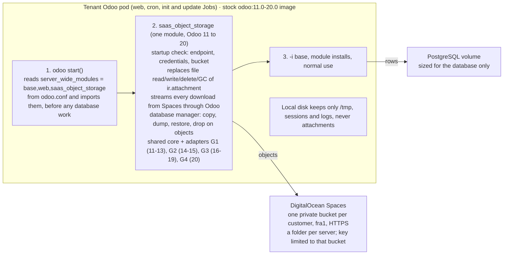

# Spaces Filestore Backend Plan

Oct 11, 2026 · @Mostafa

## Summary

**No custom Odoo image is needed.** One storage module, loaded as a *server-wide module* through `odoo.conf`, replaces the filestore before Odoo creates its first database, in every version from 11 to 20. The operator already ships a server-wide module this way (`saas_tenant_dbm`, mounted from a ConfigMap), so the stock `odoo:<version>` images stay as they are.

- **Why it works:** in every version from 11 to 20, `odoo.service.server.start()` imports the server-wide modules *before* it initializes or upgrades any database (Odoo 17: `service/server.py:1470`, ahead of `preload_registries`). A module imported at that moment can replace the filestore functions on the base `ir.attachment` class, so the first `-i base` already writes to Spaces.
- **Why a normal addon is not enough:** an addon's code joins the registry only once it is installed in the database, which is after `base` and other modules have already written attachments to disk.
- **One codebase for 11 to 20:** a shared core (Spaces client, object layout, integrity rules) plus four thin version adapters, because Odoo's filestore API changed in four steps (11–13, 14–15, 16–19, 20).
- **The saving:** attachments move from block storage at $0.10/GiB-month to Spaces at $0.02/GiB-month beyond the 250 GiB included, about 5× cheaper per GiB. The volume shrinks to what PostgreSQL needs.
- **Status:** plan only. Nothing is built or deployed.

## What the Odoo source shows

In Odoo 17, only three files in the whole codebase (core and all community addons) touch the filestore directly; the same three seams exist in every version, with four different shapes.

Checked against the `odoo:17.0` image (`sha256:8779f815…`, built 2026-09-09) and the `11.0`–`19.0` and `master` (20.1 alpha) branches on GitHub:

| Generation | Versions | File read / write | How downloads reach the file | Garbage collection |
| --- | --- | --- | --- | --- |
| G1 | 11, 12, 13 | `_file_read(fname, bin_size)` returns **base64**; `_file_write(value, checksum)` takes base64 | Through `datas`, so through `_file_read` | Checklist folder, `_file_gc` |
| G2 | 14, 15 | bytes: `_file_read(fname)`, `_file_write(bin_value, checksum)` | Through `datas` (`ir.http._binary_record_content`) | `_gc_file_store` + checklist folder |
| G3 | 16, 17, 18, 19 | bytes; 19 adds `_file_read(fname, size=None)` | **Bypasses `_file_read`:** `Stream.from_attachment` (16–17, `odoo/http.py`) or `ir.attachment._to_http_stream` (18–19) opens the local path, with optional X-Sendfile | `_gc_file_store_unsafe` walks `filestore/checklist` |
| G4 | 20 (alpha) | streaming: `_file_read(self)`, `_file_write(fname, io.IOBase)`, new `filestore/upload` folder | `_to_http_stream`, `odoo/http/stream.py` | `_gc_file_store_unsafe(grace_period)` |

The three seams, by file (Odoo 17):

1. **`addons/base/models/ir_attachment.py`** — `_full_path`, `_get_path` (also the SHA-1 collision check), `_file_read`, `_file_write`, `_file_delete`, `_mark_for_gc`, `_gc_file_store_unsafe`, `force_storage` / `_migrate`.
2. **`http.py`** — `Stream.from_attachment` builds `type='path'` from `config.filestore(db)` and calls `os.stat`; `get_response` uses X-Sendfile when enabled.
3. **`service/db.py`** — the database manager: duplicate (`copytree`), dump (zips the folder), restore (moves the folder in), drop and rename (folder delete / move).

Also relevant:

- **Early loading:** `start()` calls `load_server_wide_modules()` before `preload_registries()` creates or upgrades a database (17: `service/server.py:1470`). The list comes from the `server_wide_modules` option, which can live in `odoo.conf`, so the init Job, the update Job, the cron sidecar and `odoo shell` all pick it up.
- **Scripts that build a `Registry` directly** skip `start()`. The platform runs such scripts inside pods (admin password reset, neutralize, PII masking), so they must import the adapter first.
- **Python versions differ:** the Odoo 11 image runs Python 3.5. The shared core therefore avoids f-strings and newer syntax, and uses `requests` (present in every Odoo image) instead of `boto3`.

## Architecture

A server-wide module named `saas_object_storage` is listed in `odoo.conf`, so Odoo imports it at process start, before it touches any database, and it replaces the filestore with Spaces for the life of the process.

The module arrives from the platform-addons ConfigMap; the Spaces credentials come from a Kubernetes Secret.

**Options weighed:**

| Option | Verdict | Why |
| --- | --- | --- |
| Normal addon installed in the database | Not enough | Its code joins only after installation; `base` and earlier modules have already written to disk |
| Server-wide module via `odoo.conf` (chosen) | Use | Loaded before any database work in 11–20; delivered through the existing platform-addons ConfigMap; stock images |
| Custom Odoo image with a patched core | Not needed | Same result as the server-wide module, plus one image to build and track per version; keep only as a fallback if a future version removes the early-load point |
| Mount Spaces as a folder (s3fs, rclone mount, CSI) | Reject | Needs a privileged or FUSE-capable pod; slow directory scans (GC walks the checklist folder); weaker consistency for rename and delete |

**How it replaces the filestore.** The module replaces methods on the base `ir.attachment` class (and, for 16–20, the download stream) at import time, before the registry builds the model classes, so every model built later inherits the Spaces versions. This is a narrow, explicit patch on six to eight named methods per generation, not broad monkey-patching, and each patch checks it is replacing the method signature it expects. If a future Odoo version changes a signature, the module refuses to start rather than silently writing to disk.

**Maintenance across upgrades.** Each Odoo release gets a short compatibility test (fresh database, install, upload, download, GC, database manager) that fails if a seam moved. The version adapter is the only code that changes.

## Storage design

Each customer gets one private bucket and one key that can reach only that bucket; all the customer's projects and environments (production, staging, dev) live in it, each server under its own folder. Objects keep Odoo's own content-addressed names, so database rows never change.

**Decision (2026-10-11): one bucket and one key per customer,** shared by all of that customer's projects and environments. Spaces can limit a key to specific buckets (Read, or Read/Write/Delete) but not to a folder inside one ([manage access](https://docs.digitalocean.com/products/spaces/how-to/manage-access/)). With a bucket per customer, a key read by the customer's own code (Shell, Git modules) reaches only that customer's own files, never another customer's. Each customer's bucket also has its own 800 operations/second.

One consequence inside a customer: any of the customer's servers can technically reach the files of the customer's other servers. That only matters when a customer gives a teammate access to some projects but not others (the platform's team permissions); such a teammate with Shell or Git access on one server could read files of the owner's other projects. The database itself stays separate per server.

**Giving a customer its bucket, and each new server its folder.** The control plane does this automatically while it provisions a server, before the first database exists; the customer never sees it.

1. **First server of a customer only:** take a bucket from the pool (see recycling below), or create one if the pool is empty: a private fra1 bucket with a neutral random name such as `odoo-fs-7k2m9q`, made with the platform's full-access Spaces key, which lives only on the SaaS server. Set the lifecycle rule that expires `trash/` after the backup retention period.
2. **First server of a customer only:** create the customer's key, limited to that bucket, through the DigitalOcean API (`POST /v2/spaces/keys`, one grant: that bucket, permission `readwrite`). DigitalOcean shows the secret only once, so it is stored immediately, encrypted with the existing helper (`saas_core/crypto.py`), on the customer's record.
3. **Every server:** assign its folder `<server-id>/` inside the customer's bucket (the server's numeric id in the platform database, never typed by anyone). No storage path ever uses a project name or subdomain: customers with the same project name get different buckets, two servers never share a folder, and renaming a project or changing a subdomain moves nothing.
4. **Every server:** create the Kubernetes Secret `odoo-object-storage` in its namespace with the endpoint, the customer's bucket and key, and the server's folder.
5. **Create the server as today:** the init Job starts, the storage module loads, checks the bucket, then `-i base` writes its first files under the server's folder.

Every step first checks whether it already happened (bucket assigned, key with this name exists), so the deploy's normal retries resume where they stopped. If a key was created but its secret was not stored, that key is deleted and a new one made.

**When a server ends** (after its reactivation window), a background job deletes its folder `<server-id>/` and `trash/<server-id>/`; the bucket and key stay for the customer's other servers.

**When a customer's last server ends, recycle the bucket, never delete it.** DigitalOcean deletes a bucket asynchronously: it stays pending for at least two weeks and its name stays reserved in that time ([destroy a bucket](https://docs.digitalocean.com/products/spaces/how-to/destroy/)). With trial customers coming and going, that churn would also eat into the bucket limit. So:

1. **Revoke access.** Delete the customer's key (`DELETE /v2/spaces/keys/{access_key}`), then list the account's keys and confirm no key still has a grant on this bucket. Prove it: a request signed with the old key must fail with 403.
2. **Delete everything, including what a normal listing hides:**
    - every object, in batches of 1,000 per request;
    - every old object version and delete marker, if versioning was ever turned on (`ListObjectVersions`);
    - every unfinished multipart upload (`ListMultipartUploads`, then abort each one); these hold uploaded data that a normal listing never shows.
3. **Prove the bucket is empty.** All three listings (objects, versions, multipart uploads) must come back empty, twice, a few minutes apart. Reset the bucket's settings to the platform default: no CORS, no bucket policy, only the standard `trash/` lifecycle rule.
4. **Only then hand it out.** The bucket returns to the pool and the next customer gets it with a brand-new key. Each recycle step is written to the audit log (bucket, previous owner, times, listing results).

The pool keeps a few empty buckets ready (for example 5); buckets beyond what the pool needs are only then deleted, and their slow deletion no longer matters. If any check fails, the bucket stays out of the pool and an alert goes to Teams.

**What you provide once:** a DigitalOcean API token allowed to manage Spaces keys, and a full-access Spaces key (the backup key, if it has full access). Both are stored in the SaaS settings.

**To verify in Phase 2:** the exact request body for creating a key. The docs confirm the `/v2/spaces/keys` endpoint and a per-bucket `readwrite` permission, but do not show the full create example; most likely `{"name": …, "grants": [{"bucket": …, "permission": "readwrite"}]}` ([Spaces keys API](https://docs.digitalocean.com/reference/api/reference/spaces-keys/), [doctl spaces keys create](https://docs.digitalocean.com/reference/doctl/reference/spaces/keys/create)). Also the account's bucket limit, and whether buckets pending deletion count toward it.

**Object layout** (inside the customer's bucket):

| Prefix | Holds | Notes |
| --- | --- | --- |
| `<server-id>/<db>/<sha[:2]>/<sha>` | Attachment content | The part after `<db>/` is the `store_fname` Odoo already stores, so rows and backups stay valid |
| `<server-id>/<db>/checklist/<sha>` | Empty “may be garbage” markers | Replaces the local `filestore/checklist` folder, same logic as Odoo |
| `trash/<server-id>/<db>/<sha>` | Deleted content awaiting expiry | One lifecycle rule on `trash/` expires it after the backup retention period |

**Write** (`_file_write`): compute the SHA-1 as Odoo does; `HEAD` the key; if it exists, compare the stored `x-amz-meta-sha1` (Odoo's collision check); otherwise write a checklist marker, then `PUT` the content with `Content-MD5`. Odoo inserts the row only after the write returns, so a successful write is never reported before the object is stored. A transaction that rolls back leaves an object plus its marker, which GC removes.

**Read** (`_file_read`, downloads): `GET` with a 3 s connect and 30 s read timeout and 3 retries with backoff on 5xx and “Slow Down”. Downloads always stream from Spaces through Odoo, so every access check stays inside Odoo and the bucket is never exposed to browsers.

**Delete and GC.** `_file_delete` only writes a checklist marker, exactly as Odoo does. GC lists the markers, asks the database which names are still referenced, and for each unreferenced one **moves** the content to `trash/` (server-side copy, then delete) instead of deleting it. A lifecycle rule expires `trash/` after the longest backup retention (6 months, per the backup plan), so restoring an old database dump never finds its files missing. Every step is idempotent and safe to repeat.

**Duplicates and concurrency.** Content addressing means two uploads of the same file write the same key with the same bytes; the second `PUT` is harmless. Odoo's database rows are the reference count.

**When Spaces is down.** No local fallback, ever. Writes raise an error and the transaction rolls back; reads return an error page and log the bucket, key and HTTP status. At start the module checks the endpoint, the credentials and the bucket (`HEAD` bucket, then write, read and delete a probe object) and stops Odoo with a clear message if any step fails.

**Audits.** A weekly job compares the bucket listing with `ir_attachment.store_fname` and reports missing objects (a row with no object) and orphans (an object with no row and no marker) to the backup integrity report from the backup plan.

**Speed.** Web assets are attachments read on every page, so the module keeps a small read-through cache on local disk (an `emptyDir` with a 512 MiB `sizeLimit`, entries keyed by SHA-1, so they can never be stale). Losing the cache only costs a few extra reads.

## What changes in the platform

The module is the small part; most of the work is teaching the platform's own backup, restore, copy and quota code that files now live in a bucket, not on the volume.

| Area | Today | With Spaces |
| --- | --- | --- |
| Operator (`compute/operator`) | Mounts `/var/lib/odoo` from the shared volume | Adds `server_wide_modules` to the `odoo.conf` template, ships `saas_object_storage` in the platform-addons ConfigMap, injects Spaces settings from a Secret, adds the cache `emptyDir`. A new `spec.storage.filestore.backend: Volume \| ObjectStorage` switch, default `Volume`, so existing tenants are untouched |
| Control plane provisioning | Sizes one volume for database + files | On a customer's first server, takes a bucket from the pool (or creates one) and creates the customer's limited key; for every server, assigns its folder and sizes the volume for the database only; deletes a server's folder after its reactivation window, and recycles the bucket after the customer's last server |
| Storage quota and usage | Volume usage | Volume usage + bucket size (daily listing, cached). The module refuses uploads once the tenant is over its storage allowance |
| Daily backup and snapshots (backup plan) | Database dump + tar of the filestore | **Database dump only.** Files are already in the bucket and are never deleted before the backup retention ends (the `trash/` rule), so restic keeps only the database |
| Snapshot restore and reactivation | Untar the filestore | Restore the database; files are already there |
| Restore one database / customer upload | Unzip `filestore/` into the pod | Upload each file from the zip to the bucket (streamed), then load the database |
| Copy Production to Staging/Dev | Zip, then unzip on the target | Copy objects from the production folder to the staging/dev folder inside the customer's bucket, on the server side (no download), then load the database dump |
| Database manager (Odoo's and `saas_tenant_dbm`) | Folder copy, zip, move, delete | Handled inside the module (the `service/db.py` seam): copy/delete by prefix, dump streams objects into the zip |
| Platform scripts run in pods (password reset, neutralize, PII masking, database list) | Build a `Registry` directly | Import the module first; they rarely touch files, but this guarantees it |
| Download of a backup zip from the Databases page | `pg_dump` + walk the filestore in the pod | `pg_dump` + stream the objects into the zip |

**Existing tenants** stay on their volumes. A separate migration tool comes later: copy files to the new bucket, switch the backend, restart, verify every row has its object, and keep the old files for 30 days before freeing them.

## Networking and cost (DOKS fra1)

Files cost about 5× less per GiB in Spaces than on block storage, and traffic between the fra1 cluster and an fra1 bucket is free, so moving files out of the volume is a clear saving.

| Item | Block storage (today) | Spaces |
| --- | --- | --- |
| Storage | $0.10 per GiB-month, 1 GiB minimum per volume | $5/month for the account, 250 GiB included, then $0.02 per GiB-month |
| Transfer | n/a | Inbound free; Spaces fra1 to Droplets fra1 free; otherwise 1,024 GiB/month included, then $0.01 per GiB |
| Requests | n/a | No per-request charge on Standard storage; 4 KiB minimum billable object |
| Limits | Volume size per tenant | 800 operations/second per bucket; 5 GB per single upload (multipart beyond) |

**Example:** 100 tenants with 5 GiB of files each (500 GiB). On volumes: about $50 per month for the files. On Spaces: $5 + 250 GiB × $0.02 = about $10 per month, under the same $5 subscription the backups already use.

**Private path.** DigitalOcean says Droplets that use the VPC-local DNS resolver reach Spaces over its internal network, and that traffic does not count against the Spaces transfer allowance. Their note names Droplets only, not DOKS. DOKS nodes are Droplets, but pods resolve names through CoreDNS, so this must be checked on our cluster: resolve `fra1.digitaloceanspaces.com` from a node and from a pod, compare the addresses, and watch the account's bandwidth graph during a test upload. Either way fra1-to-fra1 transfer is free under the pricing page.

**Fewer calls:** the read cache for assets, `HEAD` only when a write might collide, and one `LIST` per GC run rather than per file.

Sources: [Spaces pricing](https://docs.digitalocean.com/products/spaces/details/pricing/), [Spaces limits](https://docs.digitalocean.com/products/spaces/details/limits/), [Volumes pricing](https://docs.digitalocean.com/products/volumes/details/pricing/), [Spaces private network release note](https://docs.digitalocean.com/notes/2026/spaces-private-endpoint/).

## What still uses the local disk

Attachments leave the disk entirely; a few small, non-attachment needs remain, and none of them holds customer files.

| Need | Where it stays | Why |
| --- | --- | --- |
| Sessions (`data_dir/sessions`) | The tenant's existing volume (the PostgreSQL one), a few MB | On a throwaway disk every rollout would log users out |
| `data_dir/addons` (apps uploaded through the UI) | Same volume, small | Rarely used; must survive restarts |
| Upload buffering, report rendering (wkhtmltopdf), Odoo temp files | `/tmp` (`emptyDir` with a size limit) | Disposable by design |
| Read cache for assets | `emptyDir`, 512 MiB limit | Disposable; keyed by SHA-1 |
| Code: Odoo, addons, platform addons | The image and ConfigMaps | Read-only |
| Logs | stdout | Collected by Kubernetes |
| PostgreSQL data | Its volume | Unchanged |

The volume shrinks from “database + files” to “database + a few MB”, which is where the saving comes from.

## Phases, tests and acceptance

Build for Odoo 17 first, prove it end to end on a fresh tenant, then add the other generations one at a time.

1. **Phase 1 — Core + Odoo 17 (G3).** Shared core (Spaces client with SigV4 signing on `requests`, retries, startup check, cache), the G3 adapter, and the `service/db.py` seam. Tested against MinIO in CI and a real fra1 test bucket.
2. **Phase 2 — Operator and control plane.** The `backend: ObjectStorage` switch, `odoo.conf` and Secret wiring, bucket pool, per-customer bucket and key, per-server folders, lifecycle rule, bucket recycling, storage usage and quota. New test tenants only.
3. **Phase 3 — Platform flows.** Backups become database-only, restore, prod-to-staging copy by server-side object copy, the Databases-page zip, the weekly audit.
4. **Phase 4 — Other versions.** G3 for 16, 18 and 19; G2 (14, 15); G1 (11–13, Python 3.5 syntax); G4 (20) once 20 is released. Each passes the same compatibility suite.
5. **Phase 5 — Existing tenants (optional).** The migration tool, one tenant at a time, with the old files kept 30 days.

**Automated tests** (each Odoo version in the matrix; MinIO for CI, a real bucket for the release check):

- [ ] Fresh database, `-i base` and a set of core apps from an empty state: the bucket gets the objects and `data_dir/filestore` is never created
- [ ] Attachments written during module installation land in the bucket
- [ ] Upload, read, replace and delete through the UI and the ORM
- [ ] Pod replaced: every attachment still downloads, nothing was read from the old pod
- [ ] Spaces down or timing out: writes fail and roll back, reads fail with a clear error, nothing is written to local disk, start-up refuses with a clear message
- [ ] Concurrent uploads of the same file, and of different files
- [ ] Duplicate checksums and the SHA-1 collision check
- [ ] GC: unreferenced objects move to `trash/`, referenced ones stay, a rolled-back upload is cleaned
- [ ] Cross-tenant: customer A's key gets 403 on customer B's bucket
- [ ] Missing object and orphan object are both reported by the audit
- [ ] Restore an old database dump: its files are still there (within retention)
- [ ] Web assets, report PDFs, email attachments and images render; website assets load
- [ ] Database manager duplicate, backup (zip), restore and drop

**Acceptance:** a brand-new Odoo 17 tenant initializes its database, installs its modules and serves attachments with Spaces as the only persistent filestore; deleting its pod and letting Kubernetes start a new one loses nothing; the bucket listing and the database agree.

## Risks and open questions

The items to confirm before Phase 2 are the account limits for buckets and keys, and whether pods on DOKS take the free private path to Spaces.

| Risk or question | Why it matters | Plan |
| --- | --- | --- |
| Buckets and keys per account | One bucket and one key per customer (not per server); keys default to 200 per account | Confirm the bucket limit and request higher bucket and key limits from DigitalOcean support before onboarding many tenants; the bucket pool keeps churn low |
| Pod-to-Spaces network path | Free private routing is documented for Droplets, not DOKS pods | Test from a pod in fra1 (Networking section); transfer is free fra1-to-fra1 either way |
| Lifecycle rules by prefix | GC relies on expiring `trash/` | Verify a prefix-scoped expiration rule on a test bucket in Phase 2 |
| Page speed | Each uncached file read is a network call | Asset read cache; measure page loads against the volume today |
| Odoo 20 still alpha (`master` is 20.1) | Its filestore API (G4) may change before release | Build G4 only after 20 is released; the module refuses to start on an unknown signature |
| Odoo upgrades move a seam | A silent fallback to disk would lose files | Signature checks at start plus the per-version compatibility suite |
| Storage quota | Files no longer count in the volume | Bucket size in usage; uploads refused over the allowance |
| Backup plan overlap | Restic would no longer back up files | Update the Backup & Restore Overhaul Plan: restic for the database only, files protected by delayed deletion |

**Decided (2026-10-11):**

1. **New tenants only.** Existing tenants stay on their volumes; migrating them (Phase 5) is a later, separate decision.
2. **Downloads always stream through Odoo,** so every access check stays inside Odoo. No signed links to the bucket.
3. **Odoo 20 waits for its stable release** before its adapter (G4) is built.
4. **One bucket and one key per customer, for all their projects and environments,** with a folder per server; a key leaked through customer code reaches only that customer's files; buckets are recycled through a pool instead of deleted.
