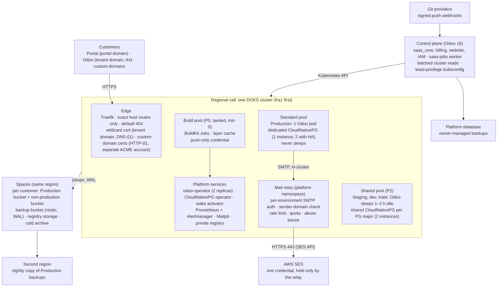
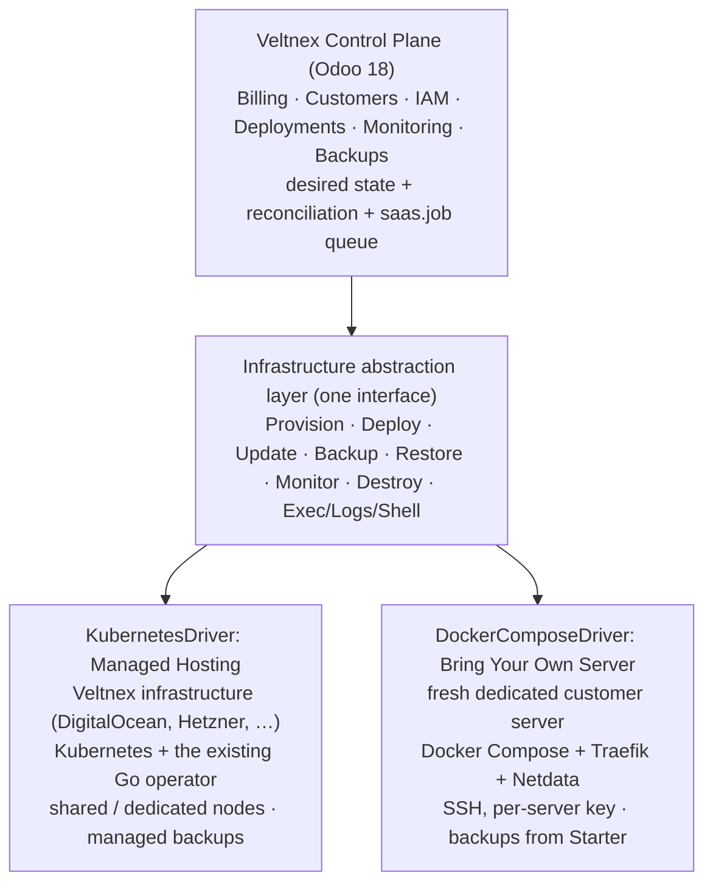

# Veltnex Architecture Review and Target Design

Oct 11, 2026 · @Mostafa · Revision 2 · Doc (revision 1 only): https://claude.ai/code/artifact/2e71a7cf-e77c-4e5f-bd39-a0854eee94ad

This is the architecture review and the target design. The work items are in [PLAN-implementation.md](PLAN-implementation.md). That file also keeps the four earlier plans (backup and restore, Spaces filestore, cluster capacity, PostgreSQL) unchanged as Appendices A–D.

Revision 2 answers eight review concerns, adds AWS SES for outgoing mail, and hardens the wildcard certificate and the custom-domain path. Every claim below is marked as one of these. Decisions and their approval status are in the next section.

- **Verified:** checked in the repository, on the live DOKS cluster (read-only Prometheus and kubectl reads on 2026-10-11), or in a provider document that was opened and is linked.
- **Assumption:** reasonable but not yet proven; each one has a test in the plan.

Nothing here is implemented. All decisions are approved subject to the launch acceptance criteria (next section). **This is the target design.** The launch is executed from the leaner [`PLAN-cost-reduction.md`](../PLAN-cost-reduction.md) at the repository root, which takes the security blockers and the cost cuts from here. Implementation waits for the owner's go-ahead.

## Decisions and their status

All decisions, A1–A19, were approved on 2026-10-11. A14–A19 were delegated by the owner, subject to the launch acceptance criteria in the plan. Where the owner set a condition, it is a "Done when" in [PLAN-implementation.md](PLAN-implementation.md#launch-blockers-and-launch-acceptance-criteria).

| # | Decision | Status | Condition or note | Plan items |
| --- | --- | --- | --- | --- |
| A1 | CloudNativePG as the one PostgreSQL engine: dedicated 1 instance per Production environment, shared for non-production, HA by raising instances to 2 | **Superseded by A23** (external shards, 2026-10-11) | Qualify backups, upgrades, failover and restore before adopting it for every environment. New Production uses it only after the qualification suite passes (P1.9a) | P0.22, P1.9a, P1.9b, P2.2, P3.3, P4.1, P4.2 |
| A2 | A Production bucket and a non-production bucket per customer, each with its own key | **Approved** | Test code can never reach Production files | P1.4, P3.1, P3.4 |
| A3 | Sessions in a per-environment PostgreSQL database | **Approved with conditions** | Test session behaviour, performance and the automatic cleanup of expired sessions | P3.2 |
| A4 | Tenant apps on their own registrable domain, on the Public Suffix List | **Approved (strongly)** | Protects the portal from cookies set by customer apps | P0.20, P0.7 |
| A5 | Custom-domain ownership by a permanent DNS TXT record | **Approved** | Add a clear procedure for when the customer deletes the record or loses control of the domain (concern 8, "Ownership lost") | P1.1 |
| A6 | Memory requests from measured usage | **Approved** | Pricing is based on usable node capacity, not theoretical node size | P0.21, P0.18 |
| A7 | Central mail relay to AWS SES | **Approved** | No AWS credentials in tenants; quotas, isolation and automatic pausing on abuse | P1.8, P0.13 |
| A8 | Production attachments copied to dev only on the customer's explicit request | **Approved** | Staging copies include them; dev does not unless asked | P1.4 |
| A9 | Shared non-production cluster with 2 instances per cell | **Approved with conditions; revised 2026-10-11** | **1 instance with nightly dumps until about 30 non-production environments per cell**, then 2. Test failover, storage growth and resource contention before the second instance | P2.2 |
| A10 | Basic performance monitoring free; history and advanced reports paid | **Approved** | — | P2.7, P4.7 |
| A11 | Automatic Production backups included in every plan | **Approved with conditions** | Plan-based retention and recovery features | P1.16 |
| A12 | Read-only window for the final major-version upgrade, chosen by the customer | **Approved with conditions** | A tested copy, a verified backup, a customer-selected window and a documented recovery procedure | P1.18 |
| A13 | State an uptime target on the website; SLA only with HA | **Approved with conditions** | A target only, until HA passes failure and recovery tests; a contractual SLA only once the platform consistently meets it | P0.23, P4.1 |
| A14 | Provider-agnostic cells: any provider meeting the cell contract; launch on DigitalOcean, add providers through the onboarding checklist when a region needs them | **Approved** (delegated by the owner, 2026-10-11) | A cell takes customers only after P0.26 passes | P0.25, P0.26, P2.10 |
| A15 | Object storage on Azure (no S3 API) | **Approved** (delegated) | An Azure Blob adapter in the filestore module, built only when the first Azure region is needed. restic, CloudNativePG and the registry already support Azure natively. No self-run object store, which would be a stateful service to operate | P2.10 |
| A16 | Platform DNS provider independent of the clouds | **Approved** (delegated): **Cloudflare DNS**, DNS only, no proxy | Built-in cert-manager solver; API tokens scoped to a single zone; free DNSSEC and CAA; independent of every compute provider | P0.7, P0.26 |
| A17 | Data residency per region; business data never leaves the allowed locations; the central control plane holds metadata only | **Approved** (delegated) | — | P0.25, P1.21 |
| A18 | Infrastructure as code: a provisioning module per provider | **Approved** (delegated): **OpenTofu** | Open-source and Terraform-compatible, with providers for all seven clouds | P2.11 |
| A19 | Customer chooses region, then provider; a separate price per provider in each region (owner requirement) | **Approved** (delegated) | Region → offerings (provider in region) → cells; a price per plan per offering, never below that offering's floor; a project stays in one region and offering | P1.22, P0.18 |
| A20 | Odoo Enterprise source model and legal gate | **Pending legal review** | (a) bring your own Enterprise source, built per tenant into tenant-only registry repositories, at launch; (b) platform Enterprise images only with a written agreement with Odoo. No Enterprise offering before written legal confirmation | P1.23, P1.24 |
| A21 | Bring Your Own Server on a `DockerComposeDriver` (Docker Compose + Traefik) behind one infrastructure interface. On a **fresh dedicated server**: firewall reset, CSF disabled, a **per-server** platform SSH key in root, and Netdata (owner, 2026-10-11) | **Approved direction** | Fresh-server preflight with customer confirmation; `from=`-restricted per-server keys; commands audited; Netdata sized to the server; capabilities shown per hosting type; conformance test across runtimes | P1.36, P1.32, P1.37, P1.38 |
| A22 | Pricing and marketing: BYOS by subscription (Free $0, Starter $19, Pro $39, Agency $199 per month in USD, excluding servers; no annual discount; no backups on Free); managed hosting by resources with the 60% floor; Odoo Enterprise licences separate from hosting | **New** (owner requirement; design proposed) | Claims backed by published calculations; no invented social proof | P1.33, P1.34, P1.32 |
| A23 | PostgreSQL outside Kubernetes: external shards (several customers per server) by tenant placement; Production, non-production and dedicated shard classes | **Owner direction** (2026-10-11); design proposed | Supersedes A1. Guardrails: per-role limits, opaque names, per-shard headroom, noisy-tenant moves, log filtering by database, TLS | P1.40–P1.43 |
| A24 | Shard implementation | **Pending** | Recommended: self-managed PostgreSQL VMs (about $1.4 per tenant, or $2.7 with HA); provider-managed only where price and connection limits fit (DigitalOcean 8 GiB: $122.10, 197 connections) | P1.40 |
| A25 | HA and PITR on Production shards: included for all Production, or priced add-ons | **Pending** | At about $1.3 per tenant for the standby, inclusion is affordable | P1.40, P1.43, P4.1, P4.2 |

**Launch blockers.** The full list, with each acceptance check, is in the plan's "Launch blockers and launch acceptance criteria". The owner added these on 2026-10-11:

- no PostgreSQL superuser for any tenant (P0.24);
- no Production deploy without passing tests (P1.11);
- an isolated, auditable SSH gateway (P1.13);
- backups in every plan (P1.16);
- safe major upgrades (P1.18);
- an uptime target, not an SLA (P0.23).

The remaining open questions were settled on 2026-10-11 (see the end of this file). Only the tenant domain name needs the owner, because it is a brand choice and a purchase.

## Summary

**Keep Kubernetes, the Go operator and one namespace per environment, in provider-agnostic cells.** Each cell is a cluster on any provider that meets a tested contract, placed where the customer's data must stay. Production stays dedicated and always on. Staging, dev and trials share and sleep. Revision 2 changes six things:

1. **One PostgreSQL engine:** CloudNativePG for every new environment (A1). Production keeps a dedicated database. Shared Production shards save about $1 per tenant a month and multiply the blast radius, so they are rejected.
2. **The isolation boundary is the bucket, not the folder.** Spaces keys are per bucket only, so Production files get their own bucket and key (A2).
3. **A corrected cost model.** The old formula charged the node twice. The new one prices each tenant by the larger of its CPU and memory share, after system overhead and packing. For a 2-worker Production environment it gives about $14 a month, so the 60% price floor is about $35.
4. **One unit of consistency for backups and restores:** a database snapshot, plus exactly the files it references, plus the code that wrote it.
5. **Tenant safety at the edge:**
    - tenant apps on their own registrable domain;
    - the wildcard certificate locked down;
    - custom domains on a separate issuance path with TXT ownership proof and takeover rules;
    - exact host routing only.
6. **Builds are a launch security item, not a cost item.** They run customer code with seccomp and AppArmor turned off, so they move to their own tainted node pool before launch.

## Current state assessment

**Verified on 2026-10-11** in the repository and on the live cluster unless marked otherwise.

| Area | Status | Evidence | Main limitation |
| --- | --- | --- | --- |
| Tenant runtime | Implemented | operator `resources/deployment.go`, `tenancy.go` | One Odoo pod plus a cron sidecar and a PostgreSQL StatefulSet on one RWO volume, pinned to one node (`deployment.go:282`) |
| Zero-downtime updates | Implemented | MaxSurge 1, update gate `controller/update.go` | The surge pod must fit on the same node; a node drain still means 1–3 minutes down |
| Pod hardening | Implemented | restricted Pod Security, non-root, read-only root, seccomp `RuntimeDefault`, no service-account token (`tenancy.go:36`) | Good baseline |
| Network isolation | Partial | `networkpolicy.go` | Ingress only from the gateway, which is good. Egress 443 reaches any address, including in-cluster; no SMTP egress |
| PostgreSQL | Implemented, dedicated | `resources/database.go`; CloudNativePG mode `cnpg.go` single-instance | The tenant login is the image's `POSTGRES_USER`, a superuser (`database.go:92`); no HA, PITR or major-version guard |
| SQL console | Implemented | `hosting_sql_query` runs through Odoo's own connection (`saas_instance.py:2191`) | Runs as that superuser |
| Shell | Implemented | `shellContainer` (`deployment.go:225`): no secrets, but the Odoo data dir is mounted read-write | Session files and the data-dir `addons/` folder are writable |
| Builds | Implemented | `drivers/k8s_builds.py` | Rootless BuildKit with seccomp and AppArmor `Unconfined` (`:288`); runs customer `pip install`; no node selector, so builds share tenant nodes; private ranges blocked on egress (good) |
| Registry credentials | Partial | `_upsert_pull_secret(namespace, …, registry_username, registry_password)` (`k8s_builds.py:412`) | The same push-capable login is copied into every tenant namespace, so any tenant's credential could pull every tenant's image. That is unacceptable for Enterprise code (P1.24) |
| Image registry | Partial | Docker Hub `moutazmuhammad/*` | Free Docker Hub repositories are public |
| Filestore on Spaces | Planned | Appendix B | Files on block storage keep Odoo stateful |
| Environments | Implemented | `_create_env_child`, `_NEUTRALIZE_SQL`, `_PII_MASK_SQL` | PII masking covers database rows, not attachments; no sleep; no mail catcher |
| Backups | Implemented (full dumps) | `run-backup.sh`: `pg_dump` per database, then a tar of the filestore, then a manifest | The manifest records no image, commit, module or PostgreSQL version. One shared S3 key sits in every tenant namespace. PostgreSQL 16 client only. Every backup starts at 02:00 |
| Restore | Partial | `run-restore.sh:125`, `saas_instance.py:3400` | Drops the database before loading |
| Memory requests | Partial | `_package()` requests are 25% of limits; a 2-worker plan requests 448 MiB | Measured one-day average working sets were 0.46–1.4 GiB per environment, so memory can be overcommitted |
| Tenant domain | Partial | live CR host `ee.node.eagle-tech.info`; portal `main.eagle-tech.info` | Tenants and the portal share the registrable domain `eagle-tech.info` |
| TLS | Implemented | per-host certificate through the cluster issuer (`kubernetes_driver.py:525`) | Let's Encrypt allows 50 new certificates per registered domain per 7 days ([source](https://letsencrypt.org/docs/rate-limits/)) |
| Custom domains | Missing | only `subdomain.base_domain` | — |
| Outgoing mail | Missing as a platform service | — | Customers configure their own SMTP, which the network policy blocks today |
| Control plane to cluster | Over-privileged | bootstrap binds `cluster-admin` (`bootstrap.py:215`) | — |
| Control-plane scaling | Partial | `_cron_reconcile`, `_cron_verify_webhooks`, `_cron_sync_scheduled_backups` | Per-tenant API calls in unbounded loops |
| Platform database backup | Owner-managed | confirmed 2026-10-11 | Backed up outside the repository |
| Monitoring and alerts | Partial | Prometheus, no Alertmanager; alert webhook unset | — |
| CI/CD gates | Partial | `cd.yml` "temporary fast deployment mode" | — |

## Recommended target architecture

**A regional cell (one DOKS cluster) runs four classes of environment.** Production is dedicated and always on; everything else shares and sleeps.

| Class | Odoo | Database (A1) | Files (A2) | Idle | Backups | Priced by |
| --- | --- | --- | --- | --- | --- | --- |
| Production | 1 pod in a Production pool; never sleeps | Dedicated CloudNativePG, 1 instance | Customer's Production bucket | Always on | Daily snapshot set (DB + referenced files + code) with restic, 7/4/6; second-region copy | Workers + storage |
| Production HA (add-on) | 2 pods on different nodes | Same cluster raised to 2 instances; WAL archiving | Production bucket | Always on | Same + PITR 7 days | Base + HA fee |
| Staging | 1 small pod in the Shared pool | A database on the cell's shared CloudNativePG cluster | Customer's non-production bucket, own prefix | Sleeps after 2 idle hours | Manual snapshots | Slot fee; awake option |
| Development | Same | Same | Non-production bucket, own prefix | Sleeps after 1 idle hour; archived after long idle | None | Slot fee |
| Trial | Same | Same | Its own bucket pair (it is a customer) | Sleeps after 1 idle hour | None | Free, capped |

**Node pools by phase.** Revision 1 placed Shared and Build pools at launch, before the phases that build them; this table corrects that.

| Pool | Holds | Taint | Arrives |
| --- | --- | --- | --- |
| Standard | Production (and everything else until P2) | none | Today (pool `node`) |
| Build | BuildKit Jobs only | `saas.platform/pool=build:NoSchedule` | P0, as a security fix |
| Shared | Staging, dev, trials, shared database clusters, Mailpit | `saas.platform/pool=shared:NoSchedule` | P2 |
| Large | Production above the Standard node size | `saas.platform/pool=large:NoSchedule` | When the first large customer arrives (P3–P4) |

HA is not a pool. An HA tenant runs in its normal Production pool with pod anti-affinity, so that pool needs at least 2 nodes.

**Sleep: what it really saves (owner, 2026-10-11).** Stopping pods saves nothing by itself. The provider bills nodes and volumes, not pods. Sleep saves money only when all of these hold:

1. **Sleeping workloads live on nodes that can disappear.** Non-production Odoo pods run alone on the Shared pool. The shared database, Mailpit and the wake activator run on the Standard pool. When environments sleep, the Shared pool's nodes empty and the autoscaler removes them. The pool's minimum is 0 at night and on weekends, and 1 node in business hours for fast wakes (a scheduled minimum, *assumed* to be tunable per cell). A cold pool means the first wake waits for a new node, about 1–3 minutes (*assumption*).
2. **No reserved resources stay behind.** A sleeping environment keeps no pod, so it has no requests. Its database is a database inside the shared cluster, with no pod of its own. So its only remaining costs are volumes.
3. **Volumes are kept as small as possible.**
    - **Dev files:** before P3 a dev environment's files sit on a block volume, which bills while asleep. It is created at the minimum size (1 GiB, or the provider minimum), and dev copies have no attachments unless asked (A8).
    - **Archiving:** after 14 idle days the environment is archived, its volume deleted, and only object storage remains.
    - **After P3:** files live in the non-production bucket and are billed only for what is stored.
4. **Measured, not assumed:** the metering reports Shared-pool node-hours and volume GiB-hours per day. The acceptance test is that the Shared pool's node-hours fall when environments sleep.

**Behaviour during sleep:**

| Topic | Rule |
| --- | --- |
| Who sleeps | Development after 1 idle hour, Staging after 2, Trials after 1. Production never sleeps. An "always awake" option is billed. |
| What counts as activity | HTTP requests to the environment (excluding platform health probes and known crawlers), an open web shell or Odoo shell, a running build or deploy, and portal actions on that environment |
| Wake-up | Any HTTP request to a sleeping host reaches the wake activator. Browsers see "Waking up your server…" and are redirected when it is ready. API and JSON calls get `503` with `Retry-After`, so webhooks such as payment test callbacks retry. The portal has a Wake button. Wakes are rate-limited per cell to avoid a storm. Target: under 30 s with a warm node, 1–3 minutes from a cold pool |
| Builds while asleep | A push to a sleeping branch builds and runs its tests. The update gate (`-u`) runs as a Job against the shared database without waking the web pod. The environment stays asleep on the new image, and the next visit wakes it |
| Scheduled actions (crons) | Staging and dev crons are already disabled by neutralization, so sleep changes nothing for them. A trial's crons do not run while it sleeps; on wake, Odoo runs each overdue job once. There is no catch-up for every missed run, the same as Odoo.sh's idle behaviour |
| Backups | Dev and trials have no scheduled backups. A manual staging snapshot runs without waking: it dumps from the shared cluster and mounts the file volume in a Job. Archiving at 14 days needs no wake |
| Billing | Non-production is a flat slot fee, whether it sleeps or not; the customer is not billed per awake hour. "Always awake" is a separate fee. Trials are free. Awake hours are metered internally to check cost and margin |
| Shell, logs, mail catcher | Opening the shell wakes the environment. Logs and Mailpit stay readable while it sleeps |


## Provider-agnostic cells and data residency

**Requirement (owner, 2026-10-11):** customer environments must be able to run on DigitalOcean, Hetzner, GCP, AWS, Azure, Huawei Cloud or Oracle Cloud. Some customers are bound to a geography, and no provider covers every country. A **cell** is therefore one Kubernetes cluster in one place, on any provider, that meets a fixed contract. The control plane manages every cell the same way, through the Kubernetes API and a few provider adapters.

**What is already provider-neutral (verified):**

- Clusters are reached only through a kubeconfig (`saas.server`).
- Allocation picks a cluster by region (`_allocate_servers`).
- Backup storage speaks the S3 API, with presets for AWS, DigitalOcean Spaces and Hetzner, plus a GCS client (`saas_instance_backup.py`).
- The Build Job already blocks `169.254.0.0/16` and `100.64.0.0/10` (`k8s_builds.py:47`).
- The registry, restic and CloudNativePG all support S3, GCS and Azure Blob storage natively.

**What is tied to one provider or one place (verified):**

| Today | Problem | Target |
| --- | --- | --- |
| Backup storage is one global setting (`res_config_settings.py`) | Every customer's backups go to one bucket in one country | A backup target per cell, in the cell's allowed locations |
| Cost rate card: `cost_per_cpu_month` plus `cost_per_gb_ram_month` (`saas_server.py:190`) | Adds CPU and RAM separately, the double count found in concern 6; one card per provider shape is needed anyway | Per cell: node price and node allocatable; the concern-6 formula; volume price and minimum volume size |
| Bootstrap supports DOKS and MicroK8s (`scripts/bootstrap`) | No path for other providers | A provider module per provider that produces a cell meeting the contract, then the same bootstrap |
| Plans assume DigitalOcean: the Spaces key API (Appendix B), the DOKS autoscaler status and `doctl` (Appendix C), `do-block-storage` | Not portable | Provider adapters (below); per-cell storage class and node pool names |

**The cell contract:** what any provider must give before a cell takes customers. Bootstrap tests every row automatically.

| Contract item | Why | How it is checked |
| --- | --- | --- |
| Kubernetes within the operator's supported versions | Operator and CRD rules | Version check |
| A CNI that **enforces NetworkPolicy** | Tenant isolation rests on it, and some providers ship a CNI that ignores policies unless it is enabled | A probe pod must fail to reach another namespace and the cloud metadata address |
| Cloud metadata endpoint unreachable from tenant and build pods | Many providers serve node credentials at `169.254.169.254` | Covered by the probe; plus provider settings such as an IMDS hop limit of 1 where available |
| CSI block storage with online volume expansion | Database volumes grow without downtime | Create, write, expand and check |
| A LoadBalancer Service for HTTP, HTTPS and TCP 22 | Traefik and the SSH gateway | Live request through the load balancer |
| Node pools that take labels and taints (`saas.platform/pool`) | Standard, Build, Shared and Large pools | Label and taint check |
| Kernel limits for Odoo (inotify watches; learned from oec.sh's installer) | Odoo 19 and later can exhaust the default inotify limit at start | `sysctl` check on each node |
| Object storage with the S3 API and **credentials scoped to one bucket** | A2 isolation, backups, registry, WAL | Key A cannot list bucket B |
| An object store and backup locations inside the region's allowed countries | Data residency | Endpoints are checked against the region policy |
| Outbound 443 to the control plane and the mail upstream | Management and mail | Probe |

**Provider adapters in the control plane.** Everything else uses Kubernetes and S3 directly. These are the only places a provider is named:

1. **Object storage:** create and recycle buckets, scoped keys (create, rotate, revoke), lifecycle and versioning, server-side copy. Data paths use the S3 API.
2. **DNS:** platform zones and DNS-01 for the wildcard. cert-manager has built-in solvers for Route 53, Cloud DNS, Azure DNS, DigitalOcean and Cloudflare, and webhooks for others.
3. **Capacity:** read the Cluster Autoscaler status where the provider exposes it. Otherwise use pending pods and node conditions. Pool ceilings stay manual, as decided.
4. **Mail upstream:** SES in a region allowed for that cell, or a generic SMTP provider where SES is not allowed.
5. **Provisioning:** an infrastructure-as-code module per provider that creates the cluster, pools, load balancer, object storage and DNS records (A18). Bootstrap then installs the platform and runs the contract checks.

**Provider fit at a glance.** These are *assumptions* from general knowledge, to be verified by each provider's onboarding checklist (P2.10). Only DigitalOcean's limits were verified in this review.

| Provider | Managed Kubernetes | S3-compatible object storage | Per-bucket credentials | Notes |
| --- | --- | --- | --- | --- |
| DigitalOcean | DOKS | Spaces | Yes (verified) | Launch provider |
| AWS | EKS | S3 | Yes, IAM (even per prefix) | Turn on NetworkPolicy enforcement in the CNI; IMDSv2 with hop limit 1 |
| GCP | GKE | Cloud Storage through its S3 interoperability (HMAC keys) | Yes, IAM per bucket | Dataplane V2 or network policy enabled at creation |
| Azure | AKS | **Blob Storage is not S3-compatible** | Per container (SAS or identity) | Needs A15; the network policy engine is chosen at creation |
| Huawei Cloud | CCE | OBS (S3-compatible) | IAM and bucket policies | Check NetworkPolicy support per network model |
| Oracle Cloud | OKE | Object Storage S3 compatibility API | IAM policies per bucket | Large minimum block volume size, so the per-tenant volume cost is higher |
| Hetzner | **None**; self-managed (for example Talos or k3s with Hetzner's cloud controller and CSI, and Cilium) | Object Storage (S3-compatible) | To verify | Heavier operations: we run the Kubernetes control plane |

**Data residency (A17):**

- **Region policy:** each region carries a policy: its country or jurisdiction, the providers allowed, and the allowed locations for primary data, backup copies, logs and mail upstream.
- **What stays in the region:** customer business data, meaning databases, files, backups, WAL, stored logs and mail content. It never leaves those allowed locations. The second backup copy goes to another zone, site or in-country provider. If none exists, the customer is told the durability is lower, rather than the data leaving.
- **What the central control plane holds:** account, billing and project metadata, plus performance findings, which are normalized query text without values. If a jurisdiction ever forbids even that, a regional control plane is a later option.
- **Blocked moves:** copying Production to staging across regions, cross-cell moves and restores to another region are refused unless the region policy allows them.
- **Domains:** each cell gets its own wildcard under the tenant domain, for example `*.<region>.<tenant-domain>`, so routing and certificates stay per cell.

**Pricing per cell:** the price floor (60%, aiming for 70%) is computed from each cell's own rate card.

**Regions, providers and pricing (owner, 2026-10-11).** The customer chooses the region for their project. Each region is linked to several providers, and each provider has its own, different pricing.

- **Model:**
    - **`saas.region`:** the location and its residency policy. It exists today.
    - **`saas.provider` (new):** DigitalOcean, AWS, GCP, Azure, Huawei Cloud, Oracle Cloud, Hetzner.
    - **`saas.region.offering` (new):** one provider in one region. It holds:
        - the cells (`saas.server`) that serve it;
        - whether it is active and offered to customers;
        - its rate card, used for the price floor;
        - its price list;
        - which features it supports (HA, PITR, SSH, backup locations).
    - **`saas.server`:** each cell belongs to exactly one offering.
- **Choosing:**
    1. When creating a project, the customer picks a region.
    2. The portal then shows that region's offerings as cards: provider name, monthly price for the chosen plan, backup locations, and available features.
    3. The customer picks one. The recommended card is the cheapest that has capacity. If only one offering exists, the step is skipped.
- **Pricing per offering:** each plan has a price per offering. The price is set by staff or computed from the offering's rate card, and it can never be below that offering's 60% floor; the target is 70% at scale. Publishing a price below the floor is refused. Today's single `saas.region.price_multiplier` (`saas_region.py:33`, used by `saas_pricing._region_multiplier`) becomes a fallback for offerings without a price list.
- **The project stays together:** a project's environments (Production, staging, dev) live in the same region. By default they also use the same offering, so copies stay inside one provider's network and object storage.
- **Changing region or provider:** this is a move between cells. It means a backup, a restore and a switch at a customer-chosen window (like pool moves), it must pass the region policy (A17), and it changes the price from the next billing period.
- **Allocation:** `_allocate_servers` picks the least-loaded healthy cell within the chosen offering, not across the whole region.
- **Billing:** invoices and the portal show region and provider. Margin reports are per offering.


## Architecture diagram



## Review of the eight concerns

### 1. Dedicated PostgreSQL per Production versus shards

**Evidence:**

- **Verified (Prometheus, one-day averages on the live cluster):**
    - an idle tenant PostgreSQL used 58–193 MiB of memory, against 230–1,280 MiB for Odoo plus cron in the same tenant;
    - the highest 5-minute CPU rate of any tenant database over the day was 0.165 cores; the average across tenants was 0.019.
- **Verified (code):**
    - a 2-worker plan reserves 125m CPU and 128 MiB for the database (`saas_plan._recommended_db_resources`, `_package()`);
    - the Odoo login is a superuser in its own database server (`database.go:92`).
- **Verified (node, DigitalOcean pricing):** an `s-2vcpu-4gb` node has 1,900m CPU and 3,003 MiB allocatable, of which DaemonSets reserve 412m and 412 MiB. The node costs about $24 a month (repo docs).

**Options:**

| Option | Cost per Production DB per month (assumed sizes) | Isolation and noisy neighbours | Failure domain | Operations |
| --- | --- | --- | --- | --- |
| A. Dedicated Managed StatefulSet (today) | About $2: 150 MiB request, memory-bound on the corrected model, plus a 1–2 GiB volume | Full; one tenant per server | One tenant | Custom code for backup, PITR and HA, none of which exist |
| B. Dedicated CloudNativePG, 1 instance (recommended) | About $2.10: A plus the instance manager, assumed at about 30 MiB | Full | One tenant | One engine for every class; PITR and HA become settings; base backups and WAL handled by the engine |
| C. Production shards (one CloudNativePG cluster with 2 instances for about 50 tenants) | About $1: 2 instances × 2 GiB, plus 25% packing loss, divided by 50 | Shared buffers, CPU and IO; one heavy report slows 50 customers; superuser impossible, so extensions and the SQL console are restricted | 50 tenants per failure; PITR restores the whole shard | Shard placement, rebalancing, per-shard major upgrades |
| D. Hybrid: dedicated for paid plans, shards for a micro "Starter" plan | Mix | Mixed | Mixed | Both systems |

**Trade-offs:**

- **Cost:** shards save about $1 per tenant a month. That is about 3% of a $35 Production price floor.
- **Risk:** shards raise the failure domain from one tenant to about 50.
- **Restore:** shards make PITR a whole-shard operation.
- **Upgrades:** shards force every tenant in a shard onto one major version, which conflicts with selling Odoo 14–20.

**Recommendation: B.** Every Production environment gets a dedicated CloudNativePG cluster with 1 instance, and its requests come from measurement (A6). Reject C for Production. Revisit D only if a sub-$20 Starter plan is ever priced, and then only for trials converted to a "lite" tier. Existing tenants on the Managed StatefulSet move by dump and restore at a customer-chosen time.

*Assumption:* every version sold, Odoo 14–20, runs on PostgreSQL 13 or later. That is the CRD minimum and the oldest major current CloudNativePG images ship. Odoo 14, the oldest, is tested first in P1.7. No PostgreSQL 12 legacy engine is needed.

### 2. Tenant isolation

**Verified** in code unless marked.

| Vector | Today | Risk | Target |
| --- | --- | --- | --- |
| Customer Python addons in Odoo | Non-root, read-only root, seccomp `RuntimeDefault`, no service-account token. The code can read `odoo.conf`: its own database password, which is a superuser login, and `admin_passwd` | Contained to the tenant's own database server. A superuser can run `COPY … TO PROGRAM` inside its own PostgreSQL container | **Launch blocker (P0.24):** every environment, existing and new, uses a limited owner role. `CREATEDB` is allowed on a dedicated server only. The superuser login exists only in a Secret that platform Jobs use, never in Odoo or the shell |
| Builds (`pip install`, `setup.py`) | seccomp and AppArmor `Unconfined`, any node, private ranges blocked on egress | A kernel escape from a build lands on a node running other tenants | Tainted Build pool (P0). The push credential lives only in `odoo-builds`. BuildKit does not mount the client's `config.json` into `RUN` steps (*assumption* from BuildKit's design; test in P0) |
| Registry credentials | The same push-capable login is in every tenant namespace | Anyone reading one tenant Secret could overwrite any tenant's image | A read-only pull credential in tenant namespaces; push only from the Build pool. Per-repository tokens need a token-auth registry, which comes later |
| Shell | No secrets, but the data dir is read-write: session files and the data-dir `addons/` folder, which Odoo adds to its addons path | A shell user can hijack other users' sessions of the same customer, or plant a module that runs in Odoo. This is privilege escalation inside one customer, not across customers | The shell gets the code and a read-only filestore only. Sessions move to the database (A3). Shell access requires a full-developer role with 2FA |
| Kubernetes API | No token mounted (`automountServiceAccountToken: false`) | Low | Keep. The control plane's own access becomes least-privilege (P0.1) |
| Network | Ingress only from gateway pods on 8069, 8072 and 8089 (cross-tenant blocked). Egress 443 to any address | In-cluster services on 443, such as the API server, are reachable without credentials | Deny private ranges on all egress, reusing the builds' `_BLOCKED_CIDRS`. Outgoing mail goes only to the in-cluster relay; direct SMTP to the internet stays closed, so no tenant can send around the quotas. IMAP and POP3 over TLS (993, 995) are allowed for Odoo's incoming mail servers. No inbound mail port is opened |
| Database credentials | One random password per tenant, held in Secrets and `odoo.conf` | Fine per tenant | Non-superuser roles. On shared clusters: per-login connection limit, `statement_timeout`, `temp_file_limit`, and `REVOKE CONNECT … FROM PUBLIC` |
| Object-storage credentials | None in Odoo pods today. The backup key sits in tenant namespaces (P0.5) | See concern 3 | The Production key only in Production namespaces; the non-production key only in non-production ones |
| Cookies | Tenant hosts and the portal share `eagle-tech.info` | Customer code on a tenant host can set cookies for the parent domain, which the portal then receives (cookie tossing or session fixation) | A4: tenants on their own registrable domain, listed on the Public Suffix List |

### 3. Bucket per customer with one key across environments

**Verified** in DigitalOcean's [key guide](https://docs.digitalocean.com/products/spaces/how-to/manage-access/) and [API reference](https://docs.digitalocean.com/reference/api/reference/spaces-keys/):

- a limited key grants Read or Read/Write/Delete per bucket;
- grants are per bucket only, with no prefix or folder scoping;
- keys can be created with `POST /v2/spaces/keys`; the guide still says Control Panel only, but the API reference documents the endpoint.

The account limits are 100 buckets and 200 keys, raised through support ([limits](https://docs.digitalocean.com/products/spaces/details/limits/)).

**Conclusion (verified):** with one bucket and one key per customer, any staging or dev code, which is customer code under test, can read, overwrite and delete Production files. A folder per environment does not help.

**Options:**

| Option | Buckets per customer | Isolation | Cost and limits |
| --- | --- | --- | --- |
| One bucket per customer (revision 1) | 1 | None between environments | Fewest buckets |
| Production plus non-production bucket (recommended) | 2 | Production fully isolated; staging and dev share a bucket | The 100-bucket limit allows 50 customers, so ask support for an increase early |
| Bucket per environment | 3–5 | Full | Limits reached at 20–30 customers; more pool recycling |
| Storage gateway issuing prefix-scoped access | 1 | Full | An always-on service, rejected earlier |

**Recommendation (A2):**

- **Buckets and keys:** each customer gets a Production bucket and a non-production bucket. The Production key is placed only in the Production namespace, and the non-production key only in staging and dev namespaces.
- **Copying files to staging:** copying Production to staging is a server-side copy by a platform Job with a platform key. Neither environment's key ever touches the other bucket.
- **Backups** stay in the platform backup bucket, which no customer key can reach.

**Remaining exposure:** dev code can read staging's copied files, which are real Production attachments. Database PII masking does not cover attachments (verified: `_PII_MASK_SQL` only updates rows).

**A8:** staging copies include attachments, and dev copies include them only when the customer chooses. Otherwise dev gets the database without files, and missing files show as broken links.

### 4. Consistency model for backups, PITR and full restore

**Verified:**

- `run-backup.sh` dumps the main database, then each extra database (each with its own snapshot), and only then tars the filestore;
- the manifest has no image, commit, module, Odoo or PostgreSQL version.

**Assumptions** from Odoo's attachment design:

- filestore files are content-addressed, written once and never modified;
- Odoo deletes unreferenced files later in its garbage collection, which can run between the dump and the tar.

**Defined model:** a restore point is one database snapshot, plus exactly the files that snapshot references, plus the code identity that wrote it.

| Operation | How consistency is reached |
| --- | --- |
| Daily logical backup | Open a transaction, export its snapshot, and in that same snapshot list `ir_attachment.store_fname`. Run `pg_dump --snapshot=<id>`, then copy exactly the listed files. Files are immutable, so copying them later is correct. Garbage-collected files go to `trash/` (Spaces lifecycle, 14 days) instead of being deleted, so a file referenced by the snapshot still exists while the copy runs. Missing files are counted in the manifest. |
| PITR (HA or PITR add-on) | CloudNativePG base backup plus WAL to the backup bucket. Restoring to time T rebuilds the database at T. Every file referenced at T exists, live or in `trash/`, if trash retention (14 days) exceeds the PITR window (7 days); the restore job moves needed objects back from `trash/`. |
| Several databases in one environment | Each has its own snapshot. Odoo databases are independent, so this is acceptable and documented. |
| Full environment restore | Manifest v2 records database names, PostgreSQL major, Odoo version, image digest, build id and commit, module fingerprint, plan, and the referenced-file count. Restore offers two modes: "exact", which uses the recorded image, or "current code", which runs the update gate after loading. |
| Verification | After every restore: `/web/health`, an admin login, and zero missing referenced files. A monthly drill restores a random Production backup into a scratch environment. |
| restic efficiency | Pipe an uncompressed `pg_dump -Fc -Z0` into `restic backup --stdin`, so restic's chunking deduplicates day to day and its own compression applies. *Assumption:* to be measured in P1.5 against the 1.3× target. |

Today, while files are still on the volume, the same model applies with "copy the listed files from the volume". Garbage collection is paused during the backup window instead of using `trash/`.

### 5. Stateless Odoo

**Verified** in DigitalOcean's [limits page](https://docs.digitalocean.com/products/spaces/details/limits/): 800 operations a second per new bucket, 5 GB single PUT, multipart up to 5 TB, a 4 KiB minimum billable object size, and versioning enabled only through the API.

**Not documented:** read-after-write consistency. It is an *assumption*, though content-addressed keys mean objects are never overwritten.

**Design and checks:**

- **Files:**
    - files go through the Appendix B module;
    - web asset bundles and files under 64 KiB stay in the database, to avoid one Spaces request per asset and the 4 KiB billing minimum (*assumed* threshold);
    - each pod has a read-through cache on an `emptyDir` of 1–2 GiB;
    - a read that returns 404 within 5 seconds of the write is retried with backoff.
- **Sessions (A3):**
    - **Options:**
        - a per-environment `…_sessions` database on the environment's own server (recommended: no new service);
        - Redis per cell with an ACL per tenant (faster, but a new stateful service to run);
        - an `emptyDir`, which logs everyone out on every rollout, so it is rejected.
    - **Versions:** the session store differs between Odoo generations (werkzeug's store in 14, Odoo's vendored copy from 15). That needs an adapter per generation, like the filestore. *Assumption*, to spike in P3.
    - **Cleanup:** a cron removes expired sessions.
- **Several replicas:**
    - the Odoo bus uses PostgreSQL `LISTEN/NOTIFY`, so long-polling and websocket requests can land on any replica;
    - cron jobs are taken with `SELECT … FOR UPDATE SKIP LOCKED`, so cron containers in two replicas never run the same job twice;
    - both points are from Odoo's source design and are re-verified per version in P3;
    - the database manager stays restricted to the platform.
- **Failure handling:**
    - Spaces errors on upload return a user-facing error;
    - reads fall back to the cache;
    - the readiness and liveness probes never call Spaces, so a Spaces outage cannot cause a restart storm;
    - objects orphaned by rolled-back transactions are cleaned by a monthly bucket-against-database reconcile.
- **Acceptance (P3):**
    - a node drain with zero failed requests;
    - sessions survive a pod replacement;
    - two replicas with the bus working across them;
    - one hour of a simulated Spaces outage with no pod restarts.

### 6. Corrected cost model

**What was wrong:** revision 1 priced CPU at the full node price per CPU and RAM at the full node price per GiB, then added both. That charges each node twice.

**Corrected model.** Verified inputs:

- node price about $24;
- allocatable 1,900m CPU and 3,003 MiB;
- DaemonSets 412m and 412 MiB per node, leaving 1,488m and 2,591 MiB usable;
- cell services: 320m and 650 MiB of requests (CoreDNS, monitoring, operator, toolbox, cert-manager, Traefik).

```latex
\text{compute} = \frac{P_{node} \cdot \max\left(\frac{CPU_{req}}{CPU_{usable}}, \frac{RAM_{req}}{RAM_{usable}}\right)}{u_{pack}}
```

```latex
\text{cost} = \text{compute} + \text{DB volume} + \text{Spaces GiB} \cdot 0.02 + \text{backup GiB} \cdot 0.02 \cdot c + \frac{\text{cell and platform overhead}}{N_{tenants}} + \text{mail}
```

Here `u_pack` is the packing efficiency. It must leave room for one rollout surge pod per node, because before P3 the surge pod has to land on the tenant's own node. On `s-2vcpu-4gb` nodes that leaves room for only about one 2-worker tenant, so packing is about **0.45**. On `s-4vcpu-8gb` nodes it is about **0.75** (*assumed*: about 5 tenants of 1,100 MiB beside one 950 MiB surge). `c` is 2 when backups are copied to a second region. The result is a **variable-cost floor**: card fees, support labour and the margin lost while a new cell fills up are on top of it.

**Realistic utilization (verified):**

- tenants averaged 0.037 cores of CPU against 437m requested, so CPU requests are about 12 times actual use;
- memory working sets matched or exceeded requests;
- so memory, not CPU, is the binding resource.

A6 sets requests to measured values. Per environment that means CPU about 150m and memory about the p95 working set. This is assumed at 950 MiB for a 2-worker Production environment, from the observed range.

**Worked example: a 2-worker Production environment** (revision 3; assumptions marked):

- **Requests:** Odoo plus cron 950 MiB (*assumed*; it must be replaced by the measured 7-day maximum, not a one-day average) and **its dedicated PostgreSQL 150 MiB**, which revision 2 left out. That is 1,100 MiB and about 200m CPU, so memory binds.
- **Storage:** today's block volume until P3 moves files to Spaces.
- **Node:** `s-4vcpu-8gb` at about $48 (*assumed* list price) with about 3,488m and 6,488 MiB usable (*assumed* allocatable minus the verified DaemonSet share), compared with today's `s-2vcpu-4gb`.

| Line | `s-2vcpu-4gb`, packing 0.45 | `s-4vcpu-8gb`, packing 0.75 |
| --- | --- | --- |
| Compute (Odoo + cron + its database) | $22.60 | $10.85 |
| Block volume (10 GiB plan allowance) | $1.00 | $1.00 |
| Backups (restic, 8 GiB after dedup, ×2 locations) | $0.32 | $0.32 |
| Mail (about 1,000 messages) | $0.10 | $0.10 |
| **Variable cost before overhead** | **$24.02** | **$12.27** |

**Overhead depends on how full the cell is.** One cell costs about $28 a month:

- load balancer, $12;
- cell services, about $5 on the larger node;
- Spaces subscription, $5;
- Prometheus volume, $1;
- average Build-pool time, *assumed* $5.

The platform adds about $36: a right-sized control-plane VM and the separate platform database VM (*assumed* $24 and $12). That is about **$64 in total** for one cell.

**Price floor by tenants in the cell** (`s-4vcpu-8gb`; card fees of about 3% included as `price × 0.97`):

| Production tenants in the cell | Cost per tenant | Floor at 60% (÷ 0.37) | Target at 70% (÷ 0.27) |
| --- | --- | --- | --- |
| 10 | $18.70 | $50.50 | $69 |
| 50 | $13.55 | $36.60 | $50 |
| 200 | $12.60 | $34.00 | $47 |

**What this means for pricing:**

- **Node size:** a cell must not run on `s-2vcpu-4gb` nodes. There, the same tenant's variable cost is $24, so the 60% floor is about $68 at 50 tenants.
- **Early cells:** new cells run below the 60% target until they fill. Prices are set for about 50 tenants per cell, and margin reports show the curve.
- **After P3:** with files on Spaces and only the database on a volume, about $0.70 a month comes off the variable cost.

**Non-production with sleep** (*assumed*: awake 15% of the month, 400 MiB Odoo request, `s-4vcpu-8gb`):

- Odoo compute: about $0.60;
- share of the shared database, one instance (A9 revised for launch): about $0.50 over 40 environments;
- its database storage and file volume: about $0.20–0.60;
- total: about **$1.30–1.70** a month, against about $5.80 when always on with a dedicated database.

The saving is real only under the conditions in "Sleep: what it really saves" below. The Appendix D figures ($5.30 and $1.10) are superseded.

**Verify these with metering:** every figure above becomes a measured number per tenant once usage metering exists (the cost-reduction plan, `PLAN-cost-reduction.md`).

**Mail:** SES is billed per message (pass-through; see the SES item in the plan). It is priced as an included quota per plan plus usage.

### 7. Inconsistencies resolved

| Inconsistency in revision 1 | Resolution |
| --- | --- |
| Two PostgreSQL engines (Managed StatefulSet and CloudNativePG) with different backup, PITR and HA stories | A1: CloudNativePG for all new environments; Managed only for existing tenants until they are moved |
| PgBouncer in session mode in front of the shared cluster | Removed at launch. Session mode multiplexes nothing for Odoo, which holds connections per worker and needs session features (`LISTEN/NOTIFY`). Per-role `CONNECTION LIMIT` and Odoo's `db_maxconn` cap connections. Add a pooler only if a shared cluster nears `max_connections` |
| Non-production gets HA (2 instances) while Production has none | Intentional and now stated: one shared-cluster failure would stop every non-production environment in the cell, while a Production database failure affects one tenant. Cost about $19 per cell (A9) |
| "HA add-on" drawn inside the Large pool | HA is pool-independent; it needs at least 2 nodes in the tenant's pool |
| Launch said "Standard, Shared and Build pools and a shared cluster", but those were P2 items | The pool table above: Build moves to P0 (security), Shared and the shared cluster arrive in P2, Large on demand |
| The CloudNativePG operator is assumed present but not vendored | Vendor its chart in `compute/charts/vendor/` (repository rule) in P0, so new Production environments can use it |
| PITR is "add-on, CloudNativePG mode only" | With A1, PITR is a setting on any new Production environment |
| HA in P4 depends on stateless Odoo (P3) | Kept in that order: HA needs two Odoo replicas, and those need no RWO volume |

### 8. Custom domains, TLS and tenant-safe routing (launch plan)

The wildcard covers only the platform's own tenant domain, such as `*.main.eagle-tech.info` today, and not a customer domain such as `erp.customer.com`. The two follow separate paths.

**Wildcard protections:**

- **Separate domain (A4):** tenant apps get their own registrable domain, separate from the portal, which removes cookie tossing into the portal.
- **Public Suffix List:** submit a **wildcard rule** `*.<tenant-domain>` to the List's private section. That makes each region label, such as `fra1.<tenant-domain>`, a public suffix, so every tenant host is its own site. Listing only `<tenant-domain>` would leave all tenants in one region sharing `fra1.<tenant-domain>`. The List's merge takes weeks to months, so launch does not wait for it: the separate domain alone protects the portal.
- **Locked-down key:** the wildcard key lives only in Traefik's namespace. The control plane's least-privilege role (P0.1) cannot read Secrets there or in `cert-manager`.
- **Narrow DNS credential:** `_acme-challenge.<tenant-domain>` is a CNAME into a dedicated challenge zone. That zone is its own Cloudflare zone (A16), and cert-manager's API token is scoped to that zone only, so a leaked token cannot repoint tenant traffic.
- **Issuance controls:** CAA records allow only Let's Encrypt and only the platform's ACME account (`accounturi`), for both `issue` and `issuewild`. Certificate Transparency is watched, with an alert on any certificate for the tenant domain that the platform did not order.
- **Renewal:** renewal starts 30 days before expiry (cert-manager), with an expiry alert at 14 days.
- **Subdomain reuse:** a cancelled tenant's subdomain is quarantined for 90 days (*assumed*), so old links and bookmarks never reach a new customer.

**Custom domains (separate path):**

- **Claim:** the customer adds `erp.customer.com` to a Production environment and gets two records to create:
    - a CNAME to their environment's host, or an A record for an apex domain;
    - a TXT record `_veltnex-challenge.erp.customer.com` holding a random token bound to that customer and that environment.
- **Ownership proof:**
    - the TXT token proves control of the customer's DNS zone;
    - the CNAME or A record proves routing;
    - both are required before any certificate is ordered;
    - an HTTP check alone is not enough, because a dangling CNAME left by an old owner would let anyone who claims the name pass it.
- **Issuance:** a separate ClusterIssuer with its own ACME account, using HTTP-01 per host. It is ordered only after both checks pass, which avoids Let's Encrypt's failed-validation limits.
- **Ongoing ownership (A5):** the TXT record stays in place. It is re-checked daily and before every renewal. If it is missing for 7 days, the host is disabled, its renewal stops and the customer is told. The daily check alone never proves ownership; it only detects loss of it.
- **Ownership lost (A5 procedure).** This applies when the TXT record is deleted or changed, the domain expires, or someone else takes control of the zone:
    - **Day 0:** the daily check, or the pre-renewal check, fails. The finding shows on the dashboard and a short email goes to project owners. The domain keeps serving on its current certificate.
    - **Days 1–7:** a grace period. The customer restores the record, or re-verifies with a fresh token, at any time, and the finding clears.
    - **Day 7:** the host leaves routing, renewal stops, and the certificate is revoked through ACME. If it was primary, `web.base.url` returns to the platform address. The customer is told, and the binding becomes "released".
    - **Someone else proves a new TXT token for that host at any point:** the DNS owner wins. The old binding is removed at once, its certificate is revoked, and the previous customer is told. Nothing transfers automatically in the other direction.
    - **Routing record removed but TXT still present:** the customer is warned that traffic no longer reaches Veltnex. There is no takeover risk, because nobody else can prove the TXT.
- **Release and reuse:** removing a domain, or cancelling, takes the host out of routing at once. The record of the release is kept:
    - the same customer can re-add the domain with their existing token;
    - any other customer must prove a new TXT token, so a claim is never transferred automatically.
- **Routing safety:**
    - Traefik routes exact hosts only, with no tenant as a catch-all; unknown hosts get the default 404;
    - a host is unique across the platform, enforced by a database constraint and checked again by the operator before it writes an Ingress;
    - platform domains and the portal domain are on a blocklist;
    - wildcard customer domains are not supported at launch.
- **Primary domain:** the control plane sets `web.base.url` and `web.base.url.freeze` in the Production database. The default address keeps working.

**Mail with AWS SES (decided and approved 2026-10-11, A7).** Nothing in the cluster receives SMTP from the internet. The only change is outbound mail toward SES.

- **No AWS credentials in tenant namespaces:**
    - one SES credential exists, in a Secret in the relay's platform namespace (`veltnex-mail`);
    - tenants never hold AWS credentials, IAM users or SES keys;
    - the relay sends to SES over its HTTPS API (443), so it needs no SMTP egress either.
- **The relay:** a small in-cluster SMTP relay with 2 replicas.
    - **Authentication:** each Production environment gets its own relay username and password. The platform issues them, stores them encrypted and can revoke them. They are worthless outside the cluster.
    - **Injection:** the control plane writes them into the Production database as the outgoing mail server.
    - **Neutralization:** staging and dev are neutralized to Mailpit and have no relay credential at all.
- **Usage isolated per customer:**
    - **Sender domains:** the relay accepts only `From` domains verified for that customer. These are the customer's own domain (SES DKIM records shown in the portal next to the custom-domain records) or a platform mail subdomain for customers without one.
    - **Tagging:** every message is tagged with the tenant id in an SES message tag.
- **No unlimited sending:**
    - per-environment rate limits (messages per minute and recipients per message) are enforced in the relay;
    - a daily and monthly quota per plan is enforced by the control plane from SES send events, and it disables the relay credential when exceeded; overage is billed only if the plan allows it;
    - a global limiter keeps the whole cell under the SES account's sending rate.
- **Spam and abuse:**
    - SES bounce and complaint events, through SNS to the control plane, pause a customer above set rates; *assumed* starting points are 5% bounces or 0.1% complaints;
    - new customers start with a low quota that rises with clean history;
    - message size and recipient caps apply;
    - every send is logged per tenant for support and billing.
- **Customers' own SMTP:** direct SMTP egress is closed by default, so nobody can bypass the quotas from platform IPs. A customer who must use their own provider gets a staff-approved egress exception for that host only.
- **Prerequisites:** take the SES account out of the sandbox, and choose the SES region (*assumed* eu-central-1).

## Performance monitoring per customer

**Goal:** find each customer's slow and expensive queries, show what they cost in database time and user-facing latency, and notify the customer only when it is worth their attention. The platform never changes a customer database by itself; it tells the customer, or their developer, what to fix. It is built at the lowest cost: no new always-on service, and reuse of what already runs.

**What is measured, at the lowest cost:**

| Signal | Why it matters | Source (cost) |
| --- | --- | --- |
| Query duration (mean, max) | Finds slow queries | `pg_stat_statements` (already in Production tuning plans; a few % CPU, *assumed*) |
| Total execution time | Finds queries that consume most database time | `pg_stat_statements.total_exec_time` as a share of the tenant total |
| Call count | Tells a rare slow query from an average one repeated thousands of times (N+1) | `pg_stat_statements.calls` |
| Rows read against rows returned | Hints at a missing or unused index | Blocks read per call against rows per call (`pg_stat_statements`); `seq_scan` and `seq_tup_read` against `idx_scan` (`pg_stat_user_tables`). Plans are on demand with `EXPLAIN (GENERIC_PLAN)` on PostgreSQL 16+, not `auto_explain` logging, so no log pipeline is needed |
| Lock waits | Finds queries blocked by other transactions | A custom query in the CloudNativePG metrics exporter: the longest current lock wait and the count of waits over 5 s, scraped by Prometheus every 30 s; plus `pg_stat_database.deadlocks` |
| Database CPU and connections | Ties slow queries to pressure | Container CPU against the limit (cAdvisor, already scraped); connections against `max_connections` (exporter) |
| Odoo request latency | What users actually feel | p50 and p95 per environment from Traefik's request-duration histogram, already in Prometheus at no extra cost. Per-endpoint detail is deferred, because it needs a log pipeline |

**One shared Veltnex service, not a stack per tenant.** Collection is a single CronJob per cell. Analysis, the Advisor and notifications run once in the control plane for all customers. No tenant gets its own exporter, Prometheus, dashboard server or agent.

**How it runs (lowest cost):**

- **Collector:** a CronJob in a platform namespace, not an always-on service. It runs every 15 minutes and reads each Production database with a read-only `pg_monitor` role that lives only in the platform namespace. Tenant network policies admit it on 5432 from that namespace only.
- **What it keeps:** the deltas of `pg_stat_statements`, of which it keeps only:
    - the top 10 fingerprints by total time;
    - anything above the environment's thresholds.

  Query text is normalized (constants become `$1`), so no customer values leave the database. On shared clusters, rows are filtered by database.
- **Storage:** in the control-plane database. There are two tables:
    - `saas.perf.finding`: one row per environment and query fingerprint, updated in place;
    - `saas.perf.sample`: hourly points, kept 14 days for basic insights and 90 for the paid tier.

  At 1,000 environments that is about 240,000 small rows a day (*assumed* sizing). Prometheus keeps only per-environment series; query ids never become labels.
- **Attribution:** a fingerprint's tables map to Odoo models (`ir_model`) and to the modules that define them (`ir_model_data`). A finding says "from your module X" or "from core module Y".
- **Database settings:**
    - `pg_stat_statements`, `track_io_timing`, and `log_lock_waits` with `deadlock_timeout` at 1 s;
    - new environments get them at creation;
    - existing tenants get them at their next customer-chosen maintenance window, because a preload library needs a restart.

**Performance Advisor.** A finding never says only "Slow query detected". Every finding answers six questions on the dashboard:

| Question | How the Advisor answers it |
| --- | --- |
| What is the problem? | A plain sentence plus the normalized query, its tables, the Odoo model and module behind it ("from your module X" or "from core module Y"), and the class: slow, heavy, repeated (N+1), possible missing index, lock contention, or database pressure |
| How often does it happen? | Calls per hour, the hours of the day it runs, and how long the pattern has existed (first seen, last seen) |
| Does it really affect performance? | Its share of the database's time; whether the database was CPU-, connection- or lock-bound when it ran; and the environment's p95 latency over the same windows. Each finding is labelled "affecting users", "using capacity" or "minor" |
| What are the likely causes? | Rule-based by class: a sequential scan on a large table (missing index); many calls with few rows each (N+1 from a loop in custom code); waits behind a long transaction (cron or import); high temporary-file use (sort or join over memory); growth in table size. The generic plan is shown where PostgreSQL 16+ allows |
| What should be done? | Concrete steps for the class, such as: add `index=True` to the field used in the filter; batch with `read_group` or prefetch; split the cron's transaction; move to a larger plan. Each step links to a short guide |
| Did it get better after the change? | The Advisor marks the deploy (build id) or the time the customer clicks "I changed something". It compares the fingerprint's mean duration, calls and share of database time over the 24–48 hours before and after, and shows Improved, No change or Worse with the numbers. A finding that improves enough closes as "Resolved by your change" |

**When the customer is notified.** Never an email per slow query, which would cause notification fatigue and cost without benefit. There are three levels:

| Level | Trigger (default; adjustable) | Where it shows |
| --- | --- | --- |
| 1 · Recurring slow query | A query above 2 s that keeps recurring (above the threshold in 2 consecutive hourly windows), or one that exceeds the environment's performance budget | Dashboard only, with similar findings grouped by fingerprint |
| 2 · High cumulative consumption | A short query repeated tens of thousands of times that takes a large share of database time (default: over 20% for 3 hours) | Dashboard, with an in-portal badge; the finding explains the impact (share of database time, calls per hour, effect on latency), not just the single run time |
| 3 · Noticeable degradation | Sustained rise for 15 minutes in p95 latency, database pressure (CPU above 80% of the limit, connections above 85%) or lock waits (over 30 s) | Portal banner, plus one short email only when it is marked "affecting users" (p95 latency also above budget). The email carries no recommendations, only a link to the dashboard |

**Anti-fatigue rules:**

- **Recommendations stay on the dashboard.** It is clearer and cheaper; no recommendation or digest is ever emailed.
- **One finding per fingerprint:** one open finding per fingerprint. It is highlighted again only if it gets at least 50% worse, or after a 7-day cooldown.
- **Auto-resolve:** a finding resolves itself after 24 hours below its threshold.
- **Email cap:** at most 1 Level 3 email per environment every 6 hours.
- **Acknowledge or snooze:** customers can acknowledge or snooze a finding.

**Adjustable thresholds:**

- **Starting defaults:** the numbers above are starting defaults, not limits suitable for every application.
- **Profiles:** each environment gets defaults from its database size class and a workload profile:
    - *Standard* (interactive ERP);
    - *Reporting-heavy*, with relaxed duration thresholds;
    - *Batch and imports*, with relaxed lock thresholds inside declared batch windows.
- **Overrides:** customers can override the performance budget, thresholds and quiet hours per environment in the portal.
- **Tuning:** defaults are tuned from the data collected in the first months.

**The dashboard finding card** (the approved layout; metrics are illustrative, not tenant data). The same header, without the recommended actions, is the short Level 3 email:

```text
Veltnex Performance Alert
Production · Database Performance
Needs attention

A database query is consuming excessive resources
We detected a query pattern that is contributing significantly to your database execution time.

Average duration     2.8 sec
Calls per hour       18,400

Recommended actions
- Review the query's execution plan.
- Check whether appropriate indexes exist.
- Investigate repeated queries and possible N+1 patterns.
- Review custom Odoo modules that may be generating unnecessary database calls.
```

The card opens the full finding: the normalized query, its tables and module, the trend, the generic plan where available, and the before-and-after check.

**Cost:** the CronJob costs a few CPU-minutes per cell every 15 minutes. Storage is a few GB in the control-plane database. Level 3 emails are rare and go through the mail relay. Basic insights are included in every Production plan; the 90-day history and the plan and index-hint views are the paid tier (A10).

## Pricing and go-to-market (oec.sh model)

**Requirement (owner, 2026-10-11):** follow oec.sh's pricing system and its way of marketing. Their published model ([oec.sh](https://oec.sh/), read on 2026-10-11):

- **Flat platform plans with no per-user fees:**
    - Free "forever": 1 server, 3 environments, 2 projects, SSH terminal, daily backups;
    - Starter $19 a month: 2 servers, 5 projects, 5 custom domains, sanitization;
    - Pro $39 a month: "unlimited everything", DNS, replicas, advanced monitoring;
    - SaaS $249 a month: storefront, client portal and Stripe billing for resellers;
    - 20% off annual plans (Veltnex does not copy this; see below).
- **Servers:** on the customer's own cloud account or server, "billed separately at provider rates, no markup". A managed option is mentioned without published prices.
- **Marketing:**
    - "Free Odoo Hosting on Any Cloud" and "Save 70% vs Odoo.sh";
    - deploy in 60 seconds, no credit card;
    - no vendor lock-in;
    - audiences: agencies and resellers ("the cPanel + WHMCS for Odoo"), developers and partners;
    - comparison and migration guides;
    - social-proof counters;
    - "Start Free, No Card" as the repeated call to action.

**Veltnex version (A22):**

| Offer | What the customer pays | Veltnex cost | Margin rule |
| --- | --- | --- | --- |
| **Bring Your Own Server** (primary, as at oec.sh) | A flat plan: Free, Starter, Pro, Agency. Servers are paid by the customer directly to their provider | Control plane share, support, monitoring, plus backup storage if the customer uses Veltnex's (billed per GB) | At least 60% on Veltnex's own revenue, from metering (P1.31). Support time is the main cost |
| **Veltnex-managed hosting** | **By resources** (owner, 2026-10-11): workers, storage and environments through the existing pricing engine, with the server cost included in the price | Nodes, volumes, load balancer and backups | The 60% floor from the corrected cost model (P0.18), checked with metering |

- **Plans (owner, 2026-10-11):** prices are in US dollars per month, **excluding server cost**, which the customer's provider bills. The server and project limits are the owner's; the feature split per plan is a proposal the owner can move.

| Plan | Price | Limits (owner) | Features (proposed) |
| --- | --- | --- | --- |
| **Free** | $0 | 1 server, 2 projects | Dashboard management, deploy from the dashboard, web shell and Odoo shell, logs, uptime; **no backups** (upgrade needed); community support |
| **Starter** | $19 | Up to 2 servers | Plus **daily backups to the customer's own S3**, **Git auto-deployment** (push to deploy, tests, promotion), **monitoring** (resources, `pg_slow_queries.log`), custom domains, staging with Mailpit |
| **Pro** | $39 | **Unlimited projects**; servers, Veltnex backup storage, build minutes and support under **fair use** (below) | Plus **teams and permissions** (persona roles, IAM), **automated backups** (Veltnex off-site storage, 7/4/6, integrity checks, restore drills, second location), **advanced monitoring** (the performance Advisor) |
| **Agency** | $199 | For hosting companies and client management | Plus several client organisations, white-label portal, client billing |
| **Add-on: Managed Database Services** | Per database (to set) | — | A Veltnex-run PostgreSQL with HA and PITR, once P4.1 and P4.2 exist |
| **Annual** | **No annual discount on management subscriptions** (owner, 2026-10-11). Managed hosting keeps its existing yearly pricing in the billing engine | — | — |

**Fair use (owner, 2026-10-11).** Projects stay unlimited on Pro, but servers, build minutes, backup storage and support are under a published fair-use policy. Without it, a Pro customer with 50 servers using monitoring, backups and Git deployments heavily would cost more than $39. Starting points (*proposed*; the owner sets the final numbers):

| Resource | Starter | Pro | Agency | Above the allowance |
| --- | --- | --- | --- | --- |
| Projects | Within the plan | Unlimited | Unlimited | — |
| Servers | 2 | 10 included | 50 included | A per-server add-on price, or the next plan |
| Veltnex backup storage (after deduplication) | None (customer S3) | 50 GiB per account | 500 GiB | Per GiB-month, priced above cost (2 locations at about $0.02 each) |
| Builds on Veltnex builders | — (BYOS builds run on the customer's server) | Same | Same | Applies only to managed hosting, where minutes are in the resource price |
| Metrics retention / deploy and build log retention | 7 days / 14 days | 14 days / 30 days | 30 days / 90 days | Longer retention is the paid performance tier (A10) |
| Git deploy triggers | 200 a day | 1,000 a day | 5,000 a day | Rate-limited, not billed |
| Support | Email, 2 business days | Email, 1 business day, up to 2 hours a month | Priority, up to 10 hours a month | Billed per hour, or the next plan |

- **Enforcement:** metering (P1.31) watches every row. A customer gets a notice at 80% of an allowance. At 100%, new usage is throttled or blocked, never existing data or running environments, until they upgrade or buy the add-on.
- **No hidden overage:** add-ons are listed on the pricing page.

**BYOS cost to Veltnex is not zero.** Veltnex does not pay the customer's compute, but it pays for the items below (*assumed* per server per month at about 100 BYOS servers; metering replaces these with real numbers):

| Cost line | Estimate | Note |
| --- | --- | --- |
| Control plane and its database (share) | About $0.40 | About $36 a month for the application and database VMs, shared by every customer |
| Monitoring and metrics retention | About $0.10–0.30 | Netdata runs on the customer's server; Veltnex stores summaries and alert history |
| Deploy logs, Git webhooks, build history | About $0.05–0.10 | Rows in the control-plane database plus log objects |
| Veltnex backups (Pro and above) | About $0.32 per Production environment | restic 8 GiB after deduplication × 2 locations; restores add egress |
| Builds | $0 | They run on the customer's server |
| **Support and troubleshooting** | **The dominant cost:** at an *assumed* $30 an hour, 30 minutes a month is $15 | That is why support has a fair-use allowance per plan |

Starter at $19 stays profitable only while support stays near its allowance. Metering tracks support time per customer, and margin reports flag customers whose support time breaks their plan's margin.

- **Agency segment:** hosting companies and resellers are the same customers Veltnex targets. The Agency plan sells client organisations at launch, and white-label and client billing follow within about 90 days (P1.35). The existing control plane (products, plans, billing, portal, IAM) is most of what a reseller platform needs.
- **Freemium path:** connecting a server is free, so customers start relying on the dashboard. The paid features above are the upgrade path, gated per plan in the portal. Pro is where the high-value operations live; Agency serves resellers.
- **Backup rule (owner, 2026-10-11):**
    - **Free has no backups;** the customer must upgrade to get them. The portal shows a permanent "No backups on the Free plan" warning, and signup asks the customer to acknowledge it.
    - **Starter:** daily backups to the customer's own S3-compatible storage (*proposed* tier).
    - **Pro and above:** Veltnex off-site automated backups, with retention, integrity checks, restore drills and a second location.
    - **Managed hosting:** it always includes Veltnex backups. A11 applies to managed hosting.
- **Free-tier guardrails:** BYOS only, so Veltnex pays no compute. One free account per verified person or company (the trial rule already exists). Abuse controls apply, and inactive free servers are detached after 90 days of no contact.
- **Marketing, honest version:**
    - **Same structure:** the same message, "your cloud, no lock-in, deploy fast, save versus Odoo.sh", with "Start free, no card".
    - **Savings claims:** every number is backed by a published calculation page. The Odoo.sh pricing page shows no amounts without its calculator (verified 2026-10-11), so the comparison must quote the calculator's output with a date.
    - **"Deploy in N seconds":** measured by the automated walk-through (P1.30).
    - **No invented social proof:** the counters start once real numbers exist.
    - **Odoo trademark:** usage follows Odoo SA's trademark guidelines (to check).
    - **Content and audiences:** comparison and migration guides (from Odoo.sh, Odoo Online and self-hosting), a partner and agency program, a developer page (API, Git, Odoo shell), and provider referral credits for new BYOS servers where providers offer them.

## One control plane, pluggable runtimes (owner, 2026-10-11)

**Do not build two systems.** There is one control plane (Odoo 18: billing, customers, IAM, deployments, monitoring, backups) and one **infrastructure abstraction layer** under it, with a driver per runtime:



**Evidence (verified 2026-10-11):**

- **A thin interface exists:** `control-plane/saas_core/drivers/base.py` defines `ComputeDriver` with 8 operations (create, destroy, start, stop, restart, exec, logs, health).
- **Most behaviour sits outside it:** `KubernetesDriver` adds about 40 more (backups, package and resize, Prometheus, storage, interactive exec, log streams), so the interface must be **extracted** before a second driver can plug in.
- **A starting point exists:** the old `SshDockerDriver` (294 lines, Docker Compose, with "shadow" deployments) was removed in commit `cb9038d`. It is a starting point, not something to restore as is.

**The five technical decisions (owner):**

| Decision | Choice |
| --- | --- |
| Infrastructure driver | One interface for Kubernetes and Docker. The operations: provision, deploy, update (with an update gate), backup, restore, monitor, destroy, exec, logs, shell, health, usage. Each driver also declares a **capability set** |
| Remote execution | **SSH with a per-server root key** (owner decision, 2026-10-11, for fresh dedicated servers), the push model of the old `SshDockerDriver`. Fixed command templates only, `from=`-restricted keys, every command audited. A Veltnex agent with mTLS stays a later option for servers that cannot accept inbound SSH |
| Secrets | Central encryption in the control plane (fail-closed, P0.8). A server receives only the credentials it needs: its own registry pull, its own backup target, its own mail credentials. Never a shared credential |
| State | Desired state, reconciliation, and the `saas.job` queue (all exist today). Drivers report actual state, and the control plane reconciles |
| Billing | **Managed: by resources** (the existing worker and storage pricing, with the 60% floor). **BYOS: by service and subscription** (Free, Starter, Pro, Agency) |

**Policies per runtime:**

| | Managed (Kubernetes) | BYOS (Docker Compose) |
| --- | --- | --- |
| Database | Dedicated PostgreSQL per Production (limited role, P0.24); shared cluster for non-production | A PostgreSQL container on the customer's server, same limited role; the data never leaves the server |
| Filestore | Volume, then Spaces at P3 | A local Docker volume on the server |
| Backups | Veltnex off-site restic, included per plan | None on Free; daily to the customer's own S3 from Starter; Veltnex off-site restic from Pro |
| Builds and tests | Build pool (P0.19) | On the customer's server (`docker build`), tests in a throwaway PostgreSQL container |
| Routing and TLS | Traefik in the cell; wildcard for the tenant domain; per-host certificates for custom domains | Traefik on the server with per-host HTTP-01 (customer domains, or a separate BYOS domain) |
| Isolation | Namespaces, NetworkPolicy, Pod Security | One customer per server; Docker networks per project; fixed command templates over SSH with a per-server key |

**Capabilities are not identical, and the customer sees which apply.** The portal and docs show a capability matrix per hosting type:

| Capability | Managed | BYOS |
| --- | --- | --- |
| Zero-downtime deploys | Rolling update with the update gate | Near-zero: blue-green on one server (start the new container, health-check it, switch the Traefik route, stop the old). Proven on Docker in the old "shadow" code; not guaranteed under memory pressure |
| High availability | Paid add-on (P4.1) | Depends on the customer's own infrastructure |
| Point-in-time recovery | Paid add-on (P4.2) | Not offered |
| Sleep | Non-production sleeps (dev 1 h, staging 2 h, trials 1 h) | Off; it saves Veltnex nothing |
| Staging from Production, Mailpit, Git, tests, Odoo shell, logs, custom domains, performance Advisor | Yes | Yes |
| SSH | Web shell and Odoo shell (SSH gateway deferred) | The customer's own SSH (their server) plus the web shell and Odoo shell |
| Backups | Included per plan | Customer S3 in every plan; Veltnex off-site from Pro |
| Infrastructure SLA | Uptime target (P0.23) | None; the server is the customer's |

**Odoo Enterprise licences are billed separately from hosting** in both models, so prices compare cleanly with Odoo.sh. Hosting and management fees are on Veltnex's invoice; the Enterprise subscription stays between the customer and Odoo (A20).

**Secure server onboarding** (learned from oec.sh's script, not copied):

- **Kept:** a one-time token command, an OS and resource preflight, registration and progress, safe re-runs, the apt-lock wait, swap, inotify limits for Odoo 19 and later, and UFW with only 80 and 443 inbound.
- **Different:**
    - **owner decision (2026-10-11):** the customer provides a **fresh, empty server dedicated to Veltnex**. So, as at oec.sh, the firewall is reset (UFW to SSH, 80 and 443), CSF is disabled, a **platform SSH key goes into `root`**, and Netdata is installed;
    - **safeguards:** a fresh-server preflight that refuses non-empty servers and needs the customer's confirmation; **one key per server** (never one platform-wide key), encrypted, restricted with `from=` to the control plane's IPs, every command audited, removed on detach; Netdata's memory limited by server size, listening on localhost only and read over SSH;
    - **residual risk, accepted by the owner:** a full control-plane compromise reaches every BYOS server as root, so control-plane hardening is part of BYOS security.

**Implementation order (owner):**

1. Keep the existing Kubernetes operator; no rewrite.
2. Build a separate `DockerComposeDriver` for BYOS, reusing the deleted `SshDockerDriver` where it helps.
3. Extract deployment, backup, restore and monitoring into the one interface.
4. Build secure server onboarding: a clean-room script with a fresh-server preflight and per-server keys, not oec.sh's code.
5. Run the same Odoo version and the same custom addons on both runtimes; only the execution differs. This is a conformance test in CI.

This replaces revision 3's "single-node k3s on BYOS" design. It also refines the earlier k8s-only rule: Kubernetes stays the only runtime for **managed hosting**, and Docker Compose is the BYOS runtime behind the same interface.

## Odoo Enterprise

**The rule:** Odoo Enterprise code is under a commercial licence, separate from Community's. One customer's subscription gives that customer rights; it gives no other customer of the platform access to the code. Veltnex therefore never stores Enterprise code where another customer could reach it, and never redistributes it unless Odoo agrees in writing.

**Legal gate (launch blocker for offering Enterprise; Community is unaffected).** Nothing about Enterprise is offered until a legal review confirms, in writing:

- the customer's right to have their subscription hosted by Veltnex;
- what rights Veltnex itself needs (for example a hosting or partner arrangement with Odoo);
- how staging and dev copies of a registered database are treated under the subscription.

Until then, the "Enterprise" option is hidden.

**Source model (A20):**

| Option | How the Enterprise code arrives | Legal exposure | Status |
| --- | --- | --- | --- |
| a. Bring your own (recommended for launch) | The customer adds the Enterprise repository they are entitled to, or their own copy, as a repository or submodule of their project. The build fetches it with the customer's own credentials into that tenant's image only | Veltnex hosts the customer's own copy for that customer, like their custom addons | After the legal gate |
| b. Platform Enterprise images | Veltnex keeps one Enterprise image per Odoo version and serves it to entitled customers | Redistribution by Veltnex; needs a written agreement with Odoo | Only after such an agreement exists |

**The flow when a customer chooses Enterprise** (option a):

1. **Subscription check:**
    - **At order:** the customer enters their Odoo subscription code and accepts terms stating they hold a valid subscription for the users they run.
    - **No verified pre-check:** no public API to validate a code before a database exists was found (*assumption*). The real check is Odoo's own registration in step 5, monitored in step 6.
2. **Version:** the customer picks an Odoo version from 14 to 20. The Enterprise branch they provide must match it, and the build refuses a mismatch by reading the manifests' version prefix.
3. **Image:**
    - built per tenant from the customer's own sources (P1.11 pipeline) into a registry repository that **only that tenant can pull**: per-tenant registry access (P1.24);
    - no Enterprise code is cached in shared build layers;
    - the image is never offered for download;
    - the shell shows the customer only their own environment.
4. **Database, Secrets and Deployment:** created as for any environment. The non-superuser role, Production bucket and backups are unchanged, and `web_enterprise` is installed.
5. **Registration:**
    - the platform writes the customer's subscription code to the database as Odoo's own registration expects;
    - Odoo's built-in registration with Odoo's servers then runs, or the customer enters the code in Odoo's UI themselves;
    - this is the normal activation path; nothing is patched or skipped.
6. **Monitoring, without bypass:**
    - **Daily read:** a read-only check reads Odoo's own subscription status from the database (expiration date and reason) and the number of active users.
    - **Portal:** shows the status. The customer gets an alert 30 and 7 days before expiry, and when the status turns invalid.
    - **No interference:** the platform never edits, extends or blocks those values; Odoo's own behaviour applies.
    - **Terms:** forbid tampering. Staff are alerted to a database whose status was changed outside Odoo's registration.

**Staging and dev copies of an Enterprise database:**

- a copy gets a new database UUID;
- it is neutralized, as today;
- it is never registered as a second Production database;
- whether such copies need anything more under the subscription is part of the legal gate.

## PostgreSQL outside Kubernetes: external shards by tenant placement (owner direction, 2026-10-11)

**Direction (owner):** move PostgreSQL entirely out of Kubernetes for managed hosting. Tenant databases live on **external PostgreSQL servers ("shards"), each serving several customers**, and a placement service decides which shard holds each tenant. The goals are lower operating cost and simpler database management.

This **supersedes A1** (CloudNativePG everywhere) and revision 2's concern-1 conclusion (a dedicated database per Production environment). The isolation, noisy-neighbour and failure-domain risks found there are handled by the guardrails below rather than by one database server per tenant.

**Evidence (verified 2026-10-11):**

- **The operator already supports external databases:** `spec.database.mode: External` reads a pre-created Secret (`compute/operator/internal/controller/database.go`).
- **Today's tenant network policy blocks it:** a database outside the namespace is unreachable, so egress to the shards must be added.
- **DigitalOcean Managed PostgreSQL** ([limits](https://docs.digitalocean.com/products/databases/postgresql/details/limits/), [pricing](https://www.digitalocean.com/pricing/managed-databases)):
    - backend connections are 97 at 4 GiB, 197 at 8 GiB and 397 at 16 GiB;
    - there is no superuser;
    - a single node costs $60.90 at 4 GiB, $122.10 at 8 GiB and $244.35 at 16 GiB.

**Cost per Production tenant** (2-worker plan, about 8 connections each, *assumed*; shards kept at 80% of connections):

| Shard type | Monthly cost | Tenants per shard | Per tenant | With a standby (HA) |
| --- | --- | --- | --- | --- |
| DigitalOcean Managed PostgreSQL 8 GiB | $122.10 | About 20 (197 connections) | About $6.1 | About $12 |
| Self-managed PostgreSQL on an 8 GiB VM | About $48 (*assumed*, the `s-4vcpu-8gb` price) | About 35 (`max_connections` about 350) | About $1.4 | About $2.7 |
| Revision 2: dedicated pod in Kubernetes | — | 1 | About $2.1 | Not offered |

**Recommendation (A24): self-managed PostgreSQL VMs as shards,** with provider-managed PostgreSQL only where a provider's managed price and connection limits still fit the margin. Managed PostgreSQL is simpler to run but costs 3–4 times more per tenant on DigitalOcean.

**Design:**

- **Shard classes, never mixed:**
    - **Production shards:** a primary plus a streaming standby, with WAL archiving and base backups to object storage (pgBackRest), so every Production tenant gets HA and point-in-time recovery at a shared cost.
    - **Non-production shards** (staging, dev, trials): one node, with nightly backups and WAL.
    - **Dedicated shards:** Large or heavy customers alone on their own server, a premium tier.
- **One PostgreSQL major per shard:** Odoo 14–20 map onto majors 13–17 (P1.7). A major upgrade moves the tenant to a newer-major shard (P0.6 and P1.18 unchanged).
- **Placement service in the control plane:** it picks a shard by these filters and ranks:
    1. region and residency (the same region as the cell, A17);
    2. class;
    3. PostgreSQL major;
    4. capacity: connection budget, CPU, memory and disk headroom, and database count.

  The connection budget per tenant is computed from its plan: workers, gevent, cron, and Odoo's `db_maxconn` set low. A shard stops taking tenants at 80% of `max_connections` or at sustained CPU above 60%.
- **Moves between shards:** `pg_dump` and restore in a customer-chosen window, or logical replication for a near-zero-downtime switch. They are used to rebalance, to evict a noisy tenant to a dedicated shard, and to change major version.
- **Isolation on a shared server:**
    - **Roles:** one owner role per environment, never superuser (P0.24, natural on shards); `REVOKE CONNECT … FROM PUBLIC`.
    - **Per-role limits:** `CONNECTION LIMIT`, `statement_timeout`, `idle_in_transaction_session_timeout`, `work_mem` and `temp_file_limit`.
    - **Names:** database and role names are opaque ids, because `pg_database` and `pg_roles` are visible to every login.
    - **Admin credentials:** the shard's admin login stays in the control plane; tenant namespaces only get their own role.
- **Noisy neighbours:** a shared server cannot fence CPU or IO per database. So each shard keeps headroom, the performance collector reads `pg_stat_statements` per shard (filtered by `dbid`) to rank tenants by load, and a tenant above its share for a sustained period is moved, with notice, to a less-loaded or dedicated shard.
- **Logs and privacy:** `log_line_prefix` includes the database name. A customer's `pg_slow_queries.log` (P1.14) is filtered to their own databases before it is shown; other tenants' lines are never exposed.
- **Connections:** no transaction-mode pooling, because Odoo's bus needs session features (`LISTEN/NOTIFY`). Connections are budgeted instead. A session-mode PgBouncer may be added only to absorb connection storms.
- **Network:**
    - shards sit in the cell's private network (VPC);
    - tenant network policies allow egress to the shard addresses on 5432 only;
    - TLS is required (`sslmode=verify-full`).
- **Backups and restore:**
    - **Shard level:** point-in-time recovery for the whole server.
    - **Tenant level:**
        - a daily logical dump per database (restic, P1.5), for downloads, moves and fast single-tenant restore;
        - **tenant point-in-time restore**: restore the shard to a scratch server at time T, dump that one database, load it into the tenant's place, then delete the scratch server.
- **Odoo becomes simpler sooner:** with the database outside the pod, Odoo shares no volume with PostgreSQL. The Odoo pod keeps only its filestore volume until P3 moves files to Spaces. Kubernetes nodes stop carrying database memory, so more Odoo fits per node.
- **BYOS is unchanged:** the database stays in a container on the customer's server. The **Managed Database Services** add-on means placing a BYOS customer's database on a Veltnex shard in the same region.

**What this changes in the plan:**

- **Dropped:** P0.22 (vendor CloudNativePG), P1.9a and P1.9b, P2.2, and CloudNativePG in P4.1 and P4.2.
- **Added:** P1.40 (shards), P1.41 (placement and moves), P1.42 (Odoo on external shards, including migrating existing tenants) and P1.43 (tenant point-in-time restore).
- **HA and PITR:** they become properties of Production shards, so they can be included in plans rather than sold per tenant (A25).

**Decisions:**

- **A23:** external shards. This is the owner's direction; the design above is the proposal.
- **A24:** self-managed VM shards first (recommended) versus provider-managed.
- **A25:** whether shard-level HA and PITR are included for all Production or remain priced add-ons.
- **Failover at launch:** a scripted, operator-triggered promotion of the standby (target recovery time about 15 minutes, *assumed*), or automatic failover (pg_auto_failover or Patroni) from the start (recommended later).

## Key architecture decisions

| # | Decision | Rejected alternatives | Why it wins |
| --- | --- | --- | --- |
| D1 | One namespace per environment on shared clusters | Cluster per customer; one Odoo for many databases | Custom code per customer rules out a shared Odoo; a cluster each multiplies fixed cost |
| D2 | Dedicated CloudNativePG (1 instance) per Production environment (A1) | Production shards; the Managed StatefulSet; managed databases | About $2 per tenant a month buys a one-tenant failure domain, per-tenant versions and PITR and HA as settings (concern 1) |
| D3 | Shared CloudNativePG per PostgreSQL major for non-production, 2 instances, no PgBouncer at launch | Dedicated pods; a pooler in session mode | The saving is in idle non-production environments, and a pooler adds a hop with no gain (concern 7) |
| D4 | Production bucket and non-production bucket per customer, through one server-wide module | One bucket per customer; a bucket per environment; volumes | Keys are per bucket only (verified, concern 3) |
| D5 | Sessions in a per-environment PostgreSQL database (A3) | Redis; `emptyDir` | No new service; survives pod moves and replicas |
| D6 | Sleep non-production (dev 1 h, staging 2 h, trials 1 h); Production never | Always on; deleting dev environments after about 3 days as Odoo.sh does | Largest saving; the customer keeps their data |
| D7 | HA as a paid add-on | HA for all | It doubles the database and Odoo pods |
| D8 | PITR as a paid setting on CloudNativePG Production | PITR for all | WAL storage and restore drills cost money |
| D9 | Builds on a tainted Build pool from P0, with a push-only credential there and pull-only in tenants | Builds on tenant nodes | Unconfined sandboxes must not share nodes with tenants (concern 2) |
| D10 | Scale by cells | One giant cluster | Blast radius and upgrade risk |
| D11 | The control plane stays Odoo, with batched reads; platform database backups owner-managed | Rewrite | The bottleneck is per-tenant polling |
| D12 | Pools by phase: Standard now, Build in P0, Shared in P2, Large on demand | All pools at launch | Pay for a pool only when it has a job |
| D13 | Tenant apps on their own registrable domain, on the Public Suffix List (A4) | Subdomains of the portal domain | Cookie isolation between tenants and from the portal |
| D14 | Wildcard for platform hosts; custom domains on a separate issuance path with TXT ownership | HTTP-01 per platform host; HTTP-only verification for custom domains | Rate limits, and takeover safety (concern 8) |
| D17 | Provider-agnostic cells behind a tested contract and five adapters (A14–A18) | Building for one cloud; a multi-cloud abstraction layer over every service | Customers bound to a country can be served on whatever provider exists there, while the platform stays one codebase |
| D16 | Per-customer performance insights: a CronJob collector reading `pg_stat_statements`, the exporter's lock metrics and Traefik latency, with findings stored in the control-plane database (A10) | A per-tenant monitoring stack; an always-on perf service; `auto_explain` with a log pipeline; query ids as Prometheus labels | Lowest cost; no new always-on service; recommendations on the dashboard, not by email, avoiding notification fatigue |
| D15 | Mail through AWS SES behind a platform relay that holds the only credential (A7) | An IAM user per customer; one shared SES credential in tenants; customers' own SMTP only | No AWS credentials in tenants; quotas, rate limits and abuse pauses per customer |

## Scalability analysis

**The first limits are not Kubernetes:**

- Let's Encrypt's limit on the tenant domain (fixed by P0.7);
- control-plane polling per tenant (P2.4);
- every backup starting at 02:00 (P0.16);
- pool ceilings (P0.12);
- Spaces account limits, which now matter twice as much: 100 buckets is 50 customers with A2, so request an increase before launch.

| Bottleneck | Trigger | Response |
| --- | --- | --- |
| Spaces buckets and keys (2 per customer) | 70% of 100 buckets or 200 keys | Ask support for an increase before launch; recycle buckets through the pool |
| Shared non-production cluster | 70% of connections, sustained CPU above 60%, about 200 databases, or 70% disk (*assumed*) | Open the next shared cluster in the cell |
| Dedicated Production databases | None shared; each scales with its plan | Larger plan or the Large pool |
| CloudNativePG operator | About 1,000 clusters per cell (*assumed*) | Watch reconcile latency; tune concurrency; open a new cell |
| Operator | Reconcile latency above 30 s | 2 replicas with leader election; narrower informers |
| Cell | About 1,500 environments or 60 nodes (*assumed*), or a customer needs a country with no cell | New cell, on whichever provider serves that country and meets the contract |
| Control-plane crons | A cycle overruns its interval | Batched reads per cluster |

**How it grows:**

1. **Launch (P0 and P1):** one cell, the Standard pool and the Build pool. New Production environments run on dedicated CloudNativePG (after A1). Non-production still runs dedicated, always on.
2. **P2:** the Shared pool, shared clusters, sleep and archiving.
3. **P3 and P4:** stateless Odoo, the Large pool on demand, HA and PITR, then more cells.

## Security and reliability review

| Severity | Risk | Evidence (verified) | Safeguard |
| --- | --- | --- | --- |
| Critical | The control plane holds cluster-admin | `bootstrap.py:215` | P0.1 least privilege |
| Critical | Customer code images may be public | 04 docs; per-cluster registry | P0.3 private registry |
| High | Builds run customer code unconfined on tenant nodes | `k8s_builds.py:288`, no node selector | P0.19 tainted Build pool |
| High | A push-capable registry login sits in every tenant namespace | `k8s_builds.py:412` | P0.3 pull-only in tenants |
| High | Tenants and portal share a registrable domain | live CR host and portal host | P0.20 (A4) |
| High | Staging and dev keys could reach Production files under one bucket per customer | DigitalOcean keys are per bucket | P1.4 (A2) |
| High | One backup key in every tenant namespace | `saas_instance.py:3787` | P0.5 |
| High | Restore drops the database first | `run-restore.sh:125` | P0.4 |
| High | PostgreSQL 17 backups fail; major changes break the database | backup Dockerfile; `database.go:256` | P0.17, P0.6 |
| High | Rate limits can be bypassed with a forged header; secrets fall back to plaintext | `api.py:162`, `crypto.py` | P0.8 |
| High | No 2FA; CI does not gate; alerts reach only the log | — | P0.9–P0.11 |
| High | Memory requests are below working sets, so evictions are possible under pressure | `_package()` against Prometheus | P0.21 (A6) |
| Critical (launch blocker) | The tenant database login is a superuser for every environment; the SQL console uses it | `database.go:92`, `saas_instance.py:2191` | P0.24: a limited role for every environment, existing and new |
| Medium | Shell can write sessions and the data-dir addons | `deployment.go:225` | P1.10 |
| Medium | Egress 443 reaches in-cluster addresses; tenants have no outgoing mail path | `networkpolicy.go` | P0.13 and P1.8 |
| Medium | Backups do not record code identity, and garbage collection can race the file copy | `run-backup.sh` | P1.5 manifest v2 and snapshot file list |
| Medium | Cancel deletes after a 2-minute wait for the final backup | `finalize.go:211` | P0.14 |
| Medium | One operator replica | `deployment.yaml:45` | P0.15 |
| Resolved | Platform database backups | owner-managed | Monthly restore drill |

**Odoo 14–20 are sold (decided; revised from 11–20 on 2026-10-11).** Versions Odoo no longer patches carry a portal notice and an upgrade offer. Per-environment isolation contains a compromise to that customer.

**Failure domains:**

| Failure | Target |
| --- | --- |
| Odoo pod or node | Before P3: 1–3 minutes. After P3: rescheduled on any node; HA tenants fail over |
| Production database | Base plans: restore from the nightly snapshot set, losing up to 24 hours. PITR tenants: under 5 minutes lost |
| Shared non-production cluster | At launch, 1 instance: restore from its nightly dump and WAL, with non-production down meanwhile. With 2 instances: the standby takes over. Production is unaffected either way |
| Cell | Scripted restore of each tenant into another cell from Spaces, practised in a whole-cell disaster-recovery drill with a measured recovery time |
| Control plane | Tenants keep running; provisioning, billing, webhooks, mail-quota enforcement and domain checks stop. The platform database runs on its own VM, separate from the application VM and managed by the owner. The application VM is rebuilt by bootstrap in under an hour. Control-plane health (cron lag, job queue, portal uptime) is monitored |
| Spaces region | Production backups copied nightly to the second region |
| SES or relay | Mail stays queued in Odoo and is retried; Production keeps working |
| Let's Encrypt or DNS | Existing certificates last up to 30 days past the first failed renewal; alert at 14 days |

## Required platform capabilities

**These must exist on the platform (owner's list, 2026-10-11).** Most already exist. The gaps get launch items, except stored log history and automated OpenUpgrade runs, which come right after launch. "Today" is verified in the code on 2026-10-11.

| Area | Capability | Today (verified) | Gap → plan item |
| --- | --- | --- | --- |
| Git and CI/CD | Connect GitHub | GitHub, GitLab, Gitea, Bitbucket; signed push webhooks (`controllers/webhook.py`) | — |
| | Build on push | BuildKit Job per push (`k8s_builds.py`, `saas_instance_build.py`) | Cache (P2.6), Build pool (P0.19) |
| | Branches mapped to dev, staging, Production | `_env_branch`, `action_link_environment_branch` | — |
| | Automated tests, build failure detection | Build status and the update gate; **no test runs** | P1.11 tests per push |
| Shell | Web shell | Browser terminal over WebSocket exec (`ssh_terminal.py`), into a shell container with no secrets | Hardening (P1.10) |
| | SSH | **None:** no key-based SSH | P1.13 SSH gateway, **deferred after launch** (owner); the web shell and Odoo shell cover launch |
| | Odoo shell and Python console | **Not usable:** the shell container has no `odoo.conf`, so `odoo shell` cannot connect | P1.12 |
| Dependencies | `requirements.txt` and Python dependencies | Merged from every repository root at build (`templates/build/inspect.py`), installed in the image | Show the resolved package list per build (P1.11) |
| Addons | Community and custom addons | Official Odoo images plus the customer's repositories | — |
| | Git submodules | **None** (`fetch.sh` is shallow and drops `.git`) | P1.2 |
| Logs and monitoring | Live logs | Live tail of the web container | P1.14 adds cron, install, build and pip logs |
| | Build and server status | Build status; runtime observation (`saas_instance_health.py`) | — |
| | Availability and performance indicators | Usage dashboard (Prometheus); **no uptime percentage** | P1.15 uptime; P2.7 performance |
| | `pg_slow_queries.log` | **None** | P1.14 |
| Backups | Automatic Production backups | Daily backups exist, but are a **paid add-on** (`saas_master.daily_backup_pct`) | P1.16: included in every Production plan (A11) |
| | Manual backups, database import | Snapshots; import through a presigned upload | — |
| | Restore | Per-database and full-instance restore | Swap-safe restore (P0.4) |
| | Database plus filestore | Yes | Consistency model (P1.5) |
| | Production copy in staging | Yes, neutralized and PII-masked | Attachment rule (A8) |
| Staging | Test on Production data | Yes | — |
| | Mail catcher | **None** | P1.3 |
| | Promote staging to Production | Merge on the provider, **GitHub only** (`saas_instance_repo.py:869`) | P1.17: merge for all providers, plus a pre-deploy snapshot |
| Platform | Automatic mail servers | **None** | P1.8 relay into Production, Mailpit for the rest |
| | Customer domain on Production, subdomains for dev | Subdomains only | P1.1 |
| | Server management: monitoring, backups, DNS | Platform-side, partial | P0.7, P0.11, P0.12, P1.1 |
| | Database upgrade with a test before the final run | **Module upgrades only** (`_run_upgrade` runs `odoo -u`) | P1.18 version upgrade workflow; P2.9 OpenUpgrade automation |
| | Access control by role and environment | Fine-grained permissions per environment (`saas_iam/roles.py`); **no persona roles** | P1.19 Developer, Tester and Project Manager presets |
| | Summary dashboard as the home after login | A dashboard page exists but is not routed; login lands on `/` (`Login.tsx:57`) | P1.39 |
| | History of builds, imports and restores | Builds and database operations recorded separately | P1.20 one activity timeline per environment |

**Two contradictions to fix:**

- **Backups:** automatic Production backups must be included, not sold separately (A11). Their cost is already in the cost model (about $0.32 a month for a 2-worker plan).
- **Website claims:** the website promises a "99.99% uptime SLA" (`frontend/veltnex/src/pages/Hosting.tsx:95`). A single Odoo pod is down 1–3 minutes on a node failure, and MAINTAINING.md forbids SLA promises. Change it to a target, or sell an SLA only with the HA add-on (A13, P0.23).

## Odoo.sh competitive gap analysis

Unchanged from revision 1, plus mail: Odoo.sh catches staging mail and sends Production mail itself. Veltnex matches that with Mailpit and SES. Sources: [branches](https://www.odoo.com/documentation/18.0/administration/odoo_sh/getting_started/branches.html) and [pricing](https://www.odoo.sh/pricing), read on 2026-10-11.

| Capability | Odoo.sh | Veltnex today | Verdict |
| --- | --- | --- | --- |
| Custom domains with TLS | Yes | Missing | Launch (P1.1) |
| Git submodules | Yes | Missing | Launch (P1.2) |
| Mail catcher | Yes | Missing | Launch (P1.3) |
| Outgoing mail service | Yes | Missing | Launch (P1.8, SES) |
| Backups in several locations | 7 daily, 4 weekly, 3 monthly; 3 locations | 7 dumps, one bucket | Launch (P1.5) |
| Logs | Stored log files, including `pg_slow_queries.log` | Live tail only | Launch: named logs including `pg_slow_queries.log` (P1.14); stored 7 days (P2.8) |
| Staging from neutralized Production | Yes | Yes, plus PII masking | Advantage |
| Dev builds with tests | Yes; kept about 3 days | Production copy; kept; no tests | Tests per push at launch (P1.11); persistence is an advantage |
| SSH and Odoo shell | Yes | Browser shell only | Launch (P1.12, P1.13) |
| Version upgrades | Upgrade service with a test database | Module upgrades only | Launch workflow (P1.18) |
| Git providers | GitHub | 4 providers | Advantage |
| HA and PITR | Not on the pricing page | Missing | Premium add-ons |
| Enterprise licence | Excluded from hosting price | Community images | Business decision |

## Prioritized roadmap

```mermaid
flowchart TD
    P0["P0 · Launch blockers (before launch)<br/>Least-privilege access · private registry, pull-only tenant credentials · tainted Build pool<br/>Restore swap · backup key scope · spread backups · tools per PG major · major-version guard<br/>Wildcard TLS with CAA, delegated DNS-01, CT watch · separate tenant domain + PSL<br/>Real client IP, fail-closed secrets · 2FA · CI gates · alerts · capacity reader<br/>Egress: private ranges denied, mail only via relay · right-sized memory · 60% price floor · vendored CloudNativePG"]
    P1["P1 · Launch features (before launch)<br/>Custom domains (TXT ownership, separate issuer, takeover rules) · submodules · Mailpit<br/>Production + non-production buckets · restic with manifest v2 and snapshot file list · second-region copy<br/>Mail relay to SES with quotas · CloudNativePG for new Production · non-superuser roles · shell hardening<br/>Odoo 14–20 matrix · tests per push · Odoo shell · SSH gateway · logs incl. pg_slow_queries.log<br/>Uptime % · backups included · promotion with pre-deploy snapshot · version upgrade workflow · persona roles · activity history"]
    P2["P2 · Cost engine<br/>Shared pool · shared CloudNativePG (2 instances, no pooler) · sleep 1 h / 2 h / 1 h<br/>Archive idle dev · batched control-plane reads · build cache · performance insights v1<br/>Stored logs (7 days) · OpenUpgrade automation"]
    P3["P3 · Stateless Odoo<br/>Spaces filestore with DB-stored assets and local cache · sessions database<br/>Drop node pinning · backups from a platform namespace · moves between pools"]
    P4["P4 · Premium and scale<br/>HA (2 instances + 2 Odoo pods) · PITR setting · Large and dedicated pools<br/>More cells · control plane on 2 servers · performance insights paid tier"]
    P0 --> P1
    P1 -- "Gate A · launch" --> P2
    P2 -- "Gate B · growth" --> P3
    P3 -- "Gate C · premium demand" --> P4
```



## Open questions and assumptions

**Decided on 2026-10-11:**

- Odoo 14 to 20 are sold (revised from 11–20).
- 60% gross margin at launch, 70% or more at scale, never at the cost of security or Production stability.
- Production never sleeps; dev sleeps after 1 idle hour, staging after 2, trials after 1.
- The owner backs up the platform database.
- Customers can connect custom domains such as `erp.customer.com` to Production.
- Outgoing mail goes through AWS SES.

**Status:** A1–A13 approved on 2026-10-11, subject to the launch acceptance criteria.

**Settled on 2026-10-11 (delegated by the owner):**

1. **Archiving:** a dev environment idle for 14 days is archived to its region's object storage. It can be restored on demand in about a minute.
2. **Trials:** they share the non-production cluster, sleep after 1 idle hour, and last 14 days.
3. **Add-ons at launch:**
    - none of HA, PITR or dedicated pools are sold at launch;
    - PITR becomes part of the Business tier's recovery features once P4.2 passes;
    - HA is sold after Gate C, when it has passed failure and recovery tests;
    - dedicated pools are on request.
4. **Second backup location:** set per region by its residency policy. For the DigitalOcean fra1 cell it is ams3, which is inside the EU.
5. **Enterprise:** Community by default. Enterprise follows the "Odoo Enterprise" section: a legal gate first, then bring-your-own source built into tenant-only images (A20, P1.23, P1.24).
6. **Safe two-copy restore** (Appendix A, open question 3): restores go into a new database volume, or a new CloudNativePG cluster, and Odoo switches over after verification. The old volume is deleted after 24 hours. Volumes never have to grow for a restore, and the extra cost is a few hours of a second volume. Managed StatefulSet tenants that have not moved yet use drop-then-load, only after a fresh verified backup.
7. **SES region:** per cell, the nearest SES region the region policy allows; for fra1 it is eu-central-1. Leaving the SES sandbox is an owner action on the AWS account.

**Needs the owner:** the tenant domain name (A4). It should be a short registrable domain, separate from the portal's brand domain, used only for tenant apps. It goes on the Public Suffix List once registered.

**Evidence still needed (each has a test in the plan):**

- read-after-write behaviour of Spaces;
- Odoo 14 on PostgreSQL 13;
- the relay's sustained throughput against the SES account rate;
- the restic deduplication ratio with uncompressed dumps;
- BuildKit not exposing the client credential to `RUN` steps;
- the real p95 memory per plan, which sets A6's numbers;
- which registry live clusters push to.
