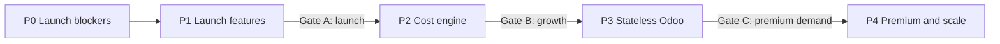
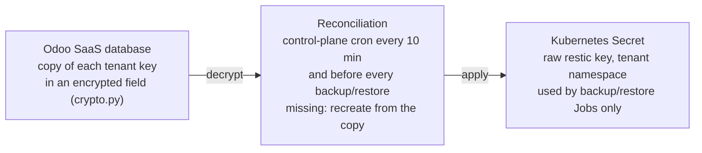
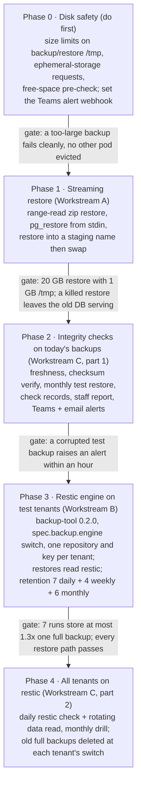
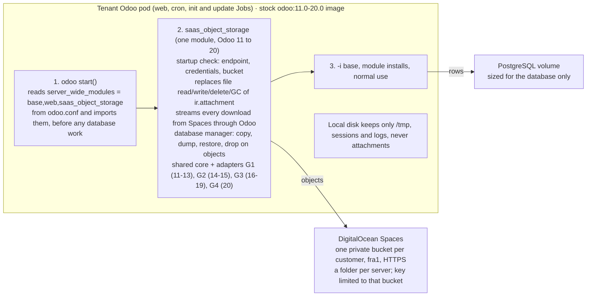

# Veltnex Implementation Plan

Oct 11, 2026 · @Mostafa · Revision 3 · Target design: [ARCHITECTURE-TARGET.md](ARCHITECTURE-TARGET.md)

This plan turns the target architecture into ordered, shippable items. The four earlier root plans are kept unchanged as Appendices A–D. Each item points to the appendix section that holds its detail. Where this plan differs from an appendix, "Changes to the earlier plans" lists the difference, and this plan wins.

Inside the appendices, an old file name means its appendix: `PLAN-backup-restore.md` is A, `PLAN-spaces-filestore.md` is B, `PLAN-cluster-capacity.md` is C, and `PLAN-postgresql-architecture.md` is D.

**Status: plan only. Revision 3 (2026-10-11):** it fixes the six problems found in the review (launch scope, cost model, ordering contradictions, design security holes, missing launch work, wrong references) and adds Bring Your Own Server, now on a `DockerComposeDriver` behind one infrastructure interface (owner direction, 2026-10-11). Decisions A1–A19 are approved (A14–A19 delegated by the owner); A20 waits for the legal review; A21 (BYOS design) is new. The launch itself runs from `../PLAN-cost-reduction.md`. Implementation starts only when the owner says so, after this document is accepted.

## How to use this plan

- **Order:** phases run in order. Items in a phase are independent unless a "Needs" line says otherwise. A gate must pass before the next phase starts.
- **Each item gives:**
    - **What:** the change;
    - **Where:** the files or components it touches (paths from the repository root);
    - **Done when:** the acceptance check.
- **Working rules:**
    - Every customer-facing flow is a rolling update with zero downtime, verified live with an HTTP poll. The only exception is a cross-pool move (1–3 minutes, at a customer-chosen time).
    - Odoo tests run on the SaaS server against a throwaway database. Runtime behaviour is verified on the DOKS test cluster.
    - When tests pass, commit and push to main. Deploying is done by hand, not by this plan.
    - Store-computed fields across addons get an upgrade-with-data test, not only a fresh install.
    - "Verified" and "assumption" have the same meaning as in the architecture. Every assumption an item relies on has a test in its "Done when".
- **IDs** are stable. Reference them in commits and PRs.

## Decisions and the items they drive

All approved on 2026-10-11 (A14–A19 delegated by the owner), subject to the launch acceptance criteria.

| Decision (architecture) | Items that wait for it |
| --- | --- |
| A1 CloudNativePG everywhere | P0.22, P1.9a, P1.9b, P2.2, P3.3, P4.1, P4.2 |
| A2 Production and non-production buckets | P1.4, P3.1, P3.4 |
| A3 Sessions database | P3.2 |
| A4 Separate tenant domain | P0.20, P0.7 (domain choice) |
| A5 Permanent TXT ownership | P1.1 |
| A6 Memory requests from measurement | P0.21, P0.18 (price floor uses it) |
| A7 Mail relay to SES | P1.8, P0.13 (mail egress) |
| A8 Attachments in staging and dev copies | P1.4 |
| A9 Shared cluster with 2 instances | P2.2 |
| A10 Performance insights split | P2.7, P4.7 |
| A11 Production backups included | P1.16 |
| A12 Read-only window for version upgrades | P1.18 |
| A13 Uptime promise | P0.23 |
| A14 Provider-agnostic cells | P0.25, P0.26, P2.10 |
| A15 Azure object storage | P2.10 |
| A16 Platform DNS provider: Cloudflare | P0.7, P0.26 |
| A17 Data residency | P0.25, P1.21 |
| A18 Provisioning modules: OpenTofu | P2.11 |
| A19 Region, provider and pricing model | P1.22 (deferred), P0.18 |
| A20 Enterprise source model and legal gate (pending legal) | P1.23 |
| A21 BYOS on a Docker Compose driver with the mTLS agent, behind one interface | P1.36, P1.32, P1.37, P1.38 |
| A22 Pricing: managed by resources, BYOS by subscription, Enterprise licence separate; marketing (no backups on Free; no annual discount on subscriptions) | P1.33, P1.34, P1.35 |

## Launch scope (revision 3)

**The launch is executed from [`PLAN-cost-reduction.md`](../PLAN-cost-reduction.md) at the repository root.** That plan carries the security musts, the launch features and the cost cuts, ordered by saving. This file is the target plan. Its items are grouped below by when they are needed, so the launch is not blocked by work that only pays off later.

**Tier L · must be done before the first paying customer:**

- **Security:**
    - P0.24 database role with limited rights;
    - P0.1 least privilege;
    - P0.19 separate Build pool;
    - P0.3 registry isolation (per-tenant repositories);
    - P0.20 separate tenant domain;
    - P0.8 request hardening;
    - P0.9 2FA;
    - P0.13 tenant egress;
    - P0.26-core: only the NetworkPolicy and metadata probes.
- **Data safety:**
    - P0.4 restore safety;
    - P0.5 backup key scope;
    - P0.6 PostgreSQL major-version guard;
    - P0.14 safe cancel;
    - P0.16 spread backups;
    - P0.17 backup tools per major;
    - P1.5 restic off-site backups;
    - P1.16 backups in every plan.
- **Operations:**
    - P0.10 CI gates;
    - P0.11 Alertmanager and alerts;
    - P0.12 capacity reader;
    - P0.15 operator availability;
    - P0.21 memory requests from measurement;
    - P0.27 customer migration and notice;
    - P0.28 maintenance windows for cluster upgrades;
    - P0.29 platform database on its own VM;
    - P1.25 cell disaster-recovery drill;
    - P1.26 load test;
    - P1.27 external pentest;
    - P1.28 legal documents;
    - P1.29 on-call, status page and control-plane observability;
    - P1.30 automated end-to-end walk-through.
- **Honesty and pricing:** P0.23 uptime target; P0.18 cost model (the internal cost floor behind A22); P1.31 usage metering; P1.33 freemium pricing; P1.34 marketing site.
- **Two hosting types under one control plane:** P1.36 one infrastructure interface; P1.32 BYOS on the `DockerComposeDriver` with the Veltnex agent, home of the Free plan; P1.37 capability matrix; P1.38 conformance test across runtimes.
- **Parity features:**
    - P1.1 custom domains (A5 procedure);
    - P1.2 submodules;
    - P1.3 Mailpit;
    - P1.8 mail relay (a stock relay at launch; see the cost plan);
    - P1.11 no Production deploy without tests;
    - P1.12 Odoo shell (short-lived credentials);
    - P1.14 logs including `pg_slow_queries.log`;
    - P1.15 uptime;
    - P1.17 promotion with a verified snapshot;
    - P1.7 Odoo 14–20 matrix;
    - P1.10 shell hardening.
- **Cost:** P2.1 sleep (owner decision: required); the shared non-production database (P2.2, 1 instance); P2.5 Shared pool.

**Tier L+ · within about 90 days after launch:**

- P1.9a and P1.9b CloudNativePG (core qualification, one major);
- P1.18 major-upgrade workflow, needed before any upgrade is sold;
- P1.35 agency white-label and client billing (the Agency plan itself sells at launch);
- P1.19 persona roles;
- P1.20 activity history;
- P2.7 performance insights v1;
- P2.3 archive;
- P2.4 control-plane scaling;
- P2.6 build cache;
- P2.8 stored logs;
- P2.9 OpenUpgrade.

**Later, when the trigger happens:**

| Items | Trigger |
| --- | --- |
| P0.25 provider adapters (beyond the per-cell backup target and rate card, which are in Tier L), P0.26-full, P1.21 residency enforcement, P1.22 region and provider pricing, P2.10, P2.11 | A signed customer needs a second region or provider |
| P1.4 buckets with P3.1 filestore, P3.2 sessions, P3.4 Odoo without a volume, P3.5, P3.6, P3.7 | Growth (P3) |
| P1.23 Enterprise | Legal gate passes (A20) |
| P1.13 SSH gateway | Owner decision: deferred |
| P4.1 HA, P4.2 PITR (with their CloudNativePG failover and PITR qualification), P4.3–P4.7 | Gate C |

**The owner's acceptance conditions (2026-10-11), and where each is tested:**

| Condition | Tested in |
| --- | --- |
| Automatic Production backups in every plan, with plan-based retention and recovery features | P1.16 "Done when" (no PITR at launch) |
| Major Odoo upgrades use a tested copy, a verified backup, a customer-selected window and a documented recovery procedure | P1.18 "Done when" |
| The website advertises an uptime target until HA passes failure and recovery tests; a contractual SLA only once the platform consistently meets it | P0.23, P4.1 |
| SSH gateway isolated and auditable | P1.13, when it is built (deferred) |
| No Production deployment proceeds when required tests fail | P1.11 "Done when" (every deploy path; grandfather rule) |
| A1: qualify CloudNativePG before adopting it | P1.9a (core); failover and PITR in P4.1 and P4.2 |
| A3: session behaviour, performance and cleanup | P3.2 |
| A5: procedure when the TXT record is deleted or the domain is lost | P1.1 |
| A9: failover, storage and contention on the shared cluster | P2.2, before the second instance |
| No tenant uses a PostgreSQL superuser | P0.24 |
| Sleep must reduce paid resources, with defined wake, cron, backup and billing behaviour | P2.1 "Done when" (metered node-hours) |

## Changes to the earlier plans

| Earlier plan | What changes here | Why |
| --- | --- | --- |
| A · Backup & Restore | Its Phase 0 (disk safety, alert webhook) and Phase 1 (streaming restore with swap) are P0.4. Its Phases 2–4 (integrity, restic) are P1.5, which adds manifest v2 (code identity), a snapshot-consistent file list, uncompressed dumps for restic deduplication, and a second-region copy. Key scope is P0.5. restic repositories stay in the backup bucket, which no customer key reaches. | Consistency model (architecture, concern 4) |
| B · Spaces Filestore | The design is kept, but on any provider's object storage through the object-storage adapter (P0.25); the DigitalOcean key API becomes that adapter's first implementation, and Azure needs A15. One bucket per customer becomes two: a Production bucket and a non-production bucket (A2), because Spaces keys are per bucket only (verified). The bucket and keys are created in P1.4. The filestore is P3.1, delivered through the operator's platform-addons ConfigMap (`compute/operator/internal/resources/platformaddons.go`). It keeps web assets and files under 64 KiB in the database, reads through a local cache, retries reads that come back 404 just after a write, and uses a 14-day `trash/` lifecycle. Three adapter generations are built, for Odoo 14–20: 17–19, then 16 and 20, then 14–15. Appendix B's generation for 11–13 (G1) is dropped, because the platform sells 14–20. Sessions are P3.2. | Concerns 3 and 5 |
| C · Cluster Capacity | Its DOKS-specific parts (autoscaler status ConfigMap, `doctl`, `do-block-storage`) go behind the capacity adapter and per-cell settings (P0.25). Its Phase 1 is P0.12. Pools arrive by phase: Build in P0 (P0.19, security), Shared in P2 (P2.5), Large on demand (P4.3). HA is not a pool. Its Phases 3 and 4 are P3.5 and P3.6. | Concern 7 |
| D · PostgreSQL | CloudNativePG becomes the engine for every new environment (A1): dedicated 1-instance per Production (P1.9b, after the P1.9a qualification), shared for non-production (P2.2) with 2 instances and no PgBouncer. Sleep windows are dev 1 h, staging 2 h, trials 1 h; Production never sleeps (P2.1). Its cost table is superseded by the corrected model (architecture, concern 6). | Concerns 1, 6 and 7 |

## P0 · Launch blockers

Before launch. "Launch blocker" marks a finding from the review.

**P0.1 Least-privilege cluster access for the control plane.** Launch blocker.
- **Today (verified):** bootstrap binds the control plane's ServiceAccount to `cluster-admin` (`scripts/bootstrap/bootstrap.py:215`).
- **Calls the control plane makes** (grep of `saas_core`):
    - OdooInstance get, create, patch and delete;
    - namespaces read and list;
    - deployments listed across all namespaces;
    - in tenant namespaces: pods (list, read, create, delete, exec, log), secrets, jobs, a cron job read, a deployment patch, config maps, network policies, a service-account read and a lease read;
    - the Prometheus service proxy;
    - `odoo-builds` and the toolbox namespace;
    - one config map in `kube-system`.
- **Design.** RBAC cannot match namespace prefixes, so the grant is split three ways:
    1. **ClusterRole `veltnex-control-plane`:** OdooInstances CRUD; namespaces, nodes and deployments read only.
    2. **Roles in fixed namespaces:**
        - `odoo-builds`;
        - the toolbox namespace;
        - `monitoring`: `services/proxy` on the Prometheus service only;
        - `kube-system`: get on `cluster-autoscaler-status` only.

       No role can read Secrets in the ingress, `cert-manager` or `veltnex-mail` namespaces.
    3. **Per-tenant RoleBinding:** a binding to ClusterRole `veltnex-tenant-access`, created by the operator in every tenant namespace. It does **not** include `serviceaccounts/token`. The deferred SSH gateway (P1.13) has the operator mint its tokens instead.
- **Steps:**
    1. The chart template is `compute/charts/odoo-operator/templates/controlplane-rbac.yaml`.
    2. The operator adds the binding in `resources/tenancy.go`.
    3. Bootstrap creates the fixed namespaces and issues the kubeconfig (`bootstrap.py`, `register_cluster.py`).
    4. Run a week on the test cluster, logging every 403. Then remove `cluster-admin`.
- **Done when:**
    - `kubectl auth can-i --list` shows no cluster-wide write except OdooInstances;
    - the full UI walk-through passes.

**P0.2 Platform database recovery.** Closed on 2026-10-11: the owner backs it up outside the repository. A restore-drill runbook goes in `setup/02-SAAS-SERVER-SETUP.md`.

**P0.3 Private registry with per-tenant access.** Launch blocker. Includes the former P1.24.
- **What:**
    - **Registry:** a private registry per cell, backed by the cell's object storage, with token authentication and per-repository permissions. It is chosen once, in P0, so nothing is built twice. Options: Harbor with a robot account per tenant project, or a token server in front of `registry:2`. Pick by memory footprint on the cell.
    - **Pull credentials:** each tenant namespace holds a pull credential for **its own repository only**. Today the same push-capable login is copied everywhere (verified: `k8s_builds.py:412`).
    - **Push credentials:** each build gets a push credential limited to its tenant's repository, used only on the Build pool.
    - **Platform images:** operator and backup-tool images move to an organization repository, pinned by digest.
    - **Validation:** `saas.server` refuses a public registry.
- **Where:** `control-plane/saas_core/models/saas_server.py`, `control-plane/saas_core/drivers/k8s_builds.py` (`_upsert_pull_secret`, build push credentials), `compute/charts/odoo-operator/values.yaml`, `compute/operator/internal/resources/backup.go`, `setup/04-IMAGES-AND-REGISTRY.md`, `.github/workflows/cd.yml`.
- **Done when:**
    - an anonymous pull fails;
    - tenant A's pull credential is refused for tenant B's repository;
    - a build's push credential cannot push to another repository;
    - existing tenants roll to their own credentials with zero failed requests.

**P0.4 Restore safety.** Appendix A, Phase 0 and Workstream A.
- **What:**
    - bounded `/tmp`;
    - streaming restore, never through local disk;
    - where the restore goes (settled 2026-10-11):
        - **on CloudNativePG:** into a new cluster on a new volume, then switch Odoo to it after verification; the old cluster is deleted after 24 hours;
        - **on the Managed StatefulSet:** into a new volume and pod, or `<db>__restoring` when the volume has room, then the swap;
        - drop-then-load only on Managed tenants that have not moved yet, and only after a fresh verified backup.
- **Where:** `compute/operator/internal/resources/backup.go:73`, `restore.go:94`, `compute/tools/backup-tool/run-restore.sh`, `control-plane/saas_core/models/saas_instance.py` (`_do_restore_backup`, `_do_copy_dbs`).
- **Done when:** Appendix A's checks for disk safety, large restore, safe failure and bad upload pass, and a restore never requires growing the live volume.

**P0.5 Backup key scope.** Launch blocker.
- **Steps:**
    1. Create a key granted only on the backup bucket and roll it through `_cron_sync_scheduled_backups`. Revoke the old key.
    2. Encrypt the keys in settings (`res_config_settings.py:100`).
    3. Turn on bucket versioning, with old versions expiring after 30 days. *Assumption:* Spaces supports expiring old versions. If it does not, rely on the second-region copy (P1.5).
    4. *(Delivered later, in P1.5)* per-tenant restic passwords.
    5. *(Delivered later, in P3.4)* backup Jobs move to a platform namespace.
- **Done when:**
    - the old key is revoked and every tenant's next backup succeeds;
    - the new key cannot list other buckets;
    - a deleted backup object is recovered.

**P0.6 Guard PostgreSQL major-version changes.** Launch blocker.
- **What:**
    - a CEL transition rule on `spec.database` (`self.version == oldSelf.version`);
    - the operator records `status.database.runningMajor` and keeps the old image on any mismatch, as defence in depth;
    - upgrades happen only by restoring into a new environment.
- **Where:** `compute/operator/api/v1alpha1/odooinstance_types.go`, `controller/database.go:256`, `validate.go`, `compute/charts/odoo-operator/crds`, `kubernetes_driver.py`.
- **Done when:**
    - a patch from 16 to 17 is refused by the API server and the database keeps serving;
    - an envtest covers both layers.

**P0.7 Wildcard TLS for the tenant domain, with protections.** Launch blocker. Needs A4 for the domain name.
- **What:** one `*.<tenant-domain>` certificate through DNS-01, held in Traefik's default `TLSStore`, with `spec.domain.tls.mode: Shared` for platform hosts. It is protected by:
    - **Delegated challenge:** `_acme-challenge.<tenant-domain>` is a CNAME into a dedicated challenge zone on Cloudflare (A16). cert-manager's API token is scoped to that zone only, so it can change nothing else.
    - **CAA records:** they allow only Let's Encrypt and only the platform's ACME account (`accounturi`), for `issue` and `issuewild`.
    - **Certificate Transparency watch:** an alert on any certificate for the tenant domain that the platform did not order.
    - **Key location:** the key lives only in Traefik's namespace (P0.1 denies reading it).
    - **Separate ACME accounts** for the wildcard and for custom domains (P1.1).
    - **Renewal:** at 30 days left, with an expiry alert at 14 days (P0.11).
    - **Subdomain quarantine:** a cancelled tenant's subdomain is quarantined for 90 days (*assumed*).
- **Steps:**
    1. ClusterIssuer and token (`scripts/bootstrap/doks.sh`).
    2. Certificate and `TLSStore` (`compute/charts/vendor/traefik` values).
    3. Operator `tls.go` and `route.go` with tests.
    4. Control plane sets `Shared` for new environments.
    5. Switch existing tenants in batches of 10, then delete their old Certificates after a day.
    6. Update the bootstrap readiness check.
- **Done when:**
    - 60 environments are created in one day with valid TLS and one Let's Encrypt order;
    - a certificate requested for the tenant domain from another ACME account is refused (CAA);
    - the CT watch raises an alert on a test certificate issued from the Let's Encrypt staging environment.

**P0.8 Request hardening.**
- **What:**
    - take the client IP from the proxy-appended address only;
    - secret encryption fails closed;
    - encrypt `webhook_secret`.
- **Where:** `control-plane/saas_website/controllers/api.py:162`, `main.py:1246`, `control-plane/saas_core/crypto.py`, `fields.py`, `models/saas_instance_repo.py:164`.
- **Done when:**
    - a forged header does not reset rate limits;
    - a server started without a key exits.

**P0.9 Two-factor authentication.**
- **What:** TOTP, required for staff and for any customer role that can open a shell or the SQL console.
- **Where:** `saas_core/__manifest__.py` (`auth_totp`), `saas_iam`, `saas_website/controllers/api.py`, `frontend/veltnex`.
- **Done when:** a user without TOTP cannot open a shell.

**P0.10 CI gates.**
- **What:** tests, typecheck, lint and scans become required before `cd.yml` deploys.
- **Done when:** a failing test blocks the deploy.

**P0.11 Alerts that reach people.**
- **What:**
    - the Teams webhook and a Teams message format in `saas_alert.py`;
    - Alertmanager rules for nodes not ready, pods pending over 5 minutes, PVCs above 85%, backups older than 27 hours, certificates expiring within 14 days, the operator down, the mail relay down, and SES bounce or complaint rates.
- **Done when:** each rule fires once on the test cluster.

**P0.12 Capacity reader, ceilings and alerts.** Appendix C, Phase 1.
- **Done when:** Appendix C's Phase 1 checks pass.

**P0.13 Tenant egress policy.** Launch blocker. Needs A7.
- **What:**
    - **No inbound mail:** no SMTP port is opened for inbound traffic anywhere.
    - **Egress allowed:**
        - DNS;
        - 443 to the internet, with `except` for the pod, service and VPC ranges, link-local `169.254.0.0/16` (cloud metadata on every provider) and `100.64.0.0/10`, the same list as `_BLOCKED_CIDRS` in `k8s_builds.py`;
        - 993 and 995 to the internet, for Odoo's incoming mail servers;
        - SMTP only to the in-cluster mail relay (P1.8).
    - **Direct SMTP:** direct SMTP to the internet stays closed, so quotas cannot be bypassed. A per-tenant exception to one named host is staff-approved.
    - **Inside the namespace:** only Odoo to PostgreSQL on 5432, plus the gateway, ACME and perf-collector paths.
    - **Configurable:** ports and ranges come from operator values (`tenantEgress.*`).
- **Where:** `compute/operator/internal/resources/networkpolicy.go`, `controller/network.go`, `compute/charts/odoo-operator/values.yaml`, `scripts/bootstrap/doks.sh`.
- **Done when:**
    - `curl https://kubernetes.default` from a tenant fails;
    - SMTP to an internet host fails;
    - once P1.8 ships, SMTP to the relay works (checked in P1.8, not at P0);
    - IMAP 993 to an internet host works;
    - the UI walk-through passes.

**P0.14 Safe cancel.**
- **What:** deletion waits for the final backup to succeed; after a timeout it stops and alerts staff.
- **Where:** `compute/operator/internal/controller/finalize.go:52–59` (the final-backup wait) and `:101` (the 2-minute timeout). Today deletion goes ahead after a failed final backup (verified).
- **Done when:** a cancel with the bucket unreachable keeps the namespace and raises an alert.

**P0.15 Operator availability.**
- **What:** 2 replicas with leader election (`templates/deployment.yaml:45`).

**P0.16 Spread backup start times.** Launch blocker.
- **What:** a schedule from `offset = crc32(subdomain) % 240`, giving `M H * * *` across 01:00–04:59 UTC, passed from `_sync_scheduled_backup` to `set_scheduled_backup`. Existing tenants converge within 30 minutes.
- **Done when:** 20 tenants show 20 different minutes.

**P0.17 Backup tools for every PostgreSQL major.** Launch blocker.
- **What:**
    - the backup-tool image ships `postgresql-client-13` to `-17`, selected by `PG_MAJOR`, with a server-version check;
    - on-demand dumps and restores run in the PostgreSQL container instead of the Odoo container;
    - until this ships, the control plane offers only supported majors.
- **Where:** `compute/tools/backup-tool/*`, `resources/backup.go`, `restore.go`, `saas_instance_backup.py:73`, `kubernetes_driver.py` (`exec_stream_out`).
- **Done when:** the 13–17 test matrix passes, and a PostgreSQL 17 tenant backs up and restores.

**P0.18 Price floor from the corrected cost model.** Needs A6.
- **What:**
    - **Cost function:** the one in the architecture (revision 3). It uses the larger of the CPU and memory share against usable node capacity, packing per node size, and the dedicated database line, plus storage, backups, mail, and overhead by the number of tenants in the cell.
    - **Inputs:** it reads the per-cell rate card from P0.25. The per-offering price lists of P1.22 come later.
    - **Floor:** prices are at least the variable cost ÷ 0.37 (60% after about 3% card fees), with a target of ÷ 0.27 (70%) at scale. Add-ons follow the same floor.
    - **Margin reports** show the curve by tenants per cell, and the margin cron alerts below 60%. Margin never comes from cutting isolation, backups or security.
- **Where:** `control-plane/saas_billing/models/saas_pricing.py`, the margin cron in `saas_billing`, `control-plane/saas_core/models/saas_plan.py` (`_package()` plus a `_cost()`), `saas_server.py` (rate card).
- **Done when:**
    - a plan below the floor cannot be published;
    - on the test cluster, the model's cost for one month is within 15% of the cluster's real DigitalOcean invoice split by the metering (P1.31). This is a comparison against reality, not against the model itself.

**P0.19 Tainted Build pool.** Launch blocker (security).
- **What:** a DOKS pool `build` with min 0 and taint `saas.platform/pool=build:NoSchedule`. Build Jobs get the toleration and node affinity; nothing else tolerates it. This is needed because customer `pip install` runs with seccomp and AppArmor `Unconfined` (verified, `k8s_builds.py:288`).
- **Also check:** BuildKit does not mount the client's `config.json` into `RUN` steps.
- **Where:** `control-plane/saas_core/drivers/k8s_builds.py`, `setup/03b-DOKS-CLUSTER-SETUP.md`.
- **Done when:**
    - a build scales the pool from 0 and back;
    - no tenant pod lands on it;
    - a `RUN cat /home/user/.docker/config.json` test step finds nothing.

**P0.20 Separate tenant domain.** Launch blocker. Needs A4 and an owner action: registering the domain.
- **What:**
    - register a new registrable domain for tenant apps, separate from the portal's;
    - move base domains to it, with old hosts redirected for a transition period (customer notice in P0.27);
    - submit the **wildcard rule `*.<tenant-domain>`** to the Public Suffix List, so each region label is a public suffix and every tenant host is its own site.
- **Launch does not wait for the List's merge,** which takes weeks to months. The separate domain alone protects the portal.
- **Where:** `saas.based.domain` records, `scripts/bootstrap/*`, docs.
- **Done when:**
    - a cookie set by a tenant page for the parent domain is not sent to the portal (browser test);
    - the List pull request is filed.

**P0.21 Memory requests from measurement.** Needs A6.
- **What:** set per-plan Odoo, cron and database requests from measured p95 working sets (Prometheus). Memory requests are roughly the p95 working set; CPU requests drop toward measured use. Existing tenants are resized by a rolling update.
- **Where:** `saas_core/models/saas_plan.py` (`_package()`, `_REQUEST_RATIO`, per-worker settings).
- **Done when:**
    - no tenant's working set exceeds its memory request for more than 10% of a week;
    - no evictions in that week.

**P0.22 Vendor the CloudNativePG operator.** Needs A1.
- **What:** vendor the chart in `compute/charts/vendor/cloudnative-pg` (repository rule) and install it in each cell. Nothing uses it until P1.9a qualifies it.
- **Done when:** the operator runs in the test cluster and survives a node drain.

**P0.23 The website advertises an uptime target, not an SLA.** Launch blocker. A13 approved.
- **What:**
    - replace "99.99% uptime SLA" (`frontend/veltnex/src/pages/Hosting.tsx:95`) and the "Uptime target" figure (`Home.tsx:584`), plus their Arabic strings, with an **uptime target** that the single-pod design meets;
    - the target's wording says it is a goal, not a contractual commitment;
    - no page, plan, invoice or terms text offers an SLA or credits.
- **When an SLA may be introduced:** only after both conditions hold:
    1. HA (P4.1) has passed its failure and recovery tests;
    2. measured uptime (P1.15) has met the proposed SLA for at least 3 consecutive months on the plans it would cover (*assumed* period).

  It needs a separate decision by the owner.
- **Done when:** a review of every public page, in both languages, finds no SLA wording, and the target matches what P1.15 measures.

**P0.24 No PostgreSQL superuser for any tenant.** Launch blocker (owner, 2026-10-11). Applies to every environment, existing and new, on every engine.
- **Today (verified):** the Managed PostgreSQL pod creates the tenant login as the image's `POSTGRES_USER` (`compute/operator/internal/resources/database.go:92`), which is the bootstrap superuser. Odoo, cron, the update Job, the SQL console (`saas_instance.py:2191`), the database manager, backups and restores all use it, and customer code can read it from `odoo.conf`.
- **Design: two logins per database server.**
    - **`veltnex_admin`:** superuser, kept in a new Secret `odoo-database-admin`. It is used only by the PostgreSQL pod and by platform Jobs that truly need it: creating roles, restore swap, terminating sessions, granting `pg_monitor` to the perf collector. It is never mounted into Odoo, cron or the shell.
    - **`odoo_owner`:** `LOGIN NOSUPERUSER NOCREATEROLE NOREPLICATION NOBYPASSRLS`, with `CREATEDB` only on dedicated servers. It owns every Odoo database and the objects in them, and lives in `odoo-database-credentials`. It is what Odoo, cron, the update Job, the SQL console and the Odoo shell use.
    - **Extensions:** Odoo's extensions (`unaccent`, `pg_trgm`) are created in `template1` by the admin, so they exist without superuser. They are trusted extensions from PostgreSQL 13.
    - **Restores:** `pg_restore --no-owner --role=odoo_owner`, so every restored object belongs to the owner. The swap and session termination use the admin.
    - **Database manager:** "create" and "duplicate" (`CREATE DATABASE … TEMPLATE`) work as the owner, because it owns the source database and has `CREATEDB`. "Drop" works on its own databases.
    - **CloudNativePG (P1.9a and P1.9b):** its application user is a non-superuser owner, and superuser access is off by default (*assumption*, checked in P1.9a).
    - **Shared non-production clusters (P2.2):** no `CREATEDB`; database operations go through the platform.
- **Migrating existing tenants (zero downtime):**
    1. A platform Job, as the admin, creates `odoo_owner` with a new password. For each Odoo database it runs `ALTER DATABASE … OWNER`, changes the owner of schema `public`, and sets the owner of every table, sequence, view, materialized view and function owned by the old login. These are catalog-only changes in one transaction per database.
    2. Write the owner credentials to `odoo-database-credentials`, and move the old superuser to `odoo-database-admin` with a **rotated password**. Customer code could read the old one.
    3. A rolling update of the Odoo pod picks up the new credentials. Old pods keep their connections until they are replaced.
    4. Verify from the new pod that `SELECT rolsuper FROM pg_roles WHERE rolname = current_user` returns false.
- **Where:**
    - operator: `resources/database.go`, `secrets.go`, `configmap.go` (the `odoo.conf` login), `init_job.go`, `update_job.go`, `backup.go`, `restore.go`, `deployment.go` (console config);
    - backup tools: `compute/tools/backup-tool/run-restore.sh` and `run-backup.sh`;
    - control plane: `saas_core/models/saas_instance.py` (`hosting_sql_query`, `_do_restore_backup`, `_do_copy_dbs`, neutralize and mask), the database-manager platform addon (`resources/platformaddons/saas_tenant_dbm`), and a migration action for existing tenants.
- **Done when (retested after the rights are reduced):**
    - from Odoo and the SQL console, `rolsuper` is false, and these are refused: `COPY … TO PROGRAM`, `pg_read_server_files`, `ALTER SYSTEM`, `CREATE ROLE`;
    - a new environment initialises (`-i base`), installs and upgrades modules (`-u` and the update gate);
    - database-manager create, duplicate and drop work on a dedicated server;
    - backup, per-database restore, full restore and the restore swap all work;
    - a Production-to-staging copy with neutralization and masking works;
    - *(re-run when P2.7 ships, which also enables `pg_stat_statements`)* the perf collector reads it through `pg_monitor`;
    - Odoo 17–20 (in the chart today) pass the above; it is re-run for 14–16 in P1.7, and on CloudNativePG in P1.9a;
    - an existing tenant is migrated with zero failed requests in an HTTP poll, and its old password no longer logs in.

**P0.25 Remove provider and single-location assumptions from the code.** Launch blocker. Needs A14 and A17.
- **What:**
    - **Backup target per cell:** move backup storage from the global setting (`res_config_settings.py`) to a storage target on each cell (`saas.server`), with endpoint, bucket, region and encrypted key. Backups, snapshots and restores use the tenant's cell target. Existing tenants keep the current bucket as their cell's target.
    - **Per-cell infrastructure names:** storage class, load-balancer annotations and node-pool label values become cell settings, not constants or DigitalOcean defaults.
    - **Object-storage adapter:** behind an interface (buckets, scoped keys, lifecycle, versioning, server-side copy). DigitalOcean Spaces is the first implementation; data paths stay on the S3 API.
    - **Capacity adapter:** reads the Cluster Autoscaler status where present, else pending pods and node conditions. Pool ceilings stay manual.
    - **Rate card per cell:** node price, node allocatable, volume price and minimum volume size, replacing `cost_per_cpu_month` plus `cost_per_gb_ram_month` (`saas_server.py:190`). P0.18 uses it.
    - **Region policy fields on `saas.region`:** jurisdiction, allowed providers, allowed locations for data, backup copies, logs and mail upstream.
- **Where:** `control-plane/saas_core/models/saas_server.py`, `saas_region.py`, `res_config_settings.py`, `saas_instance_backup.py`, `drivers/kubernetes_driver.py`, new `control-plane/saas_core/providers/` (object storage, DNS, capacity, mail upstream), `scripts/bootstrap/`.
- **Done when:**
    - no code path outside `providers/` names a provider;
    - two backup targets configured on the one launch cell (a per-cell setting) each receive and restore their tenants' backups; a second cell is not needed;
    - existing tenants' backups continue unchanged.

**P0.26 Cell contract checker.** Launch blocker. Needs A14.
- **What:** bootstrap runs the cell contract from the architecture as automated probes before a cell is registered, and again after every cluster upgrade:
    - NetworkPolicy enforcement, including the cloud metadata address being unreachable from a tenant probe and a build probe;
    - CSI expansion;
    - LoadBalancer for HTTP, HTTPS and TCP 22;
    - pool labels and taints;
    - an object-storage key unable to read another bucket;
    - endpoints inside the region's allowed locations;
    - outbound reach to the control plane and the mail upstream.

  A cell that fails any check cannot take customers.
- **Where:** `scripts/bootstrap/bootstrap.py` (checks exist for PVC, DNS and certificates; extend them), `register_cluster.py`, `setup/09-BOOTSTRAP.md`.
- **Done when:** the DOKS cell passes, and a cluster with NetworkPolicy enforcement turned off, or with metadata reachable, fails with a clear message.

**P0.27 Migrating existing tenants, with customer notice.** Launch blocker.
- **What:** one cutover runbook and a communication schedule for every change that affects tenants already running:
    - the tenant domain move with redirects (P0.20, P0.7);
    - egress now blocked (P0.13): port 80, SMTP to customers' own servers, SFTP and external databases. Customers who use them get a per-host exception or a migration path;
    - the database password rotation (P0.24);
    - the registry switch (P0.3);
    - the backup add-on credit (P1.16);
    - the test rule on existing branches (P1.11);
    - the move to `s-4vcpu-8gb` nodes.
- **Notice periods:** 14 days for breaking changes and 3 days for maintenance (*assumed*).
- **Done when:** every live tenant has gone through each change with zero failed requests in an HTTP poll, or within its announced window. The notices are archived.

**P0.28 Maintenance windows for cluster upgrades.** Launch blocker.
- **What:**
    - turn off automatic Kubernetes and node upgrades on every cell;
    - upgrades run in announced weekly windows;
    - nodes are drained one at a time, with the pre-P3 1–3 minute interruption per tenant stated in the notice;
    - after P3, drains are without downtime.
- **Where:** cluster settings (`setup/03b`), runbook, status page (P1.29).
- **Done when:** a cell upgrade runs in a window with notices sent, and every tenant is back within its stated interruption.

**P0.29 Platform database on its own VM.** Owner decision 2026-10-11: the owner runs it.
- **What:**
    - move the platform database from the application VM to a separate VM on the private network, managed by the owner;
    - the application VM connects over the private network and is rebuildable by bootstrap;
    - recommended to the owner: WAL archiving to object storage alongside their backups;
    - this database holds the usage metering (P1.31), so its growth is monitored.
- **Where:** `setup/02-SAAS-SERVER-SETUP.md`, `scripts/bootstrap/ubuntu_saas.py`, `scripts/deploy/saas-deploy.sh`.
- **Done when:** the application VM is rebuilt from bootstrap against the separate database with no data loss, and the owner's restore drill passes.

## P1 · Launch features

**P1.1 Custom domains for Production.** Needs A5.
- **Flow:**
    1. The customer adds `erp.customer.com` in the portal (cap of 5 per environment, *assumed*).
    2. The portal shows two records:
        - a CNAME to the environment host (or an A record for an apex, with a warning);
        - a TXT `_veltnex-challenge.erp.customer.com` with a random token bound to the customer and the environment.
    3. **Verification:** the token proves ownership, and the CNAME or A record proves routing. Both are required. HTTP checks are not used as ownership proof.
    4. **Issuance:** a separate ClusterIssuer with its own ACME account issues an HTTP-01 certificate for that host only, after both checks pass.
    5. **Primary domain:** the control plane sets `web.base.url` and `web.base.url.freeze`.
- **Ongoing:**
    - the TXT record stays in place and is re-checked daily and before each renewal;
    - if it is missing for 7 days, the host is disabled, its renewal stops and the customer is told.
- **Ownership lost (A5 procedure):** the TXT record is deleted or changed, the domain expires, or the zone changes hands.
    - **Day 0:** a dashboard finding and a short email to owners. The domain keeps serving.
    - **Days 1–7:** grace. Restoring or re-verifying clears it.
    - **Day 7:** the host leaves routing, renewal stops and the certificate is revoked through ACME. `web.base.url` reverts if the domain was primary.
    - **Another party proves a new TXT token:** the DNS owner wins. The old binding and its certificate go at once, and the previous customer is told.
    - **Routing record removed but TXT still present:** a warning only.
- **Release and reuse:**
    - removing a domain, or cancelling, takes the host out of routing at once and keeps a release record;
    - the same customer may re-add it with their token;
    - any other customer needs a new token proven through TXT.
- **Routing safety:**
    - exact-host rules only, with a default 404;
    - a host is unique platform-wide, through a database constraint plus an operator check before it writes an Ingress;
    - a blocklist of platform and portal domains;
    - no wildcard customer domains.
- **Where:**
    - new model `saas.instance.domain` (host, state, primary, token, last checks);
    - `kubernetes_driver.py`;
    - a **new** CRD field `spec.domain.extraHosts`; `DomainSpec` (near `odooinstance_types.go:225`) has only `hostname` and `tls` today;
    - operator `route.go`, `tls.go`, `networkpolicy.go`;
    - a ClusterIssuer in bootstrap;
    - `saas_website/controllers/api.py`;
    - `frontend/veltnex` (domain page, Arabic in `ar.json`).
- **Done when:**
    - a verified domain serves TLS within 5 minutes;
    - an HTTP poll on the default host has zero failures during add and remove;
    - invitation emails use the primary domain;
    - a second customer cannot claim a released domain without a new TXT token;
    - a domain whose TXT is removed is warned on day 0 and disabled with its certificate revoked on day 7;
    - a second customer proving a fresh TXT for a lost domain takes it over, and the first binding is removed with a notice.

**P1.2 Git submodules.**
- **What:** recursive fetch with the same host's credentials; record each submodule's commit.
- **Where:** `saas_core/templates/build/fetch.sh`, `inspect.py`, `models/saas_instance_build.py`.
- **Done when:** a repository with an OCA submodule builds and installs on staging.

**P1.3 Mailpit.**
- **What:** one Mailpit per cell. It runs on the Standard pool until P2, then on the Shared pool. Neutralization points staging and dev mail at it. The portal shows each environment's mail.
- **Where:** `_NEUTRALIZE_SQL` (`saas_instance.py:3449`), `compute/charts/vendor/mailpit`, `frontend/veltnex`.
- **Done when:** a staging password-reset mail appears in that environment's tab and never reaches the relay.

**P1.4 Production and non-production buckets.** **Moved to P3, delivered together with P3.1**, because nothing stores files in them before the filestore moves. Needs A2 and A8.
- **What, at P3:**
    - each customer gets a Production bucket and a non-production bucket from the pool, through the object-storage adapter (P0.25), plus a key granted on each;
    - the Production key goes only to Production namespaces, and the non-production key only to staging and dev;
    - **trials get no bucket of their own:** a prefix in a platform trial bucket, copied into the customer's buckets on conversion. That keeps trial churn away from the 100-bucket account limit;
    - Production-to-staging file copies are a server-side copy by a platform Job;
    - dev copies include attachments only on request (A8);
    - ask the provider for higher bucket and key limits before P3.
- **Done when:**
    - a staging pod's key cannot list the Production bucket;
    - a copied staging environment opens its attachments.

**P1.5 restic backups, consistency and an off-site copy.** Appendix A, Workstreams B and C.
- **What:** everything in Appendix A, plus:
    - **Snapshot-consistent file list:** in one transaction, export the snapshot and list `ir_attachment.store_fname`; run `pg_dump --snapshot`; copy exactly the listed files. Garbage collection is paused for the backup window while files are on volumes.
    - **Manifest v2:** databases, PostgreSQL major, Odoo version, image digest, build id and commit, module fingerprint, plan, and referenced and missing file counts.
    - **Dumps for deduplication:** uncompressed `pg_dump -Fc -Z0` piped to `restic backup --stdin`.
    - **Second region:** a nightly copy of Production repositories.
    - **Restore modes:** "exact image" or "current code" (the update gate runs after loading).
    - **Post-restore check:** health, login, and zero missing referenced files.
- **Done when:**
    - Appendix A's checks pass;
    - missing files in a manifest are 0 on 20 test tenants;
    - deduplication over 7 days is at most 1.3× one full backup (*assumption* tested here);
    - a second-region restore works.

**P1.21 Data residency enforcement.** Needs A17.
- **What:**
    - **Placement:** the region policy (P0.25) is enforced at every place data can move: environment creation, Production-to-staging copies, backups and their second-region copy, restores, cross-cell moves, stored logs, archives and the mail upstream.
    - **Refusals:** a move outside the allowed locations is refused with a clear reason.
    - **Customer view:** the portal shows each environment's provider, country and backup locations.
    - **Lower durability:** where only one site exists in a country, the customer is told that backup durability is lower.
- **Where:** `saas_core/models/saas_region.py`, `saas_instance.py` (allocation, copy, move), `saas_instance_backup.py`, P1.5's copy Job, P1.8's relay settings, `frontend/veltnex`.
- **Done when:**
    - a copy or restore to a disallowed region is refused;
    - every object a test tenant owns lies in allowed locations (an inventory script);
    - the portal shows the locations.

**P1.22 Region and provider choice, with pricing per provider.** **Deferred to P2.10**, when a second provider or region is onboarded: with one offering the step is skipped by its own rule, and a provider change needs cross-cell moves that do not exist at launch. Needs A19. The design is unchanged: offerings per region, a price per plan per offering above that offering's floor, and allocation within the chosen offering.

**P1.23 Odoo Enterprise (bring your own), behind a legal gate.** Needs A20. Launch blocker for offering Enterprise only; Community launches without it.
- **Legal gate first:** a written legal confirmation of:
    - the customer's right to have their subscription hosted by Veltnex;
    - any rights Veltnex needs from Odoo;
    - the treatment of staging and dev copies.

  Until it exists the Enterprise option stays hidden (a feature flag, off).
- **What:**
    1. **Order:** the customer enters their subscription code, picks a version from 14 to 20, accepts the subscription terms, and connects the Enterprise repository they are entitled to (or their copy) as a repository or submodule.
    2. **Build:** it fetches that source with the customer's credentials, refuses a version mismatch (manifest version prefix), and builds into the tenant's own registry repository (P1.24). The P2.6 build cache is per tenant for repositories that contain Enterprise code.
    3. **Provisioning:** as for any environment, plus `web_enterprise`.
    4. **Registration:** the platform writes the subscription code to the database as Odoo's registration expects, and Odoo's own registration runs. No patching, no skipped checks.
    5. **Monitoring:** a daily read-only check of Odoo's subscription status (expiration date and reason) and active users, shown in the portal. It alerts at 30 and 7 days before expiry and on an invalid status. Staff are alerted to status changes made outside Odoo's registration.
    6. **Copies:** staging and dev copies get a new database UUID, are neutralized and are never registered as Production.
- **Where:** `saas_core/models/saas_product.py` and `saas_instance.py` (edition, subscription code stored encrypted), `drivers/k8s_builds.py` and `templates/build/` (per-tenant cache and version check), `_NEUTRALIZE_SQL` (new UUID for copies), the perf collector or a small read-only Job for the status read, `frontend/veltnex` (Enterprise option, status card), terms of service.
- **Done when:**
    - the legal confirmation is filed;
    - with the flag on in the test cluster, an Enterprise 17 project builds from a test entitlement, registers through Odoo's own flow, and shows its status;
    - a second tenant cannot pull the first tenant's image (P1.24);
    - a staging copy has a different UUID and stays neutralized;
    - no code path writes Odoo's expiration values.

**P1.24 (merged into P0.3).** Per-tenant registry access is now part of P0.3, so the registry is built once.

**P1.7 Odoo 14–20 support matrix.** Decided on 2026-10-11: the platform sells Odoo 14 to 20.
- **What:**
    - a matrix of Odoo version, image, Python and PostgreSQL major, using as few majors as possible, starting with Odoo 14, the oldest, on PostgreSQL 13;
    - `supportedOdooVersions` covers 14.0–20.0 (today 17.0–20.0);
    - versions 14–16 must be added to the chart and to `saas.odoo.version`;
    - a portal notice on versions Odoo no longer patches, with an upgrade offer (P1.18);
    - Enterprise: see P1.23 (legal gate, bring your own source, tenant-only images).
- **Where:** `compute/charts/odoo-operator/values.yaml`, `saas_core/models/saas_odoo_version.py`, `kubernetes_driver.py`.
- **Done when:** one tenant per version deploys, builds an addon, backs up and restores.

**P1.8 Mail relay to AWS SES.** Needs A7.
- **What:**
    - **The relay:**
        - a 2-replica SMTP relay in namespace `veltnex-mail`, reachable only from tenant namespaces;
        - it holds the only SES credential and sends to SES over HTTPS (443), so it needs no SMTP egress;
        - no AWS credential exists in any tenant namespace.
    - **Per-environment credentials:**
        - each Production environment gets relay credentials that are platform-issued, encrypted and revocable;
        - they are written into its database as the outgoing mail server;
        - staging and dev have none (Mailpit).
    - **Relay checks:**
        - `From` must be a verified domain of that customer (SES DKIM records shown in the portal) or the platform mail subdomain;
        - rate limits per minute and recipient caps;
        - message size caps;
        - an SES message tag with the tenant id;
        - a global limiter under the SES account's rate.
    - **Quotas:**
        - daily and monthly quota per plan, enforced by the control plane from SES send events by disabling the relay credential;
        - new customers start low and rise with clean history.
    - **Abuse:** SES bounce and complaint events, through SNS to the control plane, pause the customer above set rates (*assumed* 5% and 0.1%), with a staff alert.
    - **Prerequisites:** SES out of the sandbox; region chosen (*assumed* eu-central-1).
- **Where:**
    - new relay image in `compute/tools/mail-relay` (or a vendored chart, if an off-the-shelf relay meets the checks);
    - `saas_core` models for mail identities, quotas and events;
    - a control-plane webhook for SNS;
    - `_NEUTRALIZE_SQL`;
    - `frontend/veltnex`;
    - P0.13 egress.
- **Done when:**
    - a Production tenant sends through the relay;
    - a forged `From` is refused;
    - a tenant over quota is paused within 15 minutes;
    - a simulated complaint spike pauses the tenant;
    - no tenant namespace contains an AWS credential;
    - relay throughput meets the SES account rate (*assumption* tested here).

**P1.9a CloudNativePG qualification (core).** Needs A1. These tests are its conditions for adoption.
- **What:** on the test cluster, on the **PostgreSQL major used for new environments** (one major at launch; repeat for each further major and on each CloudNativePG upgrade):
    - backups (base backup plus the P1.5 logical backup) restore;
    - full restore, per-database restore and the switch after a restore into a new cluster (P0.4);
    - a CloudNativePG operator upgrade and a PostgreSQL minor update with no data loss and only the documented restart;
    - the application user is not a superuser, and P0.24's checks pass.
- **Not here:** failover with 2 instances is an entry criterion of P4.1, and PITR of P4.2.
- **Done when:** every check passes and the qualification report is filed in `setup/`. Until then nothing moves to CloudNativePG.

**P1.9b CloudNativePG for new Production.** Needs P1.9a.
- **What:** new Production environments get a dedicated CloudNativePG cluster with 1 instance, owned by the non-superuser application role (P0.24). Existing Managed tenants move by dump and restore at a customer-chosen time.
- **Where:** CRD `spec.database.mode`, `controller/database.go`, `resources/cnpg.go`, `kubernetes_driver.py`.
- **Done when:** a new Production environment passes the full UI walk-through, and a migrated tenant has zero data difference.

**P1.10 Shell hardening.**
- **What:**
    - the shell container gets the code and a read-only filestore, with no sessions and no data-dir `addons/`;
    - the Odoo container mounts the data-dir `addons/` read-only;
    - shell requires the full-developer IAM role and 2FA (P0.9).
- **Where:** `resources/deployment.go:225`, `saas_iam/roles.py`.
- **Done when:** a shell user cannot write `/var/lib/odoo/sessions` or `/var/lib/odoo/addons`.

**P1.11 Automated tests, and no Production deploy without them.** Launch blocker for Production.
- **What:**
    - **Test step:** after the image builds, a test Job on the Build pool runs `odoo --test-enable --stop-after-init -i <changed modules>` against an ephemeral PostgreSQL sidecar in the same pod. No shared database is needed, so it works before P2.
    - **Branch settings:**
        - dev and staging branches choose off, changed modules (default), or all custom modules, with optional test tags;
        - **the Production branch is always "tests required" and cannot be switched off.**
    - **Hard rule: no Production deployment proceeds when required tests fail.** It applies to every path that changes Production code:
        - a push to the Production branch;
        - a promotion from staging (P1.17);
        - a plan or version change that rebuilds;
        - a staff action.

      There is no override. A failed test or a failed module install marks the build red, and Production keeps the image it has.
    - **Rollback:** a rollback to an earlier image is allowed only to a build whose required tests passed when it was built. Builds made before P1.11 are grandfathered: the image running in Production at the time P1.11 ships counts as tested, and older images do not.
    - **Build page:** shows the test log and the resolved Python packages (`pip freeze`).
- **Where:** `control-plane/saas_core/drivers/k8s_builds.py`, `templates/build/`, `models/saas_instance_build.py` (`action_rollback` check), `models/saas_instance.py` (every Production deploy path calls one gate), `frontend/veltnex` (build page).
- **Done when:**
    - for each path above, a commit with a failing test is not deployed to Production and the old image keeps serving (HTTP poll);
    - the Production branch's test setting cannot be turned off from the UI or the API;
    - rolling back to a never-tested build is refused;
    - test pods run only on the Build pool.

**P1.12 Odoo shell and Python console.**
- **What:** the Odoo shell never runs in the plain shell container, which stays free of secrets (P1.10). Instead:
    - **Start:** when a user with the `odoo_shell` permission and 2FA opens it, a platform Job (as `veltnex_admin`) creates a temporary login role. It is `IN ROLE odoo_owner`, `VALID UNTIL` two hours from now, with a random password.
    - **Short-lived pod:** the operator starts a separate `odoo-shell` pod in the tenant namespace, with the Odoo image and an `odoo.conf` holding only that temporary login (no `admin_passwd`). The browser terminal attaches to `odoo shell -d <db>` in it.
    - **End:** when the session ends or times out, the pod is deleted and the role is dropped.
    - **Production:** the console warns that changes are live, and the session is recorded in the audit log.
- **Where:** `compute/operator/internal/resources/` (shell pod), `control-plane/saas_core/controllers/ssh_terminal.py` (browser terminal), `saas_iam/roles.py`, `frontend/veltnex`.
- **Done when:**
    - `env['res.partner'].search_count([])` works;
    - the plain shell container has no database password at any time;
    - the temporary role no longer logs in after the session ends;
    - a user without the permission cannot start the console.

**P1.13 SSH gateway.** **Deferred after launch (owner, 2026-10-11).** Launch offers the web shell and the Odoo shell only. When it is built, these fixes from the review apply on top of the earlier design:
- **Session length:** the gateway enforces its own maximum session length and idle timeout, and kills the exec stream itself. A Kubernetes token's expiry does not end an exec stream that is already open (*assumption*, to test).
- **Minting tokens:** the per-session token is minted by the operator, not the control plane. It is triggered by a signed request from the control plane, so no internet-facing component holds `serviceaccounts/token` for every tenant.
- **Removed members:** removing a member or a key ends that user's open sessions within a minute.
- **Isolation, keys only, no forwarding and audited sessions:** kept from the earlier design.

**P1.14 Logs, including `pg_slow_queries.log`.** Replaces the old P1.6.
- **What:** the portal's log viewer shows named logs per environment, live and as a download of what the node still holds:
    - `odoo.log` (web container) and `cron.log` (cron container);
    - `install.log` and `update.log` (init and update Jobs);
    - `build.log` and `pip.log` (build Job);
    - the previous container's log after a crash;
    - `pg_slow_queries.log`: PostgreSQL's `log_min_duration_statement` lines from the database container. Default 1 s, adjustable per environment together with the P2.7 thresholds. Normalized text is shown where possible.
- **Retention:** live history is what the kubelet keeps (*assumed* about 50 MB per container). Stored history is P2.8.
- **Where:** `control-plane/saas_core/controllers/container_logs.py`, `kubernetes_driver.py` (`open_log_stream`: container, `previous`, Job logs), operator database parameters, `frontend/veltnex`.
- **Done when:** a query slower than the threshold appears in `pg_slow_queries.log` within a minute, and each named log opens.

**P1.15 Uptime and availability indicators.**
- **What:**
    - record each environment's observed-state transitions (Online, Unavailable, Stopped and so on) from the existing runtime observation into a history table;
    - show uptime over 24 hours, 7 days and 30 days, excluding customer-requested stops and announced windows;
    - show incidents on the environment's page.

  No new service.
- **Where:** `saas_core/models/saas_instance_health.py`, a new `saas.instance.runtime.event` model, `frontend/veltnex`.
- **Done when:** a 5-minute forced outage shows as one incident and the right percentage.

**P1.16 Automatic Production backups in every plan.** Launch blocker. A11 approved. Needs P1.5 and P0.18.
- **What:** every Production environment has automatic daily backups at no extra charge, using the P1.5 engine with its consistency model. Retention and recovery features scale by plan. The defaults below are *assumed*; final numbers are a pricing decision, recorded on `saas.plan`.

| Plan tier | Daily | Weekly | Monthly | Second location | Recovery features at launch |
| --- | --- | --- | --- | --- | --- |
| Entry | 7 | 4 | 3 | Yes | Self-service restore of the whole environment or one database, into the same environment or a new one; download |
| Standard | 7 | 4 | 6 | Yes | As Entry, plus restore into staging for testing |
| Business and Large | 14 | 8 | 12 | Yes | As Standard. Point-in-time recovery is added **after** P4.2 passes; it is not part of the launch tier |

- **Minimum:** every plan keeps at least 7 daily, 4 weekly and 3 monthly backups.
- **Billing:** the cost of retention sits inside the price floor (P0.18). The `daily_backup_pct` add-on is retired for Production, and existing subscriptions are credited (customer notice in P0.27).
- **Integrity:** every backup is covered by P1.5's integrity checks and monthly restore drill.
- **Where:** `control-plane/saas_core/models/saas_plan.py`, `saas_instance.py` (`daily_backup_enabled` always on for Production), `control-plane/saas_billing`, `compute/operator` (`spec.backup` retention), `frontend/veltnex`.
- **Done when:**
    - a new Production environment on each tier has scheduled backups with that tier's retention, without buying anything;
    - each recovery feature listed for launch works for that tier;
    - the margin report clears 60% for every plan.

**P1.17 Promotion from staging to Production.**
- **What:**
    - **Merge:** extend `_merge_branch_on_provider` beyond GitHub to GitLab, Gitea and Bitbucket.
    - **Gates:**
        - the required tests (P1.11) and the update gate must pass, with no exception;
        - before any Production deploy, the platform takes an automatic pre-deploy snapshot of the database and the referenced files, and verifies it (manifest written, file count matches), so a bad migration can be undone.
    - **Same tree:** if the merged tree equals the tested staging tree, reuse the staging image instead of rebuilding.
- **Where:** `saas_core/models/saas_instance_repo.py:869`, `saas_instance.py` (`action_merge_environment`), `saas_instance_build.py`.
- **Done when:**
    - a GitLab project promotes staging to Production;
    - a promotion whose tests fail stops before Production;
    - every Production deploy has a verified snapshot from minutes before it, and restoring it returns the old data.

**P1.18 Major Odoo version upgrades.** Launch blocker for selling upgrades. A12 approved.
- **Required at every upgrade:**
    - **A tested copy:** the upgrade first runs on an upgrade-test environment created from the latest Production backup. The customer tests it with their custom code's upgrade branch, and the required tests (P1.11) pass on the target version. The cutover cannot be booked until the customer marks the test copy accepted.
    - **A verified backup:** right before the cutover, a fresh backup is taken and verified by restoring it into a scratch environment (health, login, zero missing files). The cutover does not start if verification fails.
    - **A customer-selected maintenance window:** the customer books the window. Production is read-only during it, the only exception to the zero-downtime rule besides pool moves. The customer is reminded 24 hours and 1 hour before.
    - **A documented recovery procedure:** a runbook in `setup/` and a portal summary, covering:
        - the go/no-go checks after the upgrade (health, login, a customer smoke list);
        - the rollback: switch back to the untouched old Production database and image, kept for 14 days (*assumed*), losing only work done after the window;
        - who decides, and how the customer is told.
- **Flow:**
    1. Choose the target version.
    2. Create the upgrade-test environment.
    3. Produce the upgraded database. Either the customer imports one (for Enterprise from Odoo's upgrade service, or any migration of their own), or, until P2.9 automates it, staff run OpenUpgrade by hand for Community and import the result.
    4. Test and accept the copy.
    5. Book the window.
    6. Take and verify the backup, then make Production read-only.
    7. Run the upgrade on fresh data.
    8. Run the go/no-go checks, then switch over, or roll back per the runbook.
- **PostgreSQL majors:** they use the same workflow (P0.6).
- **Where:** `saas_core/models/saas_instance_db_operation.py`, `saas_instance.py`, `setup/` (runbook), `frontend/veltnex` (upgrade wizard with booking and reminders).
- **Done when:**
    - an Odoo 16 test project is upgraded to 17 through every step;
    - the cutover is refused without an accepted test copy or with a failed backup verification;
    - a rollback drill returns the old version within the window;
    - the runbook is reviewed by the owner.

**P1.19 Persona roles.**
- **What:** presets built from the existing fine-grained permissions (`saas_iam/roles.py`), assignable per environment:
    - **Developer:** dev and staging get builds, deploy, logs, shell, SSH, Odoo shell and the SQL console; Production gets logs and build view only by default.
    - **Tester:** staging gets view, logs and the mail catcher; dev gets view.
    - **Project Manager:** everything except Production shell, SQL and database deletion; manages members and approves promotions.

  Customers can still compose fine-grained roles.
- **Where:** `saas_iam/roles.py`, `saas_iam` UI, `frontend/veltnex` (members page).
- **Done when:** each preset grants exactly its table in a unit test.

**P1.20 Activity history per environment.**
- **What:** one timeline per environment showing who did what and when, with links to logs:
    - builds and deploys (with commit and test result);
    - promotions, rollbacks and imports;
    - backups and restores;
    - version upgrades, domain changes and plan changes.

  It is read from `saas.build`, `saas.instance.db.operation`, `saas.instance.backup` and `saas.audit.log`; no new store.
- **Where:** `saas_website/controllers/api.py`, `frontend/veltnex`.
- **Done when:** a restore and an import both appear, with their user and result.

**P1.25 Whole-cell disaster-recovery drill.** Launch blocker.
- **What:** rebuild the test cell from nothing and restore every tenant from object storage. Measure the recovery time, and write and test the runbook.
- **Done when:** all tenants are restored, the recovery time is recorded, and the runbook works for a second operator.

**P1.26 Load test.** Launch blocker.
- **What:** synthetic users on a representative Production plan, plus a burst of builds and wakes, on the test cell. It measures p95 latency, memory headroom (feeding P0.21) and capacity alerts (P0.12).
- **Done when:** p95 latency and evictions stay within targets at the planned tenants per node.

**P1.27 External security review and pentest.** Launch blocker.
- **What:** an outside review of P0.1, P0.3, P0.13, P0.19, P0.24, P1.12 and the portal API, with fixes before launch.
- **Done when:** no Critical or High finding is open.

**P1.28 Legal documents.** Launch blocker.
- **What:** terms of service, a data processing agreement, a subprocessor list (DigitalOcean, AWS SES, Cloudflare), privacy wording, an outbound-abuse policy, and residency wording that promises nothing beyond P1.21 until it exists.
- **Done when:** the documents are published and accepted at signup.

**P1.29 Operations readiness.** Launch blocker.
- **What:**
    - an on-call rota with incident and abuse runbooks;
    - a support channel with ticketing;
    - a public status page;
    - **control-plane observability:** Odoo cron lag, `saas.job` queue length, portal uptime, and platform database disk and backups, alerting like P0.11.
- **Done when:** a simulated incident is detected, paged, handled and posted on the status page.

**P1.30 Automated end-to-end walk-through.** Launch blocker.
- **What:** a scripted browser test of the full customer journey: signup, project, build with tests, staging copy and mail, promotion, custom domain, backup and restore, Odoo shell, sleep and wake. It replaces the manual walk-through in every "Done when".
- **Done when:** it runs in CI against the test cell and gates platform deploys.

**P1.31 Usage metering and cost attribution (billing intelligence).** Launch blocker (owner, 2026-10-11).
- **What:** the platform measures what each customer really consumes, so it can price and bill correctly.
    - **Collected daily** from Prometheus, Kubernetes and the platform's own records, per environment:
        - CPU and memory requests over time, and the actual p95 and maximum;
        - awake and asleep hours;
        - volume GiB;
        - object storage and backup GiB after deduplication;
        - build minutes;
        - mail messages;
        - egress where the provider reports it.
    - **Stored** in the platform database (`saas.usage.daily`), with 13 months of history.
    - **Priced:** each day's usage is priced with the cell's rate card (P0.25) and the cost function (P0.18), giving cost and margin per environment, project, customer, plan and cell.
    - **Insight:** staff see unprofitable customers, plans whose real usage has drifted from their package, and the margin curve per cell. Customers see their usage against their plan.
    - **Billing:** usage-based items, such as storage over the plan and mail over the quota, are billed from these records, never from estimates.
- **Where:** new `saas_core/models/saas_usage.py`, a daily collector cron through the batched cluster reads, `saas_billing` (usage lines, margin reports), `frontend/veltnex` (usage page).
- **Done when:**
    - one month of metered cost for the test cell is within 15% of DigitalOcean's invoice;
    - a tenant over its storage allowance gets the correct usage line;
    - the margin report lists every plan.

**P1.32 Bring Your Own Server on the `DockerComposeDriver`.** Tier L: the second hosting type at launch. Needs A21 and P1.36.
- **Customer requirements:**
    - Ubuntu 22.04 or 24.04 LTS, or Debian 12;
    - at least 2 vCPU, 4 GB RAM and 40 GB disk (4 vCPU and 8 GB recommended);
    - a public IPv4 address with 80 and 443 reachable;
    - root access, for the install only.
- **Secure onboarding:**
    1. **Command:** `curl -sfL https://<portal>/byos/install.sh | sudo VELTNEX_TOKEN=… bash`, with a one-time token valid 30 minutes.
    2. **Preflight:** OS, resources and ports, refusing before any change.
    3. **Registration:** progress milestones, and safe re-runs.
    4. **System setup:** apt-lock wait, swap, inotify limits, unattended security upgrades, UFW with 80 and 443 inbound only, and SSH left untouched.
    5. **Agent:** it installs the **Veltnex agent**, which gets a per-server client certificate from the control plane's CA and connects outbound over mTLS.
    6. **Runtime:** the agent installs Docker and Traefik through its signed operations.
- **The install script is written by Veltnex (clean-room), not copied from oec.sh.** The owner shared oec.sh's Quick Connect script as a reference. It has no published licence and is served by their API, so their code is not reused, even modified. Only the techniques are.
    - **Techniques kept:**
        - root and OS preflight with support tiers (Ubuntu LTS and Debian stable first), failing before any change;
        - JSON progress lines and milestones reported to the platform;
        - the error trap that reports the failing step;
        - one-time registration token, removed from the environment after use, and a separate progress token;
        - safe re-runs;
        - apt-lock wait;
        - swap sized from RAM (skipped inside containers such as LXC);
        - inotify limits for Odoo 19 and later;
        - Docker CE from Docker's signed repository, with `daemon.json` log rotation;
        - a repair step for a broken CA bundle;
        - recording the SSH port before touching the firewall.
    - **Done differently:**
        - **Firewall:** **no `ufw --force reset`.** Rules are only added (80 and 443) and the customer's existing rules are kept. CSF or any other firewall is never disabled without the customer's consent; the script stops and explains instead.
        - **No platform SSH key** in any account.
        - **No Netdata:** it runs with `SYS_ADMIN`, `pid=host`, the Docker socket and 2 GB of memory, and streams to a fixed IP. Monitoring goes through the agent with lightweight collectors.
        - **Pinned images:** images and binaries are pinned by version and digest, not `stable` or `v3.6`.
        - **Verified script:** the script itself is signed, and its checksum is shown in the portal before running.
        - **Traefik:** per-customer ACME e-mail, and the dashboard off.
        - **No webhook secret in a config file:** the agent's mTLS certificate replaces the shared HMAC secret.
        - **fail2ban:** optional, offered rather than imposed.
        - **No `eval` in maintenance scripts:** cleanup (old images and build cache) runs as a signed agent operation, never with `eval`, and never prunes volumes.
- **The agent:**
    - runs as user `veltnex-agent` in the `docker` group, which is effectively root on that host, hence the controls below;
    - executes only an allowlist of operations signed by the control plane (deploy, update, backup, restore, logs, shell session, health, usage), never arbitrary shell;
    - the customer sees its audit log and can pause it;
    - its certificate is revoked on detach.
- **Runtime:**
    - one Docker Compose project per environment: Odoo, cron, and PostgreSQL with the limited role (P0.24), on a project network;
    - Traefik with per-host HTTP-01 on customer domains, or a separate BYOS domain;
    - builds and tests with `docker build` and a throwaway PostgreSQL container on the server;
    - blue-green updates through Traefik (start new, health-check, switch, stop old), reusing the old `SshDockerDriver` "shadow" approach;
    - the update gate (`-u`) runs before the switch.
- **Backups:** **none on Free** (upgrade needed, with a warning the customer acknowledges). Daily to the customer's own S3 from Starter. Veltnex off-site restic, with the P1.5 consistency model, from Pro.
- **Monitoring:** health, resources and `pg_slow_queries.log` through the agent; the performance collector runs on the server.
- **Treated as untrusted:** the server gets only its own credentials. Data it reports is trusted only for that customer.
- **Billing:** by subscription (P1.33). Sleep is off. There is no infrastructure SLA.
- **Detach:** the agent and its certificate are removed, and data stays on the server.
- **Where:**
    - `control-plane/saas_core/drivers/docker_compose_driver.py` (new; start from `git show cb9038d^:control-plane/saas_core/drivers/ssh_docker_driver.py`);
    - a new `compute/tools/veltnex-agent` (Go: mTLS client, signed-operation allowlist, Compose runner);
    - `scripts/byos/install.sh` (generated per token);
    - `saas_core/models/saas_server.py` (`runtime = docker_compose`, owner, agent certificate);
    - the registration and progress API in `saas_website`;
    - `frontend/veltnex` (Servers page, install command).
- **Done when:**
    - a fresh Ubuntu 24.04 VM registers within 10 minutes;
    - a Production environment deploys from Git with tests, gets TLS on the customer's domain, updates through blue-green with no failed requests in an HTTP poll at normal load, backs up and restores;
    - an unsigned or non-allowlisted command is refused by the agent;
    - there is no platform SSH key and no open management port;
    - detaching leaves the Odoo data intact.

**P1.33 Pricing: managed by resources, BYOS by subscription.** Launch blocker. Needs A22.
- **What:**
    - **Managed hosting, by resources:** workers, storage and environments through the existing engine (`saas_pricing.py`), with the server cost included and the 60% floor from P0.18, checked with metering (P1.31).
    - **BYOS, by subscription** (owner; US dollars per month, excluding servers):
        - Free $0: 1 server, 2 projects;
        - Starter $19: up to 2 servers;
        - Pro $39: unlimited servers and projects within the published plan;
        - Agency $199: hosting companies and resellers.

      Paid features are gated per plan. The proposed split: backups to the customer's own S3, Git auto-deploy and monitoring from Starter; teams and permissions, Veltnex off-site backups and the Advisor from Pro; client organisations, white-label and client billing in Agency. **No annual discount on management subscriptions** (owner).
    - **Backups (owner):** none on Free, so the customer must upgrade; the portal warns and signup asks for acknowledgement. Customer-S3 backups from Starter, Veltnex off-site from Pro. Managed hosting always includes Veltnex backups (A11).
    - **Odoo Enterprise licences are separate** from hosting and management fees in both models, so the comparison with Odoo.sh is clean.
    - **Free plan:** BYOS only, one per verified person or company; servers inactive for 90 days are detached.
    - **Existing customers:** keep their plan until renewal (notice in P0.27).
- **Where:** `control-plane/saas_billing` (subscription products, limits, feature gates), `saas_core/models/saas_plan.py` (limits and feature flags), `saas_iam` (members by plan), `frontend/veltnex` (pricing page with both hosting types, upgrade prompts).
- **Done when:**
    - every gate is enforced with an upgrade prompt;
    - a managed invoice prices resources above the floor;
    - a BYOS invoice shows only the subscription and any Veltnex storage;
    - the margin report clears 60% for every managed plan and every subscription tier.

**P1.34 Marketing site and content (oec.sh approach, honest).** Launch blocker for public launch.
- **What:**
    - **Message:** "Odoo on your own cloud, connect a server free, no lock-in, save versus Odoo.sh", with "Start free, no card".
    - **Savings page:** a published calculation using the Odoo.sh calculator's output for named sizes, with the date, against Veltnex plus the provider's list price.
    - **Measured claims:** "deploy in N seconds" is measured by P1.30.
    - **Social proof:** no counters until real numbers exist.
    - **Content:** comparison pages; migration guides (Odoo.sh, Odoo Online, self-hosted); BYOS guides per provider; a developer page.
    - **Agency page:** a dedicated page for hosting companies and resellers, a priority segment, covering white-label, client billing and wholesale margin.
    - **Referral credits:** provider referral credits for new BYOS servers where available.
    - **Arabic and English;** Odoo trademark use checked; the SLA wording fixed (P0.23).
- **Where:** `frontend/veltnex` (public pages), `docs/customer` (guides, generated by `scripts/generate-customer-docs.py`).
- **Done when:**
    - every number on the public site links to its source or calculation;
    - the guides exist in both languages;
    - the legal and trademark review is passed.

**P1.35 Agency and reseller program ($199 Agency plan).** Tier L+. Needs A22. Hosting companies and resellers are the same customers Veltnex targets (owner, 2026-10-11), and the control plane already has products, plans, billing, a customer portal and IAM.
- **At launch (Tier L):** the Agency plan sells with several client organisations under one agency account, the agency's staff working across them through IAM, and per-client limits and usage from metering (P1.31).
- **L+:**
    - **White-label:** the agency's logo, colours and portal domain, and the agency's sender domain through the relay.
    - **Client billing:** the agency sets its own prices for its clients, and Veltnex invoices the agency wholesale. It reuses `saas_billing` and the agency's payment gateway account.
    - **Reports:** an agency dashboard of clients, environments and margin.
    - **Wording:** the agency's terms sit on top of Veltnex's.
- **Isolation:** each client organisation is a separate customer for every rule in this plan (buckets, registry, database roles, IAM). An agency never sees another agency's clients.
- **Where:** `saas_iam` (organisations and agency roles), `control-plane/saas_billing` (wholesale and client pricing), `saas_website` and `frontend/veltnex` (theming per portal domain), `saas_core` (client limits).
- **Done when:**
    - an agency creates two client organisations, manages both, and each client sees only its own;
    - with white-label on, a client sees only the agency's brand;
    - the agency's wholesale invoice matches the metered usage of its clients.

**P1.36 One infrastructure interface.** Launch blocker for BYOS. Needs A21.
- **What:** extend `ComputeDriver` (`control-plane/saas_core/drivers/base.py`; 8 operations today) into the full interface:
    - provision, deploy, update with the update gate, backup, restore, monitor and usage, destroy, exec, logs and log stream, interactive shell, health;
    - a `capabilities()` call returning what the driver supports (rolling updates, blue-green, HA, PITR, sleep, shared database, and so on).

  Move the roughly 40 `KubernetesDriver`-only methods behind it.
- **Model code:** `saas.instance` calls only the interface, never a driver directly, and reads capabilities instead of checking `compute_driver == 'kubernetes'`.
- **No rewrite:** the Kubernetes operator stays as it is.
- **Where:** `drivers/base.py`, `drivers/kubernetes_driver.py`, `models/saas_instance.py`, `models/saas_instance_backup.py`, `models/saas_server.py` (runtime field).
- **Done when:**
    - all existing tests pass with the Kubernetes driver behind the interface;
    - a fake driver in tests exercises every operation;
    - no model code imports a concrete driver.

**P1.37 Capability matrix per hosting type.** Launch.
- **What:** the portal shows, per environment and in the docs, what its hosting type supports (architecture, "Capabilities are not identical"), read from the driver's `capabilities()`. Unsupported actions are hidden or explained, never offered and then failed.
- **Done when:** a BYOS environment shows no sleep, HA or PITR options, and shows its blue-green deploy note; a managed one shows its add-ons.

**P1.38 Conformance test across runtimes.** Launch.
- **What:** in CI, the same Odoo version and the same custom addons (a test repository with a submodule) run on both drivers:
    - deploy, build with tests, update with a module upgrade, backup, restore, Odoo shell, logs and custom domain.

  Only the execution differs; results must match.
- **Done when:** the suite passes on Kubernetes and Docker Compose for Odoo 16 and 18, and on every version in the P1.7 matrix before release.

### Gate A · Launch

- [ ] Every Tier L item in "Launch scope (revision 3)" is done and its "Done when" passed on the test cluster, through the automated walk-through (P1.30) wherever it applies.
- [ ] The owner's acceptance conditions table is fully checked.
- [ ] Restore drill passed for a Production tenant and the platform database.
- [ ] Full UI walk-through as a new customer, including:
    - a custom domain with TXT proof;
    - a staging copy with mail caught;
    - Production mail through the relay;
    - a build with a submodule and a failing test that blocks deploy;
    - SSH and the Odoo shell;
    - `pg_slow_queries.log` and uptime on the environment page;
    - a promotion with its pre-deploy snapshot;
    - a test version upgrade;
    - a restore, shown in the activity history.

## P2 · Cost engine

**P2.1 Sleep and wake.** The full rules are in the architecture, under "Sleep: what it really saves" and "Behaviour during sleep". The launch plan (`PLAN-cost-reduction.md`) delivers it.
- **Windows (decided):** Production never sleeps; dev after 1 idle hour, staging after 2, trials after 1.
- **Savings must be real:**
    - non-production Odoo runs alone on the Shared pool, while the shared database, Mailpit and the activator run on the Standard pool, so the Shared pool can scale to 0 (with a scheduled business-hours minimum of 1);
    - sleeping environments hold no pod and no requests;
    - dev volumes are minimum size;
    - archiving after 14 days deletes the volume.
- **Idle detection:** from Traefik's per-service request counter (excluding platform probes and known crawlers), plus shell sessions, builds and portal actions.
- **Wake:**
    - an activator in `odoo-system` (the operator binary, separate Deployment);
    - browsers get "Waking up your server…" and a redirect;
    - API calls get `503` with `Retry-After`;
    - a Wake button in the portal;
    - rate-limited per cell.
- **Behaviour while asleep:**
    - builds and the update gate run without waking;
    - non-production crons stay disabled by neutralization; trial crons run overdue jobs once on wake;
    - manual staging snapshots run without waking;
    - logs and Mailpit stay readable.
- **Billing:** a flat slot fee, whether awake or asleep, plus a billed "always awake" option. Awake hours are metered internally (P1.31).
- **Where:** CRD (a `Sleeping` phase), `controller/suspension.go`, `compute/operator/cmd/`, `route.go`, `saas_instance.py`, `saas_billing`, `frontend/veltnex`.
- **Done when:**
    - windows are respected per class;
    - a wake takes under 30 s with a warm node, and under 3 minutes from a cold pool;
    - Production never sleeps (test);
    - **the Shared pool's metered node-hours fall** in a one-week test, with environments asleep at night;
    - a push to a sleeping branch deploys without waking it.

**P2.2 Shared CloudNativePG for non-production.** Needs A1 and A9.
- **What:**
    - **Cluster:** one cluster per PostgreSQL major per cell, on the **Standard** pool so the Shared pool can scale to zero. It has **1 instance with nightly dumps and WAL archiving until about 30 non-production environments per cell, then 2** (A9 revised), and **no PgBouncer**.
    - **Login per environment:** each environment gets a database and a login that is not superuser and has no `CREATEDB`, with:
        - `REVOKE CONNECT … FROM PUBLIC`;
        - a `CONNECTION LIMIT` matching Odoo's `db_maxconn` × workers;
        - `statement_timeout`, `idle_in_transaction_session_timeout`, `work_mem` and `temp_file_limit`.
    - **Database operations:** create, duplicate and drop run through the control plane, never through Odoo's database manager.
    - **Production copy:** streams `pg_dump` into it, then neutralizes and masks.
- **Where:** CRD (`Shared` mode), `controller/database.go`, `resources/cnpg.go`, `saas_instance.py` (`_create_env_child`, `_do_copy_dbs`, `hosting_sql_query`), `saas_plan.py`.
- **Done when:**
    - a staging environment is ready in under 2 minutes;
    - a heavy query cannot push others past their timeouts;
    - a tenant cannot list or connect to another tenant's database.
- **A9 conditions:**
    - **Failover:** killing the primary during a load test of 30 environments resumes within the measured CloudNativePG failover time, with no data loss beyond in-flight transactions.
    - **Storage:** 70% disk and WAL growth during a bulk import are alerted before they become full, and the volume grows without downtime.
    - **Contention:** with one environment running a heavy import, others' p95 query time stays within 2× their baseline.

**P2.3 Archive long-idle dev environments.**
- **What:** after the archive window (open question; *assumed* 14 days), dump the environment to the non-production bucket's archive prefix and drop it. Restore it on demand.

**P2.4 Control-plane scaling.**
- **What:**
    - cache API clients;
    - one list per cluster per cycle;
    - health from Prometheus;
    - webhook and backup-sync loops on change;
    - stop, suspend, cancel and env activation through `saas.job`.
- **Where:** `saas_instance.py` (around lines 1591, 4307, 5769), `saas_instance_health.py:166`, `saas_instance_backup.py:1057`, `saas_job.py`.
- **Done when:** with 500 simulated instances, every cycle finishes within its interval.

**P2.5 Shared pool.**
- **What:** a DOKS pool `shared` tainted `saas.platform/pool=shared:NoSchedule`. Non-production Odoo pods, shared clusters and Mailpit tolerate it; Production never does.
- **Where:** `resources/deployment.go`, `resources/cnpg.go`.
- **Done when:** a dev environment never lands on the Standard pool, and Production never lands on the Shared pool.

**P2.6 Build cache.**
- **What:** a BuildKit registry cache keyed on the base image and the merged `requirements.txt`, plus a "clean build" button.
- **Done when:** an unchanged-requirements rebuild takes at most half the time.

**P2.7 Performance insights and Advisor (shared service).** Needs A10.
- **One service:** one shared Veltnex service, with no monitoring stack per tenant.
- **Collection:**
    - a CronJob per cell every 15 minutes, with a `pg_monitor` role held only in the platform namespace;
    - it reads `pg_stat_statements` deltas (the top 10 by total time plus anything over thresholds) and table scan statistics;
    - lock waits and deadlocks come from a custom query in the CloudNativePG exporter (Prometheus, 30 s);
    - latency comes from Traefik histograms that already exist;
    - generic plans come on demand with `EXPLAIN (GENERIC_PLAN)` on PostgreSQL 16+.
- **Storage:** `saas.perf.finding` (one row per environment and fingerprint) and `saas.perf.sample` (hourly; 14 days, or 90 for the paid tier) in the control-plane database.
- **Advisor:** each finding states:
    - the problem (query, tables, model, module and class);
    - its frequency;
    - its real impact (share of database time, pressure at the time, p95 latency): "affecting users", "using capacity" or "minor";
    - the likely causes (rules per class);
    - concrete next steps;
    - whether it got better after the customer's change (before and after comparison around a build id or "I changed something").
- **Notification levels (recommendations live on the dashboard only, never by email):**
    - **Level 1, recurring slow query:** dashboard only, grouped by fingerprint.
    - **Level 2, high cumulative consumption:** dashboard with an in-portal badge and the impact explained.
    - **Level 3, sustained degradation** in latency, pressure or lock waits: a portal banner, plus one short email when it is affecting users. The email links to the dashboard and carries no recommendations.
- **Anti-fatigue:** one open finding per fingerprint; highlight again only if 50% worse or after 7 days; auto-resolve after 24 hours below threshold; at most 1 Level 3 email per environment every 6 hours; acknowledge or snooze.
- **Thresholds:** adjustable defaults per database size class and workload profile (Standard, Reporting-heavy, Batch and imports with declared windows), with per-environment overrides in the portal. Defaults are tuned from the first months of data.
- **Dashboard card:** the approved "Veltnex Performance Alert" layout (architecture). The Level 3 email reuses its header only, sent through the mail relay.
- **Database settings:**
    - `pg_stat_statements`, `track_io_timing`, and `log_lock_waits` with `deadlock_timeout` at 1 s;
    - new environments get them at creation;
    - existing ones at a customer-chosen maintenance window.
- **Where:** a new collector Job in `compute/tools/perf-collector`; `saas_core` models, rules and crons; `saas_website` API; `frontend/veltnex` "Performance" page and finding cards; one short Level 3 email template (English and Arabic).
- **Done when:**
    - on the test cluster, an injected N+1 loop in a test addon produces a Level 2 dashboard finding naming the module;
    - a missing-index query produces a Level 1 finding with an index suggestion that, once applied, is marked Improved;
    - a lock held for 60 s while latency is above budget produces a Level 3 banner and exactly one email;
    - collector overhead stays under 2% of database CPU (*assumption* tested here).

**P2.8 Stored logs (7 days).**
- **What:** a log shipper DaemonSet (*assumed* Vector, vendored) sends tenant container logs, including `pg_slow_queries.log`, to compressed daily objects under the non-production or Production bucket's `logs/` prefix. They are kept 7 days, or 30 days on a paid tier. The portal searches a day's file on demand.
- **Cost:** one small agent per node (*assumed* 50–100 MiB) and Spaces storage. Measure it before rollout.
- **Done when:** yesterday's `odoo.log` downloads for any environment.

**P2.9 OpenUpgrade automation for Community.**
- **What:** for Community version steps that OpenUpgrade supports, the P1.18 upgrade-test environment runs OpenUpgrade automatically, one version step at a time, with logs. The supported steps are listed in the P1.7 matrix.
- **Done when:** a Community 15 database reaches 16 in an upgrade-test environment without manual steps.

**P2.10 Second provider onboarding.** Needs A14 and A15 (for Azure). Required before selling a country that DigitalOcean does not serve.
- **What:** a written onboarding checklist, run for each new provider:
    - its provisioning module (P2.11);
    - the cell contract (P0.26);
    - its object-storage adapter, including scoped keys or the A15 option for Azure;
    - its DNS-01 solver;
    - its capacity adapter;
    - the P1.9a CloudNativePG qualification against its object store;
    - restic and registry on its storage;
    - its rate card and price floor;
    - a full UI walk-through in that cell.

  The first provider after DigitalOcean is the one the first geography-bound customer needs.
- **Done when:** the checklist passes for that provider and a test customer in its cell runs every launch feature.

**P2.11 Provisioning modules.** Needs A18.
- **What:** an OpenTofu module per provider creates:
    - the cluster, or for Hetzner a self-managed cluster (*assumed* Talos or k3s with Hetzner's cloud controller, CSI and Cilium);
    - the Standard, Build and Shared pools with labels and taints;
    - the load balancer, object-storage buckets, and DNS records in the platform DNS provider (A16).

  Bootstrap then installs the platform. DigitalOcean is first, then each provider as P2.10 needs it.
- **Where:** new `infra/<provider>/`, `scripts/bootstrap/`, `setup/`.
- **Done when:** a fresh DigitalOcean cell is created from the module and passes P0.26 with no manual console step except the pool ceilings.

### Gate B · Growth

- [ ] Measured idle saving per non-production environment compared with the model.
- [ ] Shared clusters ran 30 days with no Production impact.
- [ ] Cost model inputs collected from Prometheus for every plan.

## P3 · Stateless Odoo

**P3.1 Spaces filestore.** Appendix B, with the changes above. Needs A2.
- **What:**
    - the server-wide module through platform addons;
    - assets and files under 64 KiB kept in the database (*assumed* threshold);
    - a read-through `emptyDir` cache of 1–2 GiB;
    - a retry with backoff for a 404 within 5 s of a write (*assumption*: read-after-write is not documented by DigitalOcean);
    - garbage collection moves files to `trash/` with a 14-day lifecycle;
    - a monthly bucket-against-database reconcile.
- **Done when:**
    - Appendix B's checks pass;
    - a write-then-read test over 10,000 objects shows no stale reads after the retry;
    - an hour-long simulated Spaces outage causes no pod restarts.

**P3.2 Sessions in a per-environment PostgreSQL database.** Needs A3.
- **What:** a session store adapter per Odoo generation (werkzeug store for 14, vendored store from 15 — *assumption* to confirm in a spike), in a `<env>_sessions` database hidden by `dbfilter`, with a cleanup cron.
- **Done when (A3 conditions):**
    - **Behaviour:** a user stays logged in across a pod replacement on another node, for each generation. Logout, password change and session expiry behave as in stock Odoo. Two replicas share sessions.
    - **Performance:** at 50 requests per second on a test tenant, the session store adds under 5 ms to p95 request time (*assumed* budget), and its database stays under 1% of the tenant's database time.
    - **Cleanup:** sessions past their expiry are removed within 24 hours, and the table stays bounded in a 7-day soak test.

**P3.3 Production database tuning presets.** Needs A1.
- **What:** CloudNativePG parameters from the package (`shared_buffers`, `effective_cache_size`, `work_mem`, `max_connections`, autovacuum for Odoo's large tables), plus the P2.7 settings.

**P3.4 Odoo without a volume.**
- **What:**
    - no filestore PVC in the Odoo pod;
    - no pod affinity to the volume's node;
    - backup Jobs run in a platform namespace and reach the tenant database through its Service, so no platform key is in tenant namespaces.
- **Where:** `resources/deployment.go:282`, `pvc.go`, `backup.go`, `networkpolicy.go`.
- **Done when:**
    - a node drain gives zero failed requests;
    - the tenant namespace holds no backup Secret.

**P3.5 Moves between pools.** Appendix C, its Phase 3.

**P3.6 Limited simultaneous updates.** Appendix C, its Phase 4.

**P3.7 Multi-replica validation.**
- **What:** with 2 Odoo replicas on a test tenant, check that:
    - the bus delivers across replicas (`LISTEN/NOTIFY`);
    - crons never run twice (`FOR UPDATE SKIP LOCKED`);
    - websocket and long-polling work through any replica.

  This is re-verified per Odoo generation.
- **Done when:** all three checks pass for 14, 16, 18 and 20.

### Gate C · Premium demand

- [ ] At least one paying customer asks for HA or PITR, or the business decides to offer them.

## P4 · Premium and scale

**P4.1 HA add-on.** Needs A1.
- **What:**
    - the tenant's CloudNativePG cluster goes to 2 instances;
    - Odoo runs 2 replicas with anti-affinity and a PodDisruptionBudget of 1;
    - the tenant's pool needs at least 2 nodes;
    - lift `replicas: 1` only for HA tenants (CEL rule near `odooinstance_types.go:447`);
    - the price follows the floor.
- **Done when:** killing the primary database and one Odoo pod fails no request beyond the failover window.

**P4.2 PITR setting.** Needs A1.
- **What:**
    - WAL archiving and base backups to the backup bucket, 7 days;
    - "restore to time" creates a new environment;
    - files come back from `trash/` when needed.
- **Done when:** data before the chosen minute exists and data after it does not, and every file referenced at that minute opens.

**P4.3 Large and dedicated pools.**
- **What:** tainted pools on demand, at node cost plus margin, with a minimum term.

**P4.4 (moved):** tests per push are now P1.11 and stored logs P2.8.

**P4.5 Second cell or region.**
- **What:** bootstrap a cluster and register it as a `saas.server`.

**P4.6 Control plane on two application servers.**
- **What:** two application servers in front of the platform database; a managed PostgreSQL becomes worth it at this point.

**P4.7 Performance insights paid tier.** Needs A10.
- **What:** 90-day history, plan and index-hint views, and trend reports.

## Open questions

All decisions are recorded in [ARCHITECTURE-TARGET.md](ARCHITECTURE-TARGET.md#decisions-and-their-status). The questions open in revision 1 were settled on 2026-10-11 (architecture, "Open questions and assumptions"):

| Settled | Value | Item |
| --- | --- | --- |
| Archive window | 14 idle days | P2.3 |
| Trials | Share the non-production cluster; 14 days; sleep after 1 h | P2.1, P2.2 |
| Second backup location | Per region policy; ams3 for fra1 | P1.5, P1.21 |
| Safe two-copy restore | Restore into a new volume or cluster, switch, delete the old one after 24 h | P0.4 |
| SES region | Nearest allowed per cell; eu-central-1 for fra1 | P1.8 |
| Add-ons at launch | None; PITR with P4.2, HA after Gate C | P4.1, P4.2 |
| Enterprise | Legal gate, then bring your own source into tenant-only images (A20 pending legal) | P1.23, P1.24 |

**Needs the owner:**

- register the tenant domain (P0.20, P0.7);
- take the SES account out of the sandbox (P1.8);
- obtain the Enterprise legal review (A20, P1.23).

---

## Appendix A · Backup & Restore Overhaul Plan

*Earlier root plan `PLAN-backup-restore.md`, kept unchanged below. Where it differs from the phases above, this plan wins (see "Changes to the earlier plans").*

Oct 11, 2026 · @Mostafa

### Summary

We make every restore stream from the bucket with no full local copy, move the backup job to **restic** (incremental, de-duplicated), and add scheduled integrity checks with a staff report and alerts. The work runs in five phases, safety first, so tenants are protected from a full disk before the bigger changes land.

- **Goal A — Streaming restore.** No restore path downloads a whole backup to the pod's `/tmp`. Database data streams into PostgreSQL; files go straight to the filestore volume.
- **Goal B — Restic backups.** One restic repository per tenant in the existing bucket. Each daily run uploads only changed data; 7 daily backups cost about one full copy plus the daily changes.
- **Goal C — Integrity checks.** Daily and weekly `restic check` runs, plus a monthly test restore, recorded in a report you can open in the backend, with alerts on failure.

While reviewing the code I found a more urgent problem. The operator's backup and snapshot-restore Jobs also stage everything in `/tmp`, on an emptyDir with **no size limit**. That is the node's own disk, so one large tenant can fill it and get other tenants' pods evicted. Phase 0 fixes this first.

### How it works today

Every artifact lives in the bucket (DigitalOcean Spaces `node2027`, fra1). Backups already stream out; three of the four restore paths, and the backup job itself, stage whole files on local disk first.

| Path | Made by | Format in bucket | Local disk used | Code |
| --- | --- | --- | --- | --- |
| Daily backup, snapshot, final snapshot | Operator CronJob / one-off Job (`run-backup.sh`) | `db.dump` + `filestore.tar.gz` + `manifest.json`, full copy every run | **Yes** — both files written whole to `/tmp` (unbounded emptyDir) before `rclone copy` | `compute/tools/backup-tool/run-backup.sh`, `operator/internal/resources/backup.go:73` |
| Snapshot restore (full instance) | Operator restore Job (`run-restore.sh`) | reads the same run | **Yes** — downloads both files to `/tmp`, then `pg_restore` and `tar -x` | `run-restore.sh:66`, `operator/internal/resources/restore.go:94` |
| Database backup download | `pg_dump -Fc` in the Odoo pod, piped to the multipart uploader | `.dump` under `ondemand/` | No — already streaming | `saas_instance_backup.py` (`exec_stream_out` → `_upload_stream_to_bucket`) |
| Zip backup (used by copies) | Odoo-format zip written to the pod's stdout, streamed up | `.zip` (dump.sql + filestore) | No — already streaming | `saas_instance_backup.py` `_stream_odoo_zip_to_bucket` |
| Restore one database (upload or backup) | `curl` into the Odoo pod, `unzip`, `psql -f dump.sql`, `cp` filestore | reads a `.zip` | **Yes** — zip downloaded to `/tmp`, then extracted there too (about 2× the size) | `saas_instance.py` `_do_restore_backup` (“Downloading backup...”) |
| Copy Production to Staging/Dev | Zip backup of the source, then the restore above on the target | `.zip`, deleted after | **Yes** — same as restore one database | `saas_instance.py` `_do_copy_dbs` |

Two more facts shape the plan:

- Restoring one database drops the old database **before** the new one is loaded. A failed restore leaves the customer with no database.
- Operational alerts go to a webhook (`saas_master.alert_webhook`), which is **not set** on the live server, so today they only reach the log.

### Workstream A — Streaming restore

Every restore reads the bucket as a stream: database data is piped into PostgreSQL and files are written straight onto the filestore volume, so `/tmp` holds only small buffers whatever the backup size.

**A1. Restore one database from a zip (uploads, backups, copies).** A zip keeps its index at the end, so it cannot be read front to back from a plain download. We read it with HTTP range requests instead; the bucket supports them on presigned URLs.

1. A small Python helper runs inside the Odoo pod. It opens the presigned URL as a seekable remote file (range reads, 8 MB read-ahead) and hands it to Python's `zipfile`.
2. **Validate first, nothing touched yet:** read the zip index, require `dump.sql`, check the manifest's Odoo version, and reject paths that escape the filestore (`../`).
3. Restore into a staging name `<db>__restoring`: stream the `dump.sql` entry into `psql` stdin in 1 MB chunks, with `ON_ERROR_STOP=1`.
4. Extract `filestore/` entries one by one into `<filestore>/<db>__restoring` on the volume.
5. **Swap only on success:** drop the old database and rename `<db>__restoring` to `<db>`, then swap the filestore folders. On failure, drop the staging copy; the customer's database is untouched.
6. Neutralize and mask PII for Staging/Dev, exactly as today.

**A2. Restore one database from a `.dump` (pg\_dump custom format).** `curl` the presigned URL and pipe it into `pg_restore --no-owner --exit-on-error` (custom format restores from stdin; parallel `-j` is not available that way). Same staging-name and swap as A1.

**A3. Copy Production to Staging/Dev.** Keep the bucket in the middle (the two pods sit in different namespaces), but both halves stream: the source already streams its zip up, and the target uses A1. A later option is to stream a `.dump` instead of a zip, which is smaller and faster to load.

**A4. Operator snapshot restore (`run-restore.sh`).** Replace `rclone copy` + local files with `rclone cat <run>/db.dump | pg_restore` and `rclone cat <run>/filestore.tar.gz | tar -xz -C <filestore>`. After Workstream B this becomes `restic dump` / `restic restore` straight onto the volume.

**A5. Guard rails.** The staging-name swap needs room for two copies of the database on the PostgreSQL volume. Check free space first and refuse with a clear message (“free X GB or add storage”) rather than fail halfway.

**Code touched:** `saas_core/models/saas_instance.py` (`_do_restore_backup`, `_do_copy_dbs`), a new pod-side helper next to `_docker_exec_python`, `compute/tools/backup-tool/run-restore.sh`.

**Risks.** Range reads cost one request per 8 MB, which is cheap on Spaces. A presigned URL can expire mid-restore, so it gets a lifetime of the restore timeout plus a margin, and a re-sign on 403. Very large single files inside the filestore stream fine because they are written as they are read.

### Workstream B — Move the backup job to restic

**Recommendation: restic, with one repository per tenant.** Both tools de-duplicate and handle our needs. Restic wins on maturity, a simpler single binary, and the platform's earlier restic code path; kopia's main advantages (lock-free concurrency, built-in scheduler) matter less when each tenant has its own repository.

|  | restic | kopia |
| --- | --- | --- |
| Maturity | Since 2015, very widely used | Since 2019, smaller user base |
| Incremental / de-duplication | Yes, content-defined chunks | Yes, content-defined chunks |
| Compression | zstd (repository format v2) | zstd and others |
| Encryption | AES-256 + Poly1305, always on | AES-256-GCM or ChaCha20, always on |
| Back up a stream (`pg_dump` stdin) | `--stdin --stdin-filename db.dump` | `--stdin-file` |
| Restore as a stream | `restic dump <snap> db.dump \| pg_restore` | `kopia show <object>` |
| Integrity check | `check`, `check --read-data-subset=n/N` | `snapshot verify --verify-files-percent` |
| Concurrent writers | Prune takes an exclusive lock | No exclusive locks |
| Earlier use in this platform | Yes (`restic` backup format, pre-Kubernetes) | No |

**Repository layout.** One repository per tenant at `restic/<partner>/<subdomain>/` in the existing bucket. This keeps tenants isolated, gives each its own key, and avoids lock contention between tenants. The repository password is generated by the control plane, stored encrypted in `saas.instance` (the existing encrypted-field mechanism), and passed to Jobs through the tenant's backup Secret.

**What each run stores.** The run makes two restic snapshots that share a `run:<timestamp>` tag, so restore always pairs a database with its matching files. Both are also tagged by source (`scheduled`, `snapshot`, `final`):

- `pg_dump -Fc -Z0 | restic backup --stdin --stdin-filename db.dump` — uncompressed dump so restic's chunking de-duplicates well; restic compresses it.
- `restic backup /filestore` — unchanged files are skipped outright.

Nothing is staged in `/tmp`, so the emptyDir problem disappears for backups too.

**Retention.** Paid plans keep 7 daily, 4 weekly and 6 monthly backups: `restic forget --tag scheduled --keep-daily 7 --keep-weekly 4 --keep-monthly 6 --prune`. With de-duplication the 10 extra backups add only the data that changed in those weeks and months. Customer snapshots are kept until deleted (`forget <id>`). The final copy taken at cancellation goes to the long-term archive bucket (Cold Storage, see `PLAN-spaces-filestore.md`), so a customer can restore a project years later by paying the restoration fee.

**Changes.**

1. `backup-tool` image 0.2.0: add restic and a `BACKUP_ENGINE=full|restic` switch in `run-backup.sh` / `run-restore.sh`.
2. Operator: new `spec.backup.engine` field (default `full`), passed to the Jobs; CRD + chart bump.
3. Control plane: the backup model records restic snapshot ids (`format='restic'` already exists), lists snapshots via a small Job or `restic snapshots --json`, and deletes customer snapshots with `forget`.
4. Snapshot pricing: unchanged rules, DigitalOcean-style (see “Snapshot pricing after restic” below).

#### Snapshot pricing after restic

**Decision: bill each snapshot like DigitalOcean does — on its own full size, as if it were stored alone, at the same per-GB-month price.** De-duplication between snapshots lowers our storage cost; it does not change what the customer pays, so prices stay predictable and match today's.

- **Billed size** = `restic stats <snapshot-id> --mode raw-data` for the run's two snapshots (database + files) together: the compressed data that snapshot needs on its own. This is the same kind of number as today's size (compressed `db.dump` + `filestore.tar.gz`), so a customer's price does not jump at migration.
- **Rounding and price** stay as in `saas_snapshot_billing.py`: size rounded up to whole GB, 1 GB minimum, × `saas_master.snapshot_price_per_gb` per month.
- **Frozen at creation**, prorated to the customer's snapshot billing day, then billed monthly in advance until deleted — all exactly as today. Deleting a snapshot stops its next renewal; no refunds for the prepaid period.
- **Not billed:** daily automatic backups (covered by the daily-backup add-on price) and the final snapshot during the reactivation window.

DigitalOcean's own docs say only that pricing is “based on the size of the snapshot”, at $0.06 per GB-month with a $0.01 minimum ([DigitalOcean snapshot pricing](https://docs.digitalocean.com/products/snapshots/details/pricing/)); billing each snapshot on its own size is the reading that matches their console and their staff's statements.

#### Repository keys

**Decision: one random key per tenant, held raw only in a Kubernetes Secret, with an encrypted copy in the SaaS database that rebuilds the Secret automatically.**

Keep a copy of `saas_secret_key` (`odoo.conf`) in your password manager.

1. **Generate.** When a tenant's first restic backup is enabled, the control plane creates a random key (`secrets.token_urlsafe(48)`) and runs `restic init` once. Backup Jobs never run `init`, so a missing key can never create a second repository with a different key.
2. **Store a copy in the SaaS database,** in an encrypted field using the platform's existing helper (`saas_core/crypto.py`). Nothing new to build.
3. **Store the key in the cluster:** Secret `odoo-backup-repo` in the tenant namespace, mounted only by the backup and restore Jobs, never by the Odoo pod or the customer shell.
4. **Recreate if missing.** Before every backup, restore or check, and in a cron every 10 minutes, the control plane checks the Secret exists and recreates it from the database copy if not.

**Cluster lost entirely.** Register the new cluster and redeploy the tenants. Reconciliation recreates every Secret from the database, and each repository in the bucket opens with its key again. No backup data is lost.

**Keep it simple for now.** The only extra step is a copy of `saas_secret_key` (from `odoo.conf`) in your password manager, so the database copies can always be decrypted. A stronger recovery scheme (an offline recovery key split between people) can come later if the platform grows; nothing in this plan blocks it.

### Workstream C — Integrity checks, report and alerts

Three levels of check run on a schedule per tenant; every result is stored, shown on a staff report, and any failure raises an alert within the hour.

| Check | What it proves | Schedule | Cost |
| --- | --- | --- | --- |
| Freshness | A backup finished in the last 26 hours for every tenant with daily backups | Hourly, control plane only | None (reads our records) |
| Structure (`restic check`) | Index, snapshots and pack metadata are consistent | Daily, per tenant | Small: metadata only |
| Data read (`restic check --read-data-subset=1/7`) | The stored bytes still decrypt and match their hashes | Daily, rotating, so all data is read every 7 days | Reads about 1/7 of the repository a day |
| Test restore | A real backup restores and Odoo can open it | Monthly per tenant, staggered | One scratch database and Job for a few minutes |

**The test restore.** A Job restores the latest backup into a throwaway database `__verify_` on the tenant's PostgreSQL, runs `SELECT count(*) FROM res_users` and checks the filestore file count against the manifest, then drops it. Until restic lands, the same drill runs against today's full backups, so we get value from Phase 2 on.

**Where results go.**

- New model `saas.backup.check`: tenant, check type, started/finished, result (`ok` / `warning` / `failed`), details, repository size and the size added by the last run.
- **Staff report:** a backend menu *SaaS → Backups → Integrity* with a list per tenant (last result of each check, last good backup, repository size) and filters for failures. A weekly summary email goes to SaaS managers.
- **Customer view:** the Snapshots page shows “Last verified: \<date>” per server, nothing technical.
- **Prometheus:** export `saas_backup_last_success_timestamp` and `saas_backup_check_failed` per tenant to the existing Prometheus, so the cluster dashboard can graph them.

**Alerts.**

- Failure of any check, or a missed backup, calls `saas.alert._notify` (event `backup_integrity`), which posts to the alert webhook, plus an email to SaaS managers.
- Alerts go to a **Microsoft Teams** channel: create a webhook for the channel (a Teams Workflows flow “post to a channel when a webhook request is received”) and put its URL in `saas_master.alert_webhook`. Teams Workflows expect an Adaptive Card, so `_notify` gets a small Teams formatter. Today the setting is empty and alerts only reach the log.
- A failed check is retried once before alerting, to absorb transient bucket errors. Two failures in a row page as `error`; a stale backup over 48 hours pages as `critical`.

**Repair runbook** (linked from the alert): run `restic check` again; if packs are damaged, `restic repair index` / `repair snapshots`, then force a fresh full backup of that tenant and re-run the data check.

### Rollout

Five phases, each gated by a live test on the DOKS cluster; nothing in a phase ships to customers until its gate passes.

**Old backups.** Old full backups are not kept: a tenant's old runs are deleted when it switches to restic, and every restore path reads restic only. This removes all dual-format work from Phases 3 and 4.

**Rollback.** Phase 3 and 4 are a per-tenant switch (`spec.backup.engine`). Setting it back to `full` makes the next run a normal full backup; restic repositories are kept until their retention ends, so nothing is lost. Phase 1 can fall back to today's download path behind a setting while it beds in.

### Testing and acceptance criteria

Each phase is done when its checks below pass on the DOKS test cluster, verified live, with zero downtime for the tenant being restored.

- [ ] **Disk safety:** a backup Job that exceeds its `/tmp` limit fails cleanly with a clear message, and no other pod on the node is evicted.
- [ ] **Streaming restore, large:** restore a 20 GB database plus 10 GB filestore into a pod whose `/tmp` limit is 1 GB. Peak `/tmp` use stays under 100 MB.
- [ ] **Restore failure is safe:** cut the stream halfway (kill the Job). The customer's original database and files are unchanged and serving.
- [ ] **Bad upload:** a zip without `dump.sql`, a truncated zip, and a zip with `../` paths are each rejected before anything is changed.
- [ ] **Prod to Staging copy:** a new staging server gets the neutralized, PII-masked copy, using the streaming path.
- [ ] **Restic size:** after 7 daily runs on an unchanged tenant, the repository is at most 1.3× one full backup (today: 7×).
- [ ] **Restic restore:** snapshot restore, one-database restore and reactivation from the final snapshot all work from restic.
- [ ] **Integrity alert:** delete one pack file from a test repository. The next data check fails, the report shows it, and the webhook and email fire within an hour.
- [ ] **Stale backup alert:** pause one tenant's CronJob for 27 hours; the freshness check raises an alert.
- [ ] **Monthly drill:** the test-restore Job restores, checks users and file count, drops the scratch database, and records `ok`.
- [ ] **UI walk-through:** the browser test of restore, snapshot, password reset and prod-to-staging copy passes as a customer, before and after each phase.

Automated tests: Python unit tests for the range-reader and swap logic (mocked driver, as in `test_teardown.py`), shell tests in `compute/tools/backup-tool/test_backup_restore.py` for both engines, and operator envtests for the new `spec.backup.engine` field.

### Open questions

Answered on 2026-10-11. One item is deferred but stays required.

| # | Question | Decision |
| --- | --- | --- |
| 1 | Alert channel | A **Microsoft Teams** channel, through its webhook in `saas_master.alert_webhook` |
| 2 | Retention for paid plans | **7 daily + 4 weekly + 6 monthly** |
| 3 | Space for the safe restore (two copies for a few minutes) | **Deferred, still required:** decide before Phase 1 ships. Until then, Phase 1 uses the safe swap only when there is room and falls back to today's drop-then-load |
| 4 | Old full backups after the switch | **Not needed:** delete them at the switch; restores read restic only |
| 5 | Copy of `saas_secret_key` | **Kept manually** by you, outside the SaaS server |

Also decided: snapshot pricing follows DigitalOcean's rule (each snapshot billed on its own full size), and repository keys use the simple scheme in Workstream B.

## Appendix B · Spaces Filestore Backend Plan

*Earlier root plan `PLAN-spaces-filestore.md`, kept unchanged below. Where it differs from the phases above, this plan wins (see "Changes to the earlier plans").*

Oct 11, 2026 · @Mostafa

### Summary

**No custom Odoo image is needed.** One storage module, loaded as a *server-wide module* through `odoo.conf`, replaces the filestore before Odoo creates its first database, in every version from 11 to 20. The operator already ships a server-wide module this way (`saas_tenant_dbm`, mounted from a ConfigMap), so the stock `odoo:<version>` images stay as they are.

- **Why it works:** in every version from 11 to 20, `odoo.service.server.start()` imports the server-wide modules *before* it initializes or upgrades any database (Odoo 17: `service/server.py:1470`, ahead of `preload_registries`). A module imported at that moment can replace the filestore functions on the base `ir.attachment` class, so the first `-i base` already writes to Spaces.
- **Why a normal addon is not enough:** an addon's code joins the registry only once it is installed in the database, which is after `base` and other modules have already written attachments to disk.
- **One codebase for 11 to 20:** a shared core (Spaces client, object layout, integrity rules) plus four thin version adapters, because Odoo's filestore API changed in four steps (11–13, 14–15, 16–19, 20).
- **The saving:** attachments move from block storage at $0.10/GiB-month to Spaces at $0.02/GiB-month beyond the 250 GiB included, about 5× cheaper per GiB. The volume shrinks to what PostgreSQL needs.
- **Status:** plan only. Nothing is built or deployed.

### What the Odoo source shows

In Odoo 17, only three files in the whole codebase (core and all community addons) touch the filestore directly; the same three seams exist in every version, with four different shapes.

Checked against the `odoo:17.0` image (`sha256:8779f815…`, built 2026-09-09) and the `11.0`–`19.0` and `master` (20.1 alpha) branches on GitHub:

| Generation | Versions | File read / write | How downloads reach the file | Garbage collection |
| --- | --- | --- | --- | --- |
| G1 | 11, 12, 13 | `_file_read(fname, bin_size)` returns **base64**; `_file_write(value, checksum)` takes base64 | Through `datas`, so through `_file_read` | Checklist folder, `_file_gc` |
| G2 | 14, 15 | bytes: `_file_read(fname)`, `_file_write(bin_value, checksum)` | Through `datas` (`ir.http._binary_record_content`) | `_gc_file_store` + checklist folder |
| G3 | 16, 17, 18, 19 | bytes; 19 adds `_file_read(fname, size=None)` | **Bypasses `_file_read`:** `Stream.from_attachment` (16–17, `odoo/http.py`) or `ir.attachment._to_http_stream` (18–19) opens the local path, with optional X-Sendfile | `_gc_file_store_unsafe` walks `filestore/checklist` |
| G4 | 20 (alpha) | streaming: `_file_read(self)`, `_file_write(fname, io.IOBase)`, new `filestore/upload` folder | `_to_http_stream`, `odoo/http/stream.py` | `_gc_file_store_unsafe(grace_period)` |

The three seams, by file (Odoo 17):

1. **`addons/base/models/ir_attachment.py`** — `_full_path`, `_get_path` (also the SHA-1 collision check), `_file_read`, `_file_write`, `_file_delete`, `_mark_for_gc`, `_gc_file_store_unsafe`, `force_storage` / `_migrate`.
2. **`http.py`** — `Stream.from_attachment` builds `type='path'` from `config.filestore(db)` and calls `os.stat`; `get_response` uses X-Sendfile when enabled.
3. **`service/db.py`** — the database manager: duplicate (`copytree`), dump (zips the folder), restore (moves the folder in), drop and rename (folder delete / move).

Also relevant:

- **Early loading:** `start()` calls `load_server_wide_modules()` before `preload_registries()` creates or upgrades a database (17: `service/server.py:1470`). The list comes from the `server_wide_modules` option, which can live in `odoo.conf`, so the init Job, the update Job, the cron sidecar and `odoo shell` all pick it up.
- **Scripts that build a `Registry` directly** skip `start()`. The platform runs such scripts inside pods (admin password reset, neutralize, PII masking), so they must import the adapter first.
- **Python versions differ:** the Odoo 11 image runs Python 3.5. The shared core therefore avoids f-strings and newer syntax, and uses `requests` (present in every Odoo image) instead of `boto3`.

### Architecture

A server-wide module named `saas_object_storage` is listed in `odoo.conf`, so Odoo imports it at process start, before it touches any database, and it replaces the filestore with Spaces for the life of the process.

The module arrives from the platform-addons ConfigMap; the Spaces credentials come from a Kubernetes Secret.

**Options weighed:**

| Option | Verdict | Why |
| --- | --- | --- |
| Normal addon installed in the database | Not enough | Its code joins only after installation; `base` and earlier modules have already written to disk |
| Server-wide module via `odoo.conf` (chosen) | Use | Loaded before any database work in 11–20; delivered through the existing platform-addons ConfigMap; stock images |
| Custom Odoo image with a patched core | Not needed | Same result as the server-wide module, plus one image to build and track per version; keep only as a fallback if a future version removes the early-load point |
| Mount Spaces as a folder (s3fs, rclone mount, CSI) | Reject | Needs a privileged or FUSE-capable pod; slow directory scans (GC walks the checklist folder); weaker consistency for rename and delete |

**How it replaces the filestore.** The module replaces methods on the base `ir.attachment` class (and, for 16–20, the download stream) at import time, before the registry builds the model classes, so every model built later inherits the Spaces versions. This is a narrow, explicit patch on six to eight named methods per generation, not broad monkey-patching, and each patch checks it is replacing the method signature it expects. If a future Odoo version changes a signature, the module refuses to start rather than silently writing to disk.

**Maintenance across upgrades.** Each Odoo release gets a short compatibility test (fresh database, install, upload, download, GC, database manager) that fails if a seam moved. The version adapter is the only code that changes.

### Storage design

Each customer gets one private bucket and one key that can reach only that bucket; all the customer's projects and environments (production, staging, dev) live in it, each server under its own folder. Objects keep Odoo's own content-addressed names, so database rows never change.

**Decision (2026-10-11): one bucket and one key per customer,** shared by all of that customer's projects and environments. Spaces can limit a key to specific buckets (Read, or Read/Write/Delete) but not to a folder inside one ([manage access](https://docs.digitalocean.com/products/spaces/how-to/manage-access/)). With a bucket per customer, a key read by the customer's own code (Shell, Git modules) reaches only that customer's own files, never another customer's. Each customer's bucket also has its own 800 operations/second.

One consequence inside a customer: any of the customer's servers can technically reach the files of the customer's other servers. That only matters when a customer gives a teammate access to some projects but not others (the platform's team permissions); such a teammate with Shell or Git access on one server could read files of the owner's other projects. The database itself stays separate per server.

**Giving a customer its bucket, and each new server its folder.** The control plane does this automatically while it provisions a server, before the first database exists; the customer never sees it.

1. **First server of a customer only:** take a bucket from the pool (see recycling below), or create one if the pool is empty: a private fra1 bucket with a neutral random name such as `odoo-fs-7k2m9q`, made with the platform's full-access Spaces key, which lives only on the SaaS server. Set the lifecycle rule that expires `trash/` after the backup retention period.
2. **First server of a customer only:** create the customer's key, limited to that bucket, through the DigitalOcean API (`POST /v2/spaces/keys`, one grant: that bucket, permission `readwrite`). DigitalOcean shows the secret only once, so it is stored immediately, encrypted with the existing helper (`saas_core/crypto.py`), on the customer's record.
3. **Every server:** assign its folder `<server-id>/` inside the customer's bucket (the server's numeric id in the platform database, never typed by anyone). No storage path ever uses a project name or subdomain: customers with the same project name get different buckets, two servers never share a folder, and renaming a project or changing a subdomain moves nothing.
4. **Every server:** create the Kubernetes Secret `odoo-object-storage` in its namespace with the endpoint, the customer's bucket and key, and the server's folder.
5. **Create the server as today:** the init Job starts, the storage module loads, checks the bucket, then `-i base` writes its first files under the server's folder.

Every step first checks whether it already happened (bucket assigned, key with this name exists), so the deploy's normal retries resume where they stopped. If a key was created but its secret was not stored, that key is deleted and a new one made.

**When a server ends** (after its reactivation window), a background job deletes its folder `<server-id>/` and `trash/<server-id>/`; the bucket and key stay for the customer's other servers.

**When a customer's last server ends, recycle the bucket, never delete it.** DigitalOcean deletes a bucket asynchronously: it stays pending for at least two weeks and its name stays reserved in that time ([destroy a bucket](https://docs.digitalocean.com/products/spaces/how-to/destroy/)). With trial customers coming and going, that churn would also eat into the bucket limit. Recycling never loses a customer's data: it starts only after every server of that customer has a verified copy in the archive bucket (see “Restoring a cancelled project” below), so a restore years later comes from the archive into a fresh bucket. Then:

1. **Revoke access.** Delete the customer's key (`DELETE /v2/spaces/keys/{access_key}`), then list the account's keys and confirm no key still has a grant on this bucket. Prove it: a request signed with the old key must fail with 403.
2. **Delete everything, including what a normal listing hides:**
    - every object, in batches of 1,000 per request;
    - every old object version and delete marker, if versioning was ever turned on (`ListObjectVersions`);
    - every unfinished multipart upload (`ListMultipartUploads`, then abort each one); these hold uploaded data that a normal listing never shows.
3. **Prove the bucket is empty.** All three listings (objects, versions, multipart uploads) must come back empty, twice, a few minutes apart. Reset the bucket's settings to the platform default: no CORS, no bucket policy, only the standard `trash/` lifecycle rule.
4. **Only then hand it out.** The bucket returns to the pool and the next customer gets it with a brand-new key. Each recycle step is written to the audit log (bucket, previous owner, times, listing results).

The pool keeps a few empty buckets ready (for example 5); buckets beyond what the pool needs are only then deleted, and their slow deletion no longer matters. If any check fails, the bucket stays out of the pool and an alert goes to Teams.

**Restoring a cancelled project, even years later.** A customer can bring back a deleted project after a year or more by paying the data-restoration fee, and that must work even after their bucket has been emptied and recycled. So the final copy of a server never lives in the customer's bucket; it lives in a separate **archive bucket** that only the platform can reach.

1. **At cancellation**, before anything is deleted, an archive Job writes the server's final copy to the archive bucket under `archive/<customer-id>/<server-id>/<date>/`: the database dump, all of the server's files packed into one `files.tar` (streamed from the customer's bucket, never staged on disk), and a `manifest.json` (Odoo version, database names, file count, sizes, checksums).
2. **The archive is checked before the original goes:** the Job re-reads the archive's checksums against the manifest. Only after that check passes may the server's folder be deleted, and later the bucket recycled. If the check fails, nothing is deleted and an alert goes to Teams.
3. **The archive bucket uses Spaces Cold Storage:** $0.007 per GiB-month, about 3× cheaper than standard storage, with a 30-day minimum, $0.01 per GiB retrieved and a 128 KiB minimum per object ([Spaces pricing](https://docs.digitalocean.com/products/spaces/details/pricing/)). Packing files into one tar is what keeps the many small Odoo files from each being billed as 128 KiB.
4. **No customer key ever reaches the archive.** Bucket recycling, customer deletion and the per-customer `trash/` rules never touch it.
5. **Reactivation, at any time within the archive retention:** the customer pays the restoration fee; the control plane gives them a bucket from the pool with a new key (or their existing bucket if they still have other servers), restores the database from the dump, and unpacks `files.tar` into the new server's folder, streaming from the archive. The retrieval cost is covered by the fee.
6. **Archive retention** is a SaaS setting (for example 3 years). A month before an archive expires, the customer gets an email offering reactivation; at expiry it is deleted and the deletion is written to the audit log.

**What you provide once:** a DigitalOcean API token allowed to manage Spaces keys, and a full-access Spaces key (the backup key, if it has full access). Both are stored in the SaaS settings.

**To verify in Phase 2:** the exact request body for creating a key. The docs confirm the `/v2/spaces/keys` endpoint and a per-bucket `readwrite` permission, but do not show the full create example; most likely `{"name": …, "grants": [{"bucket": …, "permission": "readwrite"}]}` ([Spaces keys API](https://docs.digitalocean.com/reference/api/reference/spaces-keys/), [doctl spaces keys create](https://docs.digitalocean.com/reference/doctl/reference/spaces/keys/create)). Also the account's bucket limit, and whether buckets pending deletion count toward it.

**Object layout** (inside the customer's bucket):

| Prefix | Holds | Notes |
| --- | --- | --- |
| `<server-id>/<db>/<sha[:2]>/<sha>` | Attachment content | The part after `<db>/` is the `store_fname` Odoo already stores, so rows and backups stay valid |
| `<server-id>/<db>/checklist/<sha>` | Empty “may be garbage” markers | Replaces the local `filestore/checklist` folder, same logic as Odoo |
| `trash/<server-id>/<db>/<sha>` | Deleted content awaiting expiry | One lifecycle rule on `trash/` expires it after the backup retention period |

**Write** (`_file_write`): compute the SHA-1 as Odoo does; `HEAD` the key; if it exists, compare the stored `x-amz-meta-sha1` (Odoo's collision check); otherwise write a checklist marker, then `PUT` the content with `Content-MD5`. Odoo inserts the row only after the write returns, so a successful write is never reported before the object is stored. A transaction that rolls back leaves an object plus its marker, which GC removes.

**Read** (`_file_read`, downloads): `GET` with a 3 s connect and 30 s read timeout and 3 retries with backoff on 5xx and “Slow Down”. Downloads always stream from Spaces through Odoo, so every access check stays inside Odoo and the bucket is never exposed to browsers.

**Delete and GC.** `_file_delete` only writes a checklist marker, exactly as Odoo does. GC lists the markers, asks the database which names are still referenced, and for each unreferenced one **moves** the content to `trash/` (server-side copy, then delete) instead of deleting it. A lifecycle rule expires `trash/` after the longest backup retention (6 months, per the backup plan), so restoring an old database dump never finds its files missing. Every step is idempotent and safe to repeat.

**Duplicates and concurrency.** Content addressing means two uploads of the same file write the same key with the same bytes; the second `PUT` is harmless. Odoo's database rows are the reference count.

**When Spaces is down.** No local fallback, ever. Writes raise an error and the transaction rolls back; reads return an error page and log the bucket, key and HTTP status. At start the module checks the endpoint, the credentials and the bucket (`HEAD` bucket, then write, read and delete a probe object) and stops Odoo with a clear message if any step fails.

**Audits.** A weekly job compares the bucket listing with `ir_attachment.store_fname` and reports missing objects (a row with no object) and orphans (an object with no row and no marker) to the backup integrity report from the backup plan.

**Speed.** Web assets are attachments read on every page, so the module keeps a small read-through cache on local disk (an `emptyDir` with a 512 MiB `sizeLimit`, entries keyed by SHA-1, so they can never be stale). Losing the cache only costs a few extra reads.

### What changes in the platform

The module is the small part; most of the work is teaching the platform's own backup, restore, copy and quota code that files now live in a bucket, not on the volume.

| Area | Today | With Spaces |
| --- | --- | --- |
| Operator (`compute/operator`) | Mounts `/var/lib/odoo` from the shared volume | Adds `server_wide_modules` to the `odoo.conf` template, ships `saas_object_storage` in the platform-addons ConfigMap, injects Spaces settings from a Secret, adds the cache `emptyDir`. A new `spec.storage.filestore.backend: Volume \| ObjectStorage` switch, default `Volume`, so existing tenants are untouched |
| Control plane provisioning | Sizes one volume for database + files | On a customer's first server, takes a bucket from the pool (or creates one) and creates the customer's limited key; for every server, assigns its folder and sizes the volume for the database only; deletes a server's folder after its reactivation window, and recycles the bucket after the customer's last server |
| Storage quota and usage | Volume usage | Volume usage + bucket size (daily listing, cached). The module refuses uploads once the tenant is over its storage allowance |
| Daily backup and snapshots (backup plan) | Database dump + tar of the filestore | **Database dump only.** Files are already in the bucket and are never deleted before the backup retention ends (the `trash/` rule), so restic keeps only the database |
| Snapshot restore and reactivation | Untar the filestore | Restore the database; files are already there |
| Restore one database / customer upload | Unzip `filestore/` into the pod | Upload each file from the zip to the bucket (streamed), then load the database |
| Copy Production to Staging/Dev | Zip, then unzip on the target | Copy objects from the production folder to the staging/dev folder inside the customer's bucket, on the server side (no download), then load the database dump |
| Database manager (Odoo's and `saas_tenant_dbm`) | Folder copy, zip, move, delete | Handled inside the module (the `service/db.py` seam): copy/delete by prefix, dump streams objects into the zip |
| Platform scripts run in pods (password reset, neutralize, PII masking, database list) | Build a `Registry` directly | Import the module first; they rarely touch files, but this guarantees it |
| Download of a backup zip from the Databases page | `pg_dump` + walk the filestore in the pod | `pg_dump` + stream the objects into the zip |

**Existing tenants** stay on their volumes. A separate migration tool comes later: copy files to the new bucket, switch the backend, restart, verify every row has its object, and keep the old files for 30 days before freeing them.

### Networking and cost (DOKS fra1)

Files cost about 5× less per GiB in Spaces than on block storage, and traffic between the fra1 cluster and an fra1 bucket is free, so moving files out of the volume is a clear saving.

| Item | Block storage (today) | Spaces |
| --- | --- | --- |
| Storage | $0.10 per GiB-month, 1 GiB minimum per volume | $5/month for the account, 250 GiB included, then $0.02 per GiB-month |
| Transfer | n/a | Inbound free; Spaces fra1 to Droplets fra1 free; otherwise 1,024 GiB/month included, then $0.01 per GiB |
| Requests | n/a | No per-request charge on Standard storage; 4 KiB minimum billable object |
| Limits | Volume size per tenant | 800 operations/second per bucket; 5 GB per single upload (multipart beyond) |

**Example:** 100 tenants with 5 GiB of files each (500 GiB). On volumes: about $50 per month for the files. On Spaces: $5 + 250 GiB × $0.02 = about $10 per month, under the same $5 subscription the backups already use.

**Private path.** DigitalOcean says Droplets that use the VPC-local DNS resolver reach Spaces over its internal network, and that traffic does not count against the Spaces transfer allowance. Their note names Droplets only, not DOKS. DOKS nodes are Droplets, but pods resolve names through CoreDNS, so this must be checked on our cluster: resolve `fra1.digitaloceanspaces.com` from a node and from a pod, compare the addresses, and watch the account's bandwidth graph during a test upload. Either way fra1-to-fra1 transfer is free under the pricing page.

**Fewer calls:** the read cache for assets, `HEAD` only when a write might collide, and one `LIST` per GC run rather than per file.

Sources: [Spaces pricing](https://docs.digitalocean.com/products/spaces/details/pricing/), [Spaces limits](https://docs.digitalocean.com/products/spaces/details/limits/), [Volumes pricing](https://docs.digitalocean.com/products/volumes/details/pricing/), [Spaces private network release note](https://docs.digitalocean.com/notes/2026/spaces-private-endpoint/).

### What still uses the local disk

Attachments leave the disk entirely; a few small, non-attachment needs remain, and none of them holds customer files.

| Need | Where it stays | Why |
| --- | --- | --- |
| Sessions (`data_dir/sessions`) | The tenant's existing volume (the PostgreSQL one), a few MB | On a throwaway disk every rollout would log users out |
| `data_dir/addons` (apps uploaded through the UI) | Same volume, small | Rarely used; must survive restarts |
| Upload buffering, report rendering (wkhtmltopdf), Odoo temp files | `/tmp` (`emptyDir` with a size limit) | Disposable by design |
| Read cache for assets | `emptyDir`, 512 MiB limit | Disposable; keyed by SHA-1 |
| Code: Odoo, addons, platform addons | The image and ConfigMaps | Read-only |
| Logs | stdout | Collected by Kubernetes |
| PostgreSQL data | Its volume | Unchanged |

The volume shrinks from “database + files” to “database + a few MB”, which is where the saving comes from.

### Phases, tests and acceptance

Build for Odoo 17 first, prove it end to end on a fresh tenant, then add the other generations one at a time.

1. **Phase 1 — Core + Odoo 17 (G3).** Shared core (Spaces client with SigV4 signing on `requests`, retries, startup check, cache), the G3 adapter, and the `service/db.py` seam. Tested against MinIO in CI and a real fra1 test bucket.
2. **Phase 2 — Operator and control plane.** The `backend: ObjectStorage` switch, `odoo.conf` and Secret wiring, bucket pool, per-customer bucket and key, per-server folders, lifecycle rule, bucket recycling, storage usage and quota. New test tenants only.
3. **Phase 3 — Platform flows.** Backups become database-only, restore, prod-to-staging copy by server-side object copy, the Databases-page zip, the weekly audit.
4. **Phase 4 — Other versions.** G3 for 16, 18 and 19; G2 (14, 15); G1 (11–13, Python 3.5 syntax); G4 (20) once 20 is released. Each passes the same compatibility suite.
5. **Phase 5 — Existing tenants (optional).** The migration tool, one tenant at a time, with the old files kept 30 days.

**Automated tests** (each Odoo version in the matrix; MinIO for CI, a real bucket for the release check):

- [ ] Fresh database, `-i base` and a set of core apps from an empty state: the bucket gets the objects and `data_dir/filestore` is never created
- [ ] Attachments written during module installation land in the bucket
- [ ] Upload, read, replace and delete through the UI and the ORM
- [ ] Pod replaced: every attachment still downloads, nothing was read from the old pod
- [ ] Spaces down or timing out: writes fail and roll back, reads fail with a clear error, nothing is written to local disk, start-up refuses with a clear message
- [ ] Concurrent uploads of the same file, and of different files
- [ ] Duplicate checksums and the SHA-1 collision check
- [ ] GC: unreferenced objects move to `trash/`, referenced ones stay, a rolled-back upload is cleaned
- [ ] Cross-tenant: customer A's key gets 403 on customer B's bucket
- [ ] Missing object and orphan object are both reported by the audit
- [ ] Restore an old database dump: its files are still there (within retention)
- [ ] Web assets, report PDFs, email attachments and images render; website assets load
- [ ] Database manager duplicate, backup (zip), restore and drop

**Acceptance:** a brand-new Odoo 17 tenant initializes its database, installs its modules and serves attachments with Spaces as the only persistent filestore; deleting its pod and letting Kubernetes start a new one loses nothing; the bucket listing and the database agree.

### Risks and open questions

The items to confirm before Phase 2 are the account limits for buckets and keys, and whether pods on DOKS take the free private path to Spaces.

| Risk or question | Why it matters | Plan |
| --- | --- | --- |
| Buckets and keys per account | One bucket and one key per customer (not per server); keys default to 200 per account | Confirm the bucket limit and request higher bucket and key limits from DigitalOcean support before onboarding many tenants; the bucket pool keeps churn low |
| Pod-to-Spaces network path | Free private routing is documented for Droplets, not DOKS pods | Test from a pod in fra1 (Networking section); transfer is free fra1-to-fra1 either way |
| Lifecycle rules by prefix | GC relies on expiring `trash/` | Verify a prefix-scoped expiration rule on a test bucket in Phase 2 |
| Page speed | Each uncached file read is a network call | Asset read cache; measure page loads against the volume today |
| Odoo 20 still alpha (`master` is 20.1) | Its filestore API (G4) may change before release | Build G4 only after 20 is released; the module refuses to start on an unknown signature |
| Odoo upgrades move a seam | A silent fallback to disk would lose files | Signature checks at start plus the per-version compatibility suite |
| Storage quota | Files no longer count in the volume | Bucket size in usage; uploads refused over the allowance |
| Backup plan overlap | Restic would no longer back up files | Update the Backup & Restore Overhaul Plan: restic for the database only, files protected by delayed deletion |

**Decided (2026-10-11):**

1. **New tenants only.** Existing tenants stay on their volumes; migrating them (Phase 5) is a later, separate decision.
2. **Downloads always stream through Odoo,** so every access check stays inside Odoo. No signed links to the bucket.
3. **Odoo 20 waits for its stable release** before its adapter (G4) is built.
4. **One bucket and one key per customer, for all their projects and environments,** with a folder per server; a key leaked through customer code reaches only that customer's files; buckets are recycled through a pool instead of deleted.

## Appendix C · Cluster Capacity Auto-Expansion Plan

*Earlier root plan `PLAN-cluster-capacity.md`, kept unchanged below. Where it differs from the phases above, this plan wins (see "Changes to the earlier plans").*

Oct 11, 2026 · @Mostafa

### Summary

**Goal:** a new customer is provisioned automatically as long as capacity can be added; an existing customer can grow their resources without the system failing just because their current node is small; and cost stays under control, with larger nodes running only when a customer needs them (the Large pool scales from zero and the autoscaler removes nodes that become empty).

No new customer is blocked while the cluster can still grow, every existing customer always has room to update, and customers run on node pools sized for them; the autoscaler adds nodes on its own, so the platform only has to place tenants correctly and warn you early.

- **Set each pool's maximum once** to the most you are willing to pay for. Raising it automatically would do the same thing as setting it to that ceiling from the start, because the autoscaler only adds a node when a pod is waiting for one.
- **Real capacity, not typed numbers:** the platform reads the nodes and the autoscaler and stops refusing customers because of hand-entered limits.
- **Room to update, always:** every node keeps space for an update of the tenants on it.
- **Two pools by size, Standard and Large:** the platform picks the pool from the customer's plan; a customer who outgrows their node is moved to one that fits.
- **Four alerts** to Teams: provisioning stuck over 15 minutes, a stuck update, nodes near the maximum, and no pool that fits a customer.

### How it works today

The platform decides placement from numbers typed into each cluster record, while the real limit is the node pool's autoscaler maximum, which nothing in the platform reads or changes.

| Item | Today | Source |
| --- | --- | --- |
| DOKS pool (fra1) | One pool `node`, size `s-2vcpu-4gb` (1.9 CPU usable per node), autoscaler min 0 / **max 2**, 1 node running | live `cluster-autoscaler-status` ConfigMap, node labels |
| Capacity check | `saas.server._has_capacity_for` compares the sum of tenant packages against hand-entered `max_cpu_cores` / `max_ram_gb` / `max_instances` | `saas_core/models/saas_server.py` |
| When full | Overcommit if allowed, otherwise the tenant waits in `pending_provision`; a cron retries with back-off and escalates after 24 h | `saas_instance.py` `_allocate_servers`, `_cron_retry_pending_provision` |
| Placement rule | A tenant's Odoo pods and its PostgreSQL share one `ReadWriteOnce` volume, so the whole tenant lives on **one node**; a rollout needs room for a second Odoo pod on that same node | `setup/01-ARCHITECTURE.md` §4.1 |

**What happened on 2026-10-10.** The pool was at its maximum and CPU requests reached 91% of the node. A new tenant's pod and a production rollout both sat `Pending` for about 27 minutes. The autoscaler logged “max node group size reached” for the new tenant, and “node(s) didn't match pod affinity rules” for the rollout, because that rollout must land on the node that holds the tenant's volume.

Two lessons shape the design:

- **A new tenant** needs room on any node, or a new node. Raising the maximum solves it.
- **A rollout of an existing tenant** needs room on its own node. A new node never helps it, so every node must keep rollout headroom.

### 1. Real capacity instead of typed numbers

The platform stops deciding from hand-entered CPU and RAM; it looks at what the cluster really has and at what the autoscaler can still add.

**What it reads** (every minute per cluster, cached):

- Each node: allocatable CPU and memory, minus the requests already placed on it, and its pool.
- Each pool: current, minimum and maximum node count and whether a scale-up is running, from the standard `cluster-autoscaler-status` ConfigMap in `kube-system`. DOKS publishes it, and so does any cluster that runs the Kubernetes cluster autoscaler.
- Pending pods and the reason they wait.

**How a new customer is placed** (`_allocate_servers`, through a new `saas.capacity` service):

1. Pick the pool for the plan (section 3).
2. **A node in that pool has room** for the whole package plus its update room (section 2) → provision now.
3. **No node has room, but the pool is below its maximum** → provision anyway. The pods wait a few minutes while the autoscaler adds a node, and the customer sees “Preparing”. This is the change: today such a customer is refused into `pending_provision`.
4. **The pool is at its maximum** → the customer waits in `pending_provision` as today, and you get the “nodes at the maximum” alert so you can raise it.
5. **No pool has nodes big enough for the package** → the customer is not provisioned and you get the “no node fits” alert.

The hand-entered `max_cpu_cores` / `max_ram_gb` stay only as an optional extra cap, empty by default.

### 2. Room to update an existing customer

An update (new code, plan change, platform add-on change) starts a second Odoo pod next to the old one on **the same node**, because the tenant's volume is attached there. A new node cannot help it, so the room must already be on that node.

- **Update room per node:** a node only accepts a new tenant if, after placing it, it still has room for one extra Odoo pod of its largest tenant. The fit check in section 1 enforces this.
- **Limit simultaneous updates:** some changes (a new platform add-on, an operator upgrade) update every tenant at once. The operator will roll at most one tenant per node at a time, and the next only after the previous is ready, so the update room is never needed twice on one node.
- **If an update still waits for room** (for example after a manual change), the “stuck update” alert fires after 10 minutes with the node and tenant named. The old pod keeps serving meanwhile, so the customer has no downtime.

### 3. Node pools by size

A few pools by size class, not a pool per customer; the platform places each customer in the class that fits their plan.

| Pool | Machine (DOKS example) | For | Rule |
| --- | --- | --- | --- |
| Standard | `s-2vcpu-4gb` (today's pool) | Small and medium plans | Package + update room fits in about half a node, so two or more tenants share a node |
| Large | for example `s-4vcpu-8gb` or `g-4vcpu-16gb` | Plans with more workers or RAM | Anything that does not fit the Standard rule |

- **Labels:** each pool's nodes carry a label such as `saas.platform/pool=standard` or `large`. DOKS sets node pool labels at creation; on any other Kubernetes the same label is set on the node group.
- **Placement:** the operator adds a node affinity for that label to all of the tenant's pods (Odoo, cron, PostgreSQL, Jobs), so the whole tenant lands in its class.
- **Choosing the class:** a new setting on each pool (size class and machine size) plus the package size from `saas.plan._package()`; the smallest class that fits wins.
- **Each pool has its own minimum and maximum.** The Large pool can have a minimum of 0, so it costs nothing until the first large customer arrives.

### 4. A customer who outgrows their node

When a customer resizes and the new package no longer fits their node (or belongs to a larger class), the platform moves them to a node that fits.

1. **Check first:** the target pool has room or can grow (section 1). If not, the resize is refused before payment with a clear message, and you get the “no node fits” alert.
2. **Tell the customer:** a move needs a short downtime, usually 1–3 minutes, because the volume holding the database can be attached to only one node at a time. The customer picks “now” or a time window, and gets an email before and after.
3. **Move:** the operator stops the tenant's pods, the volume detaches from the old node and attaches to a node in the target pool (block volumes attach to any node in the same region), and the pods start there with the new size. The platform polls the site until it answers.
4. **Small resizes that still fit** stay on the same node with today's zero-downtime rolling update.

**Later, zero downtime here too:** once files live in Spaces (Spaces Filestore Backend Plan) and sessions move off the volume, only PostgreSQL holds the volume. A move can then start the new Odoo pods first and limit the downtime to the database restart; a fully online move would need a PostgreSQL replica (CloudNativePG), a larger project kept out of this plan.

### 5. Alerts

All go to the Teams channel through the alert webhook, and each one names the cluster, pool, tenant and the action to take.

| Alert | When | What to do |
| --- | --- | --- |
| Provisioning stuck | A customer has been provisioning or waiting for more than 15 minutes | Check the reason shown (pool at maximum, no node fits, image pull) |
| Update stuck | An update has waited for room or failed to become ready for more than 10 minutes | Free room on that node, or move the tenant |
| Nodes near the maximum | A pool reaches 80% of its maximum node count, and again at 100% | Raise the pool's maximum (and the DigitalOcean Droplet limit if needed) |
| No node fits | A customer's package fits no pool, or a resize needs a class with no room | Add or enlarge a pool, or change the plan |

### 6. One-time settings

- **DOKS Standard pool:** raise the maximum from 2 to your ceiling (for example 6–10 nodes at about $24/month each for `s-2vcpu-4gb`).
- **DOKS Large pool:** create it with a minimum of 0 and a maximum you choose, with the size-class label.
- **DigitalOcean account:** the total node count is capped by the Droplet limit (25 by default); ask DigitalOcean to raise it before you need more.
- **Other Kubernetes later:** the same two pools and labels, with each provider's own node-group minimum and maximum; nothing in the platform is DigitalOcean-specific.

### 7. Phases, tests and acceptance

1. **Phase 1 — Capacity reader, placement and alerts.** Sections 1, 2 (update room) and 5. Raise the Standard pool's maximum.
2. **Phase 2 — Size classes.** Pool labels, node affinity in the operator, class choice in the platform, the Large pool.
3. **Phase 3 — Moving a customer between pools.** Section 4, with the customer's time window and emails.
4. **Phase 4 — Limited simultaneous updates** in the operator (one tenant per node at a time).

**Tests** (on the DOKS cluster):

- [ ] With the pool full but below its maximum, a new customer is provisioned and becomes ready once the autoscaler adds a node.
- [ ] With the pool at its maximum, the customer waits and the “nodes at the maximum” alert fires.
- [ ] After filling a node, an update of a tenant on it still completes with no downtime (update room).
- [ ] A platform add-on change rolls all tenants one per node at a time, none stuck.
- [ ] A large plan lands in the Large pool; a small one in Standard.
- [ ] Resizing across classes moves the tenant with downtime under 3 minutes and its data intact.
- [ ] A package that fits no pool triggers “no node fits” and is not provisioned.
- [ ] A provisioning stuck for 15 minutes triggers its alert.

**Acceptance:** customers are never refused while a pool can still grow, no update ever waits for room on its node, and each of the four alerts has fired once in a test.

### 8. Decisions (2026-10-11)

1. **Pool ceilings are set by hand** in the provider's UI (the DigitalOcean console for DOKS). The platform only reads each pool's maximum; it never changes it.
2. **The Large pool's machine size is also chosen by hand** in the provider's UI. The platform reads each node's real size and picks the pool that fits a package, so a later change of machine size needs no platform change.
3. **Moving a customer between pools may take 1–3 minutes of downtime,** at a time the customer picks, with an email before and after. This is an accepted exception to the zero-downtime rule until the move without the shared volume is possible.

## Appendix D · PostgreSQL Architecture Plan

*Earlier root plan `PLAN-postgresql-architecture.md`, kept unchanged below. Where it differs from the phases above, this plan wins (see "Changes to the earlier plans").*

Oct 11, 2026 · @Mostafa

### The answer

**Do not put all customers on one central database. Use a hybrid:** every Production server keeps its own dedicated PostgreSQL, as today, and all Staging/Development servers and trials share one central PostgreSQL cluster per Kubernetes cluster. Idle Development servers go to sleep and wake on the next visit.

- **Customer comfort:** Production is never slowed or stopped by another customer, and a customer's update, restore or upgrade touches only their own database. Development servers are created and copied from Production in seconds and stay out of the way when unused.
- **Stable performance:** each Production database has fixed, guaranteed CPU and memory sized from the plan; the shared cluster has per-customer limits so one heavy Development query cannot hurt the others.
- **Your margin:** Production cost is covered by the plan price. The waste today sits in Development servers and trials: each carries its own PostgreSQL pod and volume while mostly idle. Sharing their database and putting them to sleep cuts that cost sharply, so Development servers can be sold cheaply and still earn well.
- **Paid extras on top:** High Availability (a standby database) and point-in-time restore for Production, for customers who need them.

### The three options

A database per Production customer protects what customers pay for; one shared cluster is right only where a short slowdown is acceptable, which is Development.

|  | A. Dedicated PostgreSQL per server (today) | B. One central cluster for everyone | C. Hybrid (recommended) |
| --- | --- | --- | --- |
| Noisy neighbours | None: each database has its own CPU and memory | One heavy report or import slows every customer | None for Production; limited by per-customer caps on the shared cluster |
| Failure impact | One customer | **All customers at once** | One Production customer, or Development only |
| Security with customer Shell/SQL access | Full: a separate server | Weaker: every customer sees the list of all databases on the cluster; extensions and roles need care | Full for Production; acceptable for Development |
| Version upgrades | Per customer, at their time | All at once; old Odoo versions need old PostgreSQL | Per Production customer; one shared cluster per PostgreSQL major |
| Restore one customer | Simple, only their server | Per database is fine; point-in-time restore is cluster-wide | Simple for Production |
| Connections | Small and predictable | Hundreds of Odoo workers need a pooler; Odoo's live-chat/bus needs session-mode connections | Pooler only on the shared cluster |
| Cost for many small or idle servers | High: one PostgreSQL pod and volume each | Lowest | Low where it matters (Development, trials) |
| Fit for Veltnex | Good for Production, wasteful for Development | Risky for paying customers | **Best** |

### Production: a dedicated database per customer

Keep today's model, a PostgreSQL pod per Production server, and make it lighter, faster and safer.

1. **Sized from the plan.** CPU and memory come from the plan as today (`saas.plan._package()`), with guaranteed requests, so performance does not depend on neighbours.
2. **Tuned for Odoo, automatically per size:** `shared_buffers` about 25% of the database memory, `effective_cache_size` about 70%, a modest `work_mem`, `max_connections` matched to the plan's Odoo workers, `pg_stat_statements` on, and autovacuum tuned for Odoo's large tables (`mail_message`, `account_move_line`).
3. **Separate the database from Odoo.** Today Odoo and PostgreSQL share one volume, which forces them onto the same node. Once files move to Spaces (Spaces Filestore Backend Plan) and sessions move to the database, Odoo needs no volume at all. Then Odoo updates can run on any node with zero downtime, and moving a customer between pools only restarts the database (Cluster Capacity plan).
4. **Backups:** daily database backups with restic (Backup & Restore plan); the files are already in Spaces.
5. **Paid extras:**
   - **High Availability:** a standby copy of the database on another node (CloudNativePG, two instances); if the node fails, the standby takes over in under a minute. Priced on top of the plan, since it doubles the database cost.
   - **Point-in-time restore:** continuous archiving of the database's changes to Spaces, so the customer can restore to any minute of the last 7 days. Cheap to run, valuable to sell.
6. **Large customers** get a bigger dedicated database on the Large node pool (Cluster Capacity plan); nothing else changes.

### Development and Staging: one shared cluster, and sleep when idle

All Staging/Development servers and trials of a Kubernetes cluster keep their databases in one shared PostgreSQL cluster; each server gets its own database and its own login, and idle servers sleep.

**The shared cluster.**

- CloudNativePG, two instances (primary and standby) on the Standard pool, with continuous archiving to Spaces. Starting size: 2 CPU and 4 GB; it grows as needed.
- One cluster per PostgreSQL major version that the Odoo versions need (for example PostgreSQL 12 for Odoo 11–13, PostgreSQL 16 for Odoo 14–20).
- A connection pooler (PgBouncer) in front, in session mode, which Odoo's live notifications require.

**Isolation per server.**

- Each server gets its own database and its own login, which can connect only to that database (`REVOKE CONNECT ... FROM PUBLIC`).
- Database names use the server's id, not the customer's name, because the list of database names is visible to everyone on a shared cluster.
- **Limits on each login** so no Development server can hurt the others: a connection limit (for example 10), `statement_timeout` (5 minutes), `idle_in_transaction_session_timeout`, `work_mem` and `temp_file_limit`.
- `pg_stat_statements` shows the heaviest servers; one that keeps hitting its limits is moved to a dedicated database automatically, and you get an alert.

**Lifecycle, all fast because nothing new starts up:**

- **Create:** a new database and login in seconds; the Production copy streams `pg_dump` from the customer's Production database into it, then is neutralized and PII-masked as today.
- **Delete:** drop the database and login; nothing to tear down.
- **Stop:** the database stays, using only disk.

**Sleep when idle.** A Development or Staging server with no visits for a set time (for example 2 hours) scales its Odoo pod to zero. The next visit shows “Waking up your server…” for about 20–30 seconds while Odoo starts; the database is already running in the shared cluster. The customer can turn sleep off per server for a fee, for example for a demo.

### Cost and how it fits the other plans

The saving comes almost entirely from Development servers and trials, which are the most numerous and the most idle.

**Rough estimate per Development server**, from today's requested sizes (PostgreSQL pod 0.125 CPU / 128 MiB, Odoo about 0.25 CPU) on `s-2vcpu-4gb` nodes at about $24/month; real numbers depend on your plans:

|  | Dedicated database, always on (today) | Shared database, always on | Shared database + sleep (idle 20 h a day) |
| --- | --- | --- | --- |
| Database | Own pod + own volume | Share of the shared cluster (about $0.50) | Same |
| Odoo | Running all month | Running all month | Running about 4 h a day |
| Approximate cost per server per month | about $5.30 | about $3.70 | about $1.10 |

With 50 Development servers that is roughly $265 → $55 a month for the same service, while Production stays exactly as reliable.

**How it fits the other plans:**

- **Spaces Filestore plan:** files leave the volume, so Odoo becomes stateless; this is what lets the database stand alone.
- **Backup & Restore plan:** Production backups stay per customer; the shared cluster is backed up as a whole by continuous archiving, plus a daily dump per Development database.
- **Cluster Capacity plan:** Production databases live in the Standard or Large pool by size; the shared cluster lives on the Standard pool.

### Phases, risks and open questions

1. **Phase 1 — Sleep for idle Development servers.** The biggest saving, small change: scale Odoo to zero after inactivity, wake on the next request. Works even before the shared cluster.
2. **Phase 2 — Shared cluster for new Development servers and trials.** CloudNativePG (vendored chart), per-server database and login, limits, pooler, Production copy by streaming.
3. **Phase 3 — Production tuning and separating Odoo from the database volume** (after the Spaces filestore lands).
4. **Phase 4 — Paid High Availability and point-in-time restore** for Production.

**Risks:**

| Risk | Mitigation |
| --- | --- |
| The shared cluster fails and every Development server stops | Two instances with automatic failover; Production is never on it |
| One Development server overloads the shared cluster | Per-login limits, top-query monitoring, automatic move to a dedicated database |
| A customer sees other database names | Names based on server ids; no customer data in names |
| Very old Odoo versions need old PostgreSQL | One shared cluster per PostgreSQL major in use |
| Customers dislike waiting for a sleeping server | Only Development/Staging sleep; a visible “waking up” page; sleep can be switched off for a fee |

**Open questions:**

1. Sleep after how long without visits: 1, 2 or 4 hours?
2. Should trials share the cluster too (recommended), or keep a dedicated database so the trial behaves exactly like the paid Production?
3. Do you want to sell High Availability and point-in-time restore as add-ons, and should Staging be allowed to stay awake by default (it is often used for testing with clients)?
